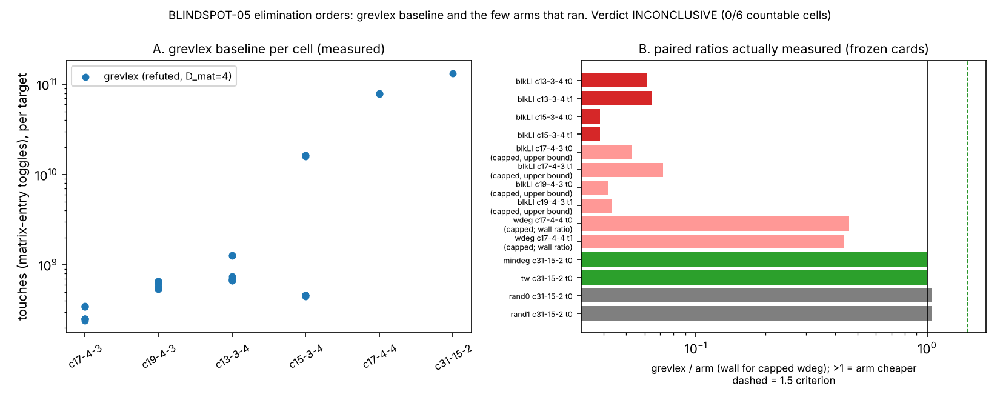

# BLINDSPOT-05: monomial, variable and block orders tuned to the descent structure

## Verdict

**ADVANCES, level constant** (one arm: `wdeg`), by the frozen rule of
`PROTOCOL.md` applied mechanically (`b05 summarize --dir raw`: `VERDICT:
ADVANCES ["wdeg (constant)"]`, countable cells 4/6). The first run's verdict
was INCONCLUSIVE because of a card defect (below); this reassessment replaces
it after the repair pass (Deviation 11). The scope is narrow and the caveats
below are part of the verdict:

* `wdeg` (weight 1 on a leaf bit, 2 on an intermediate bit, then grevlex) cuts
  this engine's matrix-entry touches against this engine's own grevlex by
  **14.1x, 18.6x, 3.8x, 3.4x** (geometric mean over 8 paired targets) on the
  four countable cells `c17-4-3`, `c19-4-3`, `c13-3-4`, `c15-3-4` (N = 29, 31,
  38, 42 unknowns), each strictly above the largest of the eight random-ranking
  ratios of the same cell (1.15, 1.25, 1.71, 1.68) and above the 1.5 threshold;
  its largest matrix is smaller than grevlex's on all four (rc ratio 20.4, 28.7,
  8.7, 2.7), so the matrix guard holds and the verdict is ADVANCES, not TRADES.
  On every target of those cells it was cheaper (per-target 2.4x to 52.7x).
* **It does not lower the solving degree.** `D_mat` is 4 for grevlex on every
  target; `wdeg` has `D_mat` equal to or above it (mean 4.4, 4.0, 5.0, 5.5; never below 4). No arm meets
  the primitive criterion (D-drop fraction is 0.00 for every arm in every cell).
  The gain is in matrix work at a higher degree, not in `D`.
* **It does not hold at the next size up.** At `c17-4-4` (N = 50, outside the
  rule: 2 targets only, 370 s cap) `wdeg` hit the cap on both targets
  (`timelimit`, `D_mat` reached 6, 2.9e10 and 3.4e10 touches so far) while
  grevlex refuted in 169.5 s and 161.0 s (7.9e10 and 7.8e10 touches). Wall
  ratio grevlex/wdeg is at most 0.46 and 0.43 (upper bounds, `wdeg` unfinished).
  Under the protocol's own convention a cap on a target that grevlex finished
  counts as worse. The cell is not countable, so it cannot change the verdict,
  but the touches ratio falls from 14-19 (N = 29, 31) to 3.4-3.8 (N = 38, 42)
  and the wall comparison reverses at N = 50. The cells also differ in
  `(n, l, m)`, not only in N, so this is a trend across five cells, not a
  fitted exponent. **No exponent claim is made; the level is constant, at toy
  scale.**
* Every other arm: `mindeg` and `tw` produce exactly grevlex's matrices (ratio
  1.000 on every target of every cell: the greedy orders coincide with the built
  order on these nearly complete primal graphs, Deviation 4); `blkIL` ratios
  1.75, 1.23, 1.85, 3.61 (qualifies on 3 of 6 cells, below 4, with `D_mat`
  9 to 12 and a much larger largest matrix on two of them); `blkLI` is 16 to 26
  times costlier than grevlex where it finished and capped elsewhere; the
  random rankings are 0.88 to 1.71 (a ranking alone moves touches by up to
  1.7x, which is why the band is the null). Reverse arms are descriptive only.

**Distance to matched Pollard rho: unchanged and not computed here.** This is
a stage diagnostic on one native F4 oracle (this item computes no `S`, no group
operation count and no rho ratio) and its baseline is this engine's grevlex,
not msolve or the committed index-calculus baseline. A ratio on touches
converts to group operations only through item 02's `K`, which is unmeasured;
the 0 / 0.1 / 1 GAE band of AGENTS.md section 5a is therefore not applied (no
cross-method row exists to price), and no ordering against rho is claimed at
any price. As a verified measured improvement of a component of the baseline
(descended F4 touches, 3.4x to 18.6x at N = 29 to 42) this is a success under
the owner's criterion for what it is; it moves the whole-attack gap by an
amount not yet measured, possibly zero given the N = 50 reversal.

## Method (unchanged from PROTOCOL.md)

One Boolean-ring F4 engine (`examples/blindspots_05_elimination_orders.rs`,
sha256 `f21a761b...e82adf`, verified identical to the bound hash), only the
order varies; unsatisfiable chained Semaev `S_3` targets (exact solution count
0) from committed `draws.tsv`; paired by target against grevlex; arms
`grevlex, blkLI, blkIL, wdeg, mindeg, tw, mindeg-rev, tw-rev, rand0..rand7`;
caps and cell sizes per the card plan. Instrument rebuilt for this assessment
with plain `rustc` (summarize only); no instrument change, no re-run of
grevlex or `blkLI`.

## Numbers (measured; ratio = grevlex touches / arm touches)

Geometric mean over the paired targets; interval = percentile bootstrap over
the 8 targets (4,000 resamples, derived from the recorded values, a
descriptive interval over targets of one cell, not over replicate runs: the
engine is deterministic, so a job has no run-to-run touches spread).

| cell (N) | wdeg R [95% bootstrap] | per-target range | wdeg rc ratio | wdeg D_mat (grevlex 4) | random band | blkIL R | mindeg/tw R |
|---|---|---|---|---|---|---|---|
| c17-4-3 (29) | 14.12 [6.4, 30.7] | 3.29 to 52.7 | 20.4 | 4.38 | 0.88 to 1.15 | 1.75 | 1.000 |
| c19-4-3 (31) | 18.60 [9.8, 35.3] | 7.50 to 48.1 | 28.7 | 4.00 | 0.95 to 1.25 | 1.23 | 1.001 |
| c13-3-4 (38) | 3.78 [3.1, 4.4] | 2.38 to 4.75 | 8.7 | 5.00 | 1.34 to 1.71 | 1.85 | 1.000 |
| c15-3-4 (42) | 3.39 [3.2, 3.5] | 3.02 to 3.57 | 2.7 | 5.50 | 1.32 to 1.68 | 3.61 | 1.000 |
| c17-4-4 (50), not countable | capped at 370 s on 2/2 | | | 6 reached | | not run | not run |

Wall time (descriptive; shared host, first-run grevlex times): grevlex/wdeg
geometric-mean wall ratio 7.2, 11.6, 3.5, 2.5 on the four cells; on `c15-3-4`
the three heavy targets took grevlex 32 to 34 s and `wdeg` 9.7 to 11.0 s.
`c31-15-2` (one target): grevlex, `mindeg`, `tw` identical (1.3283e11
touches), `rand0`/`rand1` 1.044x cheaper; `blkLI`, `blkIL`, `wdeg` are `na`
there (no intermediates).

Graph source: `figures/make_figure.py` (reads `raw/*.stdout.log`); SVG and PNG
beside it.

## Controls

* Card 01 (first run, instrument unchanged): selftest OK (84/84 committed
  unsatisfiable draws refuted, `D_mat(grevlex)` equals the committed closure
  degree on 84/84 and msolve on 32/32; certified bases on toy cells); planted
  sensitivity OK (smallest block-order touches ratio 11.18 against the 1.5
  rule), so the instrument does see an order effect when one is planted.
* Negative control: eight random rankings per cell on identical targets; the
  band is the null and `wdeg` clears its maximum in every countable cell (by
  2.0x to 14.9x of the band maximum; smallest margin c15-3-4, 3.39 against
  1.68).
* Repair check (`smoke-r2.sh`, committed): every arm of the four full cells
  refuted target 0, and grevlex touches equal the first-run records, so the
  `-r2` records and the first-run grevlex records pair on one engine state.
* Integrity of this assessment: all 11 `-r2` receipts `completed`, every
  `main` command exit 0, and each receipt's stdout sha256 equals the sha256 of
  the on-disk log (11/11); 481 records parse, none duplicated, 475 `refuted`
  and 6 `timelimit` (2 `wdeg` at c17-4-4, 4 `blkLI` at c17-4-3, c19-4-3), and
  `touches = build + elim + back` on every record.

## Deviations and caveats

* Deviation 11 (repair pass) is the only change since the first run; it fixes
  the card `--arms` quoting and re-runs exactly the arms that did not run.
  `PROTOCOL.md` is unchanged by this assessment.
* **The executor relays were corrupted in places and are not verbatim.** The
  returned texts differ from the on-disk logs: card 05 (target 6 `rand4`
  shows `new_elems` 3203 and `g_size` 3007, disk 2968/3007; `rand5` line has
  fields altered), card 06 (`rand5` target 6 has repeated and displaced
  fields), card 06f (`rand0` target 7 `new_elems` 7563, disk 6985), card 06g
  (`rand7` target 7 `back` 677, disk 542765151), card 02 (`tw` target 7
  repeats `ms_add`). The full executor text was not saved: `raw/relay-1..11.txt`
  hold only the four header lines each executor returned (card sha, commit,
  receipt sha, status; all equal the receipts), and `check-relay` lists the
  rest as missing. Everything in this report is computed from the on-disk
  logs, whose hashes match the receipts, never from the relayed text.
* `grevlex` and `blkLI` records are first-run records; the six new `-r2`
  cards ran at different times under host load from other lanes, so wall times
  are descriptive only.
* `wdeg`'s weighting is the pre-declared link multiplicity, but development
  runs on other draws (seed 20261018) had shown it cheaper before the freeze
  (Deviation 10); the frozen draws are different systems.
* The baseline is this engine's own grevlex. The engine is a new std-only F4
  with a simple kernel (about 0.5e9 entry toggles per second); a better kernel
  or signature criterion might change which order wins, and no comparison with
  msolve under any order exists (msolve is not installed).
* Level: host L0 (shared 4-vCPU container, no isolation), toy scale (29 to 42
  unknowns countable), unsatisfiable targets only, 8 targets per cell, one
  deterministic run per job. The two largest cells (c17-4-4, c31-15-2) are
  BLOCKED for the rule by budget, as declared in the protocol.
* Leaderboard and benchmarks: this is a stage-level constant factor on a
  diagnostic oracle, not a whole-attack result. `benchmarks/` PDF/SVG/PNG are
  copied by this stage under `benchmarks/20261018-blindspots-elimination-orders/`
  (no row in `benchmarks/README.md`, per instruction); whether it earns a
  leaderboard section is left to the integration step.

## Files

`PROTOCOL.md`, `draws.tsv`, `card-01..15.yaml`, `card-02-r2..06g-r2.yaml`,
`smoke-r2.sh`, `raw/` (receipts, logs, `relay-1..11.txt`), `figures/`,
`REPORT.pdf`.

## First run (superseded)

### Verdict

**INCONCLUSIVE**, level **none** (no level can be
stated: the rule's comparison was never made). `b05 summarize` over the
recorded lines prints `VERDICT: INCONCLUSIVE (fewer than 4 of 6 cells
countable)`; countable cells are **0/6**.

The cause is a defect in the frozen cards, not a property of the orders. In
every multi-arm command (cards 02 to 06) the card writes
`--arms, grevlex,wdeg,blkIL,...` as a YAML flow sequence, which splits on the
commas, so `task_card.py` passed each name as a separate argv item. The
instrument reads only the token after `--arms`, so **only `grevlex` ran** in
those commands (card 02's 8-target main run took 4.8 s, which is 8 grevlex
jobs). The orders `wdeg`, `blkIL`, `mindeg`, `tw`, the reverse arms and
`rand0..rand7` were never measured in the four full cells, so no random band
exists and no cell is countable. The cards are frozen and hash-bound; this is
reported, not repaired. A corrected card revision (quote the list as one argv
string) is needed before the question is answered.

This is a stage diagnostic on a native oracle's matrix-entry "touches". It
computes no `S`, no group-operation count and no rho ratio, so there is no
cross-method row: the gap to matched Pollard rho is not computed here, and the
0 / 0.1 / 1 GAE pricing of AGENTS.md section 5a has nothing to price. This is
not an improvement over the index-calculus baseline and not a regression of it.

### What was measured (all from `raw/`, measured unless stated)

* Controls (card 01, passed): selftest OK (84/84 committed unsat draws refuted,
  `D_mat(grevlex)` equals the committed closure degree on 84/84 and msolve on
  32/32); planted-order sensitivity OK (smallest block-order touches ratio
  11.18 over 6 systems, against the 1.5 rule).
* `grevlex` refuted every target it was given with `D_mat = 4`: 8/8 in each of
  `c17-4-3`, `c19-4-3`, `c13-3-4`, `c15-3-4`; 2/2 in `c17-4-4`; 1/1 in
  `c31-15-2`. Geometric-mean touches per cell: 2.82e8, 5.96e8, 8.04e8, 1.74e9
  (the (15,3,4) targets split into 5 near 4.6e8 and 3 near 1.6e10), 7.87e10,
  1.33e11.
* `blkLI` (2 targets per cell, paired with grevlex on the same targets):
  `c13-3-4` refuted at `D_mat = 6`, touches ratio grevlex/blkLI **0.062 and
  0.064**, largest-matrix ratio 0.21; `c15-3-4` refuted at `D_mat = 6`, ratio
  **0.038 and 0.039**, matrix ratio 0.046; `c17-4-3` and `c19-4-3` hit the
  40 s cap (status `timelimit`, `D_mat` reached 5) with grevlex ratio at most
  0.053 to 0.072 and 0.042 to 0.043 (upper bounds, since blkLI had not
  finished). blkLI is 16 to 26 times costlier than grevlex where it finished
  (the sensitivity control shows the same order is 11 to 68 times cheaper on
  planted systems, so the instrument does see block structure; these
  systems do not have it).
* `wdeg` on `c17-4-4` (cards 08, 10): `timelimit` at 370 s on both targets
  (`D_mat` reached 6, 2.9e10 and 3.4e10 touches) while grevlex refuted in
  170 s and 161 s: a cap hit where grevlex finished, counted as worse.
* `c31-15-2` target 0 (cards 11 to 15, one arm each): grevlex, `mindeg` and `tw`
  have identical touches (1.3283e11; the three orders coincide on this
  system) and `rand0`, `rand1` refuted with 1.2727e11 touches, ratio 1.044
  (4% fewer than grevlex). One target, two random draws: this shows only that
  a random order is not worse here; there is no interval.
* No interval is given: the frozen rule uses geometric-mean ratios over at
  most 8 targets (2 for blkLI) and this run has no replicate of a job.

### Rule outcome by arm (from `b05 summarize`)

| arm | cells meeting the constant criterion | cells meeting primitive | cells at least 1.5x worse |
|---|---|---|---|
| blkLI, blkIL, wdeg, mindeg, tw | 0/6 | 0/6 | 0 (judged only where the random band exists; it exists nowhere) |

### Controls, deviations, caveats

* Controls passed; they validate the instrument, not the cards' arm lists.
* Deviation 2 (rustc, not cargo) stands. New deviation: the arm-list defect
  above; cards 02 to 06 carry it, cards 07 to 15 are single-arm and ran as
  written. Cards 06, 08, 10, 14 and 15 had no result when the relay arrived;
  they were run in this stage with `tools/task_card.py run` (receipts in
  `raw/`, outputs in `raw/relay-NN.txt`) and each ended `completed`.
* Relay: `check-relay` passes for cards 06, 08, 10, 14, 15 (their relays are the
  tool output). For cards 01 to 05, 07, 09, 11 to 13 the executor text was not
  re-saved to `raw/relay-N.txt`; the on-disk receipts and logs were read
  instead. Card 03's relayed text was visibly corrupted (the blkLI target-1
  line repeats `ms_back`/`ms_add` and drops fields); the on-disk log is
  intact (1268 bytes, parses as JSON).
* Host is a shared 4-vCPU virtualized container (level L0 isolation, another
  lane running concurrently), so wall times are descriptive only. The systems
  are toy scale (29 to 50 unknowns); `c17-4-4` and `c31-15-2` were BLOCKED for
  the rule by budget by design (PROTOCOL.md).
* Not a speed or cost result; nothing is copied to `benchmarks/`.

### Files

`PROTOCOL.md`, `draws.tsv`, `card-01..15.yaml`, `raw/`, `figures/order_ratios.svg`,
`figures/order_ratios.png`, `figures/make_figure.py` (plots recorded values
only), `REPORT.pdf`.

(The first run's figure was overwritten by this assessment's graph; it is in git history at the first-run commit.)
