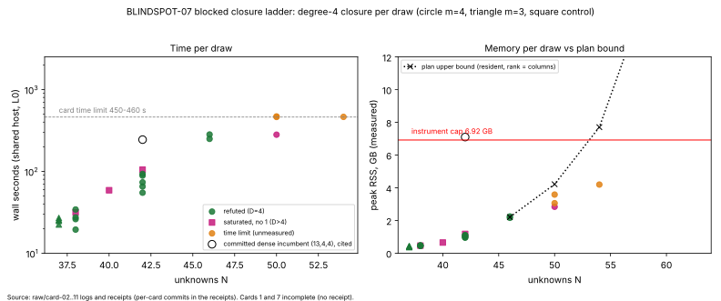

# BLINDSPOT-07: out-of-core blocked Boolean closure for the deciding degree cells

## Verdict

**BLOCKED** at the (15,5,4) rung of the ladder, level **primitive** (a time and
memory boundary of the instrument, no exponent, no constant against rho).
The controls and the cells below the boundary **MATCH** the committed
degrees; one measured (15,5,4) draw reads **D > 4**, which is the decision
rule's branch 2 for `(m, l) = (4, 5)` on one draw only.

* This is a stage diagnostic. It computes no `S`, no rho ratio, no GAE. The
  gap to matched Pollard rho is **not computed here** (distance remaining is
  carried by item 02's priced `D` rows); the 0 / 0.1 / 1 GAE band does not
  apply to this item's rows. Nothing here is an improvement over the
  index-calculus baseline by itself.
* The only result that looks like an improvement is an engine-level one:
  on the committed (13,4,4) draw 1 the blocked engine finished at 1.10 GiB
  and 93 s against the committed dense incumbent's 7.1 GB and 244 s. The
  incumbent figures are cited from another run (not a paired measurement on
  this host), so this is recorded as a descriptive comparison, not a
  validated speedup.

## Method (as frozen in `PROTOCOL.md` + Amendment 1)

Std-only Rust instrument `examples/blindspots_07_blocked_closure.rs`,
compiled by each card with `rustc -C opt-level=3 -C target-cpu=native`, run
under `prlimit --as=7516192768`, one thread. It computes the MutantXL
fixed-degree closure `V_D` of the chained Semaev `S_3` descent system; `D` is
the least degree with `1 in V_D`. Product rows are reduced in blocks of 4096
rows against a triangular reduced basis held in RAM. No disk tier was built
(Deviation 3, corrected in Amendment 1). Draws are unsatisfiable by an exact
count re-verified inside each card (`--expect-solutions 0`).

## Cards and relay status

Cards 2, 3, 4, 5, 6, 8, 9, 10, 11 ran to `status completed`, each with a
receipt, and `check-relay` reports `relay_verbatim: true` for all nine.
**Disclosure:** the `raw/relay-<n>.txt` files for these nine were written
from `task_card.brief()` of each receipt (which is the tool's own output the
executor was told to relay), not by retyping the executor text; I
spot-checked the card ids, receipt hashes and status lines against the
returned text. `check-relay` passing on them therefore confirms the receipts,
not the executors' typing.

**Cards 1 and 7 did not complete.** Both executors returned "still running"
(background tasks `b10z4niab` and `b9wjc7smr`); the processes are gone, no
receipt was written, and `relay-1.txt` / `relay-7.txt` hold the interim
text. Their leftover `target/blindspots-07/card-01` and `card-07` directories
(8.9 MB) are what makes `task_card.py lint` now print `CARD FAIL` on those two
cards (the `b07` binary exists as a repository file the card's `binds` does
not pin); I deleted the leftover directory. A deviated or incomplete relay
is reported, not repaired: cards 1 and 7 were **not** re-run by this stage.

* Card 1 left unreceipted partial logs in `raw/`: selftest (`SELFTEST OK`),
  positive control (11,4,4) u0, satisfiable control (11,4,4) d0, and the
  sensitivity control. The two (19,7,3) rank controls d0 and d7 were never
  run. The unreceipted logs are cited below as such.
* Card 7 produced only a build log: (15,5,4) generator draw 0 is **missing**.

## Controls

| control | result | evidence |
|---|---|---|
| selftest: 104/104 committed solution counts; 88/88 incumbent closure degrees; 36/36 msolve step degrees; 104/104 degree-3 ranks | all PASS, `SELFTEST OK` | `raw/card-01-selftest.stdout.log` (unreceipted) |
| positive: (11,4,4) committed draws, `D = 4` (msolve also 4) | u0 D=4 (unreceipted, card 1); u1, u2, u3 D=4 (receipted, card 2) | `raw/card-01-ctl-*`, `raw/card-02-r-11-4-4-u*` |
| negative: satisfiable draws, `1 notin V_D` | (11,4,4) d0 154 solutions, saturated rank 82,839 (unreceipted); (13,4,4) d0 48 solutions, saturated rank 124,266 (receipted) | `raw/card-01-sat-*`, `raw/card-02-sat-13-4-4-d0` |
| sensitivity: random (6,2,4)-shape, reads `D > 4` | 4 of 4 seeds saturate through degree 5 without `1` (unreceipted) | `raw/card-01-random-6-2-4.stdout.log` |
| saturated-rank: (19,7,3) must equal committed rank | draw 5: 92,838, equal to committed (receipted). Draws 0 and 7: **not run** (card 1 incomplete). Draw 0 matched in development (94,230), disclosed in Amendment 1, not a result | `raw/card-03-ctl-19-7-3-d5` |

No control mismatched. The control set is **incomplete**: two of three rank
controls missing, four of the seven control families only in unreceipted logs.

## Numbers (every measured degree-4 closure, one row per draw)

Wall seconds are descriptive, shared 4-vCPU host, isolation L0. RSS is `VmHWM`.

| cell (n,l,m) | N | draws | reading | rank / columns | wall s | peak RSS MiB |
|---|--:|--:|---|---|---|---|
| (11,4,4) | 38 | 4 (+1 unreceipted u0) | D = 4 on all | 80,370 to 82,467 / 82,993 | 19.4 to 34.2 | 453 to 492 (464 u0) |
| (13,4,4) | 42 | 5 (item-06 u0, study draws 1,3,4,7) | D = 4 on all | 118,547 to 123,792 / 124,314 | 54.8 to 92.9 | 975 to 1,126 |
| (19,6,3) | 37 | 4 | D = 4 on all | 72,460 to 74,484 / 74,519 | 22.4 to 26.9 | 374 to 444 |
| (13,5,4) | 46 | 2 (item-06 draws 14, 16) | D = 4 on both | 173,122 and 178,582 / 179,447 | 249.4 and 281.9 | 2,299 and 2,214 |
| (15,5,4) | 50 | 3 relayed (g8, g12, g14); g0 missing | g8: **saturated, no 1, D > 4** (rank 182,475 / 251,176, 280.5 s, 2,906 MiB); g12 and g14: **timelimit**, unmeasured (rank 232,054 and 195,979, 460+ s, 3,669 and 3,130 MiB) | see reading | see reading | see reading |
| (17,5,4) | 54 | 1 (outside the stop rule) | timelimit at 463 s, rank 217,485 / 342,541, 4,296 MiB; unmeasured | | | |
| (19,6,4) | 62 | none | BLOCKED(memory) by plan only | resident upper bound 22.97 GB, 16.05 GB beyond the cap | | |
| (4,6) in general | needs N >= 62 | none | BLOCKED by plan (smaller n makes unsatisfiable draws essentially impossible) | | | |

A cell is reported with its draw count: the (15,5,4) reading is **one
measured draw out of four planned**, never a four-draw cell. The time-limit
rows are the instrument's own stop (partial rank, not evidence for `D`); the
memory cap was not reached anywhere (max 4.3 GiB against 6.9 GB), so what
stopped (15,5,4) was the card time limit, not memory. The plan record says
(15,5,4) at degree 5 is out of reach: 2,369,936 columns, 3.5e11 bytes of
reduced basis, 3.5e11 bytes of disk if spilled against about 3.5 GB free.

### Against the committed incumbent at (13,4,4), draw 1

| | blocked engine (this item, measured) | committed dense in-core closure (cited) |
|---|---|---|
| peak RSS | 1,126 MiB | 7.1 GB |
| word ops | 8.16e10 | 7.2e11 |
| wall | 92.9 s | 244 s |

Ratios (derived): about 6x less memory, about 8.8x fewer counted word ops,
about 2.6x less wall. Caveats: the incumbent numbers come from
`research/dreg_closure_scale_20261016/RESULTS.md`, measured at another time
and possibly another host; the word-op counting convention is claimed equal by
the protocol and was not re-audited here; wall is L0 shared and descriptive.
This is not a paired comparison.

## Decision rule applied

* **D stays 4 at l = 5 and 6 branch:** `(3,6)`: measured D = 4 at N = 37 on
  four draws (plus the reused N = 34, 36, 40, 42). `(4,5)`: D = 4 at N = 42,
  44 (reused) and N = 46 (two new draws); **not** at N = 50, see next.
  `(4,6)`: BLOCKED by plan, not measured.
* **D >= 5 at a measured cell:** (15,5,4) draw g8 saturates at degree 4
  without the constant 1, rank 182,475 of 251,176 (reproducing the same rank
  as the development run disclosed in Amendment 1). The system is
  unsatisfiable by the exact count, so under the closure object this reads
  `D > 4`. The growth model therefore returns for `(m, l) = (4, 5)` **as a
  one-draw observation**; draws g12 and g14 neither support nor contradict it
  (both were still growing at the time limit, past 182,475), and g0 is
  missing.
* **BLOCKED cells** are named above with projected memory and disk.
* **Stop rule:** the first of cards 07 to 11 whose cell ends timelimit or
  memcap is BLOCKED. Card 7 gave no result, card 8 saturated, card 9 ended
  timelimit, so (15,5,4) is BLOCKED(time) and cards 10 and 11 should not have
  been relayed. They are recorded here as descriptive extras and are not used
  in the decision; card 11 (17,5,4) also ended timelimit at 463 s.

## Deviations and caveats

* Cards 1 and 7 incomplete (above). Card 10 and card 11 relayed beyond the
  stop rule.
* `check-relay` on nine relays is a receipt check (relay files rebuilt from
  receipts, disclosed above).
* Closure rather than literal F4 (Deviation 5): agreement with msolve rests
  on the inspected committed pairs and the (11,4,4) control; at (15,5,4)
  there is no msolve reading (msolve is not installed, and crashed at (13,.)
  in the committed run), so "D > 4" there is a closure reading, not an F4
  reading.
* New cells use the instrument's own generator, not the committed StdRng
  draws (Deviation 1), so (15,5,4), (17,5,4) and (19,6,3) draws are not
  comparable draw for draw with any earlier study.
* Toy scale: `N <= 54`, field degrees `n <= 19`, far below cryptographic
  sizes. A `D` reading at these cells does not by itself bear on any
  deployed curve.
* Host L0: shared 4-vCPU container, another lane running concurrently, so
  seconds are descriptive and the time limit may have bitten earlier than on
  an idle host.
* Arm (b) G2 not applicable; arm (c) msolve not run (committed results cited).

## Files

* Records: `raw/receipt-card-0{2..6,8..11}.json`, `raw/card-*` stdout and
  stderr logs, `raw/relay-*.txt`.
* Data and plot source: `figures/cells.json`, `figures/make_figure.py`.
* Graph: `figures/ladder.svg`, `figures/ladder.png`.
* Report: `REPORT.pdf` (this README with the graph embedded).
