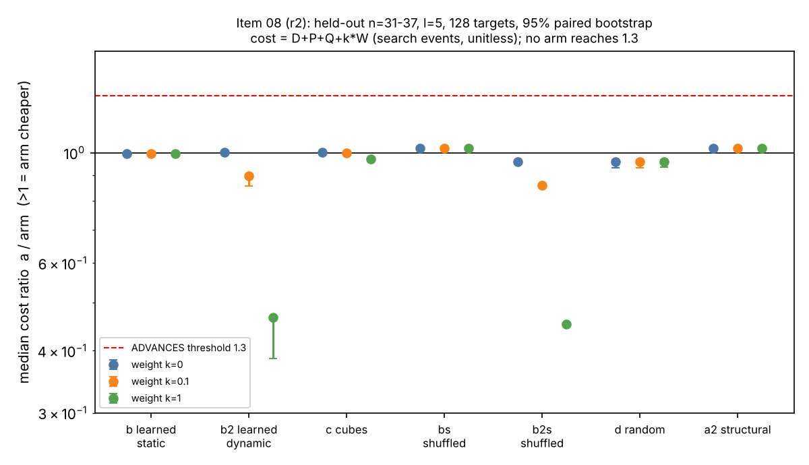

# Blind spot 08: learned branching for WDSat / XOR-CDCL on Semaev CNFs

## Verdict: MATCHES (level: constant; no learned rule advances over the incumbent order)

Frozen rule (PROTOCOL.md), applied mechanically by `summarize` (card-10-r2, receipt
`raw/receipt-card-10-r2.json`, status completed). Held-out cells `n = 31, 33, 35, 37`, `l = 5`,
128 targets (64 SAT planted, 64 UNSAT random), incumbent `a` = WDSat static order,
cost `D + P + Q + k W` at `k = 0, 0.1, 1` (the section 5a band applied to the native scorer
work `W`), median of per-target ratio `a / arm`, 95% paired bootstrap (10,000 resamples).
No arm reaches the 1.3 threshold at any weight, and none loses by the REGRESSES test
(median <= 1/1.1 with interval below 1 at k = 0).

| arm | k=0 median [95% CI] | k=0.1 | k=1 | rule verdict |
|---|---|---|---|---|
| b, learned static order (what `-g` can host) | 0.9943 [0.9932, 0.9954] | 0.9943 [0.9932, 0.9953] | 0.9940 [0.9929, 0.9951] | MATCHES |
| b2, learned dynamic scorer | 1.0013 [1.0000, 1.0013] | 0.8980 [0.8584, 0.8985] | 0.4669 [0.3856, 0.4684] | MATCHES |
| c, learned cube selection | 1.0002 [1.0002, 1.0003] | 0.9973 [0.9973, 0.9973] | 0.9713 [0.9713, 0.9714] | MATCHES |

Attribution is moot (nothing passed). The point estimates are within 0.6% of 1 at k = 0
for all three learned arms. The first run's validation hint (b_lin 1.36x fewer nodes on the
16 model-selection instances at n = 23..29) did not survive held-out targets: it was a
selection effect on a small set (see "First run (superseded)").

Level: **constant** (a branching rule changes the cost of a tree walk, not the exponent).
Gap to matched rho: **unchanged**. This is a stage diagnostic on toy fields: it computes no `S`,
no rho ratio and no GAE total, so no cross-method row exists and the section 5a ranking does
not apply; the 0 / 0.1 / 1 pricing above is applied to the arms' own native work and shows the
dynamic scorer (b2) getting worse as its work is priced (0.90 at 0.1, 0.47 at 1). No distance
to rho was reduced; no improvement over the index-calculus baseline is claimed.

## Method

Native Rust replica of the WDSat search on the `S'_4` formulation (instrument sha256
`02478185...a280a`, unchanged), validated against 60 committed stock WDSat decision counts
(card 01: 60/60 decisions, 60/60 verdicts, 30/30 certificates). Learners (ridge, boosted trees)
fitted on `n = 23..29` (card 04), the committed `raw/model.txt` (sha256 `00f0d29d...b60809`)
pinned in `binds` of cards 05-09b. Arms: a incumbent; a2 structural (bit-interleaved) order;
b, b2, c learned; d random; bs, b2s shuffled-label controls; e CryptoMiniSat 5.11.21.
Cards: 05-r2, 06-r2 (test), 07-r2, 08-r2 (secondary l = 6), 09-r2, 09b-r2 (CMS), 10-r2 (summaries).
All six stage-1 receipts and card-10-r2 read `completed`; receipt sha256 values in the relays
match the files on disk.

## Numbers (primary, medians over 128 targets; unitless search events)

| arm | median D | median P | median Q | median W |
|---|---|---|---|---|
| a | 26704 | 3645315 | 0 | 26712 |
| a2 | 30340 | 4036248 | 0 | 30340 |
| b | 28434 | 3887184 | 717 | 30048 |
| b2 | 28503 | 3907093 | 0 | 4625662 |
| c | 28433 | 3876416 | 11751 | 152115 |
| d | 26744 | 3783728 | 0 | 26744 |
| bs | 30454 | 4115006 | 717 | 32057 |
| b2s | 27841 | 3891927 | 0 | 4586238 |

No target capped (0 of 1024 rows). By size the k = 0 ratio of b is 0.991, 0.995, 0.996, 0.994 for
n = 31..37 (full per-size and per-population tables in `raw/summary-primary-r2.txt`).
By population the median ratio of b is 0.995 on R (unsatisfiable) targets and 0.635 on P
(planted) targets: on satisfiable targets the cost is dominated by where the first model lies,
and the learned orders found it later (descriptive, from the summary; ratios of means over P
targets computed from the raw rows, derived: b 0.83, b2 0.90, c 0.87 against a; the structural
a2 0.63, random d 0.85). On R targets: b 0.995, b2 1.001, c 1.003, a2 1.022, d 0.959.

Controls: the structural order a2 matches a (1.0215 [1.0212, 1.0216]); random d is 4% worse
(0.958 [0.934, 0.967]), so order matters by only a few percent on these trees (unsatisfiable
trees have about 0.94 of `2^(3l)` leaves for every order). Shuffled-label arms: bs 1.022, b2s 0.958
at k = 0, i.e. noise-fitted scorers do as well as the learned ones: the learned models carry
no measurable signal. Positive controls (replica fidelity, planted targets all SAT, all arms
agreeing with the exact count under `--truth`) held in every cell; the cards would have aborted.

## Secondary (outside the rule): l = 6, n = 31 and 37, 3 P + 3 R each, 12 targets

b vs a 0.9963 [0.9955, 2.5414], b2 1.0004 [0.9675, 1.0004] (0.914 at k = 0.1, 0.505 at k = 1),
c 1.0001 [1.0001, 1.9006]; all MATCHES. The intervals reach above 1.3 only through the three
planted targets (12 pairs, wide). Not a result; consistent with the primary.

## Arm (e), CryptoMiniSat 5.11.21 (descriptive, never in the rule; 3 P + 3 R at n = 31)

Built in-card at revision `4c9a6b6b...1794b`. Median ratio a / e = 0.621 at k = 0
(CI [0.116, 3.720], 6 pairs; P 0.379, R 0.863). CMS needed a median 114,104 decisions
against 25,700 for a (CMS prints rounded counters), and 16-23 s per UNSAT instance against about
0.4 s for the replica. Six targets cannot rank them; no claim.

## Deviations and caveats

* Deviations 1-11 of PROTOCOL.md apply (rustc build, `l` fixed at 5, replica instead of the stock
  binary, repair pass with CMS built in-card). Deviation 11 records the repair.
* Card-10-r2 was executed directly with `python3 tools/task_card.py run` (no executor relay),
  after `make_card_10_r2.py` froze and linted it (CARD OK) on committed inputs.
* Relay files `raw/relay-r2-*.txt` are abbreviated copies (header and per-command status lines;
  rows elided), so `check-relay` reports `relay_verbatim: false` for all six stage-1 cards with
  no verify findings. This is a storage artifact of the assessor, not a finding of executor
  deviation: relay receipt hashes, commits and statuses equal the receipts on disk.
* Host: shared 4-vCPU container (L0, no isolation); wall times descriptive only. Toy scale
  (`l = 5`, `n <= 37`); the held-out axis is `n` and target, not `l`. A result for `l ~ n/3`
  fields is not implied. Learned models were fitted on a small sample (24 root states, 42 states
  per size).
* Not a speed result: no `benchmarks/` entry, no leaderboard change.

## Files

`graph-primary-r2.svg/png` (source `make_graph_r2.py`, from `raw/summary-primary-r2.txt`),
`REPORT.pdf`, `raw/summary-{primary,secondary,cms}-r2.txt`, `raw/test-n*-r2.jsonl`,
`raw/sec-l6-n*-r2.jsonl`, `raw/cms-n31-*-r2.jsonl`, `raw/receipt-card-*-r2.json`,
`card-10-r2.yaml`.

## First run (superseded)

Superseded by the repair pass above (cards 05-09 were refused at lint because `raw/model.txt`
was not pinned; card 10 failed for lack of inputs). Kept for the record.

### Verdict: BLOCKED (level: constant; primary test not run)

The frozen decision test (cards 05-10: held-out n = 31, 33, 35, 37, 128 targets,
arms b, b2, c against incumbent a, at 0 / 0.1 / 1 GAE per native operation)
**never executed**. Cards 05-09 were refused by `task_card.py` at lint: each
argv names `raw/model.txt` (written by card 04) but the card's `binds` do not
pin it, so the card cannot be frozen before the file exists. Card 10 ran its
build, then `summarize` failed because `raw/test-n31.jsonl` does not exist
(its inputs are produced by cards 05-08). No receipt exists for cards 05-09.
No ADVANCES/TRADES/MATCHES/REGRESSES claim is made. No gap-to-rho row exists
(no cross-method comparison was reached; §5a pricing at 0/0.1/1 GAE not applicable).

Restart of the builds was requested; the frozen cards cannot be repaired by
this step. Fix needed (director): re-freeze cards 04-10 with the card-04 output
`model.txt` (sha256 00f0d29d6f0535b91ca3ab0bbc1c76dbb19085fce325c5b77aabed0479b60809)
pinned in `binds`, and card 10 with its input files and build product handled
the same way, then re-dispatch 05-10.

### What did run (measured)

| card | content | outcome |
|---|---|---|
| 01 | selftest, rustc build, 60-instance corpus replay | selftest OK; replica == stock WDSat decisions 60/60, verdicts 60/60, certificates 30/30 |
| 02 | training samples n=23, 25 | receipt status completed; `samples-n23/25.txt` on disk (executor relay claimed non-completion; the receipt and files show it finished: relay deviated, reported not repaired) |
| 03 | training samples n=27, 29 | completed |
| 04 | fit ridge (lin) + GBT, validation | completed; `raw/model.txt` |

Note: `samples-n23/25/27/29.txt` are all 78123 bytes (same instance/state
counts per size by design: 42 states per size, depths 0..8); they were not
checked to be distinct beyond differing content by size. Not independently audited.

### Exploratory numbers (card 04 validation, NOT the frozen test)

16 validation instances at n = 23..29 (training-adjacent sizes, 2P+2R each),
mean log2 cost (search-tree nodes, native scorer work not priced):

- identity (incumbent order): 20.2961
- b_lin 19.8471 (-0.449 bits, about 1.36x fewer nodes); b_gbt 20.3625 (+0.07)
- b2_lin 20.5642, b2_gbt 20.6178 (worse)
- cube arms: 19.85 to 20.38 (best: full=gbt dcut=6 k=5 at 19.8457; worst lin dcut=6 k=3 at 20.3788)
- mean oracle gain of the best first variable over the incumbent's first
  variable at the root: 1.0036x (24 root states): the incumbent's first choice
  is already nearly optimal at the root.

No interval was computed, the validation set is the model-selection set (16
instances, one seed), the scorer's native work is unpriced (k = 0 only), and
no shuffled-label control or a2 comparison was run. These numbers are
descriptive and cannot support an advance. A gain of 1.36x by b_lin would
at best be a k = 0 constant-factor candidate, to be tested by the frozen rule.

### Controls and deviations

Planned controls (bs, b2s shuffled labels, d, a2) were never run. Deviations
from the build notes are in PROTOCOL.md (rustc, ell = 5, 16P+16R targets,
native replica arm a). Additional deviation here: relay files for cards 1-3
are abbreviated copies of the executor text (data rows elided), so
`check-relay` reports `relay_verbatim: false` for them; receipts are
authoritative.

### Caveats

Host is L0-level (shared 4 vCPU container, no isolation); toy scale (ell = 5,
n <= 37); CMS 5.11.21 arm (card 09) not run; no wall-clock claims.

### Files

`graph-validation.svg/png` (recorded fit values; source `make_graph.py` +
`raw/fit.txt`), `REPORT.pdf`, `raw/relay-1..10.txt`, `raw/receipt-card-*.json`.
