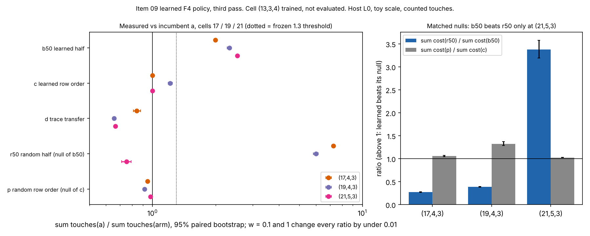
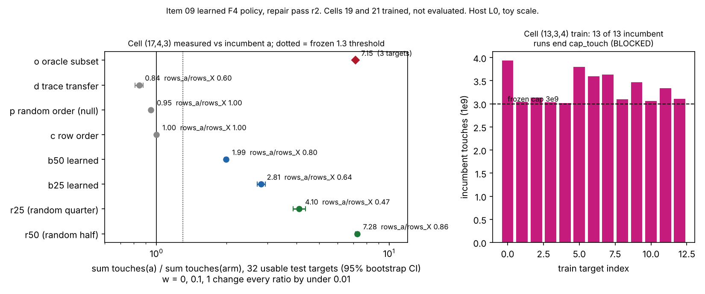

# BLINDSPOT-09: learned F4 pair selection and pivot order, with per-shape trace transfer

## Verdict (third pass, 2026-10-18)

**MATCHES (the null), level constant**, for the primary learned arm `b50`, by the frozen rule of
`PROTOCOL.md`. It is not ADVANCES, and no reading of the rule gives ADVANCES for any arm, whatever
cell (13,3,4) would show. **Nothing here is a verified improvement over the index-calculus
baseline**: this is a component measurement (one Boolean F4 step, refutation systems, counted
touches, toy scale, replica engine); it computes no `S`, no rho ratio and no GAE.

Per arm, three cells evaluated ((17,4,3), (19,4,3), (21,5,3); 32, 32 and 31 usable test targets):

| arm | verdict by the frozen rule | why |
|---|---|---|
| `b50` learned half | **MATCHES (the null)**; TRADES also applies (see below) | touches win on 3 of 3 cells (ratio 1.99, 2.32, 2.54, intervals above 1.3), but it builds 16 to 25% more rows on every cell, and it beats its matched null `r50` on 1 cell of 3 only |
| `c` learned row order | INCONCLUSIVE (no cell win; cannot reach 3 cells) | ratio 1.000, 1.211, 0.999: no effect at 17 and 21, +21% at 19 |
| `d` trace transfer | **REGRESSES** | ratio 0.842, 0.656, 0.666, every interval below 1 on all 3 cells (a lower bound on its cost where censored) |
| `r50` random half | not a result of the learned policy; "random subset improves selection" clause **not met** | 7.28 and 6.00 at 17 and 19, but 0.751 at 21 (regresses); cell (13,3,4) would have to win for the clause to hold |
| `p` random row order | no gain | 0.946, 0.915, 0.977 |

Why MATCHES and not TRADES for `b50`: both tightenings trigger. Tightening 1 (rows) reads TRADES, tightening 2
(matched null) reads MATCHES (the null). They are not ranked in the protocol; I report the one that denies the
learned policy credit as the headline (a random half of the minimal-degree pairs beats the learned half by
3.6x at (17,4,3) and 2.6x at (19,4,3)), and state that TRADES holds as well. Neither is ADVANCES.

Why cell (13,3,4) cannot change any arm verdict: `b50` already meets the touches rule on 3 cells, and can beat
its null on at most 2 (cell 21 plus cell 13); `d` already regresses on 3 cells; `c` can win at most 1 cell. Only
the `r50` clause is left open by it (2 of 3 measured cells win, the third regresses; it needs cell 13 as the
third win, and it then still would not be a learned-policy result).

* **Level: constant.** Counted touches per refutation; the exponent and primitive are not touched.
* **Gap to matched Pollard rho: not computed here.** No cross-method row exists (the item prices a component), so
  the 0 / 0.1 / 1 GAE band of AGENTS.md section 5a has one unpriced native item, the policy work of the learned
  arms, priced at 0, 0.1 and 1 touch-equivalent per operation. Policy work is under 0.4% of touches
  everywhere (at most 7.5e7 operations against at least 2.0e10 touches per cell sum); every ratio moves by
  under 0.003 across the band, so every ranking above holds at 0, 0.1 and 1. The distance to rho is
  carried by item 02's priced D rows; distance remaining is not changed by this item.
* **Cell (13,3,4): trained, not evaluated.** See "What was and was not measured".

## Numbers (frozen statistic: ratio of sums, 2,000-resample paired bootstrap, 95% interval)

Ratio = sum touches(a) / sum cost(arm) over usable test targets; measured counts, derived ratios; bootstrap
seed 1 is the assessor's choice (the protocol fixes the count, not the seed). Computed by `analyze_all.py` from
the committed `raw/eval-*.jsonl` (output `raw/analysis-r3.txt`, figure data `figures/cells.json`). Values at
w = 0 (w = 0.1 and 1 differ by under 0.003; full table in `raw/analysis-r3.txt`).

| arm | (17,4,3) n=32 | (19,4,3) n=32 | (21,5,3) n=31 |
|---|---|---|---|
| `b50` | 1.992 [1.966, 2.020] | 2.322 [2.270, 2.369] | 2.537 [2.524, 2.549] |
| `b50` rows_a / rows_X | 0.801 | 0.827 | 0.865 |
| `b25` (secondary; not run at 21) | 2.811 [2.706, 2.942] | 2.767 [2.728, 2.801] | not run |
| `c` | 1.000 [0.992, 1.007] | 1.211 [1.185, 1.244] | 0.999 [0.998, 1.000] |
| `d` (censored at 1.5x: 0, 31, 29) | 0.842 [0.810, 0.878] | 0.656 [0.648, 0.665] | 0.666 [0.662, 0.671] |
| `p` null of `c` | 0.946 [0.936, 0.957] | 0.915 [0.900, 0.928] | 0.977 [0.974, 0.981] |
| `r50` null of `b50` (censored: 0, 0, 15) | 7.278 [7.149, 7.402] | 5.998 [5.841, 6.149] | 0.751 [0.712, 0.792] |
| `r25` (secondary; not run at 21) | 4.103 [3.859, 4.365] | 3.843 [3.371, 4.574] | not run |
| null test `cost(r50)/cost(b50)` (above 1 = learned wins) | 0.274 [0.269, 0.279] | 0.387 [0.379, 0.395] | **3.378 [3.192, 3.575]** |
| null test `cost(p)/cost(c)` | 1.057 [1.044, 1.070] | 1.324 [1.284, 1.370] | 1.023 [1.018, 1.026] |

Reading, by the frozen rule only:

* `b50` roughly halves to two-fifths of the incumbent's touches on all three cells, with every reduced basis
  identical to the incumbent's and policy work included. That is a measured touch reduction of the Boolean F4
  step on refutation at toy scale. The rule does not call it a win because it builds 16 to 25% more rows
  (rows_a/rows_X below 1 on every cell) and, on 2 of 3 cells, a random half of the same minimal-degree
  pairs is far cheaper than the learned half. I do not explain why from these records (no ablation was run).
* At (21,5,3) the picture reverses: `r50` loses (0.751, and 15 of 31 `r50` runs hit the 1.5x cap, so 0.751 is
  an upper bound on its ratio) while the learned `b50` keeps 2.54. This is the only cell where `b50` beats
  its null, one cell of three.
* `c`: the row-order fit's target was the default order on 26 of 32 matrices at 17 and on 30 of 32 at 21
  (`order_wins` in `raw/fit-17-4-3.json`, `raw/fit-21-5-3-c14-r2.json`), so `c` equals `a` there. At 19 the
  fit's target was the reverse order on 27 of 32 matrices (`raw/fit-19-4-3-c05b-r2.json`), and `c` gains 21%. A
  one-cell effect, below the 1.3 threshold, rows unchanged (1.005); `c` beats `p` at 19 mostly because `p` is
  worse than `a` (0.915).
* `d` regresses everywhere: a trace from another target of the same shape selects pairs that do not
  carry over, and the extra steps cost more than the avoided pairs. Where `d` was censored its true ratio is
  lower than reported.
* Offline cost (labelling, not in the per-solve cost), derived: training labelled 1.13e11 (17), 2.47e11
  (19) and 1.11e12 (21) xors. Mean `b50` saving per target is 0.96e9, 2.2e9 and 10.2e9 touches, so about
  118, 112 and 109 targets repay it. `r50` needs no training, which is the point of the null.
* Descriptive wall (sum over usable targets, shared host, L0, no M4RI tables): `a` 46.9 / 90.0 / 272.8 s,
  `b50` 27.2 / 39.5 / 117.6 s, `r50` 11.3 / 24.1 / 293.4 s, `d` 113.1 / 228.9 / 610.4 s at 17 / 19 / 21.

Figure source: `figures/make_figure_r3.py` from `figures/cells.json`; SVG `figures/ratios_r3.svg`.

## What was and was not measured

* **Cell (17,4,3)**: evaluated, 32 of 32 usable (first-run model and traces, r2 evaluation cards 03, 03b, 04).
* **Cell (19,4,3)**: evaluated, 32 of 32 usable (cards 05b-r2 and 06-r2 to 08-r2; model fitted by each card from the four bound r2 sample chunks; the four model digests agree, `12cae1e3...`).
* **Cell (21,5,3)**: evaluated, 31 of 32 usable; test target 6 is satisfiable (6 solutions) and ends
  `cap_matrix` at the incumbent, so it is censored and excluded, as the protocol provides. Cards 14-r2 to 17-r2, 18-r2b,
  19-r2 to 23-r2, 23b-r2 (11 evaluation chunks); the 11 model digests agree (`f837405c...`) and equal the
  killed card-18-r2 partial model (a byte-identical refit; that partial output is not used).
* **Cell (13,3,4)**: **trained, not evaluated.** Cards 24b-r2 to 24e-r2 completed with cap 6e10 (Deviation 13):
  31 of 32 train targets refuted by the incumbent (mean 2.71e10 touches), target 12 satisfiable and censored
  (24 solutions, `cap_matrix`); label work 9.55e11 xors; train wall 839 s. The evaluation (fit plus eval) cards were
  never frozen: the protocol stages them after the training outputs are committed, and the director pass that sizes
  them did not happen before this assessment. Measured-command seconds in all receipts: 5,628.5 of the 7,200 s cap
  (my sum of every receipt's non-build, non-cleanup commands, stopped cards included), leaving about
  1,570 s; at the 97 s per target the director measured for the cell with all arms, that is about 15 test
  targets, not the design's 32 usable, so the cell would be a named deviation if run. This does not change
  any arm verdict (above). It leaves the `r50` clause undecided.
* Cell (13,3,4) is therefore the missing fourth cell; the rule's "at least 3 of 4" is met by the three
  evaluated cells.

## Controls

* P1 (engine against committed degrees), P2 (selftest) and P3 (basis identity on non-trivial bases): passed in the
  r2 stage 1 run, cards 01-r2 and 01b-r2 (numbers in the earlier assessment below); unchanged and not re-run.
* Every evaluation record has `check` true: 0 false in 259 + 256 + 187 records (cells 17, 19, 21 including the
  `o` runs of cell 17). Reduced-basis hash equal to the incumbent's on every arm run that completed.
* N1 negative controls `r50`, `r25`, `p` measured on every cell as the rule requires (`r25` not at 21,
  Deviation 11). The control did its job: it showed that `b50`'s touch gain at 17 and 19 is not learning.
* Positive control (headroom `o`, cell 17, 3 targets): 7.15, from the r2 stage 1 record; the random half
  reaches the same level there.
* Determinism: all eleven cell-21 cards and the four cell-19 cards refit the same model from the same bound
  samples with identical digests.

## Relay status (this pass)

I could not retype the executor's returned text into files (11 relays of about 100 KB). The files
`raw/relay-r3-<n>.txt` (n = 1..11 for cards 18-r2b, 19-r2, 20-r2, 21-r2, 22-r2, 23-r2, 23b-r2, 24b-r2, 24c-r2,
24d-r2, 24e-r2) are **regenerated from the receipts** with `task_card.brief`, with the one deviation I saw in the
prompt applied; they are not the executor's text, and a reader should treat the executor-verbatim check as made by
me by reading the prompt, not by the tool. Results:

| relay | card | check-relay |
|---|---|---|
| 1, 2, 4, 6, 7 | 18-r2b, 19-r2, 21-r2, 23-r2, 23b-r2 | verbatim (library `check_relay`; the CLI refuses with `CARD FAIL`, because the card's own outputs now exist unbound, as in the earlier pass) |
| 3 | 20-r2 | **deviated**: in the prompt the `arm p` lines of idx 19 and 20 omit `"label_xors":0,` (the receipt's tail has it); two lines altered |
| 5 | 22-r2 | **deviated**: same omission on the `arm p` lines of idx 25 and 26 |
| 8 to 11 | 24b-r2 to 24e-r2 | verbatim (CLI) |

Deviated relays are reported, not repaired. Every number above is read from the committed `raw/*.jsonl` and
the receipts. Every receipt `status` is `completed`.

## Deviations and caveats

* **Host:** shared 4-vCPU container, isolation L0; wall times descriptive, two lanes ran concurrently.
* **Toy scale:** 17 to 38 unknowns, refutation of random unsatisfiable targets at degree 4, one factor base per
  cell; no link to the 2^k ECDLP sizes where index calculus competes with rho. The engine is a replica of
  `pq_f4_f2`'s step with the row-by-row xor count (Deviation 2), not the crate engine.
* **One factor base per cell** (Deviation 5), and `d` pairs train target i with test target i.
* **Cell (13,3,4) not evaluated** (above); Deviation 13 (cap 6e10 for that cell) applies to its training.
* Censoring: `d` (31 and 29 targets at 19 and 21) and `r50` (15 targets at 21) are counted at 1.5x the incumbent,
  so their reported ratios are bounds that favour them; no verdict reverses under that.
* Choices that are mine: the bootstrap seed, `median` of an even count as the mean of the two middle values,
  and the MATCHES-over-TRADES headline.
* Killed card 18-r2 left partial outputs (`fit-21-5-3-c18-r2.*`, `model-21-5-3-r2-c18.model`, build logs); they are
  left in place, not used, and card 18-r2b replaced it. The first run's stopped cards 01, 05 to 08 are not used.
* No benchmark entry and no leaderboard change: the protocol makes one warranted only for ADVANCES or a standing
  random-subset finding, and neither holds. A pointer for the integration step: if cell 13 is evaluated and
  `r50` wins there, the random-subset clause would be met.

## Budget and cards

Measured-command seconds, my sum of all receipts: 5,628.5 (completed cards 5,291.3, stopped cards 337.2) of 7,200.
Cards: first run 02, 09, 10, 12 completed; 01, 05, 06, 07, 08 stopped; r2 and later as listed in `PROTOCOL.md`
(repair passes r2, r3, r3b). Not run and not needed for the verdict: the cell-13 fit and eval cards, the first-run
cards 25 and 26 (must not be used), and the report card 26-r2.

## Files

`PROTOCOL.md`, `card-*.yaml`, `raw/` (records, receipts, `relay-*.txt`, `analysis-r3.txt`,
`analysis-cell17.txt`), `analyze_all.py`, `analyze_cell17.py`, `figures/ratios_r3.{svg,png}` with
`figures/make_figure_r3.py` and `figures/cells.json`, `REPORT.pdf`, `REPORT.typ`.

---

## First run and earlier material (superseded)

## Earlier assessment, r2 stage 1 (superseded by the verdict above)

**BLOCKED**, level **constant**, by the frozen rule of `PROTOCOL.md` (branch
"BLOCKED if the instrument cannot complete the incumbent on a cell"). The item
is **not decided**: the rule needs at least 3 of the 4 cells, and only one
cell was evaluated.

| cell | state at the end of the r2 stage-1 run | evaluated |
|---|---|---|
| (17,4,3) | trained (first run) and evaluated: 32 of 32 usable targets, all arms | **yes** |
| (19,4,3) | all 32 train targets done (r2 chunks 0, 8, 16, 24); model not fitted, no test target solved | no (stage 2 never frozen or run) |
| (21,5,3) | all 32 train targets done (first run 0, 6, 18; r2 12, 24, 30); model not fitted, no test target solved | no (stage 2 never frozen or run) |
| (13,3,4) | train card 24-r2 **stopped**: 13 of 13 incumbent runs observed ended `cap_touch` at the frozen 3e9 cap; no sample, trace or model file | **blocked** |

What blocks cell (13,3,4): in `raw/train-13-3-4-00-16-r2.jsonl`, targets 0 to
12 each reached 3.02e9 to 3.93e9 touches (cap 3e9, checked every 256 rows, so
it overshoots) with `outcome: cap_touch`, at step 16 to 18, `degree_reached` 4,
and no reduced basis. Target 12 also has 24 solutions (satisfiable, expected
censored); targets 0 to 11 have 0 solutions and are unsatisfiable, so they
are refutations the incumbent does not finish within the frozen cap. Card
24-r2 then hit its 200 s timeout (13 of 16 targets, 12 to 20 s each against
the 4 s per target the card was sized for). Only 13 of the 32 train targets
were seen; the other 19 are unmeasured. What would unblock it: a new freeze
with the (13,3,4) cap raised above the incumbent's true cost (unknown, at
least 3.9e9 on target 0) and cards sized to 15 to 60 s per target, which is a
protocol change that this assessment does not make.

* The gap to matched Pollard rho is **not computed here**. This is a component
  measurement of one F4 step on refutation (decision) systems; it computes no
  `S`, no rho ratio and no GAE. No cross-method row exists, so the 0 / 0.1 / 1
  GAE band of AGENTS.md section 5a has nothing to price except the policy work
  of the learned arms (see below, unchanged ranking across the band). The
  distance to rho is carried by item 02's priced D rows.
* **Nothing here is a verified improvement over the index-calculus baseline.**
  The one-cell observations below do not meet the frozen "at least 3 cells"
  condition and are not claimed as a finding.

## First run (superseded)

The first run stopped while card 13 of 26 was executing and no assessment or
README was written for it, so there is no first-run verdict to preserve. Its
receipts: cards 02, 09, 10, 12 completed (cell-17 train chunks and fit, cell-21
train chunks 0, 6, 18; their outputs are reused as sha-bound inputs); cards
01, 05, 06, 07, 08 stopped (01: selftest 78 s against a 62 s timeout; 05:
`fit` exit 101, `samples.0` absent; 06 to 08: `eval` exit 101, model absent);
cards 03, 04, 11, 13 to 26 never ran. No number from a stopped first-run card
is used. The r2 repair pass (see `PROTOCOL.md`, "Repair pass r2") re-froze the
unfinished work without an instrument change (sha256 `7e46e27e...` unchanged).

## Method

As frozen in `PROTOCOL.md`: std-only Rust Boolean F4 replica
`examples/blindspots_09_learned_f4.rs` on chained Semaev `S_3` systems, arms
`a` (incumbent), `b50`/`b25` (learned pair subset), `c` (learned row order),
`d` (trace transfer), nulls `r50`, `r25`, `p`, headroom `o`. Metric
`touches = xors + mat_words` per refutation; cost at weight `w` is
`touches + w * policy_ops`. Decision statistic per cell and arm: ratio of
sums over usable test targets with a paired bootstrap (2,000 resamples, 95%
interval); cell win needs ratio >= 1.3 with the interval excluding 1 at each
`w`, equal bases, and `rows_a >= rows_X`; matched-null and 3-cell conditions as
frozen. The statistics below are computed from the committed `raw/*.jsonl` by
`analyze_cell17.py` (its output is `raw/analysis-cell17.txt`, figure data
`figures/cell17.json`); bootstrap seeds are fixed (seed 1) and are my
choice, since the protocol fixes the resample count but not the seed.

## Numbers, cell (17,4,3), 32 usable targets (all `a` runs refuted, 0 censored)

Ratio = sum touches(a) / sum cost(arm); measured counts, derived ratios.
Intervals are 95% paired bootstrap. Policy work moves every ratio by under
0.01 between `w = 0` and `w = 1` (policy_ops about 1e6 against 1e9 touches).

| arm | ratio at w=0 | 95% interval | median per target | rows_a / rows_X | censored at 1.5x |
|---|---|---|---|---|---|
| b50 learned half | 1.992 | [1.966, 2.020] | 1.999 | 0.801 | 0 |
| b25 learned quarter | 2.811 | [2.706, 2.942] | 2.712 | 0.644 | 0 |
| c learned row order | 1.000 | [0.992, 1.007] | 1.000 | 1.000 | 0 |
| d trace transfer | 0.842 | [0.810, 0.878] | 0.809 | 0.603 | 0 |
| p random row order (null of c) | 0.946 | [0.936, 0.957] | 0.939 | 1.000 | 0 |
| r50 random half (null of b50) | 7.278 | [7.149, 7.402] | 7.309 | 0.862 | 0 |
| r25 random quarter (null of b25) | 4.103 | [3.859, 4.365] | 4.467 | 0.468 | 0 |
| o oracle subset (3 targets only) | 7.151 | not computed | n/a | 0.63 to 0.67 | 0 |

Reading at this one cell, by the frozen rule (not a verdict, since 3 cells are
required):

* `b50` meets the touches condition (1.99, interval above 1.3) but **fails the
  rows tightening** (builds 25% more rows) and **fails the matched null**:
  `r50` beats it, `sum cost(r50) / sum cost(b50) = 0.274 [0.269, 0.279]`.
  `b25` likewise (0.685 against `r25`).
* `c` equals `a` (1.000 [0.992, 1.007]) and beats `p` only because `p` is worse
  than `a` (`p/c` 1.057 [1.044, 1.070]). The fit's row-order target was the
  default order on 26 of 32 sampled matrices (`raw/fit-17-4-3.json`).
* `d` regresses (0.842, interval below 1) and also builds more rows
  (rows_a / rows_d = 0.603).
* The random half `r50` reaches 7.28 and the oracle subset 7.15 (3 targets,
  its labelling cost of 4.2e9 to 4.7e9 xors per target is unpriced and
  offline). A random half of the minimal-degree pairs per step captures all of
  the headroom the oracle shows at this cell, so nothing here is attributable
  to learning. The frozen clause "r50 or p beats a by >= 1.3 on >= 3 cells is
  a measured improvement of the incumbent's pair selection on refutation" is
  **not met** (1 cell evaluated); it is a lead for cells 19 and 21 only.
* Break-even for the offline cost of `b50` at this cell: training labelled
  1.13e11 xors over 32 targets against a mean saving of 0.96e9 touches per
  target, about 118 targets to repay (derived, a rough figure).
* Descriptive wall (sum over the 32 targets, shared host, L0): a 46.9 s, b50
  27.2 s, r50 11.3 s, c 49.2 s, d 113.1 s.

## Controls

* **P1 (engine against committed degrees)**, card 01-r2: 92 of 92 refuted
  draws have degree equal to the committed closure degree, 40 of 40 equal to
  the committed msolve degree, 5 draws not refuted (cap or wall). Passed.
* **P2 (selftest)**, card 01-r2: monomial order PASS and three cell checks
  PASS (wrong 0, basis differs 0), `SELFTEST OK` (81.9 s). Passed.
* **P3 (basis identity, non-trivial bases)**, card 01b-r2, cells (8,3,3) and
  (8,2,4), 32 test + 8 planted targets, all 9 arms: no `check` false in 720
  runs, reduced-basis hash equal across arms on every target, standard-monomial
  count equal to the solution count on all 225 complete (`sat`) runs. Passed
  (my recomputation from `raw/eval-p3-*-r2.jsonl`; the card's own lines do not
  print this).
* **Cell (17,4,3)**: every `check` true (256 eval runs plus 3 `o` runs), basis hash
  equal to the incumbent's on every usable arm run.
* Positive control for detecting an effect (`o` headroom): 7.15, so the
  instrument can see a large effect, and it is a pair-selection effect a
  random half also produces.

## Budget and cards (assessor's tally)

Summed measured-command seconds in all receipts (build and cleanup excluded):
2,221 s, of which r2 stage 1 is 1,443 s, against the 7,200 s cap. Stage 2
(cards 05b, 06 to 08, 14 to 23b, 25, 25b) and stage 3 (26-r2) were never
frozen or run; they need the director pass named in the task (`make_r2_cards.py
stage2`), and for cell (13,3,4) a re-freeze first.

## Cards and relay status

All nine r2 stage-1 cards have receipts; eight `completed`, card 24-r2
`stopped at command 3` (timeout). I saved each executor reply as
`raw/relay-<n>.txt` (copied from the returned text) and ran `check-relay`:

| relay | card | check-relay |
|---|---|---|
| 1 | 01-r2 | verbatim |
| 2 | 01b-r2 | **deviated**: the executor said it did not paste the full output (omits the train/fit/eval stdout lines). The tool could not even evaluate it: `CARD FAIL`, because the card's own outputs (`model-p3-*-r2.*`) now exist unbound in the repository and lint refuses them |
| 3 | 03-r2 | verbatim |
| 4 | 03b-r2 | **deviated**: omits the receipt's `status: completed` line |
| 5 | 04-r2 | verbatim |
| 6 | 05-r2 | **deviated**: omits the receipt's `status: completed` line |
| 7 | 11-r2 | **deviated**: first line reads `CARD-BLINDSPOT-09-11-r2 (...)` without the `card: ` prefix |
| 8 | 13-r2 | verbatim |
| 9 | 24-r2 | verbatim (stopped card reported as stopped) |

The deviations are omissions or formatting; every number used above is read
from the committed `raw/*.jsonl` and the receipts, never from the executor
text, and the receipt outputs' sha256 values in the relays match the files.
Deviated relays are reported, not repaired. The leftover binary
`target/blindspots-09/card-24-r2/b09` (left by the stopped card) was deleted so
that lint would not refuse the card.

## Deviations and caveats

* **Host:** shared 4-vCPU container, isolation L0; wall times are descriptive,
  and two lanes ran concurrently.
* **Toy scale:** 17 to 38 unknowns, refutation of random unsatisfiable targets
  at D = 4, one factor base per cell; no link to the 2^k ECDLP sizes where
  index calculus competes with rho.
* **One cell of four evaluated.** The ADVANCES / TRADES / MATCHES conditions
  cannot be reached or excluded for cells 19 and 21; the (13,3,4) cell is
  blocked, so at most three cells can contribute, which makes ADVANCES for
  any arm require wins on all of (17,4,3), (19,4,3), (21,5,3). At (17,4,3)
  `c` and `d` already fail, so only `b50` can still reach a 3-cell literal
  win, and it fails the null at (17,4,3), so it cannot beat its null on 3
  cells either. Under the frozen rule that excludes ADVANCES for `b50`, `c`
  and `d`, but TRADES or MATCHES for `b50` still depends on cells 19 and 21.
  This is stated as reasoning from the frozen rule, not a measured verdict.
* Cell (17,4,3) evaluation used the first-run model and traces (card 02, bound
  by sha256), evaluated in r2 cards 03-r2, 03b-r2 and 04-r2; no first-run
  stopped card contributes.
* The bootstrap seed and the choice of `median` as the mean of the 16th and
  17th ordered ratios are mine.
* No benchmark entry: the protocol makes one warranted only for ADVANCES or a
  standing random-subset finding, and neither holds. No leaderboard change.

## Files

`PROTOCOL.md`, `card-*-r2.yaml`, `raw/` (records, receipts, relays,
`analysis-cell17.txt`), `analyze_cell17.py`, `figures/ratios.{svg,png}` with
`figures/make_figure.py` and `figures/cell17.json`, `REPORT.pdf`.

