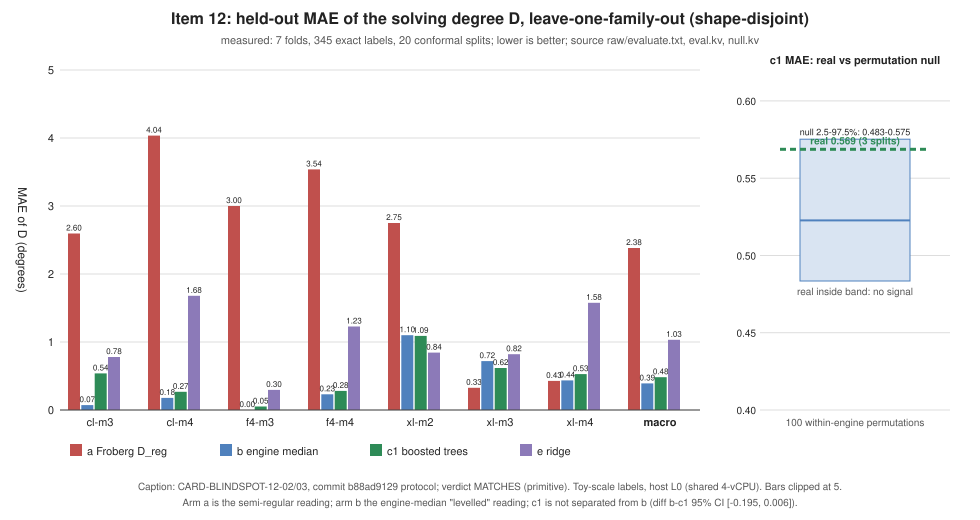

# Item 12: a surrogate for the solving-degree surface

## Verdict: MATCHES (primitive), no speedup, no gap to rho

Under the frozen rule in `PROTOCOL.md`, the gradient-boosted surrogate (arm c1)
is **not separated from the "levelled" engine-median reading (arm b)**. It does
beat the semi-regular (Froberg) reading (arm a) by a wide margin. Its 90 %
conformal intervals cover 73.5 % of held-out draws, outside the [0.85, 0.95]
band, and its error is inside the label-permutation null. Level: **primitive**
(a planning instrument). Nothing here is an exponent, a constant or a speedup;
no `S`, rho ratio or GAE is computed, so the section 5a 0 / 0.1 / 1 GAE pricing
band does not apply and the **gap to matched rho is not applicable** (no
cross-method row exists). Result is a stage diagnostic and cannot promote a
complete-DLP claim. Not a performance result, so nothing is copied to
`benchmarks/`.

## Question and method

Can a model fitted on committed toy-cell degree records predict the solving
degree `D` of cells it has not seen better than (a) the semi-regular `D_reg`
and (b) the engine's median `D` ("levelled")? No new algebraic measurement:
404 records (345 exact, 59 right-censored), 8 families, harvested from 194
committed files each pinned by sha256 in `sources.tsv` (the tool refuses a
mismatch; `SOURCES_VERIFIED 194`). `research/ffd_*` does not exist and
`research/f6_*` holds no solving degree; items 04, 05, 07 were unfinished and
are not used. Arms: (a) `D_reg`, (b) engine median, (c1) boosted trees on shape
covariates (depth 3, 200 rounds, rate 0.1), (c2) c1 plus `D_reg` (ablation),
(e) ridge. Evaluation: leave-one-family-out over 7 evaluable families, training
rows whose `(m, n, l)` shape occurs in the held-out family removed
(shape-disjoint), 20 split-conformal repeats, macro mean over folds, 2000-resample
cluster bootstrap (paired), 100 within-engine label permutations.

## Numbers (measured; `raw/eval.kv`, `raw/null.kv`, `raw/verdict.txt`)

| arm | macro MAE of D | macro MAE of log2 size | 90 % cover | Spearman rho |
|---|---|---|---|---|
| a Froberg `D_reg` | 2.382 | 4.039 | 0.914 | 0.661 |
| b engine median | **0.391** | **0.355** | 0.954 | 0.023 |
| c1 boosted trees (primary) | 0.482 | 0.538 | **0.735** | 0.519 |
| c2 c1 + `D_reg` | 0.494 | 0.539 | 0.740 | 0.542 |
| e ridge | 1.032 | 1.406 | 0.389 | -0.044 |

Paired bootstrap 95 % intervals (positive = c1 better):

* MAE(a) - MAE(c1) = [1.647, 2.137]: c1 beats a.
* MAE(b) - MAE(c1) = [-0.195, 0.006]: contains 0; c1 does not beat b (point
  estimate favours b by 0.09). On log2 size, b - c1 = [-0.340, -0.039], b is
  better (outside the rule).
* MAE(c2) - MAE(c1) = [-0.011, 0.031]: `D_reg` as a feature adds nothing.
* MAE(e) - MAE(c1) = [0.399, 0.695]: trees beat the linear baseline.

Per fold (`raw/evaluate.txt`, MAE of D, a / b / c1): cl-m3 2.60 / 0.07 / 0.54;
cl-m4 4.04 / 0.18 / 0.27; f4-m3 3.00 / 0.00 / 0.05; f4-m4 3.54 / 0.23 / 0.28;
xl-m2 2.75 / 1.10 / 1.09; xl-m3 0.33 / 0.72 / 0.62; xl-m4 0.43 / 0.44 / 0.53.
Froberg is best on xl-m3 and xl-m4 (where `D` grows with the shape) and
wrong by 2.6 to 4.0 degrees on the closure and F4 families (where `D` sits at 3
to 4); the engine median is best where `D` is constant; c1 sits between and
wins outright only on xl-m2 and xl-m3 by margins under its spread.

Null: the real c1 macro MAE over the same 3 splits is 0.569 against a null
band of 0.483 to 0.575 (median 0.523; 93 of 100 permutations at or below the
real value). The real error is inside the band, so the rule does not count c1
as a signal beyond the engine marginal.

Censored consistency (descriptive, 59 records): share with `y_hat + q >= bound`:
a 1.00, b 0.96, c1 0.66, c2 0.66, e 0.64. Intervals of c1 often sit below
degrees the censored runs already exceeded.

Sensitivity without the shape-disjoint rule (outside the verdict, `leaky_*`):
a 2.382, b 0.379, c1 0.430, c2 0.439, e 0.490. Removing the rule lets shapes
leak across engines and the surrogate gets closer to b but still does not beat it.

T3 (descriptive, outside the rule; 61 finished F4 runs, folds f4-m3 and f4-m4):
MAE of log2(columns) a 7.10, b 2.87, c1 2.25, e 2.39; rho c1 0.20. Two folds
only; no conclusion.

## Controls (all passed)

* Known answers: 13 `D_reg` values and the 124,314-column count at `N = 42, d = 4`;
  14 selftest checks (`raw/selftest.kv`, `selftest_ok=1`).
* Conformal on i.i.d. synthetic data: coverage 0.8997 over 200 repeats.
* Positive control (planted label `3 + l + [S < 0]` on the real covariates):
  c1 MAE 0.629 against b 1.938, passes `c1 <= 0.5 * b`. The pipeline can see an
  effect that exists.
* Negative control: the permutation null above. It is the reason the verdict is
  MATCHES and not ADVANCES: c1's error is what a label-shuffled model attains.

## The five cells to buy (model output, not a measurement; `raw/rank.txt`)

| rank | engine | m | n | l | N | c1 prediction | `D_reg` | predicted log2 columns |
|---|---|---|---|---|---|---|---|---|
| 1 | cl | 4 | 14 | 7 | 56 | 4.13 | 14 | 18.6 |
| 2 | cl | 4 | 14 | 6 | 52 | 4.05 | 13 | 18.2 |
| 3 | cl | 4 | 19 | 5 | 58 | 4.07 | 13 | 18.8 |
| 4 | f4 | 4 | 22 | 3 | 56 | 3.85 | 12 | 18.6 |
| 5 | cl | 4 | 22 | 4 | 60 | 3.88 | 12 | 19.0 |

Because c1 is not separated from the engine median, its prediction is about 4
everywhere, so the ranking reduces to "largest `D_reg`". Read it as the cells
where the "levelled" and "growing" readings disagree most, which one
measurement would settle, not as a model-derived expectation of `D`.

## Deviations (all tightenings or clarifications; `PROTOCOL.md`)

Arm (c) pinned to c1; bootstrap, permutation null and controls added to the
design's rule; macro averaging; censored labels excluded from training and error;
shape-disjoint folds; `rustc` build per card instead of `cargo build --example`.
Protocol commit e923d2792, amended in 3244112ed and b88ad9129 before any
measured run. The card relays were saved as `raw/relay-1.txt` to `relay-3.txt`;
`tools/task_card.py check-relay` reports `relay_verbatim: true` for all three. The
commit hashes in receipts 02 and 03 (26916471b, 77395371a) are later HEADs from
other lanes' commits, not changes to this item's inputs (card sha256 values match).

## Caveats

* Host is L0 (shared 4-vCPU container, no isolation). Nothing here is a timing.
* Toy scale: `n` up to 24, `l` up to 7, `D` between 3 and 8. No `n = 131` claim.
* Labels are mostly constant within an engine (cl and f4 at 3 to 4), so b is a
  strong baseline and the low-variance folds reward it. f4-m3 has only 4 cells.
* The evaluable folds are different engines and `m` values, so every fold is a
  covariate shift; the nominal 90 % was a hypothesis and it failed (0.735).
* Items 04, 05, 07 cells are a prospective test set for a later addendum that
  cannot change this verdict.
* The Conductor CLI is not installed on this host; no `conductor check` was possible.
  Edits were confined to this item's files.

## Files

`PROTOCOL.md`, `card-01..03.yaml`, `sources.tsv`, `raw/` (data, kv, receipts,
relays), `report/graph.svg`, `report/graph.png`, `report/graph-data.json`,
`report/plot.py` (layout only), `REPORT.pdf`.

