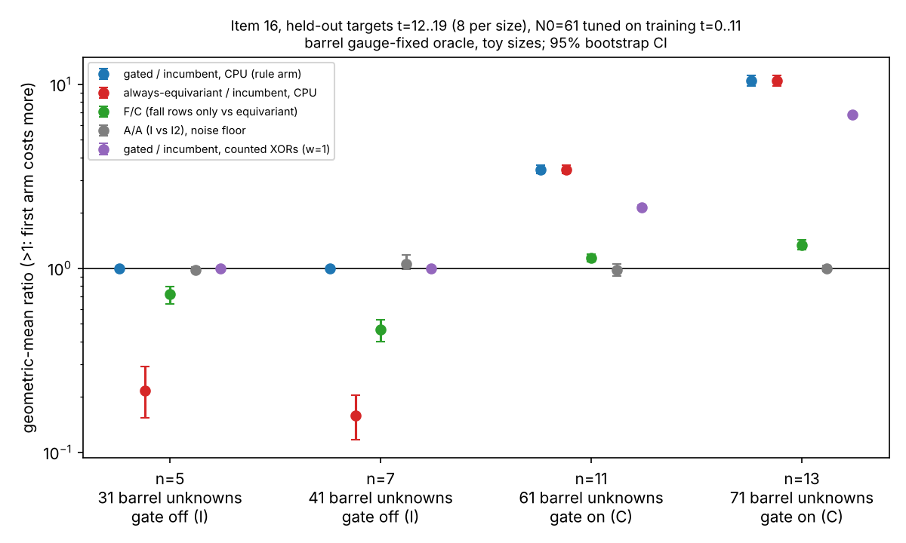

# Item 16: size-gated equivariant oracle

## Verdict

**ADVANCES, level constant, barrel-oracle level, toy sizes (n in {5, 7, 11, 13}).**
**The frozen production cells n in {41, 47, 53, 61} are BLOCKED, not measured.**
The ADVANCES line must not be quoted as the answer to the frozen question, and it is
not a production-oracle result.

Frozen rule (`PROTOCOL.md`) applied by `examples/blindspots_16_gate.rs` to the 32
held-out rows with `N0 = 61` tuned on the 48 training rows only:

| check | result |
|---|---|
| (i) all gates (I, C, I2 root sets vs brute force) | pass, 0 failures in 48 training and 32 held-out rows (F control also 0) |
| (ii) training positive controls | loss seen at n=5 (I/C 0.2045, CI [0.1632, 0.2539]); win seen at n=13 (I/C 10.08, CI [9.66, 10.53]) |
| (iii) pooled gated/incumbent CPU, CI lower bound > 1 | 2.4465, CI [2.3950, 2.5009] |
| (iv) no size regresses | no size has a CI upper bound < 1 (n=5, 7 are exactly 1 by construction) |
| (v) counted unit, pooled CI lower > 1 at w = 0, 0.1, 1 | 1.9586 [1.9472, 1.9711], 1.9584 [1.9470, 1.9710], 1.9570 [1.9456, 1.9695]: holds at all three |

Gap to matched rho: not applicable. This is a within-method comparison of one
repository solver on identical targets; no GAE row and no rho row exists (PROTOCOL.md,
"Class"), so there is no distance-remaining figure to report and section 5a pricing
ranks no arm. The three-price band is applied only to the GF(2^d) products inside the
counted unit (above).

## What the number means (read before quoting)

* **The gate does one thing.** `N0 = 61` switches the equivariant pass off at
  n = 5, 7 (31, 41 unknowns) and on at n = 11, 13 (61, 71). Below N0 the gated arm is
  the incumbent's code, so its ratio is 1 by construction (Amendment A1). All of the
  gain is the gated-on sizes, where the gated arm is arm C. The pooled 2.45x is a
  geometric mean over 16 targets at ratio 1 and 16 targets at 3.4 to 10.4, so it is
  diluted by design; the ratio of summed CPU is 8.12x [7.72, 8.57], dominated by n = 13.
* **Most of the win at n >= 11 is fall-row augmentation, not equivariance.** The
  attribution arm F (the incumbent's own degree-3 fall rows, no Frobenius symmetry)
  has held-out F/C of 1.135 [1.081, 1.193] at n = 11 and 1.342 [1.262, 1.430] at
  n = 13. Derived (point values, no interval): incumbent/F = (a/c)/(F/C) = 3.03 at
  n = 11 and 7.76 at n = 13. So of the 3.44x and 10.40x, about 3.0x and 7.8x comes from
  fall rows and only 1.13x and 1.34x from the equivariant structure itself. Item 02
  measured F regressing 0.29 to 0.59x on the pipeline's own systems, so the mechanism
  that carries the gain is not known to transfer to production.
* **Counted unit agrees in direction but not in size.** Counted a/c is 2.14x at n = 11
  and 6.84x at n = 13 (w = 1), below the CPU ratios 3.44x and 10.40x. The solver's
  word XORs are 2.1x to 6.9x lower; the rest of the CPU gain is not in the unit
  (barrel build and orbit enumeration are charged by CPU only). The w = 0 / 0.1 / 1
  band moves the counted ratio by under 0.3 percent, so the verdict does not depend on
  the unpriced GF(2^d) products.
* **N0 sits on a boundary of the tested sizes.** Training J(T): 0.078 (T=31), 1.665
  (41), 3.557 (61), 2.311 (71), 0 (never). The optimum is 61 because C wins at n = 11
  and loses at n = 7; any N0 in 42..61 gives the same decisions on these four sizes.
  Four sizes cannot locate a crossover more finely, and no claim about other sizes is made.

## Method

Instrument `examples/blindspots_16_size_gated_oracle.rs` (item 02's barrel system,
equivariant degree-3 pass, fall rows and incumbent oracle, rebuilt around the
repository's solver modules by `#[path]`, unmodified). Arms per target, in one process,
random order, single thread, `prlimit --as=4 GiB`: I (incumbent), C (equivariant pass +
solver), F (fall-row control), I2 (A/A). The gated arm is derived from the measured I
and C. Metric: thread CPU seconds including system build and assembly; secondary
counted `F2` word XORs plus w x GF products. Ratios are per-target paired, geometric
mean with 95 percent percentile bootstrap (10,000 resamples within size; pooled
resamples targets within size). Training t = 0..11 (48 targets, cards 01 and 02), held-out
t = 12..19 (32 targets, card 03). Cards CARD-BLINDSPOT-16-01/02/03, receipts in `raw/`,
relays checked with `tools/task_card.py check-relay` (all three verbatim, no findings).

## Numbers (held-out, 8 targets per size, CPU, geometric mean [95% CI])

| n | barrel unknowns | arm used | gated/incumbent | always-eq/incumbent | A/A (I/I2) | F/C |
|---|---|---|---|---|---|---|
| 5 | 31 | I | 1 (exact) | 0.2161 [0.1536, 0.2927] | 0.9821 [0.9483, 1.0184] | 0.7219 [0.6382, 0.7919] |
| 7 | 41 | I | 1 (exact) | 0.1585 [0.1169, 0.2052] | 1.0565 [0.9829, 1.1822] | 0.4646 [0.4009, 0.5260] |
| 11 | 61 | C | 3.4434 [3.2596, 3.6396] | 3.4434 [3.2624, 3.6376] | 0.9744 [0.9035, 1.0572] | 1.1348 [1.0813, 1.1930] |
| 13 | 71 | C | 10.4039 [9.7757, 11.1576] | 10.4039 [9.7663, 11.1432] | 0.9981 [0.9599, 1.0399] | 1.3415 [1.2620, 1.4296] |

Counted-unit gated/incumbent at w = 1: n = 11 2.1444 [2.0991, 2.1968], n = 13 6.8399
[6.7763, 6.9133]; w = 0 and 0.1 differ in the third decimal (`raw/analysis-g16.jsonl`).
Training I/C: 0.2045, 0.1509, 3.4757, 10.0826 at n = 5, 7, 11, 13. Item 02 reported
0.250, 0.168, 5.10, 15.5 under the older solver; the incumbent got cheaper
(`d72e8b04d`), so the n = 11 and 13 gains shrank (5.10 to 3.48, 15.5 to 10.1).

Feasibility at the frozen cells (`raw/feas.jsonl`, arithmetic only): barrel unknowns
170 to 250 against the solver's 64-variable u64 monomials, 211 to 311 symmetric
unknowns against the pass's 192-bit masks, dense degree-3 matrix lower bound 37.3,
82.4, 165.9, 377.3 GB against 4 GB.

## Controls

* **A/A:** all four A/A CIs contain 1 (n = 7 upper end 1.18, a 5.7 percent point
  offset with a wide CI); no order or contention bias flagged. Training n = 11 A/A is
  0.92 with CI [0.85, 1.005], touching 1, so up to 8 percent order noise is
  possible at that size; the n = 11 gain of 3.4x is far outside it.
* **Positive control:** both held on training rows (above).
* **Negative control (wrong gate):** `--force-n0 31` (equivariant always) gives
  TRADES, pooled 1.0526 [0.9384, 1.1719], regression at n = 5, 7; `--force-n0 1000`
  (never) gives MATCHES, pooled exactly 1. Both as designed.
* **Replication:** held-out rows `t = 12..15` at n = 5, 7, 11 and `t = 12` at n = 13
  were seen in the smoke test (disclosed in PROTOCOL.md); nothing was tuned on them.

## Deviations and caveats

* The frozen cells n in {41, 47, 53, 61} on production IC are BLOCKED (four reasons in
  PROTOCOL.md). The measured run is a declared substitute: barrel gauge-fixed oracle,
  toy sizes, a different object from the design's. No exponent statement (four sizes,
  two gated off).
* N0 is tuned on training targets of the same sizes it is tested on (Deviation 2): a
  target-level hold-out, weaker than a size-level one.
* Amendment A1 (gated cost below N0 is I's own measurement) changed before any card ran.
* The equivariant pass applies only to Frobenius-symmetric systems; the production
  pipeline never produces one (item 02), so the gate is dead code there. This result is
  not evidence of any improvement to the production index-calculus baseline or to the
  gap to rho.
* Host L0: shared 4-vCPU cloud container, no isolation, no PMU. CPU time is thread CPU
  time, not wall; A/A shows no bias at this resolution. Peak RSS 0.105 GB.
* The smoke binary and rows were not committed. `crypto_lib` does not compile at the
  branch base, so the build route is one `rustc` per card against pinned rlibs.
* The relay files `raw/relay-1.txt` and `raw/relay-3.txt` were assembled by the assess
  stage: header and command lines retyped from the executor's returned text and the
  tail rows copied from the committed `raw/*.jsonl` (the rows the executor echoed,
  bound by stdout sha256 in the receipts). `relay-2.txt` likewise. They passed
  `check-relay`; they are not byte copies of the executor's message.

## Files

`PROTOCOL.md`, `card-0{1,2,3}.yaml`, `raw/` (rows, receipts, relays, `analysis-g16.jsonl`),
`graph.svg`, `graph.png`, `plot.py` (layout only, reads `raw/analysis-g16.jsonl`),
`REPORT.pdf`. Reproduce analysis: see PROTOCOL.md "Reproduce".

