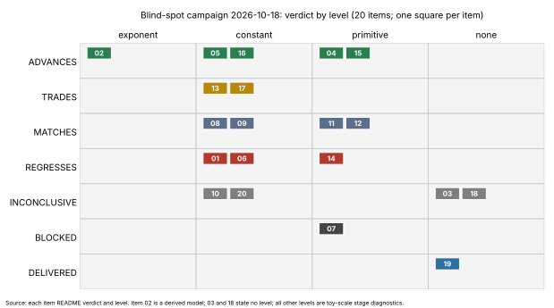

# Blind-spot campaign, 2026-10-18: integration

Twenty experiments, one per direction the program was not pursuing
(`EXPERIMENTS.md`). Each item ran under its own frozen `PROTOCOL.md` and
decision rule; the verdict, level and numbers below are copied from the item
README, which is the source of truth. Host for every item: shared 4-vCPU
container, isolation L0, one thread per job. Every measured cell is toy scale.

Graph source: `plot_campaign.py` (plots the verdict and level recorded in the
item READMEs, no computation). PDF of this page: `REPORT.pdf`.

## Table

| item | title | verdict | level | headline | gap to rho | README |
|:--|:--|:--|:--|:--|:--|:--|
| 01 | Gaudry k = 2 index calculus on E(F_{p^2}) | REGRESSES | constant (exponent INCONCLUSIVE; plain-torsion ic-a REGRESSES at the exponent) | No arm beats matched rho at 24 to 40 bits or at any native-work price (0, 0.1, 1 GAE). Best arms ic-b and ic-c2 are 50x and 52x rho at w=0, 22x and 14x at w=1, at 40 bits. | 9.9x at best (24 bits, w=1); 14x to 52x at 40 bits; extrapolated log2 gap at 246 bits about 5 to 17 | [01](01-fp2-gaudry-k2/README.md) |
| 02 | Pricing binary curves at deployed sizes under the measured degree model | ADVANCES (derived, model level) | exponent (conditional on constant D) | Some m >= 4 design arms flip below matched rho at K=1 if the degree stays constant (D = 3, 4, 6, 7). The measured growth fit D = l+4 never flips. m=3 never flips; the m=2 control never crosses. Not a measured improvement. | Koblitz m=4 w=1 K=1, D=6: +15.5 bits at n=131, -25.4 at n=571; D=l+4: +337 bits at n=571 | [02](02-deployed-binary-pricing/README.md) |
| 03 | Polynomial-method solving on descended Semaev systems | INCONCLUSIVE | none (frozen sensitivity control failed: dinur moved 1.36% and 3.99% against a 1% bound) | Counted model at N=32: rho_dinur 0.0213 (46.8x worse than FES), rho_lptwy 0.0102 (97.7x worse). Fitted exponents FES 1.063, dinur 0.937, lptwy 0.967. Model drops below FES only at N=80 (needs 2^71 bits of memory) and N=128. | Exponent distance to matched rho 0.6946 (m=2), 0.6448 (m=3); no measured gap | [03](03-polynomial-method/README.md) |
| 04 | Presentation search for the m-sum variety | ADVANCES (stage diagnostic, arm d) | primitive | Moebius-frame S_{m+1} with 2-torsion symmetrisation lowers closure degree D against the unchained incumbent on 5 of 5 cells (7 to 5, 7 to 5, 11 to 7, 10 to 7, >=13 to 10). It does not go below the chained S_3 route (D = 4); the symmetrisation itself lowers nothing (arm d0 gives the same D). | Not applicable (no cross-method row); unchanged | [04](04-presentation-search/README.md) |
| 05 | Monomial, variable and block orders for the descent | ADVANCES (arm wdeg only) | constant | wdeg cuts F4 matrix-entry touches against this engine's grevlex by 14.1x, 18.6x, 3.8x, 3.4x on four countable cells (N = 29 to 42), each above the cell's random-ranking maximum. D_mat is not lowered. At N=50 wdeg hit the cap while grevlex finished (reversal). | Not computed (stage diagnostic); unchanged | [05](05-elimination-orders/README.md) |
| 06 | Signature-based Groebner engine with trace replay | REGRESSES | constant | sig is regress-certain in 3 of 4 cells (R = touches(f4)/cost(sig) at most 0.494, 0.497, 0.492); refuted 0 of 64 targets. Exact-key replay f4r has R 0.885, 0.630, 0.741, 0.587 and falls back on every target. | Unchanged | [06](06-signature-gb-trace-replay/README.md) |
| 07 | Out-of-core blocked Boolean F4 for degree cells | BLOCKED (time) | primitive | D = 4 on every completed draw up to (13,5,4); (15,5,4): one draw reads D > 4, two hit the time limit; (19,6,4) needs 22.97 GB. Cards 1 and 7 never completed. | Not computed | [07](07-blocked-f4-degree-cells/README.md) |
| 08 | Learned branching for WDSat and XOR-CDCL | MATCHES | constant | No learned arm reaches 1.3x over the WDSat static order on 128 held-out targets (arm b 0.994, b2 1.001, c 1.000 at k=0). Noise-fitted scorers do as well. | Unchanged | [08](08-learned-sat-branching/README.md) |
| 09 | Learned F4 selection and pivot policy | MATCHES (b50); d REGRESSES; c INCONCLUSIVE | constant | b50 touches ratio 1.99, 2.32, 2.54 against the incumbent but beats its random-half null on 1 cell of 3. Cell (13,3,4) trained, never evaluated. | Unchanged | [09](09-learned-f4-policy/README.md) |
| 10 | Program search over the decomposition kernel | INCONCLUSIVE (cells: MATCHES n=31, ADVANCES n=37, ADVANCES n=41) | constant | Search finalist uses 11 to 12x fewer counted operations per relation in a replica, but about two-thirds of that gain comes from a one-gene lift patch (A1) and random search of equal budget finds much of the rest (Q(B)/Q(C) 1.005, 0.628, 0.501). | Unchanged, not measured; a constant factor does not touch the exponent | [10](10-kernel-program-search/README.md) |
| 11 | Learned necessary-condition prefilter | MATCHES | primitive | No learned filter beats the trace filter by 5 points at zero false refutations; best credited 0.21 points against a 5-point threshold. Net work negative in all 16 cells. | Unchanged | [11](11-learned-prefilter/README.md) |
| 12 | Surrogate for the solving-degree surface | MATCHES | primitive | Boosted-tree surrogate beats the semi-regular reading (MAE 0.482 against 2.382) but is not separated from the engine-median reading (0.391); 90% intervals cover 73.5%. | Not applicable | [12](12-degree-surrogate/README.md) |
| 13 | Negation-map shortfall and ECC2K-130 plan | TRADES (part B DELIVERED) | constant | Of 44 collision-preserving settings: 0 ADVANCES, 30 TRADES, 2 MATCHES, 12 REGRESSES. Best fully charged gain 1.557 [1.325, 1.825] against sqrt2 = 1.414, with intervals including 1.35. Part B: 15.189 M iterations/s per core, 4,488 core-years CPU alone. | Gain over plain rho 1.0; best cells 1.49 to 1.56 with native work free; below 1.0 at 1 GAE | [13](13-rho-negation-ecc2k130-plan/README.md) |
| 14 | First prime-field arity m = 4 cost cells | REGRESSES | primitive | Arm (b) F4 cost grows as |F|^11.03 against the |F|^1 needed. Arm (a) full IC is 6.5x to 30x matched rho (16 to 28 bits). Arm (d) BLOCKED by reach. | 6.5x (16 bit) to 30x (28 bit) rho at w=0.1, growing with p | [14](14-prime-m4-cells/README.md) |
| 15 | Genus-3 linear-algebra exponent | ADVANCES (arm d only; exponent rule gives MATCHES) | primitive | Automatic SGE filter choice lowers LA cost 1.4% at b=20 (ratio 0.9862 [0.9836, 0.9876]), the size of the A/A spread (0.9875 to 1.011). No arm lowers the LA exponent; arms b and c REGRESS, e TRADES. | Whole IC cost 0.46 to 0.93 of one measured rho run per curve at b=20 (heavy-tailed rho, toy q about 2^20); exponent about 0.05 to 0.07 above 4/3 | [15](15-genus3-la-exponent/README.md) |
| 16 | Size-gated equivariant oracle | ADVANCES (substitute barrel-oracle cells; production cells BLOCKED) | constant | Gated/incumbent CPU 2.4465 [2.3950, 2.5009] pooled; n=11 3.44x, n=13 10.40x. Most of the gain at n >= 11 is fall-row augmentation (F), not equivariance (adds about 1.13x and 1.34x). The gate is dead code in the production pipeline. | Not applicable (within-method) | [16](16-size-gated-equivariant/README.md) |
| 17 | Cyclotomic base cost arm at n = 83 | TRADES | constant | Cyclotomic base is never cheaper than the compact-orbit-scan: REGRESSES at K=74 and 93, order flips with unpriced-work price at K=300; all arms within 0.11% under tidy accounting. Solving-degree leg BLOCKED. | 232x to 1e9x above the rho theory floor (model rows, not run) | [17](17-cyclotomic-cost-n83/README.md) |
| 18 | Execute the frozen ECDLP contracts | INCONCLUSIVE (no level; nothing compared) | none | 3 of 1029 contracts runnable, 1026 BLOCKED; 4 replica trials run as frozen, all exit 0. Not a comparison, nothing improves. Lives in the sibling repository crypto-autoresearcher (commit eb4eedef8). | Not applicable | `crypto-autoresearcher/research/blindspots_20261018/18-frozen-contracts/README.md` |
| 19 | Negative-results paper and Lean statements | DELIVERED | none | Paper and evidence ledger delivered; S1 RECORDED, S2 PROVED (Lean unchecked), S3 PROVED and EXACT, S4 DERIVED UNREVIEWED, S5 EXACT, S6 NOT ESTABLISHED. A relabelling of existing negatives, not an improvement. | Not applicable | [19](../../papers/ic-negative-results/README.md) |
| 20 | Classical pre- and post-processing for quantum ECDLP | INCONCLUSIVE | constant | Negative control failed in 21 of 567 single-run cells, all at m=12 (post hoc: the chance formula is a union bound). Row-level outputs at n=256: E1-2^30 and E1-2^40 ADVANCE (0.927, 0.887; the latter sits at the 2^40 cap), lattice REGRESSES (1.715, 2.205). Logical-resource model, not a measured circuit. | Classical post-processing 70.0 to 120.9 bits remaining against rho at 127.83 bits (derived) | [20](20-quantum-classical-processing/README.md) |

Counts: ADVANCES 5 (02, 04, 05, 15, 16), TRADES 2 (13, 17), MATCHES 4 (08, 09,
11, 12), REGRESSES 3 (01, 06, 14), INCONCLUSIVE 4 (03, 10, 18, 20), BLOCKED 1
(07), DELIVERED 1 (19).

## What changed in the picture

Only what the evidence supports:

- **No whole-pipeline row moved and no gap to matched rho was reduced by a
  measurement.** Every cross-method measurement in the campaign is on the
  wrong side of rho: item 01 (14x to 52x at 40 bits), item 14 (6.5x to 30x,
  growing with p), item 17 (232x or more above the theory floor).
- **Item 02 is a model, not a measurement.** If the solving degree stays
  constant at l of 90 to 140, binary m >= 4 designs flip below matched rho
  for n above about 220 to 320 (K=1, w=1). The measured degree growth fit
  (D = l+4) never flips. The degree evidence is measured only to n <= 15,
  l <= 5, and item 07, which targets the deciding degree cells, is BLOCKED
  at (15,5,4). The question of whether D stays bounded is therefore still
  open.
- **Component gains exist, at toy scale, against the campaign's own
  baselines, and none is established as large.** Item 05 (wdeg touches
  3.4x to 18.6x, reversed at N=50), item 04 (closure degree lowered against
  the unchained incumbent, not below the chained route), item 16 (2.4x
  pooled, mostly fall-row augmentation, production cells blocked), item 10
  (about 11x in a replica, mostly a patch and random search) and item 15
  (1.4%, within the A/A spread). None changes an exponent.
- **Learned components found nothing over their incumbents** (items 08, 09,
  11, 12): the noise-fitted or random-subset controls match the learned arms.
- **Signature Groebner (06) and the cyclotomic base (17) do not help.**
  Negation-map rho (13) gains at most about 1.1 of sqrt2 with free native
  work and loses once native work is priced at 1 GAE.
- **Item 03:** the frozen sensitivity control failed, so no level is stated;
  the counted model puts the polynomial-method arms behind FES at N=32.
  Whether to relax the 1% bound is an owner decision.
- Items 18 and 19 and the INCONCLUSIVE item 20 are bookkeeping or model
  results and claim no improvement.

Under the success criterion (every verified, measured improvement over the
index-calculus baseline counts), the candidates for that label are items 05,
16, 04 and 10, each as a toy-scale, within-method stage measurement with the
limits above. This page claims none as an improvement of the baseline.

## Blocked and unfinished items, and what unblocks each

| item | blocked | what unblocks it |
|:--|:--|:--|
| 03 | Frozen sensitivity control failed (1.36% and 3.99% against 1%; the code accepts under 5%); arm (e) msolve not installed | Owner decision on the 1% bound; install msolve for the comparison arm; descriptive branch with the control waived is TRADES at exponent over constant |
| 04 | Cell 5 half measured: arm e BLOCKED(memory) (basis 2.91 GB against the 3000 MiB cap), arm b blocked by projection | A memory cap above 3 GB for arm e, or an out-of-core engine (item 07) |
| 06 | Arm (e) msolve not installed; cell c15-3-4 unsettled (F4 time limit on target 1); f4rs covers 1 to 4 targets per cell | msolve; a longer time limit for c15-3-4 target 1 |
| 07 | BLOCKED(time) at (15,5,4); draw g0 missing; rank controls for (19,7,3) incomplete; (19,6,4) needs 22.97 GB, 16.05 GB beyond the cap | More wall time per job and a larger memory cap, or a disk-backed matrix; re-run cards 1 and 7 |
| 08 | CryptoMiniSat arm descriptive only (6 targets); scale l=5 | Larger l and more CMS targets |
| 09 | Cell (13,3,4) trained, never evaluated; random-subset clause undecided (about 1,570 s of budget left) | Freeze and run the fit and evaluation cards for that cell |
| 14 | Arm (d) BLOCKED by reach (delta_max 0.0081 against 0.25 needed); arm (b) at 20 to 28 bits stops at its count cap | A reachable base (two abscissae) design cell; a higher count cap for F4 |
| 16 | Production cells n in {41,47,53,61} BLOCKED: 64-bit monomials against 170 to 250 unknowns, 192-bit masks against 211 to 311 symmetric unknowns, dense matrix 37 to 377 GB against the 4 GB cap, no Frobenius-symmetric system in the production pipeline, crypto_lib does not compile at the branch base | Wider monomial and mask types, a sparse or out-of-core matrix, a Frobenius-symmetric production system, a compiling library |
| 17 | Solving-degree leg BLOCKED: the m=2 system needs 166 or more variables against the 64-variable limit | A solver with more than 64 variables |
| 18 | 1026 of 1029 contracts BLOCKED (first gates: not_frozen:status 353, no_launcher 285, has_runs 186, withheld 147, not_frozen:no_specification 29, handoff_archive_coverage 9, needs_dispatch_queue 6) | Freeze the specifications, write launchers, record approvals, per contract; the supervisor path was not taken (replica records only) |
| 19 | Lean not kernel-checked (no toolchain, about 1.5 GB disk); S4 has no independent review; S6 open; authors and email owed by a human | The CI proof gate (`lean-proof-gate.yml`); an independent proof review |
| 10 | Card 22-r2 ran without a card or receipt | A frozen card for the summarize step |

## Leaderboard

No item qualifies as a large measured gain on an index-calculus pipeline,
phase or component, so `docs/ic-leaderboard.html`, `docs/ic/LEADERBOARD.md`,
`docs/ic/leaderboard.json` and the lab browser were not regenerated. Reasons:
item 05 is a toy-scale touch count against the engine's own grevlex that
reverses at N=50 and does not lower D; item 16's production cells are blocked
and its gain is mostly fall-row augmentation; item 04 lowers a closure
degree, not a cost; item 10 is a replica whose gain is mostly a patch and
random search; item 15's 1.4% is within the A/A spread; item 02 is derived.
Items 05 and 16 are the closest; an owner who counts them as component
speedups would add them as their own section outside tables A to C (AGENTS.md
section 7b).

## Benchmarks

Twelve items copied files into `benchmarks/20261018-blindspots-*/` (01, 02, 03,
05, 06, 07, 10, 13, 14, 15, 16, 17). Items 04, 08, 09, 11, 12, 18, 19 and 20 are
not speed results and have no copy.

Item 01 is validated and has its row back in `benchmarks/README.md`
(`benchmarks/20261018-blindspots-fp2-gaudry-k2/VALIDATION.json`): a sampled
exact replay (282 of 945 rows, every arm at 24 and 40 bits, 0 mismatches), an
independent recompute of every headline from `raw/`, and matched rho-neg run in
the same binary. The other eleven rows stay withheld. The validation gate
(owner rule 2026-10-19, `docs/VALIDATION_GATE.md`) admits a row only when the
evidence directory carries a `VALIDATION.json` that points to an independent
replay certificate, a validator's recompute from raw data, and a matched rho
reference priced at 0, 0.1 and 1 GAE; new rows cannot be frozen as pre-gate.

The item 01 validator found two misstatements in that item's README, left
unedited because the validator report pins its sha256: the prime-order
`ic-a` / `rho-neg` gap at 40 bits, w = 0, is 187.537 and rounds to 188, not
187; and the "filter's native touches from 15.9 M to 2.0 M" are the total
unpriced native work per instance (`native_total`); the filter counter alone
falls from 14.0 M to 348. Neither is a headline or changes a verdict.

Item 14 is validated too
(`benchmarks/20261018-blindspots-prime-m4-cells/VALIDATION.json`). Its original
matched rho was a plain r-adding walk without the negation map, which the gate
refuses as not the strongest available rho. A negation-map rho was added in a
new instrument copy (`instruments/blindspots_14_prime_m4_neg.rs`) under
`14-prime-m4-cells/PROTOCOL-ADDENDUM-rho-neg.md`, committed before the run; in
that binary the recorded plain-rho and arm (a) rows reproduce exactly at 16 to
28 bits, and an independent replay of the new run matches it. Arm (a) is dearer
than both rhos at every cell and every w (8.2x to 29.5x the negation-map rho at
w = 0.1). The two rhos swap order inside the band, because the negation map's
bookkeeping is priced as native work. The commit subject's "6.5x" was not any
measured ratio.

Item 15 is validated
(`benchmarks/20261018-blindspots-genus3-la-exponent/VALIDATION.json`). Its rho
had been borrowed from round 4; a matched negation-map rho now runs in the item
binary (`instruments/blindspots_15b_genus3_la_rho.rs`,
`15-genus3-la-exponent/PROTOCOL-ADDENDUM-matched-rho.md`, committed before the
runs), where the four b = 20 IC arms reproduce their recorded rows exactly. With
the frozen protocol's classification (mod-ell products are unpriced native work)
on the section 5a band, every IC arm is below rho at w = 0 (0.38x) and above it
at w = 0.1 and 1, so IC against rho is unresolved. The README's "IC below rho at
every price" used c_ell pricing, a lower-bound comparison, and does not survive
section 5a. If mod-ell products were instead charged as one F_q multiplication,
arms a and d would be below rho at every w; that would need a protocol
amendment. The linear-algebra headline (arm d 0.9862 of arm a at b = 20)
recomputes exactly.

The other nine stay withheld because a matched Pollard rho is not the right
reference for what they claim, so a rho run cannot make the row valid:

| item | claim | reason withheld |
|:--|:--|:--|
| 02 | closed-form crossover model | model, no solve; its rho already uses the strongest symmetry in closed form |
| 03 | solver bit-operation counts, INCONCLUSIVE | no group operations; its "rho_A" columns are ratios against FES, not Pollard rho |
| 05 | F4 touch ratio, wdeg vs grevlex | component on synthetic targets, no curve DLP |
| 06 | signature Groebner basis, REGRESSES | stage diagnostic |
| 07 | closure degree, BLOCKED | incomplete (cards 1 and 7 never finished) |
| 10 | kernel replica, relation phase only | component; a matched row needs a new full-solve study |
| 13 | negation walk vs plain walk, ECC2K-130 plan | rho-internal study with no IC arm; the reference would be the weaker walk by construction |
| 16 | barrel-oracle CPU, n = 5 to 13 | component, production cells BLOCKED |
| 17 | factor base and pair table at n = 83, TRADES | the IC whole solve is a model (0 relations found) |

None of the nine had a row in the base `benchmarks/README.md`, so no archive
disposition applies; the gate has no route for component, phase or
rho-internal rows.

## Instruments

The Rust instruments now live in [`instruments/`](instruments/). They were
moved there byte for byte from `examples/` after the last card ran. Each card
still names its instrument by the old `examples/` path, and the sha256 pins
still match. [`instruments/README.md`](instruments/README.md) maps each old
path to the new one.

## Process caveats shared by the items

- Many relay checks report `relay_verbatim` false, or `CARD FAIL`, because
  frozen cards name outputs that exist only after the run; items record this
  rather than repairing frozen cards. Receipts and on-disk outputs are the
  evidence.
- Several items were restarted or repaired once; each README keeps its first
  run under "First run (superseded)".
- Conductor is not installed in the container, so no `conductor check` was
  possible.
