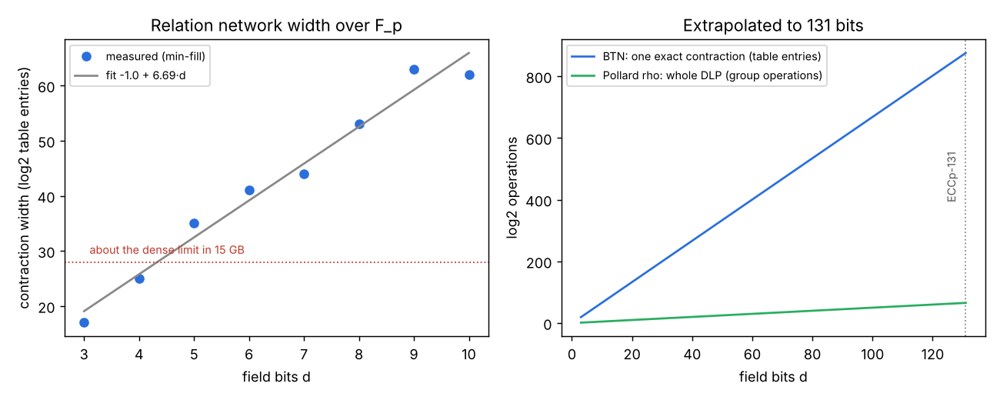

# BTN index calculus over prime fields: encoding, solves and 131-bit extrapolation

> **Native rework lives in `native/` and `native_runs/` (PR #2888).** The
> result the study is about — the method's distance from ECCp-131 — is measured
> there in Rust against the `hashed-ecdl-tensor` crate (#2878), with a
> report PDF in `native_runs/report.pdf`. Headline: the one backend that could
> beat exponential cost (OpenAI Appendix D recursion) is gated off below about
> 2^131070 edges, faithful to the manuscript's 2^(2^17) threshold; the largest
> network built here is 2^17.8 edges, so every exact count used the fallback and
> no sub-exponential behaviour appears at any reachable size.
>
> The Python below (`*.py`) is **historical evidence only**: `AGENTS.md` forbids
> Python for cryptographic research here. Its counts, widths and recovered
> secrets are exact and reproduced natively; its wall-clock timings were
> unisolated and are not valid measurements. See [`native/README.md`](native/README.md).

Prime-field version of the binary prototype in `research/btn_ecdl_20261029/`.
The paper (Akshima et al., "A Subexponential Time Algorithm for Elliptic Curve
Discrete Logarithm", v0.2, 2026-10-29) targets prime-field curves such as
ECCp-131. Its only curve-specific ingredients are point validity and point
addition as Boolean tensor networks; this directory builds both over F_p for
`y^2 = x^3 + ax + b`, runs the full index calculus (m = 2, hashed factor
bases, Lemma-1 sampling, linear algebra mod r) on small prime-order curves,
and extrapolates the measured cost to 131 bits.

The contraction here is exact bucket elimination (`gpu_contract.py`, NumPy
backend), standing in for the paper's assumed OpenAI algorithm, which has no
code. Modular multiply is schoolbook (O(d^2) edges), not the paper's O(d)
Fourier multiplier. **No ECCp-131 discrete logarithm is computed or
attempted, and no speed-up is claimed.**

| File | Role |
|---|---|
| `prime_field.py` | F_p, curve, mod-p multiply, linear mod-p, range checks, curve and addition predicates |
| `relation_p.py` | relation network A1 + A2 = R with factor-base membership |
| `curves.py` | first prime-order curve per small prime |
| `test_mulmod.py`, `test_rel_p.py` | step 1: counts vs brute force |
| `run_ic_p.py` | step 2: end-to-end index calculus, JSON record per run |
| `width_p.py`, `widths_json.py` | min-fill width per bit size (`widths.json`) |
| `first_count.py` | time of one unpinned contraction per prime (`first_count.json`) |
| `extrapolate.py`, `plot.py` | step 3: fit, extrapolation (`extrapolation.json`), `scaling.svg/png` |
| `btn.py`, `gpu_contract.py` | contractor (copied from the binary prototype; see "Fixes") |

## Step 1: encoding checks (all against brute force)

| Check | Result |
|---|---|
| mod-p multiply, p = 11 and 13 | 6 fixed products each correct; free count p^2 (121, 169) |
| relation count, p = 5 (a=1, b=1) | 6 = 6 for two targets R |
| relation count, p = 7 | 10 = 10 for two targets (`runs/enc_p7.log`) |
| relation count, p = 13 | 16 = 16 for two targets (`runs/enc_p13.log`) |
| first contraction, p = 5, 7, 11, 13 | 4 = 4, 10 = 10, 8 = 8, 16 = 16 (`first_count.json`) |

## Step 2: end-to-end solves

Each relation is checked with reference curve arithmetic before use; the
kernel of the relation matrix mod r gives ξ, checked as Q == [ξ]P.

| p | d | order r | N | relations | counts | s/count | width | secret | recovered |
|---|---|---|---|---|---|---|---|---|---|
| 5 | 3 | 7 | 10 | 11 | 143 | 1.70 | 18 | 2 | 2 |
| 5 (seed 2) | 3 | 7 | 10 | 11 | 143 | 1.75 | 18 | 1 | 1 |
| 7 | 3 | 13 | 16 | 17 | 221 | 1.70 | 18 | 3 | 3 |
| 11 | 4 | 11 | 20 | 21 | 357 | 8.15 | 27 | 3 | 3 |
| 13 | 4 | 19 | 22 | 23 | 391 | 8.41 | 27 | 5 | 5 |

Records: `runs/ic_*.json`. The s/count column includes compiling the
elimination plan, which dominates at d = 3 (the contraction itself takes
0.1 s there).

## Step 3: extrapolation to 131 bits

Measured min-fill widths (`widths.json`): d = 3..10 gives 17, 25, 35, 41, 44,
53, 63, 62. Linear fit: width ≈ 6.69·d − 0.99 (max residual 3.9). Contraction
time follows 2^width: width 18 → 25 is 128× more entries and took 0.09 s →
11.2 s (125×). Calibration: 3.35e-7 s per table entry on this CPU.

| d | width | entries per contraction | CPU time per relation |
|---|---|---|---|
| 8 | 52.5 | 2^52.5 | 2^36.1 s |
| 16 | 106.1 | 2^106.1 | 2^90.6 s |
| 32 | 213.1 | 2^213.1 | 2^198.6 s |
| 64 | 427.2 | 2^427.2 | 2^413.7 s |
| **131** | **875.5** | **2^875.5** | **2^863.0 s** |

Pollard rho on ECCp-131 needs about 2^65.3 group operations for the whole
discrete logarithm. One exact contraction of this network at 131 bits would
need about 2^876 table entries. Exact contraction becomes infeasible at d = 5
(width 35) on this machine.

## What this does and does not show

* It shows the prime-field encoding is correct (every count checked) and the
  index-calculus pipeline recovers the secret end to end at small primes.
* It measures how this contractor's cost grows: exponentially, about 2^6.7 per
  field bit. That is the cost of exact contraction on these networks, not of the
  paper's claimed algorithm.
* The paper's 2^O(b/(log b)^(1/4)) bound rests on the OpenAI contraction
  theorem (unreviewed, no code; the paper says it saves nothing below about
  2^(2^17) edges). Nothing here tests that theorem.
* Widths are min-fill heuristic upper bounds on treewidth. The fit uses 8
  points (d = 3..10) and is extrapolated 13× beyond them. The O(d)
  multiplier would lower the edge count, but no construction here shows it
  lowers the width.

## Fixes made to the copied contractor

* `btn.Net.add`: a variable listed twice in one predicate (the diagonal AND
  gates of `mul_mod(y, y)`) now gets one table axis. Before, pinning such a
  variable during Lemma-1 sampling left one axis behind and gave fractional
  counts (1.5, 0.5).
* `gpu_contract.contract_gpu`: optional prebuilt `plan`, so the plan is not
  compiled twice per count.
* `gpu_contract.py --selftest` in this directory still imports the binary
  `relation` module and does not run here; use the binary directory's copy.
