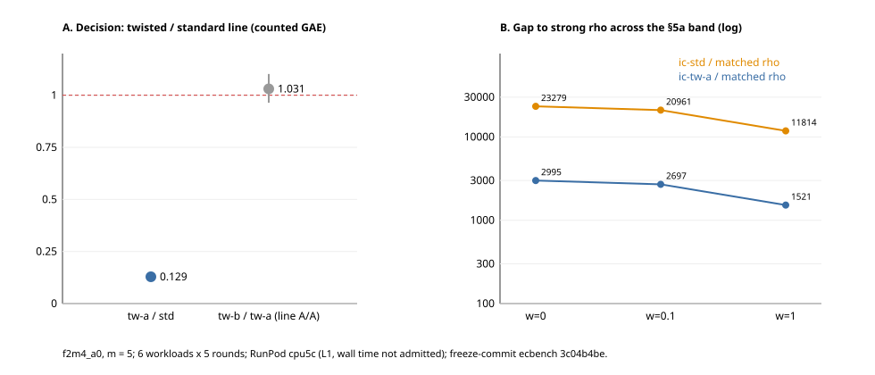

# C1 end to end, stage 1 (m = 5): results of the RunPod rerun (2026-11-27)

This study runs the frozen specs `../specs/c1-e2e-m5-std.json` and `../specs/c1-e2e-m5-tw.json` under the frozen [PROTOCOL](../PROTOCOL.md). It compares Gaudry's n = 4 decomposition with the `gaudry-x-bin` C1 oracle on the **twisted all-lift abscissa line** against the **standard line**. Both run inside the complete `ic.pipeline` solve, with strong rho on the same `f2m4_a0` targets. Every number here is `[pcc:unverified]`.

## Verdict (PROTOCOL "Decision rule")

**Improvement.**
- The decision comparison `ic-tw-a / ic-std` is **0.1286 [0.114, 0.145]**, in counted GAE, paired over 30 pairs on 6 workloads with a 95% linearised-t interval.
- Its upper end is below 1 at every §5a weight: w = 0, 0.1, 1 give 0.1286, 0.1286, 0.1287.
- The line A/A `ic-tw-b / ic-tw-a` is 1.0306 [0.964, 1.102], which contains 1.
- Prediction P1, a point value in [0.1, 0.71], is met.

On this curve family the twisted all-lift line makes the **complete one-target solve about 7.8× cheaper** than the standard line.

## Distance remaining to matched strong rho

The matched rho is whichever of `rho-strong-l1` and `rho-strong-l16` has the lower S, chosen per weight.

| arm | w = 0 | w = 0.1 | w = 1 |
|---|---|---|---|
| `ic-tw-a` / matched rho | 2995 | 2697 | 1521 |
| `ic-std` / matched rho | 23279 | 20961 | 11814 |

Both IC arms remain about 10³–10⁴× above rho at m = 5 (N = 20, r ≈ 2^18), and the order holds at every weight. This is the distance remaining, not a gate; stage 2 (m = 7) gives the second size.

## Controls

- **rho A/A:** `rho-strong-l1-aa / rho-strong-l1` = 1.0000 exactly, because counted operations are deterministic per seed.
- **IC A/A:** `ic-tw-a-aa / ic-tw-a` = 1.0000 exactly, for the same reason.
- **Line choice:** `rho-strong-l16 / rho-strong-l1` is unresolved inside the band (0.970 / 0.988 / 1.069). `ic-tw-b / ic-tw-a` = 1.031 [0.964, 1.102]: the two twisted lines agree.

## Execution and identity

| field | value |
|---|---|
| binary | `ecbench` built at the protocol freeze commit `234e6193833f9db0f3811e79cfae61c6f743dee8`, SHA-256 `3c04b4be2d9b79cd02632852d2402eb9ead0a00e9e11228b0926ce9ec66443f8`, hash-checked on the pod |
| host | RunPod pod `fxe14r1i5zyx36` (SECURE `cpu5c`, 8 vCPU, `runpod/base:1.0.2-ubuntu2404`), created through REST v2; transfer through `research/runpod_kit_20261112` |
| runs | tw first (rc 0, 460 s), then std (rc 0, 1236 s), sequentially. Each session was packed and fetched right after it finished |
| audits | tw: "audit OK: 180 records, 180 verified, 150 replays reproduced, 0 problems". std: "audit OK: 144 records, 144 verified, 120 replays reproduced, 0 problems". Both from `ecbench verify --replay-all` on the pod |
| raw data | `done_c1-e2e-m5-tw.tgz` (SHA-256 `16e5ed21…`) and `done_c1-e2e-m5-std.tgz` (`d9285091…`): sessions, run and verify logs, host capsule |
| analysis | `analyze.out` and `comparisons/` |

## Deviations from the protocol

1. **Isolation.** The host reached L1, not L2, so wall time is not admitted and only the counted-operation comparisons are reported. Cross-session wall time is refused by design.
2. **Route.** RunPod instead of isolab-eks, which is blocked (CodeBuild queue limit 0, invalid artifact-store keys).
3. **`analyze.sh` step 1.** The script's first step re-runs `ecbench verify --replay-all` locally. That same command, with the same binary, had already passed on the pod (audits above). The local re-run was killed at a 30-minute tool limit; the std replays alone take about 2 h here. The remaining steps, every `compare` and `table`, ran **exactly as frozen** (`analyze_run_tail.sh` is the script's tail with the paths filled in).
4. **Cost.** The pod outlived the run. Its delete reminder fired while the session was down, so it ran about 20.5 h, roughly USD 5.7 against a USD 2 ceiling. It was deleted at 2026-11-28T02:36Z. A first attempt on 2026-11-20 was lost with its pod ([`../LAUNCH-runpod-20261120.md`](../LAUNCH-runpod-20261120.md)).

## What this does not establish

- **Validation gate.** There is no validator report and no independent-host replay (the replays ran on the producing pod), so no IC-leaderboard or `benchmarks/README.md` row is added.
- **Scale.** This is one size and one curve family (`f2m4_a0`, m = 5). The scaling claim needs stage 2 (m = 7) under the same protocol.
- **Rho.** The improvement is relative to the standard-line IC baseline. It is not below rho; the gap is listed above.
