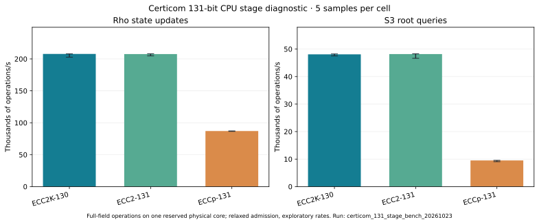

# Certicom 131-bit rho and index-calculus stage benchmark

Run date: 2026-10-23 UTC. Source base:
`d7daaa6b42e7b5209e78c2407b2eaf35da25fbe4` plus the Rust example in
this branch. Full protocol, including pre-timing amendments: [PROTOCOL.md](PROTOCOL.md).
Example SHA-256:
`1e406f4cb146fa2739a5b74d93f151645414d46d5a7523bfac525f8c387f7acd`.
Optimized binary SHA-256:
`62f333fe656ae6cc8f639b409a90fad4bac082269bffc05404fb646a672bf5b8`.



## Observed CPU diagnostic

Five samples per cell, each with 200,000 rho state steps or 50,000 full-field
Semaev S3 quadratic-root queries. Rates are operations/s; brackets show the
minimum and maximum sample rates. All five checksums agree within each cell.
The source of the computed values is [summary.tsv](summary.tsv); the raw
observations are [diagnostic-samples.csv](diagnostic-samples.csv).

| Exact curve | Rho state steps/s, median [range] | S3 root queries/s, median [range] |
| --- | ---: | ---: |
| ECC2K-130 | 207,822 [202,805–207,952] | 48,080 [47,517–48,218] |
| ECC2-131 | 207,602 [204,808–207,962] | 48,186 [46,639–48,266] |
| ECCp-131 | 87,055 [86,553–87,249] | 9,522 [9,068–9,531] |

The measurements use the repository's generic CPU binary and prime-field
implementations. The two binary curves share the same field polynomial;
their point-update medians differ by 0.11% in this diagnostic. ECCp-131's
generic CPU rho step rate is 0.419 times ECC2K-130's; its S3 root-query
rate is 0.198 times ECC2K-130's. These are stage ratios, not solve-cost or
GPU ratios.

The Intel Xeon 6975P-C host has 16 physical cores/32 logical CPUs. The
runner reserved sibling CPUs 14 and 30 and moved 246 threads off them.
The optimized build used rustc 1.99.1. The 58.14-second run reported 58.12
user CPU seconds and 28.69 other-process CPU seconds across the machine.
Its measured other-process average, 0.493 CPUs, fell just inside the
diagnostic threshold of 0.5. The default strict gate first rejected a run
at 0.95 CPU seconds over 2 seconds versus a 0.20 limit. A later strict
retry also rejected admission at 2.84 versus 0.20 CPU seconds. The successful
record is [diagnostic-isolation.jsonl](diagnostic-isolation.jsonl); the
strict rejections are [admission.stderr](admission.stderr) and
[strict-admission.stderr](strict-admission.stderr). **These wall
rates are exploratory, below the repository's strict isolation tier.**

Exact successful command, from the repository root:

```sh
python3 tools/isolated_bench.py run --cpus 14,30 --max-other-cpu 0.5 \
  --out research/certicom_131_stage_bench_20261023/diagnostic-isolation.jsonl \
  --label certicom-131-diagnostic -- \
  ./target/release/examples/certicom_131_stage_bench 200000 50000 5 \
  > research/certicom_131_stage_bench_20261023/diagnostic-samples.csv \
  2> research/certicom_131_stage_bench_20261023/diagnostic-admission.stderr
```

## What was timed

- The rho step chooses one of 16 fixed jumps by the point's low four x bits,
  adds it, and updates the two scalar coefficients modulo subgroup order.
  A planted `Q = [73]G` gives a repeatable workload. There is no DP
  reporting, cycle rule, collision search or recovered logarithm.
- The S3 query builds the polynomial coefficients and solves the resulting
  quadratic over the full 131-bit field. Its positive control checks a
  three-point group relation and root on each curve. There is no factor
  base, relation collection, filtering, sparse linear algebra, descent, or
  final logarithm verification in this timed unit.

Inputs, generators, the 16 jumps, and query x coordinates were built before
timing. The benchmark checks each generator's on-curve and subgroup-order
identities. The unisolated `5 5 1` smoke passed; it supplied no performance
claim. The CSV's identical checksums are an additional repeatability check.

## GPU and full-solver status

An ECC2K-130 GPU run was requested through the repository's ephemeral runner.
Its Spot `g7.2xlarge` launch failed with `MaxSpotInstanceCountExceeded`.
The on-demand retry was rejected by an explicit `SpotOnlyEC2Launch` policy
deny. [Both failed launch attempts](gpu-launch-attempts.tsv) are recorded.
Neither launched an instance or produced a GPU timing. The ECC2-131
and ECCp-131 GPU rho clients needed for matched GPU rates are not present
in this revision. Full-size, end-to-end index-calculus runs on these three
targets also have no completed receipt. The stage values above do not
estimate their relation yield or total cost.

For historical context only, the repository's earlier
[G7 ECC2K-130 confirmation](../../ecc2k130/benchmarks/g7-12b-xonly-doubling-bridge/bridge13-pipeline-mod72-confirmation.json)
reports 12.457221 billion complete-map scheduled updates/s. It is a
different implementation and GPU measurement; its promoted-map DP34
collection rate is unmeasured. It is not pooled with the CPU diagnostic.

| Requested item | Status | Evidence or remaining gap |
| --- | --- | --- |
| Rho speed, three target curves | Partial | Generic CPU state-step diagnostics above; no qualified end-to-end or matched GPU rate. |
| Index-calculus speed, three target curves | Partial | Full-field S3 root-query diagnostics above; no full relation/linear-algebra solve. |
| Fresh ECC2K-130 GPU rate | Blocked | Spot quota and on-demand policy deny before launch. |
| Exact target arithmetic checks | Verified for these benchmark fixtures | On-curve and subgroup-order assertions, S3 positive controls, and deterministic sample checksums. |

No external implementation was timed on this host, so this report makes no
fastest-implementation claim. The plot was rendered from the TSV by
[plot.py](plot.py); [summarize.rs](summarize.rs) validates the CSV and
computes its rates.

Post-migration verification on the saved checkout: `cargo test --release --lib`
passed with 4,487 tests, zero failures, and 119 ignored. The benchmark example
also passed `cargo check --release --example certicom_131_stage_bench` and the
`5 5 1` correctness smoke described above.
