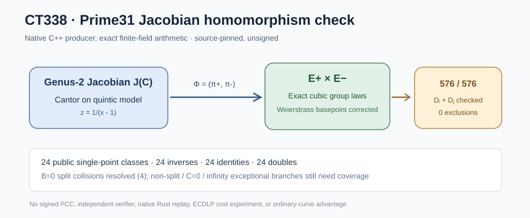

# CT338/A2 — native Cantor group-law compatibility for the Prime31 bielliptic quotient

**2026-11-23 UTC. Scoped native C++ correctness qualification, not a Rust build or a cost result; [pcc:unverified].** Same coordinator performed source development, execution, readback and review. There was no separate independent validator or signed PCC.



## New result, explicitly bounded

For the existing CT336/337 *deliberately bielliptic* genus-two positive-control curve over `p=2147483647`,

`C: y²=∏(x-j), j=1..6`,

the birational change `z=1/(x-1), eta=y*z³` gives an odd-degree genus-two model

`eta²=F(z)=∏(1-j*z), j=1..5`.

The point `W1=(1,0)` becomes the unique odd-degree infinity. The existing explicit rational quotients `π±:C→E±` send `W1` to rational **2-torsion** `T±`. The finite-field Jacobian class images therefore require a different basepoint adjustment by Mumford degree:

- `D=[P-W1]` (reduced U of degree 1): `Φ(D)=(π+(P)-T+, π-(P)-T-)`.
- `D=[P+Q-2W1]` (reduced U of degree 2): `Φ(D)=(π+(P)+π+(Q), π-(P)+π-(Q))`, since `2T±=O`.
- The identity is sent to `(O,O)`.

A native C++ extended-Euclid/Cantor composition-and-reduction backend, adapted from `research/jacobian_smoothness_audit_20261109/native-census-v1/cpp_counts.cpp` (existing repository source), evaluated `24×24=576` ordered sums of 24 public degree-one reduced Jacobian classes. A separately coded native elliptic-group evaluator computed both quotient images of each input and the Cantor output; **every output matched**. This checks the additive homomorphism formula for this finite panel, not every Jacobian element.

| Finite-field check | Result |
|---|---:|
| Rational starting reduced divisor classes | 24 |
| Cantor inverses `D+(-D)=O` | 24/24 |
| Left/right identity controls | 24/24 |
| Ordered `Φ(D_i+D_j)=Φ(D_i)+Φ(D_j)` | **576/576** |
| Doubles `Φ(2D_i)=2Φ(D_i)` included above | 24/24 |
| Source Cantor output degrees 0 / 1 / 2 | 5 / 0 / 571 |
| Resolved split `B=0` collisions | 4 ordered pairs |
| Unsupported cases in this registered panel | 0 |
| Effective malformed-input rejections | 3/3 |

All 571 degree-two outputs were checked with `U | (V²-F)` and a rational elliptic-point sum from the CT337 quadratic coordinate/ordinate formulas without factoring nonsplit support. For repeated quotient roots, the doubled-point tangent group law replaces an invalid distinct-root chord. For the four `B=0` collisions, the original support quadratic has two distinct rational roots; those roots and their original curve equations were checked before summing their two explicit point images. **This does not claim a general nonsplit `B=0` solver.**

## Retained failure and amendment sequence

1. `CT338_PROTOCOL.md` preregistered the experiment at commit `312097edff7e27b098f3721fc20c77d78db70b71`.
2. An initial native source, SHA256 `dfe14eafe37d004ec90569302ca4d57edc7b822579b07f350effb4fd954956a3`, compiled at `-O2/-O0` but its first `-O2` run **failed** the double-coverage threshold, with no success result. This failure and the planned diagnostic were logged **before** the repair in `CT338_AMENDMENT_A1.md`.
3. A diagnostic-only rerun explained the failure: 553 supported/23 excluded; 19 exclusions represented nonreduced/doubled target-coordinate support, not failed group equalities. A1 was preregistered to use actual elliptic tangent doubling. Repaired source SHA256 `aaa9ff20584625b77c4b319d5e08d9fa7352b95f4ae03a9624b7abf27f3da2fe` passed 572/576 ordered pairs and 24/24 doubles, with four `B=0` omissions.
4. `CT338_AMENDMENT_A2.md` was committed **before** adding the exact split-collision fallback. Final immutable source SHA256 `8490b62b10e6a5077f76d6dab2e315975fb5e5712bedbc82af3314f79cd746f4` passed all 576. Debug and optimized native stdout were **byte-identical**.

The final exact C++ source is checked into this PR as the UTF-8 gzip-base64 custody file `ct338_cantor_homomorphism.cpp.gz.b64` (Git blob `3ea149566b58465a349d766fb6c5027d98ca63b5`, text length 6,289 including newline). This text encoding is only for connector-safe exact byte transfer; the **decoded plaintext is the native C++ translation unit** and its SHA256 is checked below. No generated executable was published.

### Reproduction from the checked-in source

From the study directory:

```sh
base64 -d ct338_cantor_homomorphism.cpp.gz.b64 | gzip -d > ct338_cantor_homomorphism.cpp
printf '%s  %s\n' 8490b62b10e6a5077f76d6dab2e315975fb5e5712bedbc82af3314f79cd746f4 ct338_cantor_homomorphism.cpp | sha256sum -c -
g++ -std=c++17 -O2 -Wall -Wextra -Werror -o ct338_opt ct338_cantor_homomorphism.cpp
g++ -std=c++17 -O0 -Wall -Wextra -Werror -o ct338_dbg ct338_cantor_homomorphism.cpp
./ct338_opt > ct338_O2.json
./ct338_dbg > ct338_O0.json
cmp ct338_O2.json ct338_O0.json
sha256sum ct338_O2.json
```

**Executed environment:** local `g++ (Debian 14.2.0-19) 14.2.0`; all commands exited zero on final A2 execution. `ct338_O2.json` SHA256 `7633cada828ed346c6ec2d77e1b84775a68f24f2f852e6672d52bec822443697`. Frozen raw stdout is `CT338_RESULT_A2.json` in this PR. No shared-host timed experiment, paid EKS, or budget spend was run. Root Cargo/Rust validation was unavailable and must **not** be inferred from the native C++ unit.

## Exact boundary and next gate

This panel provides actual finite **Jacobian Cantor group arithmetic**, beyond CT337's effective divisor/support identities. It does not qualify any ECDLP advantage, ordinary-input transfer, kernel-degree theorem, generic source/target cost, or independent validation.

Uncovered cases: `z=0` original infinities as reduced support (`0/576` reached); `C0=0` on the Eminus cubic identity chart; nonsplit `B=0` supports; degree-one output classes (none in these 576 sums); extension-field/ramified divisor edge cases and the genuine dual composition on arbitrary Jacobian classes. A separate Rust implementation using the existing library arithmetic, an independent replay with source hashes, and public toy DLPs remain the scientific next gate.

**Ownership:** #5007 still owns F3/E7 native transfers; original 695/701 norm-point fixture, `C169/C13a/C13b/N2_actual/D` pricing and strongest same-host complete cold rho/BSGS/IC including setup/LA/memory remain reserved elsewhere. #3877 and #4215 are merged and not maintained. #4997 remains draft/stacked, with CI/review/PCC gates held. Native child-agent slots unavailable: coordinator handled math, C++ and checks; there was no native parallel-worker speed gain.

Sources: CT336_RESULT.md, CT337_RESULT.md, CT337_PROTOCOL.md; prior existing C++ Cantor implementation `research/jacobian_smoothness_audit_20261109/native-census-v1/cpp_counts.cpp`; [Magma Richelot handbook](https://magma.maths.usyd.edu.au/magma/handbook/text/1615), and Shaska's genus-two elliptic-subcover survey (https://arxiv.org/abs/1209.3187). Research-KB/Conductor were not exposed in this coordinator runtime; no novelty claim.
