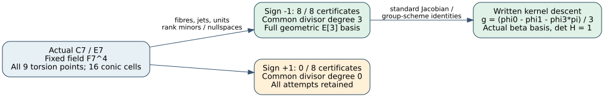

# Actual C7 three-torsion divisors and integral H basis

The complete fixed16-cell conic test supports sign−:8/8 actual nonzero
E7[3] points give principal-divisor certificates. Sign+has8 common-degree0
cells, all retained. Source5759530, result1b04550, data d9f917 and written
proof05a984. Seven strict phases0/guards[], no repair. [pcc:unverified]

[Complete PDF](REPORT.pdf) gives all8 point rows, exact fibre/jet/unit and
Macaulay rank reasoning, actualg/beta/H/Tminus proof, controls, fullraw
and original ELF custody, source links and remaining independent/native
map/formal obligations. No signed independent or generic Lean verdict.
[pcc:unverified]

Sources checked: actual frozen source/result, previous actual curve maps
and cover Gram; Milne AV v2(2008), I.7 torsion/isogenies, I.8 Remark8.12
separable quotient universal property and division, IV.2 Lemma2.1 field
of definition; Stacks062D Lemma15.31.2 regular⇒Koszul resolution. These
corroborate the explicit written dependencies, not the finite certificate
output. KB/Conductor unavailable; no novelty clearance. [pcc:unverified]
