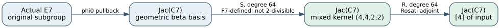

# Actual mixed Jacobian chain and a primitive degree-four cover

The native fixed-map certificate covers all16 actual E7[4] points,
256 Weil4 pairings,15 complete fibre schemes,4096 J[4] decisions,
64 kernel points with4096 pairings,1331 rational Jacobian points
and11 original elliptic scalars. All seven strict B phases exit0,
guards unchanged. Source257bf0f/result62db83d, data8b15b2.
The mixed kernel has type(4,4,2,2), and the adjoint composes in both
orders to[4]. These are genuine maps through the prior geometric beta.
[pcc:unverified]

[Two-page PDF](REPORT.pdf) records native scope, geometric dependencies,
the written integral global left inverse, and the resulting degree-four
curve cover primitive over F7. The written extension was derived after
the native run; explicit degree-four rational functions and a native
genus-three divisor engine remain open. A finite-point formula agreeing
on the rational cohort instead defines a global degree576 map, so point
interpolation cannot certify degree4. Interpretive3c0acb/d431a8/38ae70.
[pcc:unverified]

Both final pages were individually inspected at1550px. The first render's
36.94984pt link overflow, original PDF/source and complete logs remain
under render-v1. The layout-only v2 has no overfull/underfull boxes.
All scientific originals remain unchanged; no native rerun. Full
59325-byte binary and28981-byte stdout were published and read back;
original executed ELF still needs approved durable custody. CI, signed
review, generic Lean and quantitative cost admission remain separate.
[pcc:unverified]
