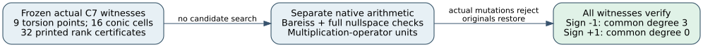

# Separate native actual C7 divisor certificate audit

All9 supplied actualE7[3] points16 conic cells32 printed ranks and64
opposite multiplication norms verify through separately written native
arithmetic. Sign−common3 and sign+common0 retained for all8 points each.
Real conic/minor/nullspace/H/T mutations reject and pristine restores.
Source76c0def/result6ac7338, data29284d/interpretationb37559; all7 strict
phases0/guards[]. [pcc:unverified]

[One-page PDF](REPORT.pdf) contains scope, counts, exact proof identities,
controls, provenance/custody and prospective nextactualJ4 task. Every
final page individually inspected1550; v1/v2 render both clean, v2 only
footer whitespace. Same-session separate implementation, not a separately
signed expert or genericLean verdict. [pcc:unverified]
