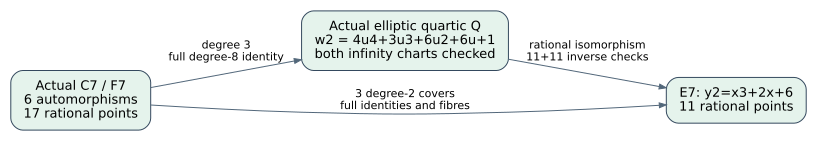

# Actual CM19 quartic maps: automorphisms and elliptic quotients

The complete fixed-frame classification gives6 F7 automorphisms of the
actual smooth C7 curve. Three degree2 maps and one degree3 map to E7
are explicitly evaluated, including all rational fibres, actual infinity
points and full polynomial function-field identities. These are curve
correspondences; actual genus3 divisor/S maps and ECDLP costs remain open.
Unsigned native development qualification. [pcc:unverified]

Source3916f563ce5717f50ee1716ac10a9c979e5f656c; complete result
62daac1e0c57cf04009fb57952dd6975339facd5 and CURRENT_RESULT_B.md.
Full38330B stdout343d44f261c12fdacd2469ad8e53f5adcd4641bcd0593679b1af96a3a158e443,
unsigned data941363. All44 complete result-commit files read back exactly.
[pcc:unverified]

All57120 ordered frame images are retained in a complete2-bit codec:
20304 non-general,36810 point-set rejects,0 coefficient rejects and6
accepted, with every accepted matrix/full15 coefficients/17-point permutation
and group table printed. Canonical-plane completeness is explicit, and
no extension-only automorphism census is claimed. The group orders are
1,2,3,2,2,3. [pcc:unverified]

Three deck-conjugate degree2 covers use actual projective changes and
the original xE=X/Y,yE=(Z2+6X2+3XY+Y2)/Y2, with Y=0 sent to O.
Each has8 double fibres,1 singleton and2 empty rational target fibres;
all17 images/involution laws and actual poles pass. [pcc:unverified]

For the first order3 map, original[X:Y:Z]=[x+y+z:5x:y-z] gives
Cnormal=x4+3x2yz+2xy3+2xz3+2y2z2=0. The actual quotient is
u=yz/x2,v=y3/x3,w=4v+1+3u+2u2, on
Q:w2=4u4+3u3+6u2+6u+1. Both fixed points at x=0 are handled
as actual quartic infinities, with signs-2/+2. The full degree8 pullback
identity and actual altered constant/restoration pass. [pcc:unverified]

The generic exact elliptic conversion yields(a1,a2,a3,a4)=(5,4,6,2),
short model(4,6), scaling3 to E7. Its equivalent specialized finite formula
is delta=w+2u2+6u+3, xE=delta+1, yE=(5u+4)delta+4.
The native full identity is checked modulo w2-f, not inferred from points.
All11+11 forward/inverse checks include both infinities and finite x=0
exceptions. The degree3 cover has5 triple,2 ramified singleton and4
empty rational fibres. E7 has121 addition/1331 associative/11 order
controls; no invented quartic group structure. [pcc:unverified]

All7 strict B phases0/guards[], unchanged2GiB/120s/one worker. All22
frozen inputs read back before execution; first35999B formatting negative
and38 small B records retained. Complete38KB stdout fits the existing
artifact threshold; original4799552B ELF temporary approved custody pending.
No old curve/integral census replay. [pcc:unverified]

Standard genuine Jacobian push-pull composition=[degree] gives11-torsion
injectivity of each pullback. Next:actual push/pull divisor correspondences
and the odd-degree elliptic-cover basis, then nontrivial CM19 S/J4/target
maps. Generic Mathlib, independent replay and complete strongest-reference
cold costs remain open; larger ambient Jacobian size gives no ECDLP gain
by itself. Parent5019's separate artifact migration remains open.
KB/Conductor unavailable, no novelty clearance; owners/paid/vault/CI/merge
requirements persist. [pcc:unverified]
