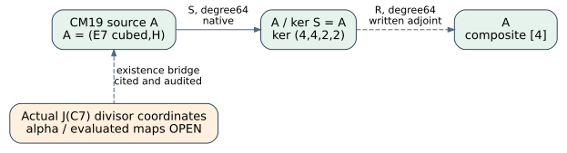

# Nontrivial mixed four-kernels in the actual-source CM19 model

The complete fixed-H search finds156 integral4-similitudes:144 have Smith
factors1,1,2,2,4,4 and12 are exactly2 times unitary automorphisms. The
mixed maps are non-scalar and have separable degree64. This is unsigned
native arithmetic plus a literature-backed abstract genuine-source bridge;
actual coordinate alpha/divisor evaluation and computational advantage
remain open. [pcc:unverified]

Exact native source323ece1140a7346630a2f172acc9303e723f3bd0. Full result
b2ce1276f1b5e967b0bccdb12f1a67e5ee940691; CURRENT_RESULT_D.md is
the current reader summary. Full82374B stdout SHA256
484eca83180791abc44cafa7d5712c0babddd88b36223055bdfb41adea211ba8.
Unsigned data e78d08, corrected display fc4ef7. All48 complete result-commit
files read back exactly. [pcc:unverified]



The first frozen mixed matrix over omega2=omega-5 is

```text
S=[[-4,-2,2],
   [2+2omega,-1+2omega,-1-2omega],
   [-4+2omega,-3+omega,3-omega]].
```

Native S^dagger H S=4H, determinant8, norm64, independent F4 rank1
and Smith factors1,1,2,2,4,4. The written integral adjoint R=H^-1S^daggerH
satisfiesRS=4I and R^daggerHR=4H. R coefficients/maps have not been
separately executed. Both isogenies preserve11-torsion injectively as a
mathematical consequence of degree64. No rational(2,2,2) first step exists
because source J[2] has only even-degree Frobenius composition factors.
[pcc:unverified]

Completeness: exact coordinate norm bounds24,60,60 from inverse diagonal
2,5,5; all252875 coordinate-grid vectors independently cross-check O norm
against the trace Gram form. Zero norm1 vectors,12 full unitary maps.
Every4-map has all923 integer minors classified, determinant norm64 and
nonzero evaluations at omega3/9 modulo11. The actual2I positive,
(3,2,2) diagonal negative and nonHermitian H mutation controls pass.
All7 strict phases0 and guards[], unchanged2GiB/120s/one worker.
[pcc:unverified]

The source C7 is the genuine smooth quartic with counts17/65/236. The
primary CM19 bridge requires ordinary E7, End(E)=Z[pi]=O_-19 and
principal class group; numerical hypotheses and Minkowski/inert2 argument
are audited. General equivalence and uniqueness classification remain
explicit literature dependencies, not re-proved generic Mathlib results.
No actual coordinate isomorphism alpha has been constructed.
[pcc:unverified]

Computational gate: original subgroup ell is at mostaboutp, even though
the ambient Jacobian isaboutp^3. Diem's published soft-O(p) quartic bound
alone does not establish an exponent gain over rho's O(sqrt(ell)) reference.
This upper-bound comparison is not a lower bound or a measured rejection
of every specialization. Same-field4-maps supply no smaller prime-field
descent. Full strongest-reference setup/map/solve/replay/memory costs and
a separate promising mechanism are required before a gain benchmark.
[pcc:unverified]

First A formatting/B Clippy negatives and frozen C prose diagnostic remain
complete; display D adds only its local unsigned marker. All38 small C raw
records public, original4671000B ELF temporary custody-pending. No native
search replay or timing claim. Primary Ritzenthaler2010 and Diem2012
checked; KB/Conductor unavailable, no novelty clearance. Existing paid,
vault, formal, CI, merge and approved-custody gates persist.
[pcc:unverified]
