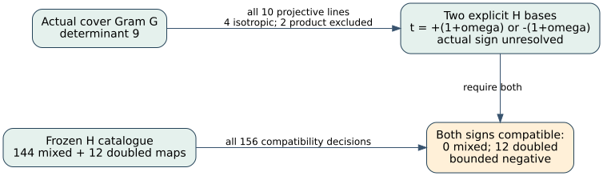

# Integral C7 gluing: complete fixed-family negative

None of the144 mixed4422 maps in the frozen CM19 catalogue is integral
under both remaining cover-gluing signs. All12 compatible maps are twice
automorphisms. This is a bounded negative for this complete156-map family,
not impossibility for mixed endomorphisms after determining the sign,
different targets, multipliers or bases. Unsigned native data186804 and
separate interpretation61246e. [pcc:unverified]

Frozen [source/protocol/derivation](https://github.com/isogeny-labs/crypto/tree/fac647db5d0468c45cd3b635e4723537269c1f51/research/chained_cm19_jacobian_gram_20261123/integral_gluing),
complete [native result](https://github.com/isogeny-labs/crypto/tree/f5b13419565d85aae0f5206f8723e0ad9985a3ae/research/chained_cm19_jacobian_gram_20261123/integral_gluing).
All46 complete result-commit files read back exactly. Full12853B output
SHA256699a12263a8f9310348e20596720852e13647aaab71b94c76f8cbf57de244c02,
including all156 decisions and all12 accepted numerator/twin matrices.
The selected1331-point action branch did not execute. [pcc:unverified]

All10 projective lines over O/3=F9 yield4 isotropic lines. The norm1 pair
t=±1 gives product polarizations excluded by standard Jacobian
indecomposability. The other pair t=±(1+ω) gives two explicit bases
Tplus=[[1,1,0],[-(1+ω),0,1],[2-ω,0,1]], Tminus=Tplus diag(1,1,-1),
with determinants±3 and full T†HT=G identities. The global interpretation
depends explicitly on the ordinary-module/polarization dictionary, not
newly proved or compiled generically here. Actual gluing sign remains open.
[pcc:unverified]

The changed-form control still has4 isotropic lines but all4 fail actual
G-integrality. A changed bridge coefficient fails the full Gram identity;
actual2I is positive while a changed coefficient fails H similitude.
All7 strict phases0, guards[],31 complete source-input readbacks; one
worker,120s/2GiB, Rust1.99.1, warnings/overflow/debug checks. No old vector
grid, short-vector or similitude enumeration was replayed. [pcc:unverified]

All38 small originals and the19931B first-format negative/23 originals
remain public. Whole4770224B ELF5de559cfa738933fb30a4809543e9a435993b28f70f6c9be490a80c5475445f8
remains temporary custody pending approved storage. Parent82374B raw's
trusted migration HeadObject403 remains unresolved. Current result C
updates delivery status only:5042 externally merged while this negative
was packaging; its entire research subtree equals originalfac647db.
Continuation5056 holds the exact negative/result/report. No native C,
green-at-merge, ledger-row rewrite, gate waiver or manual merge is claimed.
[pcc:unverified]

Next prospective test: actual E7[3] over F7^4, full finite fibre algebras,
conic jets/nonvanishing/multiplicities and exact Macaulay common-divisor
degrees. A rational-function divisor certificate may determine whether
f0*−f1*±f3*π kills the geometric3-torsion and enable divided integral
maps. Preserve every cohort cell/degeneracy; no new torsion/divisor call
has run. No ECDLP computational gain or proper-subfield descent follows
from the present negative. Actual S/J4/target evaluation, generic Lean,
independent validation, approved custody and promising full cold costs
remain open. KB/Conductor absent; no novelty clearance. [pcc:unverified]
