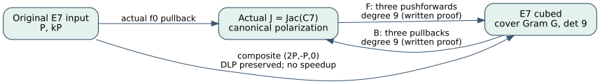

# Actual C7 Jacobian elliptic-cover basis

The actual degree2/2/3 covers give a written degree9 isogeny B:E7³→J
and its dual F:J→E7³. Native complete geometric-fibre push-pull agrees
on all11 rational elliptic points. The global proof and finite cohort
verification are separate, and all standing is unsigned. [pcc:unverified]

Frozen [source/protocol/written global proof](https://github.com/isogeny-labs/crypto/tree/746db9161fe54d85a621a7303abe013fd2a33535/research/chained_cm19_jacobian_gram_20261123),
complete [native result](https://github.com/isogeny-labs/crypto/tree/c875d22a619c363b3974a5d338943bf26de421f9/research/chained_cm19_jacobian_gram_20261123),
unsigned data1ce706. Full12923B stdout SHA256
0c42162affd4c8b4d182efb9ea12210ec3cd986780f97c343154d72ccc84d69d;
all53 complete result-commit files read back exactly. [pcc:unverified]

For f0=deck quotient, f1=f0∘R and f3=actual order3 quotient, use
B=(f0*,f1*,f3*) and F=B† with canonical polarizations. The written
global Gram is G=[[2,-1,0],[-1,2,0],[0,0,3]], det9. Jacobian push-pull
and group trace, the actual deck action on the order3 quotient, Rosati
positivity and End(E7)=O(-19) give off-diagonal -1 and zero cross terms.
Norm(detG)=81 and dual degrees then give degB=degF=9. Both are separable,
injective on2/11-primary torsion, and rational F7 group orders11³ imply
F is bijective on rational points. This avoids the previous abstract H
classification but still depends on standard written theorems; no generic
Mathlib compilation is claimed. [pcc:unverified]

The native test constructs33 full geometric fibres using F49 square roots
and F343 cube roots, with77 weighted points,25 rational and8 extension
fibres. Every point satisfies original C7, restores the actual target,
has correct ramification multiplicity/Frobenius stability and actual P/R
chart inverses. All9 Pic0 push-pull maps have99 corrected images and1089
addition laws agreeing with G; no scalar label enters the constructors.
[pcc:unverified]

The f0 infinity fibre has f3 push-sum(1,3), so omitting the basepoint
correction fails11 actual cross-map cases; zero diagonal offset gives11
positive controls. Actual missing ramification multiplicity and swapped
infinity controls reject, then pristine cases restore. All7 strict phases0,
guards[],34 complete frozen input readbacks; one worker,120s/2GiB, Rust1.99.1,
warnings/overflow/debug checks. A source-lock metadata defect and first
17469B formatting negative remain immutable. No old census is replayed.
[pcc:unverified]

All38 small original records are public. Original whole4599336B ELF
dec647981c565a52832300b99403181e449cf806d297f663a2ef1152c5ee1240
is temporary custody pending approved durable storage. Parent Hermitian
82374B raw custody remains open despite external merge. First TeX attempt
failed for missing math font package; complete logs retained. Final pages
have no overfull/underfull boxes and both were individually viewed.
[pcc:unverified]

The original subgroup transfers to (2P,-P,0) and preserves DLP without a
new solve advantage. Integral3-primary gluing of G to CM19 H, actual
nontrivial S/J4/target/divisor maps, independent replay and formal library
proof remain open. Same-prime-field covers give no subfield descent.
A larger ambient J is not a computational advantage; full cold costs
need a promising mechanism against the strongest elliptic references.
KB/Conductor absent, no novelty clearance; paid STOP/vault/owners and
CI/merge requirements persist. See ../../QUEUE.md. [pcc:unverified]
