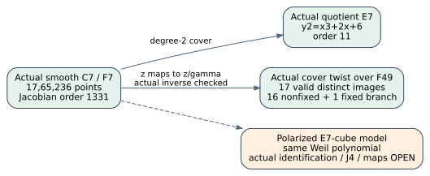

# Primary CM19 F7 source: a genuine E-cube isogeny class

The fixed single plane quartic is smooth and has counts17,65,236 over
F7,F49,F343. Its Weil polynomial is(T^2+3T+7)^3, with #J=1331.
This is an unsigned native correctness qualification of an actual curve,
not an implemented polarized-module identification or ECDLP improvement.
The original fixed250 F5 negative remains unchanged. [pcc:unverified]

Exact source0b9b506bc035d8ada6a111702b2ae3145e65deb6; complete result
89d7b471a53c564f9e0368a83315d5acbdd23218, CURRENT_RESULT_B.md and
first-B-native/quartics.stdout. Whole stdout3373B SHA256
6bcb41419d3d400fadb41b5f77355d04b3f979b30bd337f21e78a633c0b9db08.
Unsigned data PCC-20261123-180c4c. All43 complete result-commit files read
back exactly. [pcc:unverified]

The curve is(Z^2+6X^2+3XY+Y^2)^2=Y(X^3+2XY^2+6Y^3).
All15 full homogeneous coefficients agree with the primary rational CM19
quartic after X=V+3W,Y=W,Z=2U and scaling by2. An altered W4 coefficient
fails, with pristine restoration passing. Its branch polynomial is
x^4+4x+2, with exact gcd1 and Sylvester nullity0; x2 singular control fails.
The elliptic quotient is v^2=x^3+2x+6, trace-3/order11. [pcc:unverified]

Direct expanded and elliptic-fibre projective counters agree for both kappa1
and nonsquare3. The cover twist has counts5,65,380, Jac275, and Weil
coefficients[343,-147,84,-15,12,-3,1]. Both have exact elliptic factor,
reject altered N3+3 counts and pass pristine restoration. All3 new native
fields pass complete pair/triple/inverse/Frobenius tests; no old F5 replay.
[pcc:unverified]

In F49=F7[b]/(b2-3), gamma encoded7 has gamma2=3 and gamma7=-gamma.
The actual map z'=z/gamma gives17 distinct valid twist images/inverses,
with Frobenius equal to the deck involution. Exactly16 fail F7 descent;
the actual branch point[1:1:0] stays fixed. Full point lists are retained.
This is a curve-map control, not actual J4 arithmetic. [pcc:unverified]

All7 strict phases0 and guards[], unchanged one-worker2GiB/120s bounds.
All18 frozen inputs were fully read back before the call. A first5977B
format negative is retained in full; no compiler/native call preceded B.
All38 small B records public; original4656584B ELF temporary custody-pending.
No benchmark, cryptographic solve, independent replay or generic Mathlib
bridge is claimed. [pcc:unverified]

Primary Ritzenthaler2010 Example1/Table2/Section4.4 supplies the CM19 model
and Hermitian-polarization context. Transporting its actual polarized
identification, constructing a nontrivial mixed kernel/quotient/target,
preserving the elliptic subgroup and charging strongest-reference cold
costs remain open. KB/Conductor unavailable; no novelty clearance. Existing
paid/vault/CI/merge/experiment requirements persist. [pcc:unverified]
