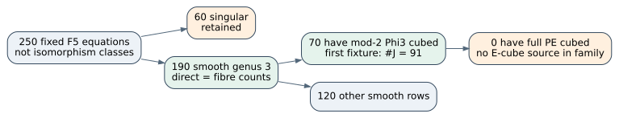

# Fixed F5 genus-three source census

The prescribed250 equations contain190 smooth plane quartics,70 mod2
Phi3-cube sources and zero full PE-cube sources. The full fixed-family
negative is retained. These are equations, not250 distinct isomorphism
classes or a complete moduli classification. Unsigned native correctness
qualification; independent replay and generic Mathlib proof pending.
[pcc:unverified]

Source: b23c6582437e3e91d64690aedaf5481ad0ede025. Full result/raw:
893f88068b6145dec9906a85d6582e5567a3e9b8, CURRENT_RESULT_C.md,
ACTUAL_FIRST_C_RESULT.json and first-C-native/quartics.stdout.
Native stdout21165B SHA256
01ac98bd9ccf40b442f76a8230b00c90f828bf94c7dd0e385d32aa3e6fa121a6.
Unsigned data PCC-20261123-d89c72. Every43 result-commit file was fully read
back with exact contents and Git blob. [pcc:unverified]

All125 quadratic forms and both kappa square classes are retained. Exact
gcd and independent Sylvester rank agree for smoothness;60 singular rows
are recorded. All190 smooth rows have independent direct and elliptic-fibre
projective counts over F5,F25,F125, an exact integer T^2+T+5 factor,
rejected N3+3 count mutation, restored factor and paired twist controls.
All3 fields pass complete native pair/triple, inverse and Frobenius checks.
All7 strict phases0 and guards[]. [pcc:unverified]

First-lex mod2 source is Z^4=Y(X^3+2XY^2+Y^3), counts(5,29,68),
P ascending[125,-25,10,-21,2,-1,1], #J=91. The quotient elliptic curve
is E5:y^2=x^3+2x+1. Every stable J[2] subspace has even dimension,
excluding a first rational(2,2,2) factor of [2]. This is a written module
argument, not an actual nontrivial mixed-kernel map or computational gain.
[pcc:unverified]

A first format failure (5282B stdout) and a formatter-stdout heading parser
failure (359B stderr) remain immutable in full; neither reached compilation.
The successful C body removes only that heading from the formatted A body.
One-worker2GiB/120s-per-phase limits unchanged, no Python science or paid
backend. Original4585568B ELF temporary custody-pending; all38 small C
records are public. No timed benchmark or cryptographic solve. [pcc:unverified]

Primary CM19 review (Ritzenthaler2010, Example1; Alekseenko et al.0902.1901v2)
distinguishes elliptic discriminant from field discriminant and retains Serre
descent. The separately derived single F7 fixture is prospective; freeze and
qualify it independently after this result. Actual polarized J[4], nontrivial
mixed kernels, target-Jacobian descent, elliptic DLP preservation and full
strongest-reference cold costs remain open. Existing paid/vault/formal/CI
requirements persist. KB/Conductor unavailable; no novelty clearance.
[pcc:unverified]
