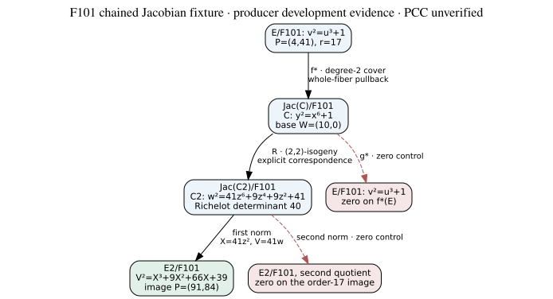

# Native chained Jacobian transfer over F₁₀₁

The development implementation evaluates explicit Richelot transfers between
genus-2 Jacobians. The initial order-17 fixture has an isomorphic Jacobian
destination; a preselected successor has nonisomorphic Jacobians over F101,
as witnessed by different rational 2-torsion cardinalities. Both complete
elliptic endpoint functions match direct elliptic shortcuts. This is producer-run
development evidence, with PCC standing **unverified**, not a signed independent
validation or a measured solving-cost result. Records include
PCC-20261111-854c56 (full rational domain), PCC-20261111-041999 (dual),
and PCC-20261111-f23cee (route deduplication). [pcc:unverified]

## Explicit objects and maps

All objects here are over F₁₀₁. Let E: v²=u³+1, C: y²=x⁶+1,
P=(4,41), r=17. Set W=(10,0). The one-infinity model is
t=1/(x−10), Y=y t³, Y²=F(t), with
F(t)=1+60t+86t²+2t³+15t⁴+60t⁵. This is a chart on the smooth
curve; the two original infinity points have t=0, Y=±1. The implementation
never runs ordinary one-infinity Cantor reduction directly on a sextic.
[pcc:unverified]

The quotient f(x,y)=(x²,y) has degree 2. For finite Q=(u,v), its
degree-zero whole-fiber pullback has Mumford representative

    A(t) = 1 + 20t + (100−u)t²,  B(t) = v t³ mod A(t).

Normalize A to monic. The degree drops at Q=(−1,0), because W is in
the fiber. Ramification at u=0 uses multiplicity two. No square-root choice
of u is needed, so nonsplit fibers are retained. The fiber above O is the
two original infinities, linearly equivalent to 2W by div(t); hence
f*(Q−O)=[fiber(Q)−2W], and f*(O)=0. [pcc:unverified]

For **any reduced rational class** [D−dW] in this model, `push` splits the
degree-at-most-two support in F₁₀₁[s]/(s²−2), preserves repeated roots,
sums the quotient images and subtracts d f(W). Both quotients send W to
(−1,0). At t=0 the first quotient sends the point to O; the second quotient
g(x,y)=(x⁻²,y/x³) sends it to (0,Y). The result must descend back to F₁₀₁.
Infinity is `Ok(None)`; a malformed/unsupported input is `Err`.
[pcc:unverified]

## Richelot hop and endpoint

Use the **ordered** factors

    G1=x²+1,  G2=x²+10x−1,  G3=x²−10x−1.

Their product is x⁶+1 over F₁₀₁; the determinant of rows
(constant,linear,quadratic) is δ=40. Define cyclically
Hi=(G'j Gk−Gj G'k)/δ. Kunzweiler, Proposition 7–8, gives the
degree-four (2,2)-isogeny R:J(C)→J(C₂), with kernel the four
classes generated by the quadratic Weierstrass pairs, and correspondence

    G1(x)H1(z)+G2(x)H2(z)=0,
    y w=G1(x)H1(z)(x−z).

The fixed determinant ordering is essential: changing its sign may change
the quadratic twist. Here C₂: w²=41z⁶+9z⁴+9z²+41. Both curves
are smooth; the native test checks the target quintic and its derivative
are coprime. The isogeny's degree and kernel follow from the cited theorem;
they are not yet formalized as Jacobian geometry in Lean. [pcc:unverified]

The evaluator constructs each correspondence fiber as a polynomial pair over
F₁₀₁², converts to T=1/(z−10), Z=wT³, and performs Cantor composition.
It subtracts d times the image of the source base point, represented by
(H2,0) before the target chart change. The first retained version rejected
exceptional support. The extension now admits **all 10,404 rational source
classes**, including y=0, source t=0 and fiber degree drops. At
G1-Weierstrass points the image is (H2,0), at G2 points it is (H1,0), and
at G3 points the completed fiber is a hyperelliptic conjugate pair and has
zero class. Source original infinity uses the leading-coefficient limits of
the correspondence. A linear affine fiber includes one original target
infinity; it must not be discarded. This completeness is confined to the
fixed F₁₀₁ rational-class domain. [pcc:unverified]

The first elliptic quotient of C₂ followed by X=41z², V=41w yields
E₂: V²=X³+9X²+66X+39. The full chain is

    E --f*--> J(C) --R--> J(C₂) --n₂--> E₂.

For P it returns (91,84), a nonidentity point of order 17. The source has
j=0; the target has c4=16·9²−48·66=47 modulo 101, so j≠0 provided
the target is nonsingular. The subgroup tests check both the equation and
scalar relations; explicit discriminant arithmetic is included in the
native tests. [pcc:unverified]

## Dual recovery and route deduplication

Reversing the normalized quadratic splitting recovers the original factors.
The second correspondence changes (x−z) to (z−x); negating its class gives
the positive dual convention. The local checks find dual(R(D))=[2]D for
every one of the 10,404 source classes. Thus f_* dual R f*=[4] on the
elliptic source; multiplication by 13, the inverse of 4 modulo 17, recovers
the original encoded point throughout the selected subgroup. This is point
recovery, not a DLP solution. [pcc:unverified]

Let φ be the original degree-two elliptic isogeny in
`NONISOMORPHIC_TRANSFER.md`, and τ(U,V)=(82U+60,98V). Native checks on
**all 102 source elliptic points** find n₂ R f*=τ φ [2]. The coordinate
isomorphism τ and its inverse are proved as polynomial identities in
`lean/PolynomialIdentities.lean`; equality of the whole geometric chain
over arbitrary extensions has not been formalized. [pcc:unverified]

This is a retained route-deduplication result: the genuine Jacobian hop
does not make the endpoint function a new reduction on E(F₁₀₁). Any cost
experiment must include τ φ [2] as a separate arm. No cost ratio or speed
advantage is inferred from this functional equality. [pcc:unverified]

## Model equivalence and a nonisomorphic successor

The initial C₂ is isomorphic to C over F101. With r=10, r²=−1,
the coordinate map and inverse are

    x=(z−1)/(z+1), y=8r w/(z+1)³;
    z=(1+x)/(1−x), w=−r y/(1−x)³.

Their matrices have nonzero determinant, and their denominator-cleared
identities are compiled in Lean. They extend to the smooth projective curves
by the standard hyperelliptic Möbius change. Both chosen Weierstrass bases
correspond. On the odd charts t=56+10T and Y=79Z; the native class maps
round-trip all 10,404 rational classes. The full target-side dual norm is
also tested on all 10,404 classes. Thus the degree-four R becomes a
nontrivial endomorphism after this model identification. It is not a new
Jacobian destination. PCC-20261111-a282a9 and PCC-20261111-a97961 remain
unverified; Lean proves polynomial identities, not the projective/Picard
extension. [pcc:unverified]

The new `richelot::model` backend tags classes with their actual curve and
chart, rejecting mixed-model arithmetic. It accepts ordered quadratic
splittings and rational Weierstrass bases over **fixed F101**; it does not
parameterize the field. The preselected successor uses

    G1=x²−1, G2=x²+x+4, G3=x²−x+4, δ=−10=91;
    C_s: y²=x⁶+6x⁴+9x²−16, W_s=(1,0);
    C_t: w²=20z⁶+81z⁴+83z²+21, W_t=(2,0).

Each Jacobian has 9,216 rational classes. Complete native checks give
kernel/fiber cardinality four, both dual compositions [2], and rational
2-torsion cardinalities **4 on the source and 16 on the target**. These
counts are also reproduced by the unchanged cryptanalysis BigUint arithmetic,
which independently obtains order 9,216 from Fp/Fp² point counts and checks
paired additions and both dual norms on both full class sets. The first
reference run used the development tree; an immutable pin/replay is tracked
separately in cryptanalysis PR #1469. PCC-20261111-ae88cc and cross-repository
PCC-20261111-21e28e are unsigned. [pcc:unverified]

Here is the mathematical isomorphism obstruction, separated from those
execution assertions. An F101-isomorphism of abelian varieties induces an
isomorphism of their F101 points commuting with [2], hence a bijection on
rational 2-torsion. The native counts can also be derived from uniqueness of
reduced Mumford representatives: in odd characteristic [u,v]=−[u,v] implies
v=0 and u divides the odd quintic, with monic u of degree at most two. The
source quintic factors as (2t+1)(6t²+3t+1)(4t²+t+1); both quadratic
discriminants are −15, a nonsquare modulo 101. Its four possibilities are
the constant, the linear factor, or either quadratic. The target has six
rational sextic roots ±2, ±18, ±28, hence five rational roots on its odd
chart: there are 1+5+10=16 such u. Closed quadratic support matters on the
source; counting only rational Weierstrass points would miss two classes.
Therefore the two Jacobians cannot be F101-isomorphic. This does not assert
nonisomorphism over an algebraic closure. `injective_torsion_iff` formalizes
only the abstract torsion-preservation step. [pcc:unverified]

The source first elliptic quotient has 96 points and largest odd prime factor
3, with P=(48,20). Its transferred class is nonzero of order 3; the target
first norm is (2,72), and the second is zero. The normalized first target
curve is V²=X³+81X²+44X+17. This fixture is retained with r=3; it is
not substituted for the original r=17 example. [pcc:unverified]

The successor also has a direct endpoint shortcut on **all 96 source
elliptic points**. Shift U=u−1 to obtain Y²=U³+9U²+24U and take the
standard degree-two quotient by (0,0), yielding V²=X³+83X²+86X.
Then τ(X,V)=(100X+80,91V) identifies it with the normalized target.
The full endpoint function equals τ φ [2]; all F101 affine coordinate
isomorphisms satisfying the coefficient equations were checked, and this
sign uniquely matches. PCC-20261111-6e9e6b is unverified. A nonisomorphic
Jacobian hop therefore still does not establish a new elliptic reduction
or a computational advantage. [pcc:unverified]

## Scope of the checks

| Development check | Scope | Evidence / status |
|---|---|---|
| Whole-fiber maps | all 102 E(F₁₀₁) inputs; all ordered pullback and isogeny additivity pairs | `evidence/native-test-01.txt`, unverified |
| Arbitrary rational source classes | all 10,404 canonical classes; norm additivity against three fixed translations; equal norm fibers | same receipt, unverified |
| Differential arithmetic | 10,404 source additions and inverses against pre-existing cryptanalysis BigUint code after a monic chart change | cryptanalysis `experiments/chained-transfer-reference/evidence/differential-01.txt`, PCC-20261111-37e5d9, unverified |
| Richelot chain and full domain | 17 subgroup scalars, 289 addition pairs, 10,404 rational source classes, four-element kernel, 2,601 image classes with equal fibers | `evidence/native-richelot-full-01.txt`, unverified |
| Dual norm and point recovery | dual-after-forward equals [2] on all 10,404 classes; all 17 source points recovered | `evidence/native-dual-01.txt`, unverified |
| Deduplication | elliptic shortcut equals full chain on all 102 source elliptic points | `evidence/native-dedup-01.txt`, unverified |
| Zero controls | g* f*=0; the second target quotient annihilates this Richelot subgroup image | same receipts, unverified |
| Model equivalence | all 10,404 class round trips; target dual norm on the entire target | `evidence/native-model-isomorphism-01.txt`, unsigned |
| Successor | both complete 9,216-class sets, rational 2-torsion counts4/16, r=3, both dual norms and complete 96-point shortcut | `evidence/native-successor-01.txt`, `evidence/native-successor-dedup-01.txt`, unsigned |
| Lean structure and model identities | nine structural and eight polynomial lemmas; axiom gates audit 21+8 declarations including generated auxiliaries, no trusted native declarations | `lean/ChainTransfer.lean`, `lean/PolynomialIdentities.lean`; local gates, unsigned |

The differential implementation is pre-existing, but both it and the new
code were run by this producer and both use Cantor's algorithm. This is
useful differential evidence, not independent signed verification. No tests
in this table establish a timing advantage. [pcc:unverified]

## Proof map and descent boundary

`two_hop_norm` composes individual dual identities;
`injective_with_recovery` and `two_hop_injective` use an explicit Bézout
certificate and the **actual subgroup's** annihilator. Scalar relations
then follow from homomorphism laws. `anti_invariant_twice_zero` yields
two-torsion, and `anti_invariant_odd_source_zero` uses odd source exponent
to conclude zero. These are conditional structural theorems: the geometric
objects, well-defined maps and dual norm identities are inputs. Claim
PCC-20261111-7a3fe0 remains unsigned/unverified. [pcc:unverified]

`no_unital_map_when_characteristic_not_divides` shows that a unital
additive map between semirings of characteristics p,q requires q dividing p.
For distinct primes this forbids a field map; it does **not** forbid arbitrary
encoded homomorphisms between finite cyclic subgroups. A prime field also
has no proper subfield: every unital subfield contains all multiples of 1.
Consequently ordinary Weil restriction to a proper subfield gives no
dimension-changing route for E/Fp. This does not close lifts, reduction at
another prime, or other computational mechanisms. Claim
PCC-20261111-a00fb9 remains unsigned/unverified. [pcc:unverified]

Core Lean 4.35.0, commit eb6cafb7290e8bd5f2937522d8d804f58f02bafc, is pinned
in `lean/lean-toolchain`. Structural axioms are propext or none; polynomial
proofs use propext, Classical.choice and Quot.sound. No Mathlib
or shared-library code is imported. The shared-library reference checked was
`aburan28/crypto-lean` main 818752990869b72a89d236bd28eb1e148cc7b424;
there is no claim that its geometry proves this concrete construction.
The full Picard/Jacobian bridge and Richelot degree theorem remain open
formalization obligations. [pcc:unverified]

## Reproduce, failures and next tasks

    cargo test --release --manifest-path research/chained_jacobian_transfers_20261110/native/Cargo.toml -- --nocapture
    cargo clippy --manifest-path research/chained_jacobian_transfers_20261110/native/Cargo.toml --all-targets -- -D warnings
    tools/lean/proof-gate.sh research/chained_jacobian_transfers_20261110/lean/ChainTransfer.lean
    tools/lean/proof-gate.sh research/chained_jacobian_transfers_20261110/lean/PolynomialIdentities.lean
    cargo test --release --example chained_jacobian_reference
    cargo test --release --example chained_jacobian_identities

Keep `evidence/lean-attempt-01.txt`: it failed elaboration, and its reported
sorryAx entries are diagnostics of failed proofs, not accepted axioms.
Root-library attempts 01–03 failed before compilation on unmaterialized
local dependencies. Root examples initially pass 1 identity test and 11
reference/native tests; a subsequent run including the generic model extension
passes 1 identity and 15 reference/native tests (`evidence/root-examples-models-01.txt`).
The final native suite passes14 tests and strict Clippy. These remain local
unsigned checks. Two identity certificates are retained in `identity-certificates.json`,
bound to the polynomial proof-source digest; local replay is not signed
verification. Attempt 04 of the full library is still running and has
already reported failures in untouched historical modules. Preserve its
final outcome rather than calling it passed. No historical Python evidence
was overwritten.
[pcc:unverified]

Sources and retrieval gaps: [SOURCES_20261111.md](SOURCES_20261111.md).
Persistent queue: [QUEUE.md](QUEUE.md), [GitHub issue #3904](https://github.com/isogeny-labs/crypto/issues/3904).
The pinned baseline oracle is open as
[cryptanalysis PR #1469](https://github.com/isogeny-labs/cryptanalysis/pull/1469).
Next: immutable successor pin/replay, chained nonbacktracking Jacobian maps,
field parameterization and a frozen cost comparison with direct source and
endpoint solvers and both collapsed elliptic routes.
S3 checkpoint access and live IsoLab budget/capacity visibility block
experiments, so no performance run has been launched. The autoresearcher
lead-atlas update waits for its vault key binding.

Canonical graphs checked: `docs/curves/jacobian-transfers.json`,
`docs/curves/jacobian-certificates.json`, IC progress/leaderboard graph
contracts. No canonical edge or measured row is promoted from this unsigned
fixture. The study-local diagram records both the route and its zero controls.

## Primary references

- S. Galbraith, corrected *Mathematics of Public Key Cryptography*, ch.8
  §8.3 and ch.10 §§10.3–10.4, linked in the sources receipt.
- S. Kunzweiler, *Efficient computation of (2ⁿ,2ⁿ)-isogenies*, DCC 92
  (2024), 1761–1802, [DOI](https://doi.org/10.1007/s10623-024-01366-1),
  §§3.1–3.2, Propositions 7–8 and Algorithm 1. The primary publisher PDF
  was read; eprint retrieval attempts returned 403.
