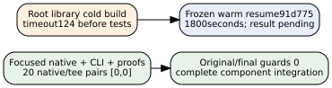

# G3 integration and root regression

The focused G3 integration passes its original command, driver, portable final guard and341 outer input guards. Twenty original native+tee exit pairs are all[0,0]: fetch, formatting, strict all-target Clippy, unfiltered native unit, three bounded CLI invocations, two original proof gates and eleven original PCC declaration bindings. This validates the new thin integration driver, separately from native unit03 c162f3 and CLI188d44. Observation2d6fec and whole custodyd0004b retain the complete original run. [pcc:unverified]

The suite runs all four tests with zero failed, ignored or filtered tests, all1828 source points and twelve geometric branch controls; the CLI covers nine points. Both original Lean4.35 modules pass: fourteen audited declarations including three generated helpers, zero trusted declarations, eleven exact named bindings locally accepted by the original PCC verifier. The written/native geometric bridges in G3_PROOF_MAP.md remain explicit. Local acceptance is unsigned. [pcc:unverified]

The required original root command cargo test --release --lib --offline --locked times out with124 after its frozen900-second bound while compiling the root crypto crate, before any root tests execute. All2133 selected input hashes remain unchanged; source, original output and terminal are preserved in whole custodyae818d,9,277,888-byte standard tar/XZ. This gate is NOT green and is not a counterexample to the component mathematics. [pcc:unverified]

Frozen resource correction91d775 starts a separate root02 attempt with the same unfiltered command, source, compiler and Cargo inputs, reusing completed dependency objects and allowing1800 seconds. No source, test, ignore, filter or verifier changes. This is a warm correctness resume; it is not a cold cost measurement. Its result is pending at this report snapshot. [pcc:unverified]

The original341-input portable manifest is immutable and records its selected scope; it does not claim the full compiler closure. The original trusted-native text manifests are separately pinned by the2133-input root guard, whose interval spans the complete focused execution. Old root four-job and consumer six-job workflows remain byte-identical. The new dedicated focused GitHub job and actual latest raw-object publication remain separate pending steps. [pcc:unverified]

Sources: evidence/genus3-integration-acceptance-01/observation.json, evidence/genus3-focused-local-01/custody.json and evidence/genus3-root-regression-01/custody.json; frozen G3_CI_PROTOCOL.md/6b95c7 and root02 plan91d775. See the three-page native report50,024 bytes for retained model/coverage/static/Lean failures, original source review and complete mathematical scope. No existing C0/T20 cost graph changes or computational advantage is asserted. [pcc:unverified]

[PDF](report.pdf); editable data, DOT/SVG and Typst are adjacent.
