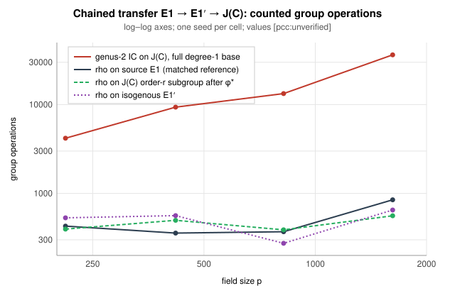

# Results: chained prime-field transfer, measured boundary

Run: `chained_transfer_bench run` (bench record
`benchmarks/records/20261111T0540Z-chained-prime-transfer.json`), deterministic.
A second run under the record reproduced every count exactly. Local
development check (exact operation counts, not timings); one seed per cell.
All values are `[pcc:unverified]`.

| p | r | rho on E1 (reference) | rho on E1′ (isogeny, deg) | rho on J(C) after φ* | IC on J(C) | IC trials | IC / rho |
|--:|--:|--:|--:|--:|--:|--:|--:|
| 211 | 109 | 428 | 530 (2) | 396 | 4,184 | 244 | 9.8× |
| 419 | 113 | 357 | 562 (2) | 497 | 9,366 | 532 | 26.2× |
| 821 | 71 | 370 | 274 (3) | 389 | 13,313 | 869 | 36.0× |
| 1619 | 401 | 847 | 649 (2) | 560 | 36,363 | 1,588 | 42.9× |

Units: counted group operations (elliptic additions and doublings for rho on
`E1`/`E1′`; Cantor additions and doublings for `J(C)`). The IC column counts
relation collection only; linear algebra over `Z/r` is extra and is not
included, so the IC figure is a lower bound on its total cost.

## What the run establishes

1. **The chain is a valid DLP transfer at every size.** Each hop passed the [pcc:unverified]
   in-code admissibility checks (`h(P) ≠ 0`, `ord h(P) = r`,
   `h([x]P) = [x]h(P)` on sampled `x`), the composed chain was verified end to
   end, and the index calculus recovered the known log in every cell.
2. **F1 (rho advantage) — not met.** Rho on the isogenous curve and on the
   order-`r` subgroup of `J(C)` lands within the run-to-run scatter of rho on
   the source (single seed per cell, so no tighter statement is made). This is
   expected: isogenous curves have the same order, and the `J(C)` subgroup is
   still cyclic of order `r`. Per group operation, a Cantor step costs more
   field work than an elliptic addition, so the field-operation comparison only
   favours the source.
3. **F2 (index calculus beats rho) — not met.** Genus-2 IC on `J(C)` costs
   9.8× to 42.9× the matched rho, and the ratio grows with `p`.
4. **F3 (IC exponent).** A least-squares fit of ln(IC group operations)
   against ln p over the four sizes gives slope **1.01** (derived; four points,
   no interval). This is the `Ω(p)` relation count of genus-2 index calculus
   (about `p/2` degree-1 places, smoothness about 1/2, so about `p` trials).
   Rho scales as `√r ≤ √p`. The gap widens as `p` grows: the boundary is
   structural, not a tuning constant.

## What it does not establish

- No timing claim; no isolation tier; no validation-gate admission.
- One bielliptic curve per size, one seed per cell; no spread for the rho
  columns.
- Nothing about other cover families, genera above 2, or cross-characteristic
  maps (none is constructed).

## Corrections from the independent replay (2026-11-12)

The independent replay (`replay/REPLAY.md`) reproduced every raw file of this
run byte for byte. It also found faults in what the run measures
[pcc:unverified]. The table above is kept as frozen evidence (`results.json`,
`frozen.sha256`). The corrected rerun is `results_v2.json`, summarised in the
next section.

- **F1, IC overcount.** `scalar_counted` counted the first addition into the
  identity as a group operation, which inflated IC by 8–13%. The replay's
  corrected IC/rho values are 8.64, 23.29, 31.34 and 39.19, with slope 1.019.
  The qualitative result does not change. The code is fixed.
- **F2, LA not emitted.** The linear-algebra cost is now written out as
  `ic_jac_la_mulmods`. The replay's figures are 14,633, 51,976, 164,828 and
  603,721 mulmods.
- **F3, rho unchecked.** Rho now has to recover the planted log
  (`rho_recovered_ok`), and a row is accepted only when IC, rho and the chain
  all verify.
- **F4, IC answer check.** The linear algebra accepts a candidate log only if
  it equals an uncharged BSGS reference. So `ic_recovered_ok` shows that no
  wrong log is returned, not that the elimination alone finds the log. The
  replay certified each answer separately with `[k]D_G = D_T`. Not fixed here.
- **F5, surrogate instance.** The Jacobian instance is the pulled-back
  surrogate (`jac_instance`), not a fresh random one. This is a stated
  limitation.
- **F6, silent rejections.** Rejected candidate curves are now logged to
  stderr.
- **F7, set-up dominance.** At these `r` (71–401), rho is dominated by fixed
  set-up (S = 34–44). The 0-GAE ratio is a loose bound.
- **F13/F14, bindings.** Some bench records bind a dirty commit that does
  not contain the measured files, and no solve certificates were emitted. The
  v2 run is recorded from a clean commit.

## Corrected rerun (`results_v2.json`, 2026-11-12)

Bench record `benchmarks/records/20261112T0316Z-chained-prime-transfer-v2.json`.
The run is from clean commit `c211ce17a4`, which carries the F1–F3 and F6
fixes. Every row recovered the planted log by rho and by IC, and every chain
verified. The IC/rho ratios and the LA mulmods equal the independent replay's
corrected values exactly. IC is relation-collection group operations; LA is
priced per AGENTS §5a at 0, 0.1 and 1 GAE per mulmod. All values are
`[pcc:unverified]`.

| p | r | rho on E1 | IC group ops | LA mulmods | IC/rho @ 0 GAE | @ 0.1 GAE | @ 1 GAE |
|--:|--:|--:|--:|--:|--:|--:|--:|
| 211 | 109 | 428 | 3,700 | 14,633 | 8.6× | 12.1× | 42.8× |
| 419 | 113 | 357 | 8,315 | 51,976 | 23.3× | 37.9× | 168.9× |
| 821 | 71 | 370 | 11,596 | 164,828 | 31.3× | 75.9× | 476.8× |
| 1619 | 401 | 847 | 33,196 | 603,721 | 39.2× | 110.5× | 752.0× |

IC is above rho at every price, so the order holds across the (one-sided)
band. The distance remaining to rho is 8.6–39.2× at 0 GAE and grows with p.
