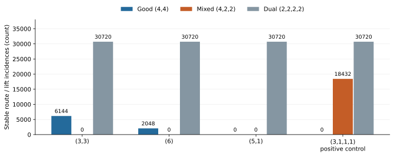

# Two-hop Richelot descent: finite-kernel qualification

The native component enumerated all 225 two-step routes and all retained mod-4
lifts of four fixed Frobenius representatives. The separately resumed Lean
component compiled all nine explicit finite-model statements without axioms.
Full raw outputs and earlier startup failures are retained. These are
unsigned producer records, not signed independent execution verdicts:
`PCC-20261123-e04b98` and `PCC-20261123-1add8a`. [pcc:unverified]

This study gives a precise filter for a proposed extension-field detour:
under the hypotheses below, two nonrational geometric steps cannot produce
a new descended destination isomorphism class. It is a consequence of the
standard double-Richelot kernel classification, not a novelty claim. The
written geometric argument and the finite-model Lean scope remain distinct.
[pcc:unverified]

## Mathematical statement and written proof

Let k have characteristic different from 2. Let A and C be abelian surfaces
over k, and let f = psi composed with phi be a k-defined isogeny, with phi
and psi geometric (2,2)-isogenies. Suppose A[2](k) = {0} and the first kernel
L = ker(phi) is not Galois stable. Then ker(f) = A[2] and f = u composed with
[2] for a k-isomorphism u from A to C. [pcc:unverified]

Write K = ker(f). Its order is 16 and it is killed by 4: for x in K,
phi(x) lies in ker(psi), so phi(2x) = 0 and 2x lies in L, which is killed by
2. Since 2 is invertible in k, these kernels are finite etale; their
geometric point groups and Galois actions detect the subgroups. The possible
abelian group types are C4 x C4, C4 x C2 x C2 and C2^4. [pcc:unverified]

In the good type C4 x C4, L is the four-element subgroup K[2] = 2K. It is
characteristic in the k-defined kernel K, contradicting nonstable L. In the
mixed type C4 x C2 x C2, 2K has exactly one nonzero element. Every Galois
automorphism preserves this element, giving a nonzero point of A[2](k),
again a contradiction. In the remaining type, K is contained in A[2] and
has the same order, hence K = A[2]. Quotient factorization gives f = u [2]
over k; the degrees of f and [2] are both 16, so u has degree one and is an
isomorphism. This last quotient/descent argument is written mathematics,
not formalized by the finite Lean module. [pcc:unverified]

For an odd-order subgroup, inverse-of-2 scalar recovery after the isomorphism
is the usual DLP-preserving scalar return. A rational target equation alone
does not prove descent of the chosen morphism. Nonrational individual
quadratic factors may form a Galois-stable whole Richelot kernel and are not
excluded. First kernels already rational, three or more hops, odd degrees,
and additive trace/norm constructions are outside this two-step conclusion.
[pcc:unverified]

## Native coverage and controls

Rust source blob `4541fb295d255f68564437efa84e28772985d701` is unchanged
through A/B/C/D. Actual C source commit is
`ee45e7615544b887025986b2ecf5e645bb84308b`; complete result checkpoint is
`fcc9079069993385b6d5b169f4d72208a46ae1b6`. The independent representation
comparison uses F2^4 symplectic coordinates and even subsets of six labels
modulo complement. All 720 root permutations, 16 elements and 256 ordered
addition/pairing pairs per action are checked. There are 304 fixed-free
actions: 40 of type (3,3), 120 of type (6), and 144 of type (5,1).
[pcc:unverified]

The 15 first Lagrangians each give 15 quotient Lagrangians and full preimage
kernels. The 225 routes comprise eight good, six mixed and one dual per
first kernel; the 151 distinct kernels comprise 120 good, 30 mixed and one
dual. Full element sets, closure, quotient pairing, isotropy, doubled images
and two-torsion cardinalities are checked. Each of four fixed root actions
has all 65,536 entrywise mod-4 lifts tested; 1,024 symplectic similitudes of
each multiplier 1 and 3 are retained. No order-three hypothesis is imposed
on a lift. Every retained lift is tested against every full route kernel.
Geometric realization of arbitrary retained lifts is not asserted.
[pcc:unverified]

| Representative cycle | Good stable incidences | Mixed stable incidences | Dual stable incidences | Stable first kernels |
| --- | ---: | ---: | ---: | ---: |
| (3,3) | 6144 | 0 | 30720 | 3 |
| (6) | 2048 | 0 | 30720 | 1 |
| (5,1) | 0 | 0 | 30720 | 0 |
| (3,1,1,1), positive control | 0 | 18432 | 30720 | 0 |

These are native-emitted route/lift incidences, not distinct geometric maps.
The same full dual kernel occurs for each first route. A copied mixed
record with a corrupted doubled-image invariant is rejected and its restored
version accepted. Two full witnesses survive: stable good K with rational
first L in a fixed-free action; stable mixed K with nonrational first L
when rational two-torsion is present. They prevent either missing hypothesis
from being dropped. Every one of 225 complete kernel bitsets is in
`first-C-native-pass-Lean-startup-failure/native.stdout`, 33,494 bytes, SHA256
`c18c77fabe991d1845014f0cddc77f73336b2e1d5c69b7bbf8569c1344a52da7`.
[pcc:unverified]

## Formal statement map and execution flow

The unchanged Lean blob is `459bbe1414a812cde2eaf38289db832819a2c567`.
Lean-only D source is `1d51fef4f3396948d7ea3a4fad681c906702c478`.
Lean 4.35.0, commit eb6cafb7290e8bd5f2937522d8d804f58f02bafc, compiled
the actual module with warnings as errors and default logical proof limits.
Each named statement prints no axioms. Exact full declarations and proof
text, with hashes, are retained in
`first-D-Lean-component-success/COMPLETE_FORMAL_DECLARATION_BINDINGS.json`.
No Mathlib/crypto-lean import or general abelian-variety instance is present.
[pcc:unverified]

| Written component | Lean declarations in namespace TwoHopDescent | Exact scope |
| --- | --- | --- |
| Mixed doubled subgroup | doubled_range; doubled_generator; doubled_point_nonzero | Explicit Bool model of C4 x C2 x C2 |
| Mixed fixed point obstruction | additive_injection_fixes_doubled_point; no_fixed_free_mixed_automorphism | Any zero-preserving additive injective self-map of that model |
| Good doubled image | doubling_covariance; doubled_image_preserved | Additive self-maps of explicit C4 x C4; image inclusion |
| Cubic action control | cubic_fixed_only_zero; cubic_order_three | One explicit F2^4 action |
| Geometric classification, arbitrary Galois action and quotient factorization | No declaration | Written proof; full geometry bridge open |

The last row remains partial formalization. Polynomial-only IDC1 over
2^61-1 does not certify these finite-group/cardinality assertions; an unrelated
polynomial identity is not offered as a substitute. `lean4checker --fresh`
was unavailable. All PCC standing remains unsigned/unverified.
[pcc:unverified]

Flow: four versioned callers were attempted. A and B abort at Lean version
startup before scientific compilation. C completes strict Rust compile,
Clippy, format and native phases, then aborts at Lean version startup; its
overall exit remains 134. D runs only Lean version/proof phases and completes
them with exit 0; C's native component is never repeated. Source/tool/qualifier
postguards match. Reports for A/B/C retain each first failure separately;
D has a separate successful component report. [pcc:unverified]

All phases keep 2GiB virtual process limits, 120s deadlines and one worker.
C's trace records a successful 1GiB anonymous reservation followed by an
unsatisfied 1GiB-plus-guard stack mapping. D requests smaller allocator/runtime
reservations at startup; it changes no mathematical source or logical proof
limits. Its 624-byte complete proof stdout SHA256 is
`cd634f65f94799e59cf2e3e65d8d1d79bbad43705a548a667535b53f840d3522`.
Whole ELF/olean packets remain temporary/store-pending, while all small raw
streams are in Git. E is frozen for one ordinary main-CI replay with whole
Actions artifact upload; no E run or existing remote artifact is claimed.
[pcc:unverified]

## Sources, inheritance and remaining work

Primary sources: [Magma Richelot handbook, double-Richelot paragraphs](https://magma.maths.usyd.edu.au/magma/handbook/text/1615);
Castryck, Decru and Smith (2020), section 6 Definition 2,
[DOI 10.1515/jmc-2019-0021](https://doi.org/10.1515/jmc-2019-0021).
Repository inheritance: CT13 mixed-kernel obstruction, CT21/T20 six-cycle
frontier, cryptanalysis CT50 at f9c7b49e (exact source in `prior-source/`),
and the separate cubic Frobenius trace study. See `SOURCES_AND_SCOPE.md`
and `SOURCE_AUDIT_INVENTORY.json` for exact search scope. The locked-vault
protocol checker and KB were unavailable; no schema/novelty clearance is
claimed. Runtime diagnosis cites tagged Lean 4.35.0 runtime/thread.cpp and
mimalloc 2.2.7 options.c/arena.c, with exact source metadata retained.
[pcc:unverified]

The incremental deliverable is the combined finite qualification and precise
two-step boundary beside the inherited single-step and mixed-type results.
No runtime benchmark is requested or reported. Canonical scoreboard/timeline
graphs were reviewed as unchanged because this adds no eligible cost or
algorithm row; this study's new figures show only recorded finite counts.
The remaining technical steps are the general geometric Lean bridge,
independent signed validation, whole remote artifact custody, and genuinely
distinct chain mechanisms under a new tracked protocol. Required CI and
30-check budget compliance remain binding; PR4990 failures are retained in
`maintenance-PR4990-first-CI/`. [pcc:unverified]
