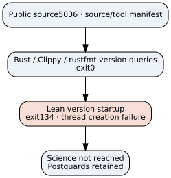

# A: first Lean startup failure, before scientific compilation

Frozen source `5036b1f5ef88a36ae1f86b836f3e58562df28ad1`, claim
`PCC-20261123-93a179`. Rust/Clippy/rustfmt version queries completed, then
the first Lean version process aborted with outer exit 134. Full 132-byte
stderr reports `failed to create thread: Resource temporarily unavailable`.
No scientific source compilation, native enumeration or Lean proof occurred.
[pcc:unverified]

The caller used one worker, 120s phase deadlines and a 2GiB virtual process
cap. All nine source/lock guards matched afterward. Complete phase streams,
context and distinct BUILD/POST records are retained in
`../../first-A-version-negative/`; the full available 28-file inventory is
there. Copied source is recoverable from the immutable source commit; the
private packet is temporary. No successful replay or signed independent
acceptance is claimed. [pcc:unverified]

Only one startup failure is recorded, with no comparable scientific
measurements; a phase diagram replaces a quantitative graph. B prospectively
tests explicit smaller runtime stacks without changing the proof, population,
time or memory cap. Preserve A's failure regardless of B's result. The
later C trace and D repair are separately versioned evidence, not facts
known at this first A call. [pcc:unverified]
