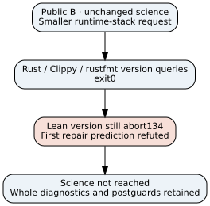

# B: smaller runtime-stack setting still fails before science

Source `b6ecfa0e78d43b6304a5d7065839900c8bfaf1b0` keeps mathematical
sources and the original population unchanged. It explicitly requests
`LEAN_STACK_SIZE_KB=16384`, `LEAN_MAIN_USE_THREAD=0` and one Lean worker.
The first B Lean version query still aborts with outer exit 134 and the
same thread-creation diagnostic; no scientific source is compiled or run.
Claim `PCC-20261123-7573a1`. [pcc:unverified]

This refutes the first stack-setting repair prediction. Preserve A/B first
failures. The unchanged 2GiB process cap, 120s phase deadlines and logical
proof limits remain binding. Full small streams, phase statuses, context,
BUILD/POST records and the available inventory are retained under
`../../first-B-version-negative/`. All postguards match; full private packet
custody is temporary rather than remote. [pcc:unverified]

No two comparable scientific measurements exist, so the graph is a phase
diagram. A later C changes phase order to qualify native code first and
trace the first Lean version failure. It does not weaken acceptance, increase
resource limits or reclassify B as passed. The runtime trace and D allocator
diagnosis belong to later separately frozen sources. [pcc:unverified]
