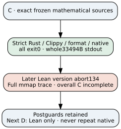

# C: native component completes; later Lean startup fails

Frozen source `ee45e7615544b887025986b2ecf5e645bb84308b` completes strict
Rust compile, Clippy, formatting and the first native enumeration, all exit 0.
Full 33,494-byte native stdout, including every 225 kernel rows and all
controls, is public at checkpoint fcc90790. Later Lean version startup
aborts 134, before proof compilation. Overall C remains 134/incomplete.
Claim `PCC-20261123-e04b98`. [pcc:unverified]

The complete 5,262-byte allocation trace records a successful 1GiB anonymous
reservation followed by a 1,073,745,920-byte MAP_STACK request returning
ENOMEM under the 2GiB virtual limit. The source-supported allocator/early
stack interaction is a diagnosis for a later repair, not a mathematical
failure or an independently isolated causal experiment. Tagged Lean runtime
and mimalloc sources are retained in the source audit. [pcc:unverified]

One worker, 120s deadlines, original population/controls and default logical
proof limits remain unchanged. Full small phase streams, distinct
BUILD/PRE/POST records and matching source/tool/qualifier guards are public
in `../../first-C-native-pass-Lean-startup-failure/`. The full 56-file
9,413,321-byte packet, including both ELFs, remains temporary/store-pending.
No timing comparison is inferred from this structural qualification.
[pcc:unverified]

Native count results and their quantitative graph are in [RESULT.md](../../RESULT.md).
This failure-specific report uses a phase diagram: it has one subsequent
startup failure rather than two comparable performance measurements. D is
frozen as Lean-only continuation; completed native C must not be repeated to
repair Lean. Neither D nor a future main-CI replay changes C's recorded exit.
[pcc:unverified]
