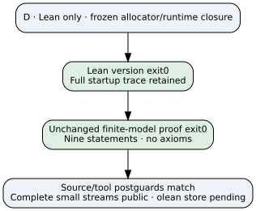

# D: Lean-only finite-model component completes

Frozen source `1d51fef4f3396948d7ea3a4fad681c906702c478` resumes Lean
version and the first proof compilation, both exit 0. It never recompiles
or reruns native C. All nine named statements print no axioms; complete
624-byte stdout and the full declaration/proof bindings are public under
`../../first-D-Lean-component-success/`. Claim `PCC-20261123-1add8a` remains
unsigned. [pcc:unverified]

The unchanged explicit mixed/good/cubic models compile under Lean 4.35.0,
with warnings as errors and default logical proof limits. No general
abelian-variety/Picard kernel-classification instance is present. See the
complete [statement map](../../RESULT.md) for exact quantifiers and the
written geometric result. A local kernel check is not signed PCC acceptance.
[pcc:unverified]

D sets `MIMALLOC_ARENA_RESERVE=65536` before startup, together with the
recorded smaller runtime-stack settings. The same 2GiB virtual process cap,
120s phase deadlines and one worker apply; four actual Lean shared-library
hashes are pinned. All source/tool guards match. Installed stdlib/OS remain
ambient inputs. This is a separately completed component, not an overall
pass for C or a repair of its historical exit. [pcc:unverified]

One formal component and no comparable performance measurements are present,
so the figure shows phase flow. The whole 377,104-byte olean remains
temporary/store-pending. The first metadata exporter mistakenly required
every non-source file below 64KiB and rejected that compiled module; its
failure record is retained. The corrected I/O exporter skips the whole
compiled module without splitting, renaming or rerunning science. E is
prospective main-CI-only for whole artifact custody. [pcc:unverified]
