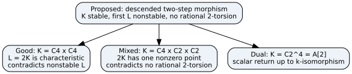

# Prospective two-hop descent qualification

No new execution. The primary-source and repository audit finds the standard double-Richelot rational-two-torsion condition. CT13 already excludes its mixed kernel on the F17 fixture; CT50 excludes a further single rational step on six-cycle targets. This study proposes a complete two-step filter and finite native/Lean qualification, with no novelty or solving-cost claim. [pcc:unverified]

Assume characteristic different from2, a descended composite of two geometric (2,2) isogenies, trivial rational source two-torsion, and a non-Galois-stable first kernel. The group-type split below predicts only the scalar-return case. A rational endpoint equation alone is insufficient. A Frobenius-permuted triple of nonrational quadratic factors can still define a rational first kernel. [pcc:unverified]

Frozen Rust population: all720 six-label actions;15 first kernels and225 full two-step routes;65536 mod4 entry lifts for each of four fixed actions, retaining both odd similitude multipliers. Preserve all kernel bitsets, type/invariant checks, a corrupt-record negative, stable-good rational-first witnesses and a rational-two-torsion control permitting mixed descent. A separate explicit Lean finite-group component checks the characteristic doubled point. [pcc:unverified]

Sources: Magma Richelot handbook, double-Richelot paragraphs; Castryck-Decru-Smith2020, section6; crypto CT13/CT21/T20 and cryptanalysis CT50 at f9c7b49e. The proposed scope leaves geometric realization, arbitrary-length chains, trace/norm descent, signed replay and complete solver comparisons open. No statistical or runtime benchmark is planned. [pcc:unverified]

PCC-20261123-a0c27a binds the prospective protocol/source audit, unsigned. Publish and read back this packet before implementation, then freeze the actual complete source/caller closure before the first compiler/native call. One worker,120s per phase,2GiB virtual memory; all small raw streams checkpointed promptly. EKS-only original workloads, paid STOP and the unread locked vault remain binding. [pcc:unverified]

