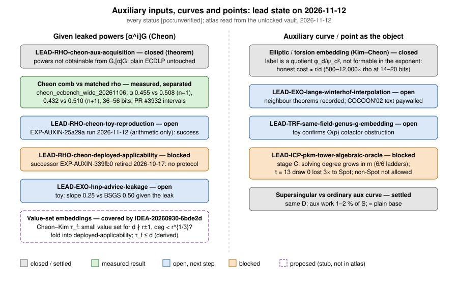
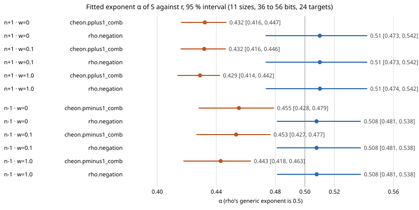

# Auxiliary inputs, curves and points: lead chase and five follow-ups (2026-11-12)

**Question.** What is the current state of every lead about auxiliary curves, auxiliary points and Cheon's DLP with auxiliary inputs,
and how far can the five follow-ups the owner approved on 2026-11-12 be taken from this session?
**Class.** Desk work and literature only. Nothing was run, launched or measured. Every statement is `[pcc:unverified]`.
**Report PDF:** [`report.pdf`](report.pdf), built from this file. **Figures:** [`figures/lead_map.svg`](figures/lead_map.svg) (lead
state) and the recorded exponent graph of the wide study, [`../cheon_ecbench_wide_20261106/alpha.svg`](../cheon_ecbench_wide_20261106/alpha.svg).

## Sources checked

- research-kb: **unavailable** (no MCP server connected; `scripts/research-kb` finds no catalog in this container).
- Lead atlas: `crypto-autoresearcher` cloned at `8c82ddc8` (2026-11-11). Every atlas file is AES-SIV vault ciphertext (`VLT1`); `KEY`
  is not set, so `tools/lead_atlas.py` cannot run. Lead fields were read from the in-repo copies:
  `research/lead_sweep_20261110/leads.json` and per-lead `RESULT.md`, `research/prime_field_lead_assessment_20261107/atlas_survey.md`,
  `papers/ecdlp-index-calculus-treatise/survey/generic.md` §19.
- **Update 2026-11-12:** the vault was unlocked later the same day (`vaultctl.py setup` + `unlock`, 27,507 files in the sparse
  checkout). Read: `knowledge/leads/ecdlp/generic/LEAD-RHO-cheon-{toy-reproduction,deployed-applicability}.yaml`,
  `ledger/hypotheses/H-AUXIN-{a86953,6db354}.yaml`, `experiments/EXP-AUXIN-25a29a/specification.yaml`,
  `experiments/EXP-AUXIN-7e2e3d/amendments/`, `ledger/decisions/DEC-20260923-a4c3d5`, `DEC-20260930-{224fc1,8af20f,ca32c7}`,
  `DEC-20261016-5bdc04`, `DEC-20261017-0fab25`, `ledger/proposals/IDEA-20260930-6bde2d.yaml`; full-text search of the decrypted
  `knowledge/` and `ledger/{hypotheses,proposals}` for Cheon–Kim / value set / τ_f / 2012/609.
- Studies: `research/cheon_ecbench_wide_20261106/`, `cheon_ecbench_medium_20261106/`, `cheon_p224_shape_20261022/`,
  `torsion_auxiliary_inputs_20260918/`, `srs_auxiliary_census_20260927/`, `pkm_supersingular_aux_20261015/`,
  `pkm_isogeny_tower_p192_20261015/`, `pkm_matched_prime_20261106/`, `pkm_falldegree_unblock_20261107/`;
  `research/notes/ecdlp-general/RESEARCH_TORSION_AUXILIARY_INPUTS.md`.
- Open PRs: #3932 (pooled Cheon intervals), #3938 (13 new leads).
- Literature: Kiltz–Winterhof, *Bull. Austral. Math. Soc.* 69 (2004) 305–315 (read in full); Lange–Winterhof COCOON'02 and AAECC'03
  (metadata only, paywalled). See [`LITERATURE_LANGE_WINTERHOF.md`](LITERATURE_LANGE_WINTERHOF.md).

## 1. Lead state

| lead | disposition | latest evidence |
|:--|:--|:--|
| `LEAD-RHO-cheon-aux-acquisition` | closed_obstructed (theorem) | `[α²]G` from `G, [α]G` is square-DH. The 2026-11-10 sweep toy was inconclusive (positive control and A/A failed). |
| Cheon comb vs matched rho, powers given | measured | Wide study: α 0.455 [0.428, 0.479] vs rho 0.508 [0.481, 0.538] (n−1), 0.432 [0.416, 0.447] vs 0.510 [0.473, 0.542] (n+1), w = 0, 36–56 bits, 1,056 replayed runs. Pooled ratio comb/rho 0.525 [0.473, 0.584] (n−1), 0.367 [0.318, 0.422] (n+1) in open PR #3932. |
| `LEAD-RHO-cheon-toy-reproduction` | open_next_step | Sweep toy matched `1.5(√(r/d)+√d)` within 4 %; inconclusive because one negative-control cell sat at exactly 5 %. EXP-AUXIN-25a29a (arithmetic only) run 2026-11-12: success (§2, item 1). |
| `LEAD-RHO-cheon-deployed-applicability` | open_blocked | No current protocol: successor EXP-AUXIN-339fb0 retired 2026-10-17 (§2, item 4). Powers-of-tau census: 5.74–14.32 bits. |
| `LEAD-EXO-hnp-advice-leakage` | open_next_step | Sweep toy: Cheon slope 0.2516 vs BSGS 0.5039 given the leak; its rho baseline is mis-specified (slope 1.006), so its rho ratios are void. |
| Elliptic / torsion embedding (Kim–Cheon) | closed by measurement; no atlas lead | Label is a quotient; honest cost ≈ `r/d`. |
| `LEAD-EXO-lange-winterhof-interpolation` | open_next_step | Neighbour theorems recorded (§2, item 3). |
| `LEAD-TRF-same-field-genus-g-embedding` | open_next_step | Sweep toy confirms `#Jac = #E₁·#E₂` on 132 curves, the Θ(p) cofactor obstruction. |
| `LEAD-ICP-pkm-tower-algebraic-oracle` | open_blocked | Stage C: solving degree grows in m on 6 of 6 ladders. Matched primes: D follows t, not p, and equals the null. t = 13 undecided (§2, item 5). |
| Supersingular vs ordinary auxiliary curve | settled | Same D in 14 cells; auxiliary work 0.9–1.9 % of S vs 10–27 % searched; against a plain base unresolved or 1–7 % dearer. |
| Cheon–Kim value-set embeddings | covered by IDEA-20260930-6bde2d (proposed) | Ceiling gain ≤ √q_max for the whole polynomial family (§2, item 2). |

**A conflict resolved.** The 2026-09-18 note's Cheon exponent 0.23 and the ecbench exponents of about 0.45 are both consistent with
theory: the first used `d ≈ √r` (predicted 1/4), the ecbench studies use P-224-shaped `d ≈ r^0.129` and `r^0.211` (predicted
`(1 − ρ)/2` ≈ 0.435 and 0.394). Different `d`, not a contradiction.

**A retraction to carry.** The Cheon/rho ratios of `research/cheon_p224_shape_20261022/` were withdrawn on 2026-10-23 (H3 gate failed);
the wide study supersedes them.

## 2. The five follow-ups

| item | outcome | why / what was done | what unblocks it |
|:--|:--|:--|:--|
| 1. Run EXP-AUXIN-25a29a (H-AUXIN-a86953: 56-bit r, d = 65536, stage counts, gain fractions) | **run, success** (update 2026-11-12, vault unlocked) | The frozen specification is integer arithmetic only: no curve, no walk, two routes, 1 GB. Both routes agree on every preregistered value: [`exp_auxin_25a29a/RESULT.md`](exp_auxin_25a29a/RESULT.md). Executed here, not in the ledger's run package (no write access to `crypto-autoresearcher`). | A session with write access mints the RUN id and files the package. A memory-charged 56-bit walk is a separate, not yet designed experiment. |
| 2. File a lead for value-set / auxiliary embeddings | **not a new lead** (update 2026-11-12) | The vault shows prior art: IDEA-20260930-6bde2d (proposed, linked from `LEAD-RHO-cheon-deployed-applicability`) prices the whole polynomial-embedding family, Kim–Cheon general `f` included, with ceiling gain ≤ √d ≤ √q_max from τ_f ≤ deg f. The stub's existence question is a sub-question of that lead. See [`LEAD_STUB_value_set_embedding.md`](LEAD_STUB_value_set_embedding.md). | Fold into the existing lead's notes, not a new id. |
| 3. Lange–Winterhof exact theorem | **partly done** | Kiltz–Winterhof 2004 Theorems 5 and 6, stated as extending Lange–Winterhof Theorem 3, are transcribed with scope in [`LITERATURE_LANGE_WINTERHOF.md`](LITERATURE_LANGE_WINTERHOF.md). The COCOON'02 text is still paywalled. | Library access or an author copy. |
| 4. Approve the revised deployed-applicability protocol | **nothing to approve** (update 2026-11-12) | The vault shows the chain: amendment d1d10 refused (DEC-20260923-a4c3d5); revisions typed, narrow and gated (2026-09-26 to 09-28); successor contract EXP-AUXIN-339fb0 approved at sha256 `6a1dca32…` (DEC-20260930-ca32c7) and authorized (DEC-20260930-224fc1), never run, then **retired** on 2026-10-17 by DEC-20261017-0fab25 as "a pre-schema draft… never an approved experiment contract". H-AUXIN-6db354 is still `proposed`. The atlas's next step ("approve a revised protocol") points at no current document. | A new protocol under H-AUXIN-6db354 must be written and reviewed in `crypto-autoresearcher`; only then can it be approved. |
| 5. Re-launch PKM `pfd-x-t13-k0-c6` on non-Spot capacity | **blocked by policy** | `taskq/deploy/eks-karpenter/spot-only-policy.yaml` admits only Spot NodePools; `COST_CONTROLS.md` forbids an On-Demand fallback; the CRIU resumable route is qualified to an 8 GiB envelope (the cell needs 56 GiB); this container has 15 GB. Three Spot attempts were already lost (`SPOT_LOSSES.md`). | An administrative exception for one On-Demand node (policy change), or an owner decision for a fourth Spot attempt, or a memory-qualified CRIU route. |

## 3. Next steps

1. Done 2026-11-12 with the vault key: item 1 run, items 2 and 4 re-read (above). Remaining in `crypto-autoresearcher` (needs write
   access): file the EXP-AUXIN-25a29a run package; correct both Cheon leads' next-step text; write a new census protocol under
   H-AUXIN-6db354.
2. Decide item 5: a one-off On-Demand exception, a fourth Spot attempt, or accept "undecided at t = 13".
3. Read Cheon–Kim 2016 §§3–5 for the value-set stub's next step (desk).
