# Cheon's DLP with auxiliary inputs as an ecbench method

Date: 2026-10-22. Protocol: [`PROTOCOL.md`](PROTOCOL.md), frozen before data.
Full generated tables: [`results/results.md`](results/results.md) (data
[`results/results.json`](results/results.json)). Follows the P-224-shape study
[`../cheon_p224_shape_20261022/`](../cheon_p224_shape_20261022/) (PR #2422).

## Summary

- **Methods.** Cheon's n−1 and n+1 algorithms are now registered ecbench methods:
  `cheon.pminus1_comb`, `cheon.pminus1_naive` and `cheon.pplus1_comb`. They are
  charged in ecbench's counted unit (`ecbench.gae`, one affine addition or
  doubling = 1, every phase charged), the same unit as `rho.negation`.
- **The oracle is a separate resource.** The leaked powers [x^i]G come from a
  planted static-DH oracle (`src/cryptanalysis/ecbench/oracle.rs`). Its queries
  and the server work behind them are counted outside `total_gae`:
  - `counters.oracle_queries`: d−1 queries for n−1, 2d−1 for n+1;
  - `oracle_server_group_ops`.

  A method sees only `query` and the count. It never sees the scalar, and a
  public target is refused.
- **Bounds and frontier.** A bound for a querying arm must be fitted with
  `bound fit --oracle LABEL`, which puts it in an *oracle domain*. There it
  never sits beside a plain-ECDLP bound, and the frontier reads an extra
  `oracle_queries` axis. All 46 earlier bound records re-derive unchanged.
- **Data.** 320 runs over 7 curve sizes (32–56 bits) in 3 sessions at L0,
  counts only. Every answer was verified, and `ecbench verify --replay-all`
  reproduced 320 of 320 runs exactly.
- **Distance to rho.** Pooled over 36–56 bits, the comb arms cost 0.552 (n−1)
  and 0.279 (n+1) of matched rho in charged operations at w = 0. The order
  holds at every price in the 12-cell band (AGENTS.md §5a, extended to oracle
  queries).
- **No exponent separation is established.** The fitted Cheon exponents (0.450,
  0.428) and rho's (0.496, 0.513) have overlapping 95 % intervals.
- **Scope.** This is a cost under a stated oracle (DLP with auxiliary inputs).
  It is not a plain-ECDLP advance and not an index-calculus improvement.

## Sealed bounds

`gae = C·r^α`, where r is the group order. "ops × floor" is the mean S over
sqrt(π/2A). The intervals are 95 % bootstrap. The tier is medium (36–56 bits);
the 32-bit toy size is reported but never pooled.

| curves | arm | α | ops × floor | sizes, runs |
|:--|:--|:--|:--|:--|
| n−1 | rho.negation | 0.496 [0.431, 0.611] | 1.114 [0.846, 1.408] | 6, 48 |
| n−1 | cheon.pminus1_comb | 0.450 [0.406, 0.473] | 0.648 [0.514, 0.818] | 6, 48 |
| n−1 | cheon.pminus1_naive | 0.441 [0.388, 0.497] | 13.814 [10.62, 16.93] | 5, 40 |
| n+1 | rho.negation | 0.513 [0.386, 0.636] | 1.143 [0.840, 1.457] | 6, 48 |
| n+1 | cheon.pplus1_comb | 0.428 [0.389, 0.460] | 0.657 [0.483, 0.845] | 6, 48 |

- **Naive session reference.** Its own rho reference has α = 0.524
  [0.417, 0.685] and ops × floor 1.190.
- **Unpriced native work** at w = 1 GAE per operation:

  | | n−1 | n+1 |
  |:--|--:|--:|
  | comb bound | 1.074 | 0.795 |
  | rho | 2.227 | 2.285 |

  At w = 0.1 the comb bounds are 0.690 and 0.670, against rho's 1.225 and
  1.257.
- **Oracle fits.** Queries = C·r^α with α = 0.154 [0.092, 0.213] for n−1 and
  0.163 [0.146, 0.189] for n+1. The server-operation exponents are 0.189
  [0.126, 0.239] and 0.198 [0.178, 0.228].

## Gap to matched rho (distance remaining)

Each value is a pooled paired ratio of sums over 36–56 bits, with a 95 %
bootstrap over pairs. w is the price of each unpriced native operation, the
same on both arms. The oracle price q ∈ {0, 0.1, 1, server work} moves every
pooled ratio by at most 0.003, so it is not shown as a column.

| arm | w = 0 | w = 0.1 | w = 1 |
|:--|:--|:--|:--|
| comb n−1 (48 pairs) | 0.552 [0.455, 0.651] | 0.528 [0.436, 0.622] | 0.418 [0.347, 0.492] |
| comb n+1 (48 pairs) | 0.279 [0.216, 0.419] | 0.259 [0.200, 0.388] | 0.165 [0.129, 0.247] |
| naive n−1 (40 pairs) | 7.660 [6.33, 9.93] | 6.983 [5.77, 9.05] | 3.938 [3.26, 5.10] |

**Per size, comb arms.** "Resolved" means the ratio is on the same side of 1
in all 12 price cells.

| bits | n−1 | n+1 |
|--:|:--|:--|
| 32 | dearer than rho | dearer |
| 36 | cheaper, interval excludes 1 | unresolved |
| 40 | dearer | cheaper |
| 44 | cheaper, interval excludes 1 | cheaper |
| 48 | cheaper, interval excludes 1 | cheaper |
| 52 | cheaper, interval excludes 1 | cheaper, interval excludes 1 |
| 56 | cheaper, interval excludes 1 | cheaper, interval excludes 1 |

- At 56 bits the 12-cell range is 0.484–0.645 for n−1 and 0.142–0.241 for n+1.
- The naive arm is 3.4–27 times dearer than rho at every size and every price.

**Frontier.** In every oracle domain, rho and the Cheon comb are both on the
frontier: Cheon wins on operations and rho wins on oracle queries. The naive
arm is dominated by rho.

## Oracle cost

- **Queries per run:** 29–209 for n−1 and 479–4,031 for n+1.
- **Server work relative to the attacker's work:**

  | | 36 bits | 56 bits |
  |:--|--:|--:|
  | n−1 | 0.95 % | 0.018 % |
  | n+1 | 11.7 % | 0.39 % |

- **At the P-224 shape** (formula, not measured), the leak needs:

  | | queries | server operations | attacker cost |
  |:--|--:|--:|--:|
  | n−1 | 2^29 | ≈ 2^37 | 2^97.5 |
  | n+1 | 2^48 | ≈ 2^56 | 2^88.4 |

## Pre-registered predictions (PROTOCOL §5)

- **P1, met:** 320 of 320 replays are identical.
- **P2, met:** 120 runs are identical to PR #2422's driver records and none
  differ. The 6 unmatched runs are the 56-bit naive arm, by design.
- **P3, met:** the fitted exponents (0.450, 0.428; rho 0.496, 0.513) are inside
  their predicted ranges.
- **P4, partly missed:** the n−1 query exponent 0.154 is inside [0.10, 0.17].
  The n+1 query exponent 0.163 is outside [0.17, 0.26], although its interval
  overlaps that range.
- **P5, met** at 56 bits.
- **P6, met.**
- **Rho sanity gate, met:** S is between 0.60 and 1.50, and the exponents are
  0.50–0.52.

## Deviations

There are no deviations in curves, d, seeds, targets, unit or pricing band.
Two things were added after the freeze, and neither chooses among results:

- the pooled-gap table (Table 2b in `results/results.md`);
- a fix to a figure-legend placement.

The naive arm stops at 52 bits. A single, uncommitted timing probe on the
56-bit curve measured about 8 minutes per target, and PROTOCOL.md discloses
this.

The 14 shaped curves have a source record in [`curves.json`](curves.json), but
they are **not** yet in `docs/curves/registry.json`. Registering them grows the
catalog to 2,586 models. The cover-transfer assessment builder and verifier
hard-assert 2,572, so refreshing them is held for a separate decision.

## Limits

- **Provenance.** Sessions record `git_commit: null`, because the binary was
  copied out of the build tree. The binary's sha256 is `0750e00f…f6e5`, built
  from the `2881fd08e` sources.
- **Host.** Four cores shared with other jobs, at L0. No wall time is reported,
  and there is no independent-runner receipt.
- **Precision.** With 8 targets per size the intervals are wide, so exponent
  claims would need more targets.
- **No challenge.** No challenge or verdict was sealed in an oracle domain.

## Rho gate: per-run reading (disclosure, 2026-10-23)

PROTOCOL.md section 6 states this study's rho gate per size: *"if the rho `S` is
outside `[0.3, 4]` on any size ... nothing is ranked against rho"*. It was frozen
before any data. Every per-size rho `S` lies between 0.60 and 1.50, so the gate
as written is met, and the rankings above follow the protocol.

The protocol also calls the gate "PR #2422's". The review of PR #2422 held that
gate to apply to every individual run. Read that way, it fails here too:

| session | rho runs | outside `[0.3, 4]` | lowest `S` |
|:--|--:|--:|--:|
| minus | 56 | 7 | 0.078 |
| minus-naive | 48 | 6 | 0.078 |
| plus | 56 | 6 | 0.035 |

The minus-naive session shares six of its rho targets with the minus session.
Rho's per-run cost has a heavy lower tail, as in PR #2422. The pooled ratios
above are ratios of sums over 8 paired targets per size. They are therefore less
sensitive to single low rho runs than per-size medians, but they are not immune.
Whether these rankings are admitted under the per-run reading is a review
decision. This section records the counts so that the decision can be made.

