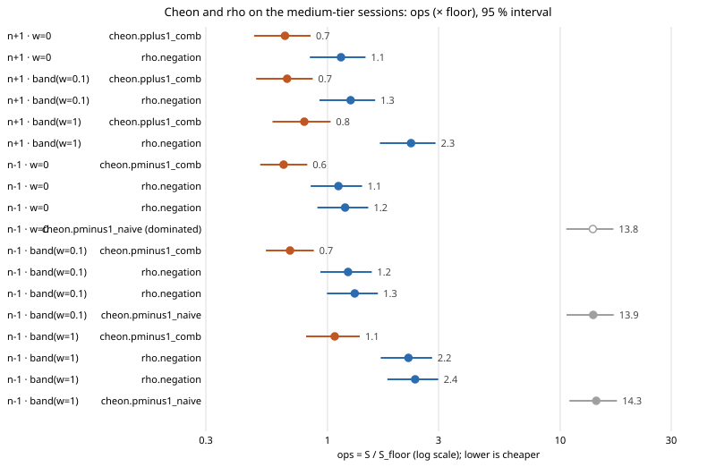

# Cheon ecbench sessions on one tier: the Cheon arms ranked by frontier procedure 2

Protocol: [`PROTOCOL.md`](PROTOCOL.md), frozen in `b83ccff8ce` before any
session ran. Run report: [`reports/run-20261106T0300Z/RUN_REPORT.md`](reports/run-20261106T0300Z/RUN_REPORT.md).

## Outcome

Re-running the medium-tier curves of
[`research/cheon_ecbench_20261022/`](../cheon_ecbench_20261022/) as sessions of
their own makes every Cheon bound rankable.

- **Fits.** The 18 whole-session fit-version-2 bounds are all accepted, with no
  admissibility reason.
- **Frontier.** Procedure 2 ranks all 18 in the six oracle domains: n−1 and n+1,
  each at w = 0, 0.1 and 1 GAE per unpriced operation.
- **Comb.** In every one of those domains the Cheon comb arm is the ops leader,
  and it shares the frontier with `rho.negation`. Comb has fewer operations;
  rho makes no oracle queries.

## Predictions (PROTOCOL.md §4)

| | prediction | result |
|:--|:--|:--|
| P1 | counts of every run equal the original session's run (same arm, curve, target) | **met**: 272 of 272 runs identical in outcome, recovered scalar, `total_gae`, `S`, oracle queries, oracle server work and every per-phase count ([`results-p1.jsonl`](results-p1.jsonl), [`compare.sh`](compare.sh)) |
| P2 | all 18 fits accepted and ranked by procedure 2 | **met**: 18 of 18 ranked, 0 admissibility reasons |
| P3 | `rho.negation` and the comb arm both on the frontier at every weight | **met** in all six n−1 and n+1 domains |
| P4 | `cheon.pminus1_naive` dominated by `rho.negation` at every weight | **met** at w = 0, 0.1 and 1, after the 2026-11-06 band amendment (below); first read as not met at w = 0.1 and 1 |

**P4 at w = 0.1 and w = 1 (amended 2026-11-06).** This report first read P4
as not met at these two weights. Procedure 2 had kept naive on the frontier
there with the note "unpriced work is uncounted on one side". That note was
wrong:

- **Both arms count their unpriced work.** Naive has
  `scalar_mulmod_uncharged`, `table_insert_uncharged` and
  `table_lookup_uncharged`; rho has
  `canonicalisations_uncharged`.
- **What was missing.** A weighted fit (`--weight 0.1` or `1`) did not record
  the per-size pricing band on either side, so the band test (AGENTS.md §5a)
  could not run in those domains.
- **The fix.** Fit version 2 now records the band on weighted fits too
  (`src/cryptanalysis/ecbench/bounds.rs`). The 24 weighted fit-version-2
  Cheon records were refitted from their own sessions and options
  (`refit_weighted_v2.sh`); only the band and the ids derived from it changed.
- **Result.** In both weighted domains rho now dominates naive across the band,
  as it already did at w = 0: ops 1.23 [0.93, 1.55] and 1.31 [0.99, 1.65]
  against 13.9 [10.7, 17.0] at w = 0.1.

This is a correction to the comparison tooling. No measured count and no
fitted value changed.

## Ranked bounds (measured, from `docs/bounds/frontier.json`)

`ops` is `S / S_floor` with its 95 % interval, as the bound records it.
`oracle queries` is static-DH queries per `√r`.

| domain | method | ops (× floor) | 95 % | oracle queries (/√r) | on frontier |
|:--|:--|--:|:--|--:|:--|
| n−1, w = 0 | `cheon.pminus1_comb` | 0.648 | [0.514, 0.818] | 0.00003 | yes, ops leader |
| n−1, w = 0 | `rho.negation` (minus) | 1.114 | [0.846, 1.408] | 0 | yes |
| n−1, w = 0 | `rho.negation` (minus-naive) | 1.190 | [0.904, 1.496] | 0 | yes |
| n−1, w = 0 | `cheon.pminus1_naive` | 13.814 | [10.619, 16.929] | 0.00003 | no, dominated by both rho bounds |
| n−1, w = 0.1 | `cheon.pminus1_comb` | 0.690 | [0.543, 0.873] | 0.00003 | yes, ops leader |
| n−1, w = 0.1 | `rho.negation` (minus) | 1.225 | [0.931, 1.549] | 0 | yes |
| n−1, w = 0.1 | `rho.negation` (minus-naive) | 1.309 | [0.995, 1.646] | 0 | yes |
| n−1, w = 0.1 | `cheon.pminus1_naive` | 13.861 | [10.651, 16.987] | 0.00003 | no, dominated by both rho bounds |
| n−1, w = 1 | `cheon.pminus1_comb` | 1.074 | [0.809, 1.376] | 0.00003 | yes, ops leader |
| n−1, w = 1 | `rho.negation` (minus) | 2.227 | [1.693, 2.816] | 0 | yes |
| n−1, w = 1 | `rho.negation` (minus-naive) | 2.380 | [1.808, 2.992] | 0 | yes |
| n−1, w = 1 | `cheon.pminus1_naive` | 14.278 | [10.953, 17.522] | 0.00003 | no, dominated by both rho bounds |
| n+1, w = 0 | `cheon.pplus1_comb` | 0.657 | [0.483, 0.845] | 0.00058 | yes, ops leader |
| n+1, w = 0 | `rho.negation` | 1.143 | [0.840, 1.457] | 0 | yes |
| n+1, w = 0.1 | `cheon.pplus1_comb` | 0.670 | [0.493, 0.864] | 0.00058 | yes, ops leader |
| n+1, w = 0.1 | `rho.negation` | 1.257 | [0.924, 1.602] | 0 | yes |
| n+1, w = 1 | `cheon.pplus1_comb` | 0.795 | [0.580, 1.031] | 0.00058 | yes, ops leader |
| n+1, w = 1 | `rho.negation` | 2.285 | [1.679, 2.913] | 0 | yes |

The n−1 domains hold two rho bounds because the minus and minus-naive
sessions each carry their own matched rho arm. The minus-naive arm stops at
52 bits.

*Graph: [`ranks.svg`](ranks.svg), drawn by [`ranks_svg.jq`](ranks_svg.jq) from
[`ranks.json`](ranks.json), the entries of the rebuilt `docs/bounds/frontier.json` copied by [`ranks_json.jq`](ranks_json.jq).
Sessions `ECBS1he3401ce241ca` (minus), `ECBS1hb3aa04e7a9c6` (minus-naive) and
`ECBS1h64874297871c` (plus); 8 targets per size. A filled marker is on the
frontier; an open one is dominated.*

## Scope

- These are costs under a stated oracle: the DLP with auxiliary inputs, which
  queries a static-DH oracle. Nothing here changes a plain-ECDLP or
  index-calculus cost.
- The measurement repeats the original study's workloads. P1 shows the counts
  are identical run by run, so these sessions change no number of the original
  report. What they change is which tier each bound is fitted on, and with it
  the procedure-2 ranking.
- No new `benchmarks/` row: the counts are identical to the original runs
  (P1), and those are already in the validated
  `benchmarks/20261022-cheon-ecbench` row. This study changes the fits and
  the ranking, not a measured value.
- Counts only, at L0 on a shared 4-core host; no wall time is admitted.
- 8 targets per size, as in the original.

## Files

- **Specs:** `spec-minus.json`, `spec-minus-naive.json`, `spec-plus.json`.
- **Sessions:** `sessions/{minus,minus-naive,plus}-20261106/` and their audit
  receipts, `sessions/*.audit.json`. Each audit reproduced every run.
- **Bounds:** `docs/bounds/records/cheon-ecbench-medium-*.json` (18), fitted by
  [`fit.sh`](fit.sh). The rebuilt pages are `docs/bounds/frontier.json` and
  `docs/bounds/FRONTIER.md`.
- **Binary:** [`sessions/BINARY.txt`](sessions/BINARY.txt).
