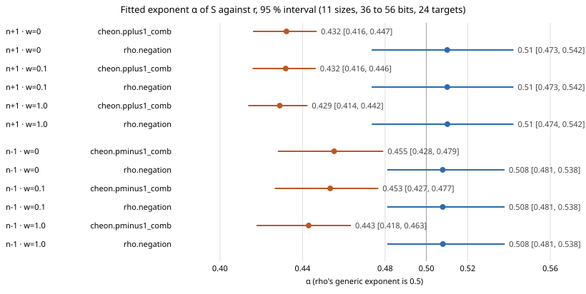

# Cheon comb against matched rho on 11 sizes, 36 to 56 bits: the cost exponents

Protocol: [`PROTOCOL.md`](PROTOCOL.md), frozen in `8c62e3c927` before any
session ran, with amendments 1 to 3 (`ad5313af9c`, `e20b20acbc`,
`5f9d99cff8`), each pushed before the data it governs.

## Outcome

- **The exponents separate in both families.** The fitted exponent of `S`
  against `r` is lower for the Cheon comb arm than for matched `rho.negation`,
  and the 95 % intervals do not overlap at any of the three prices w = 0, 0.1
  and 1 GAE per unpriced operation. That is the P3 rule.
- **n−1 is only just separated.** At w = 0 the gap between the intervals is
  0.002 (rho's lower end 0.481, comb's upper end 0.479).
- **n+1 is clearly separated.** The gap is 0.026 to 0.032.
- **What it rests on.** 1,056 runs on 11 sizes (36 to 56 bits, 2-bit steps), 24
  planted targets each, both arms, both families. Every run recovered its
  planted logarithm, and every run was reproduced by an exact replay.
- **Scope.** This is a cost of the DLP with auxiliary inputs, under a counted
  static-DH oracle. It makes no plain-ECDLP or index-calculus claim. The
  separation is of exponents fitted over 36 to 56 bits, not of asymptotic
  exponents.

## Predictions (PROTOCOL.md §4, with amendment 3)

| | prediction | result |
|:--|:--|:--|
| P0 | the generated 36–56-bit curves equal the earlier studies' | **met** before freezing: 6 of 6 per family against the run specs of `research/cheon_ecbench_20261022` |
| P1 | each medium-study run (targets 0–7, 36–56 bits) equals this study's run with the same arm, curve and target | **met**: 96 of 96 per family ([`results-p1.jsonl`](results-p1.jsonl), [`compare.sh`](compare.sh)) |
| P2 | all 12 fits accepted with no admissibility reason, and ranked by procedure 2 | **met**: 12 of 12, 0 reasons, 11 sizes each, all ranked |
| P3 | "exponent separated" iff rho's α lower end exceeds comb's α upper end at all three w | **separated** in both families (table below) |
| predictions | n+1 separates; n−1 about even odds; rho α in [0.45, 0.55]; comb α in [0.40, 0.47] (n−1) and [0.36, 0.45] (n+1) | n+1 separated, as predicted. n−1 separated too, by a margin of 0.002 at w = 0. All α within their predicted ranges |

## Fitted exponents (from the records, `fit.alpha` and `fit.alpha_ci95`)

| family | w | comb α | rho α | rho lower − comb upper |
|:--|:--|:--|:--|--:|
| n−1 | 0 | 0.455 [0.428, 0.479] | 0.508 [0.481, 0.538] | +0.002 |
| n−1 | 0.1 | 0.453 [0.427, 0.477] | 0.508 [0.481, 0.538] | +0.004 |
| n−1 | 1 | 0.443 [0.418, 0.463] | 0.508 [0.481, 0.538] | +0.018 |
| n+1 | 0 | 0.432 [0.416, 0.447] | 0.510 [0.473, 0.542] | +0.026 |
| n+1 | 0.1 | 0.432 [0.416, 0.446] | 0.510 [0.473, 0.542] | +0.027 |
| n+1 | 1 | 0.429 [0.414, 0.442] | 0.510 [0.474, 0.542] | +0.032 |

*Graph: [`alpha.svg`](alpha.svg), drawn by [`alpha_svg.jq`](alpha_svg.jq) from
[`alpha.json`](alpha.json), which [`alpha_json.jq`](alpha_json.jq) copies from the 12 records
`docs/bounds/records/cheon-ecbench-wide-*.json`.*

**For comparison:** the 6-size, 8-target fits of the earlier study gave comb
0.450 [0.406, 0.473] for n−1 and 0.428 [0.389, 0.460] for n+1, against rho
0.496 and 0.513, and the intervals overlapped. The point estimates here are
close to those. What changed is the interval widths: comb's narrowed by
about a quarter (n−1) and a half (n+1), rho's by about 70 % in both.

**On the frontier** (procedure 2, ops = S / S_floor at w = 0): comb n−1 0.717
and comb n+1 0.687, against rho 1.057 and 1.100. All 12 bounds are on the
frontier. Comb has fewer operations; rho makes no oracle queries.

## Gap to matched rho (distance remaining)

- **Pooled, w = 0.** The ratio of summed `total_gae`, comb over rho, over all
  264 pairs per family (both runs recovered the planted logarithm) ([`gap-pooled.jsonl`](gap-pooled.jsonl)) is
  **0.525** for n−1 and **0.367** for n+1.
- **Pooled, weighted.** With unpriced native work charged at w GAE per
  operation on both arms, the pooled ratios are 0.502 (w = 0.1) and 0.398
  (w = 1) for n−1, and 0.339 and 0.216 for n+1. The order against rho holds at
  every weight. These are computed by the independent validator
  (`examples/cheon_wide_validate.rs`,
  [`benchmarks/20261107-cheon-wide/band.json`](../../benchmarks/20261107-cheon-wide/band.json)).
- **No pooled interval.** No tool pools across the 11 chunk sessions with a
  bootstrap, so the pooled figures are point values.
- **Per size.** The per-size paired ratios (`ecbench compare`, 24 pairs each,
  [`gap-per-size.jsonl`](gap-per-size.jsonl)) carry intervals at every weight.
- **What "resolved" means.** A size is resolved when the interval lies below 1
  at w = 0, 0.1 and 1. Resolved sizes: n−1 8 of 11 (36, 42–48, 52–56); n+1 8
  of 11 (40, 44–56). The unresolved ones are mostly small sizes, plus n−1
  at 50 bits.

| bits | n−1 w = 0 | n−1 w = 1 | n+1 w = 0 | n+1 w = 1 |
|--:|:--|--:|:--|--:|
| 36 | 0.652 [0.481, 0.883] | 0.598 | 1.020 [0.806, 1.291] | 0.629 |
| 40 | 1.171 [0.934, 1.469] | 0.973 | 0.639 [0.477, 0.857] | 0.389 |
| 44 | 0.622 [0.497, 0.778] | 0.517 | 0.742 [0.592, 0.931] | 0.449 |
| 48 | 0.535 [0.411, 0.697] | 0.446 | 0.562 [0.394, 0.801] | 0.344 |
| 52 | 0.415 [0.359, 0.479] | 0.311 | 0.414 [0.334, 0.513] | 0.242 |
| 56 | 0.520 [0.426, 0.636] | 0.390 | 0.308 [0.240, 0.394] | 0.181 |

The odd sizes are in `gap-per-size.jsonl`. Oracle queries are not priced in
these ratios; they are a separate axis of each bound.

## Deviations and limits

- **Size range (amendment 3).** The study was frozen for 36 to 62 bits. Host
  restarts and one host replacement made the 58 to 62-bit runs (2 to 4 hours
  each) impossible here. With the owner's agreement the study was capped at
  56 bits before any further data.
  - The planning estimate for rho's interval was ±0.034 over 14 sizes; the
    observed half-width is about 0.03 to 0.035 over 11 sizes.
- **Chunked sessions (amendment 2).** Each family ran as 11 sessions, one per
  size, from specs equal to the frozen spec but for the curve list. Each bound
  is fitted over all 11 sessions of its family together, with no filter.
- **Interrupted and lost sessions.**
  - Four whole-spec sessions were killed by host restarts. They are kept and
    audited as interrupted, and enter no fit. All 2,107 of their records that
    have a chunk counterpart are identical to it.
  - Chunks 40 to 54 bits from 04:18Z to 05:40Z were lost with the replaced
    host before being pushed. They were never read for analysis and were run
    again.
- **Concurrency.** Chunks ran in parallel on up to four CPUs, outside the
  shared host lock. Counts are deterministic at L0 (P1, the cross-check and
  every replay agree). No wall time is admitted.
- **Two binaries** from the same source commit, built on two hosts
  ([`sessions/BINARY.txt`](sessions/BINARY.txt)). Every compared count agrees
  across them.
- **Finite range.** The fitted α describes 36 to 56 bits. Comb's cost has a
  d-dependent shape (its d lands within ±0.015 of the target ratio on each
  curve), so its fitted α depends on which curves are in range.
- **Host.** 4 shared cores at L0, counts only, no independent-runner receipt.

## Files

- **Protocol and inputs:** `PROTOCOL.md`; `curves.json` (generator log
  `curves.gen.log`); `spec-{minus,plus}.json`; `chunks/` (per-size specs).
- **Sessions:** `sessions/{minus,plus}-b{36..56}` with `*.audit.json`
  (`--replay-all`); the interrupted sessions and their audits; `BINARY.txt`.
- **Analysis:** `compare.sh` → `results-p1.jsonl`; `fit.sh` → the 12 records and
  the rebuilt `docs/bounds/frontier.json` and `FRONTIER.md`;
  `gap-per-size.jsonl`; `gap-pooled.jsonl`.
- **Report:** this file; `report.pdf`; `alpha.svg` and `alpha.png`.
