# Cheon's attack on curves shaped like P-224: measured scaling and extrapolation

Study `research/cheon_p224_shape_20261022/`. Protocol (pre-registered, committed
before any measured run): [`PROTOCOL.md`](PROTOCOL.md). Run report (observations
only): [`reports/run-20261022T0538Z/RUN_REPORT.md`](reports/run-20261022T0538Z/RUN_REPORT.md).
Raw records: `runs/`, `sessions/`. Code: `src/cryptanalysis/cheon_counted.rs`,
`examples/cheon_p224_shape*.rs`, `tests/cheon_counted.rs`.

This is the **DLP with auxiliary inputs**, not the plain ECDLP. The Cheon arms
are handed `[alpha^i]G` that rho cannot use. No row here is an ECDLP advance,
and no index-calculus baseline is changed.

> **Review qualification (2026-10-23).** The pre-registered H3 gate failed: 5 of
> the 84 sealed rho runs have `S` outside `[0.3, 4]`, so under PROTOCOL.md
> section 6 the rho reference is unreliable and nothing may be ranked against it.
> Every Cheon/rho ratio, crossing and "advance" reading below (Tables 2 and 5,
> the calibration paragraph, section 6) is withdrawn as a result. The Cheon-only
> scaling (Table 3's Cheon exponents, `ops / F`, Table 4's Cheon extrapolations)
> stands. The text below is the original report, unchanged; see
> [section 11](#11-review-qualification-2026-10-23).

## 1. Question and method in one paragraph

NIST P-224 has `n - 1 = 2^2 3^6 5 17 2153 q195` (smooth part `d- = 2^28.99`)
and `n + 1 = 2 7 19 641707280681 q177` (`d+ = 2^47.28`). The formulas give Cheon
costs `sqrt(n/d) + sqrt(d) = 2^97.50` (`n - 1`) and `sqrt(n/d) + d = 2^88.36`
(`n + 1`, about `2d` leaked powers) against rho at `2^111.83`. We built prime-order
curves of 32 to 56 bits (`n` has 32, 36, ..., 56 bits) whose `n - 1` (resp.
`n + 1`) equals `d * q` with `q` prime and `log d / log n` within 0.015 of
P-224's ratio (0.12943, resp. 0.21106). **Construction:** random `(a, b)` from a
SplitMix64 stream, `#E` by baby-step giant-step over the Hasse interval
(`O(p^(1/4))`), first curve in stream order with prime `n` and the shape
(`PROTOCOL.md` 2.2); no CM. Re-verified by `cheon_p224_shape check` ([n]G = O,
Hasse interval, primality, shape). Then, on the same 6 planted targets per
curve: native counted Cheon `n - 1` (fixed-base comb, and the naive
double-and-add algorithm of `cheon_attack.rs`), native counted Cheon `n + 1`
(norm-one torus of `F_(n^2)`, comb), and ecbench's `rho.negation`. Every run's
recovered logarithm was checked against the planted one. Counts are in the
repository's unit (one affine addition or doubling), every phase charged,
unpriced native work listed and priced at 0, 0.1 and 1 group-addition equivalents.

## 2. The frozen curves

| family | bits | `n` | `log2 n` | `d` | `log2 d / log2 n` | leaked points used | highest power index needed |
|:--|--:|--:|--:|--:|--:|--:|--:|
| minus | 32 | 3221255537 | 31.58 | 16 | 0.1266 | 2 | 16 |
| minus | 36 | 51539573731 | 35.58 | 30 | 0.1379 | 2 | 30 |
| minus | 40 | 824632004309 | 39.58 | 28 | 0.1214 | 2 | 28 |
| minus | 44 | 13194139832747 | 43.58 | 74 | 0.1425 | 2 | 74 |
| minus | 48 | 211106219695673 | 47.58 | 56 | 0.122 | 2 | 56 |
| minus | 52 | 3377699780661797 | 51.58 | 164 | 0.1426 | 2 | 164 |
| minus | 56 | 54043195377297631 | 55.58 | 210 | 0.1388 | 2 | 210 |
| plus | 32 | 3221175689 | 31.58 | 90 | 0.2055 | 180 | 180 |
| plus | 36 | 51539736719 | 35.58 | 240 | 0.2222 | 480 | 480 |
| plus | 40 | 824633358973 | 39.58 | 398 | 0.2182 | 796 | 796 |
| plus | 44 | 13194137032873 | 43.58 | 574 | 0.2103 | 1148 | 1148 |
| plus | 48 | 211106244944429 | 47.58 | 990 | 0.2091 | 1980 | 1980 |
| plus | 52 | 3377699707176467 | 51.58 | 1836 | 0.2102 | 3672 | 3672 |
| plus | 56 | 54043195250336543 | 55.58 | 2016 | 0.1975 | 4032 | 4032 |

`d` and `n` are exact; the ratio differs from P-224's by at most 0.015 by
construction. The `n - 1` variant consumes 2 leaked points (`[alpha]G`,
`[alpha^d]G`), but a protocol that publishes sequential powers must publish
up to index `d` to include `[alpha^d]G`; the `n + 1` variant consumes the `2d`
points `[alpha^i]G`, `i <= 2d`. At the P-224 shape these are `2^29.0` and
`2^48.3` sequential powers.

## 3. Observations (measured)

Every run below recovered the planted logarithm: 126 Cheon runs and 84 rho runs,
0 failures, 0 wrong answers, 0 timeouts (Table 1b). Full tables with phases and
unpriced counters are in the run report; the table that carries the
requested columns (size, arm, ops, `S`, ratio to rho, leaked powers, correct) is
Table 1. `ops` columns are medians over the 6 verified targets; `S = ops /
sqrt(n)`; "ratio to rho" is the median over targets of the paired ratio on the
same target, "ratio of sums" is the ecbench-style totals ratio; "leaked powers"
is the number of leaked points the arm consumes.

### Table 1. Measured operation counts, every run

Unit: group operations (one affine addition or doubling = 1), every phase charged. `S = median ops / sqrt(n)`. `F(n,d)` is the formula `sqrt(n/d)+sqrt(d)` (minus) or `sqrt(n/d)+d` (plus). `ratio to rho` is the median over targets of the paired ratio (same curve, same target). `correct` counts recovered logarithms equal to the planted one.

| family | bits | n | d | arm | leaked powers | correct | median ops | min | max | S | ops/F | ratio to rho (median of pairs) | ratio of sums |
|:--|--:|--:|--:|:--|--:|:--|--:|--:|--:|--:|--:|--:|--:|
| minus | 32 | 3221255537 | 16 | `rho.negation` | 0 | 6/6 | 36,521 | 19,231 | 72,960 | 0.643 | 2.6 | 1 (reference) | 1 |
| minus | 32 | 3221255537 | 16 | `cheon.pminus1_comb` | 2 | 6/6 | 56,960 | 42,502 | 68,568 | 1.004 | 4.0 | 1.31 | 1.45 |
| minus | 32 | 3221255537 | 16 | `cheon.pminus1_naive` | 2 | 6/6 | 986,396 | 665,226 | 1,243,458 | 17.380 | 69.5 | 22.21 | 25.18 |
| minus | 36 | 51539573731 | 30 | `rho.negation` | 0 | 6/6 | 253,101 | 150,301 | 522,990 | 1.115 | 6.1 | 1 (reference) | 1 |
| minus | 36 | 51539573731 | 30 | `cheon.pminus1_comb` | 2 | 6/6 | 159,115 | 118,228 | 179,279 | 0.701 | 3.8 | 0.66 | 0.56 |
| minus | 36 | 51539573731 | 30 | `cheon.pminus1_naive` | 2 | 6/6 | 3,377,689 | 2,347,739 | 3,885,036 | 14.878 | 81.5 | 14.12 | 11.79 |
| minus | 40 | 824632004309 | 28 | `rho.negation` | 0 | 6/6 | 444,282 | 71,008 | 1,447,215 | 0.489 | 2.6 | 1 (reference) | 1 |
| minus | 40 | 824632004309 | 28 | `cheon.pminus1_comb` | 2 | 6/6 | 818,743 | 552,699 | 935,245 | 0.902 | 4.8 | 1.70 | 1.32 |
| minus | 40 | 824632004309 | 28 | `cheon.pminus1_naive` | 2 | 6/6 | 15,237,704 | 10,234,088 | 17,428,404 | 16.780 | 88.8 | 31.68 | 24.64 |
| minus | 44 | 13194139832747 | 74 | `rho.negation` | 0 | 6/6 | 3,285,487 | 2,167,521 | 4,683,393 | 0.905 | 7.8 | 1 (reference) | 1 |
| minus | 44 | 13194139832747 | 74 | `cheon.pminus1_comb` | 2 | 6/6 | 2,004,198 | 1,549,214 | 2,431,239 | 0.552 | 4.7 | 0.61 | 0.61 |
| minus | 44 | 13194139832747 | 74 | `cheon.pminus1_naive` | 2 | 6/6 | 41,320,964 | 31,860,597 | 50,204,230 | 11.376 | 97.9 | 12.58 | 12.56 |
| minus | 48 | 211106219695673 | 56 | `rho.negation` | 0 | 6/6 | 21,834,523 | 2,843,639 | 32,193,596 | 1.503 | 11.2 | 1 (reference) | 1 |
| minus | 48 | 211106219695673 | 56 | `cheon.pminus1_comb` | 2 | 6/6 | 7,285,384 | 6,051,895 | 8,837,789 | 0.501 | 3.8 | 0.35 | 0.36 |
| minus | 48 | 211106219695673 | 56 | `cheon.pminus1_naive` | 2 | 6/6 | 165,247,846 | 137,141,584 | 200,622,954 | 11.373 | 85.1 | 7.89 | 8.06 |
| minus | 52 | 3377699780661797 | 164 | `rho.negation` | 0 | 6/6 | 61,986,494 | 39,293,404 | 120,295,824 | 1.067 | 13.7 | 1 (reference) | 1 |
| minus | 52 | 3377699780661797 | 164 | `cheon.pminus1_comb` | 2 | 6/6 | 21,471,423 | 18,487,349 | 30,042,391 | 0.369 | 4.7 | 0.32 | 0.33 |
| minus | 52 | 3377699780661797 | 164 | `cheon.pminus1_naive` | 2 | 6/6 | 399,345,336 | 343,790,499 | 558,913,697 | 6.871 | 88.0 | 5.90 | 6.17 |
| minus | 56 | 54043195377297631 | 210 | `rho.negation` | 0 | 6/6 | 158,861,495 | 134,220,877 | 231,679,321 | 0.683 | 9.9 | 1 (reference) | 1 |
| minus | 56 | 54043195377297631 | 210 | `cheon.pminus1_comb` | 2 | 6/6 | 100,364,872 | 82,959,549 | 122,760,558 | 0.432 | 6.3 | 0.59 | 0.60 |
| minus | 56 | 54043195377297631 | 210 | `cheon.pminus1_naive` | 2 | 6/6 | 2,017,940,940 | 1,667,841,393 | 2,468,411,403 | 8.680 | 125.8 | 11.94 | 12.02 |
| plus | 32 | 3221175689 | 90 | `rho.negation` | 0 | 6/6 | 51,436 | 27,244 | 93,796 | 0.906 | 8.5 | 1 (reference) | 1 |
| plus | 32 | 3221175689 | 90 | `cheon.pplus1_comb` | 180 | 6/6 | 95,294 | 58,721 | 113,909 | 1.679 | 15.7 | 1.82 | 1.59 |
| plus | 36 | 51539736719 | 240 | `rho.negation` | 0 | 6/6 | 187,614 | 114,238 | 346,591 | 0.826 | 12.6 | 1 (reference) | 1 |
| plus | 36 | 51539736719 | 240 | `cheon.pplus1_comb` | 480 | 6/6 | 222,988 | 150,802 | 248,849 | 0.982 | 15.0 | 1.08 | 1.00 |
| plus | 40 | 824633358973 | 398 | `rho.negation` | 0 | 6/6 | 1,087,652 | 214,874 | 2,075,309 | 1.198 | 23.7 | 1 (reference) | 1 |
| plus | 40 | 824633358973 | 398 | `cheon.pplus1_comb` | 796 | 6/6 | 704,630 | 388,117 | 941,678 | 0.776 | 15.3 | 0.70 | 0.55 |
| plus | 44 | 13194137032873 | 574 | `rho.negation` | 0 | 6/6 | 4,150,295 | 1,490,804 | 4,632,503 | 1.143 | 27.3 | 1 (reference) | 1 |
| plus | 44 | 13194137032873 | 574 | `cheon.pplus1_comb` | 1148 | 6/6 | 2,419,814 | 1,509,216 | 2,845,511 | 0.666 | 15.9 | 0.63 | 0.66 |
| plus | 48 | 211106244944429 | 990 | `rho.negation` | 0 | 6/6 | 10,502,984 | 504,689 | 19,888,818 | 0.723 | 22.7 | 1 (reference) | 1 |
| plus | 48 | 211106244944429 | 990 | `cheon.pplus1_comb` | 1980 | 6/6 | 5,077,816 | 3,626,295 | 9,339,109 | 0.349 | 11.0 | 0.63 | 0.59 |
| plus | 52 | 3377699707176467 | 1836 | `rho.negation` | 0 | 6/6 | 64,022,410 | 39,514,105 | 119,465,498 | 1.102 | 47.1 | 1 (reference) | 1 |
| plus | 52 | 3377699707176467 | 1836 | `cheon.pplus1_comb` | 3672 | 6/6 | 22,508,339 | 12,957,180 | 35,433,734 | 0.387 | 16.6 | 0.33 | 0.34 |
| plus | 56 | 54043195250336543 | 2016 | `rho.negation` | 0 | 6/6 | 429,577,620 | 84,161,122 | 519,640,803 | 1.848 | 82.9 | 1 (reference) | 1 |
| plus | 56 | 54043195250336543 | 2016 | `cheon.pplus1_comb` | 4032 | 6/6 | 98,342,762 | 49,002,962 | 131,761,087 | 0.423 | 19.0 | 0.21 | 0.24 |


Unpriced native work (AGENTS.md 5a) is listed for every arm in Table 2 of the run
report (`reports/run-20261022T0538Z/RUN_REPORT.md`), with the Cheon/rho ratio at
0, 0.1 and 1 group-addition equivalents per unpriced operation, the same weight
on both arms. The order (Cheon dearer or cheaper than rho) is the same at all
three weights in 20 of the 21 Cheon-versus-rho cells (7 sizes, 3 Cheon arms); the one unresolved cell is
`plus` 36 bits (1.08, 1.00, 0.66). Rho's unpriced work is one canonicalisation
per walk step (about as large as its charged count), so raising the weight
lowers every Cheon/rho ratio.

Phases. For `cheon.pminus1_comb` the baby and giant steps of step 1 are 98.9% to 100% of
the operations from 40 bits up (table construction 21.6% at 32 bits, 0.0% at
56). For `cheon.pplus1_comb` the polynomial phase (the `3(2d+1)` multi-scalar
terms) is 12.8% at 32 bits and 0.5% at 56 bits; baby and giant steps are 99.5% at
56 bits (Table 6 of the run report, Fig. 3).


## 4. Calculation (derived from section 3; no new runs)

All fits are in `results/results.md` and `results/results.json`, produced by
`examples/cheon_p224_shape_analyse.rs` and recomputed independently by
`examples/cheon_p224_shape_validate.rs` (`validator-report.json`). Fit A is
OLS of the per-size mean of `log2(ops)` on `log2 n` over the 7 sizes;
"t 95%" is the Student interval (5 degrees of freedom), "boot 95%" the percentile
interval over 2000 resamples of the targets inside each size. Fit B regresses
`log2(ops / F(n,d))` on `log2 n` and adds `log2 F` at the P-224 shape. Fit C
(`n + 1` only) fits the polynomial phase on `log2 d` and the search phases on
`log2 sqrt(n/d)` and adds the two.

### Table 3. Fitted exponents, `log2(ops) = a + b * log2(n)`

Ordinary least squares on the per-size mean of `log2(ops)` over verified targets (each size one point). `t 95%` is the Student interval (sizes - 2 degrees of freedom); `boot 95%` is the percentile interval from 2000 resamples of the targets inside every size. Sizes used are listed.

| family | arm | sizes | slope b | s.e. | t 95% | boot 95% | prediction (PROTOCOL 5) | inside |
|:--|:--|--:|--:|--:|:--|:--|:--|:--|
| minus | `rho.negation` | 7 | 0.517 | 0.024 | [0.455, 0.579] | [0.494, 0.540] | [0.45, 0.55] | inside |
| minus | `cheon.pminus1_comb` | 7 | 0.447 | 0.012 | [0.417, 0.477] | [0.439, 0.456] | [0.40, 0.50] | inside |
| minus | `cheon.pminus1_naive` | 7 | 0.453 | 0.011 | [0.425, 0.481] | [0.444, 0.462] | none | n/a (no prediction) |
| plus | `rho.negation` | 7 | 0.511 | 0.028 | [0.438, 0.584] | [0.478, 0.540] | [0.45, 0.55] | inside |
| plus | `cheon.pplus1_comb` | 7 | 0.413 | 0.013 | [0.379, 0.447] | [0.397, 0.428] | [0.30, 0.46] | inside |

### Table 4. EXTRAPOLATION to log2 n = 224 (not measured)

Every figure here is an extrapolation of a fit over the sizes in Table 3, from at most 56 bits to 224 bits. Fit A is the free power law of Table 3. Fit B regresses `log2(ops / F(n,d))` on `log2 n` and adds the formula value at the P-224 shape (`F = 2^97.50` minus, `2^88.36` plus). Fit C (plus only) fits the polynomial phase on `log2 d` and the search phases on `log2 sqrt(n/d)` separately and adds them. 'pred 95%' is the OLS prediction interval; 'boot 95%' the bootstrap interval of the extrapolated value. Gap = extrapolated minus formula, in bits.

| family | arm | fit | log2 ops at 224 | pred 95% | boot 95% | formula | gap (bits) | S/S_rho at 224 |
|:--|:--|:--|--:|:--|:--|--:|--:|--:|
| minus | `rho.negation` | A | 114.78 | [103.5, 126.1] | [110.7, 118.8] | 111.83 | +2.96 | 2^+0.0 |
| minus | `cheon.pminus1_comb` | A | 101.71 | [96.3, 107.1] | [100.3, 103.2] | 97.50 | +4.21 | 2^-13.1 |
| minus | `cheon.pminus1_comb` | B (slope of log2 ops/F on log2 n: 0.023 +- 0.010) | 103.86 | [99.2, 108.5] | | 97.50 | +6.36 | 2^-10.9 |
| minus | `cheon.pminus1_naive` | A | 107.02 | [101.9, 112.1] | [105.4, 108.8] | 97.50 | +9.52 | 2^-7.8 |
| minus | `cheon.pminus1_naive` | B (slope of log2 ops/F on log2 n: 0.029 +- 0.007) | 109.17 | [105.7, 112.6] | | 97.50 | +11.67 | 2^-5.6 |
| plus | `rho.negation` | A | 113.78 | [100.5, 127.0] | [107.8, 119.0] | 111.83 | +1.95 | 2^+0.0 |
| plus | `cheon.pplus1_comb` | A | 95.59 | [89.3, 101.8] | [92.6, 98.3] | 88.36 | +7.23 | 2^-18.2 |
| plus | `cheon.pplus1_comb` | B (slope of log2 ops/F on log2 n: 0.006 +- 0.008) | 93.32 | [89.4, 97.2] | | 88.36 | +4.96 | 2^-20.5 |
| plus | `cheon.pplus1_comb` | C (poly: log2 ops = 5.83 + 1.187 log2 d, search: 3.03 + 1.041 log2 sqrt(n/d)) | 95.01 | | | 88.36 | +6.65 | 2^-18.8 |

### Table 5. Distance to the matched rho (largest measured size, and EXTRAPOLATED crossing)

`ratio` is the median paired Cheon/rho ratio at the largest size with a complete arm. `crossing` is the `log2 n` at which fit A of the arm meets fit A of rho (extrapolation; `none` if the arm's slope is not below rho's).

| family | arm | largest size | ratio at largest size | crossing log2 n (extrapolated) |
|:--|:--|--:|--:|--:|
| minus | `cheon.pminus1_comb` | 56 | 0.59 | 37 |
| minus | `cheon.pminus1_naive` | 56 | 11.94 | 103 |
| plus | `cheon.pplus1_comb` | 56 | 0.21 | 38 |




**Calibration of the extrapolation against a known answer.** Rho's own fit
extrapolates to `2^114.78` (`minus` curves) and `2^113.78` (`plus` curves) at 224
bits, against the exact formula `2^111.83` (`0.886 sqrt(n)`): the method overshoots
a known quantity by +2.96 and +1.95 bits, because the fitted rho slopes (0.517,
0.511) lie above 1/2. Subtracting that overshoot from the Cheon gaps of Table 4
(arithmetic: gap(Cheon) - gap(rho) on the same family and fit A) leaves
`+4.21 - 2.96 = +1.25` bits (`minus`, comb) and `+7.23 - 1.95 = +5.28` bits
(`plus`, comb) above the formulas `2^97.50` and `2^88.36`.

## 5. Pre-registered predictions against outcome (PROTOCOL.md section 5)

| id | prediction (written before data) | outcome | verdict |
|:--|:--|:--|:--|
| H1 | `minus` Cheon comb slope in [0.40, 0.50] | 0.447, t 95% [0.417, 0.477], boot [0.439, 0.456]. Formula alone gives `(1 - 0.129)/2 = 0.435` | inside |
| H2 | `plus` Cheon comb slope in [0.30, 0.46] | 0.413, t 95% [0.379, 0.447], boot [0.397, 0.428]. Formula alone gives 0.395 | inside |
| H3 | rho slope in [0.45, 0.55] and per-size `S_rho` in [0.6, 2.0] | slopes 0.517 and 0.511 (t 95% [0.455, 0.579], [0.438, 0.584]); per-size median `S` 0.49 to 1.85 (0.49 at 40 bits `minus` is below 0.6) | slope inside; `S` band missed once at the median level |
| H3 gate | rho unreliable if slope outside [0.40, 0.60] or "any rho S outside [0.3, 4]" | slope gate met. **5 of 84 individual rho runs have `S` below 0.3** (minimum 0.035, maximum 2.30); per-size medians are inside [0.3, 4] | literal reading of "any" tripped; see section 7, deviation 1 |
| H4 | slope of `log2(ops/F)` on `log2 n` within +-0.08 | `minus` comb 0.023 +- 0.010; `minus` naive 0.029 +- 0.007; `plus` comb 0.006 +- 0.008 | inside |
| H5 | both Cheon variants dearer than rho at every size; fitted lines cross between 55 and 130 bits | `minus` comb is cheaper than rho (median paired ratio below 1) at 36, 44, 48, 52 and 56 bits and dearer at 32 and 40; `plus` comb dearer at 32 and 36, cheaper from 40 bits; fit-A lines cross at 37 and 38 bits (inside the measured range); the naive arm is dearer at every size (5.9 to 31.7, crossing extrapolated to 103 bits) | **falsified** |
| H6 | extrapolation `minus` 2^101 to 2^103, `plus` 2^94 to 2^97 | fit A: 2^101.71 (`minus`), 2^95.59 (`plus`); fit B: 2^103.86 and 2^93.32; fit C: 2^95.01 | fit A and C inside; fit B outside by 0.86 and 0.68 bits |
| control | `cheon_attack.rs` agrees with `pminus1_naive` | 9 of 9 identical logarithm and exponentiation count | met |
| control | wrong auxiliary input must not recover alpha | `tests/cheon_counted.rs` (both variants), output in `unit-tests.txt`: 6 of 6 pass | met |

## 6. Interpretation (separate from the observations above)

**Scope.** These are DLPwAI measurements. Every Cheon arm was given leaked
points that the rho arm cannot use; the leak is free in the cost and is
reported as its own column. Nothing here lowers the plain ECDLP cost, and no
index-calculus pipeline was run or changed, so there is no improvement over the
index-calculus baseline to report (AGENTS.md "Success criterion").

**The formulas' exponents are measured.** The fitted Cheon exponents (0.447 for
`n - 1`, 0.413 for `n + 1`) sit 0.012 and 0.019 above the exponents the
formulas imply at these shapes (0.435, 0.395); the excess is the size of the
slow log factor of an exponentiation and of the `d` term. Rho's fitted
exponents are 0.517 and 0.511 against 1/2. The cost of Cheon relative to rho
therefore falls as `n^(-0.07)` (`minus`) and `n^(-0.10)` (`plus`) over 32 to 56
bits (difference of the fitted slopes; the rho slope has s.e. 0.024 to 0.028).
The cost relative to the DLPwAI formula `F` is flat: `ops/F` is 3.8 to 6.3
(`minus` comb), 70 to 126 (`minus` naive) and 11.0 to 19.0 (`plus`), with no
significant trend (H4). The comb-versus-naive gap is a constant factor of 17 to
23 on the same exponent (slopes 0.447 and 0.453).

**Classification (AGENTS.md 3).** `cheon.pminus1_comb` and `cheon.pplus1_comb`:
advance on the DLPwAI (ratio to the plain-ECDLP floor `sqrt(n)` falls with `n`;
ratio to the DLPwAI formula is flat), not applicable to the ECDLP because the
inputs are leaked powers. `cheon.pminus1_naive` against `pminus1_comb`:
engineering (constant factor, same exponent). Matched rho: reference.

**Distance remaining to the matched rho** (not a pass or fail). At the largest
size run (55.6 bits) the median paired Cheon/rho ratio is 0.59 (`minus`, comb),
0.21 (`plus`, comb) and 11.9 (`minus`, naive). At the P-224 shape the fits put the
Cheon cost at about `2^101.7` to `2^103.9` (`n - 1` variant) and `2^93.3` to
`2^95.6` (`n + 1` variant), i.e. 4.2 to 6.4 and 5.0 to 7.2 bits above the
formulas `2^97.50` and `2^88.36`, against a rho extrapolation of `2^114.8` and
`2^113.8` (known value `2^111.83`). **All of the 224-bit figures are
extrapolations** over a factor of `2^168` in `n` beyond the largest measured
curve, with 95% prediction intervals 11 to 13 bits wide for the Cheon fits and 23 to 27 for rho (Table 4); the
calibration paragraph in section 4 shows the method's own bias on the rho
reference is +2 to +3 bits. The measured constant above the formula is the
distance between the formula and a counted implementation in this repository's
unit: about 2^2.2 (`n - 1`, comb) and 2^4.0 (`n + 1`).

**The leak is the price.** At the P-224 shape the `n - 1` variant needs `[alpha^d]G`
with `d = 2^29.0`; a protocol publishing sequential powers must publish `5.3 x
10^8` of them, and a static-DH oracle (Brown-Gallant) must be queried `d` times
to produce it. The `n + 1` variant consumes `2d = 2^48.3` points
(`3.4 x 10^14`). The measured table's "leaked powers" column grows from 180 to
4,032 over the `plus` sizes; the extrapolated `2^88` to `2^95` cost is
conditional on those `2^48` powers existing. This study does not claim that any deployed P-224 protocol
publishes such powers.

**Against the legacy Python measurement** (`research/torsion_auxiliary_inputs_20260918`,
`RESEARCH_TORSION_AUXILIARY_INPUTS.md`, pure Python, different curves with `d`
near `n^(1/2)` and `n^(1/3)`): the comb constants there were `15` to `34` times
`sqrt(n/d)` and `125` to `185` times for `n + 1`; here they are 3.8 to 6.3 and 11
to 19 at the smaller `d/n` shapes. These are different shapes, comb-width
choices and polynomial-phase shares (85-93% there, 0.5-17% here), not a
matched comparison, and they are not offered as a correction of that note.

## 7. Deviations, limitations and what is unfinished

1. **The H3 gate wording.** "Any rho `S` outside [0.3, 4]" was meant for the
   per-size medians (the protocol's tables are medians) but was written without
   saying so; read per run it is tripped by 5 of 84 individual rho runs (rho's
   cost has a heavy lower tail: the lowest run is 0.035). The consequence the
   protocol attached was "nothing is ranked against rho". We report the
   rankings anyway, **conditional on the median reading**, and the rho-free
   quantities (ops against the formula `F`, fit B, section 4's Cheon exponents)
   do not depend on it. The slope gate (the other half) was met.
2. **ecbench integration.** The rho arm ran through `ecbench` (sealed session,
   audit with 84 of 84 exact replays). The Cheon arms did not: ecbench's
   registered methods take only the target and its workload identity has no
   field for leaked powers, so a Cheon method would need a workload-identity
   extension that changes the hashed workload record CI replays for every
   committed session. Not done; the driver rebuilds the same workloads with
   `Workload::on` and the workload ids were checked equal (84 of 84). Cheon rows
   are therefore not in an ecbench database or `ecbench compare` output.
3. **Isolation.** All runs are L0 (shared host, load 8 to 10). Operation counts
   stand; wall times in the raw records are descriptive only and are not used.
4. **Replay scope.** `replay-certificate.json` re-executes, in one fresh process,
   every Cheon run up to 48 bits and target 0 at 52 and 56 bits (cost), and the
   matched `rho.negation` on the same workloads with the session's algorithm
   seeds (same binary, same unit); the whole rho session was additionally
   replayed by ecbench (`--replay-all`, 84 of 84).
5. **Curves are unregistered** (`docs/curves/registry.json`): the ICV1 slugs and
   EC1 aliases exist only in `sessions/rho-20261022/plan.json`; prose names the
   curves by family and size. Registration needs `scripts/build_curve_registry.py`
   and is left for a follow-up.
6. **Shape tolerance.** Realised `log d / log n` is 0.121 to 0.143 (`minus`) and
   0.198 to 0.222 (`plus`), not exactly P-224's; fit B uses each curve's `d`.
   `n` has `b - 0.42` bits for the size label `b` (`p` starts at `1.5 * 2^(b-1)`).
7. **Rho variance.** Six targets per curve; rho's per-run cost spans a factor of
   up to 39 within one curve (`plus` 48 bits) and `S` runs from 0.035 to 2.3, so
   per-size ratios are noisy (for example `minus` 40 bits reads 1.70 where rho's
   six runs range from 71,008 to 1,447,215). The
   pre-registered fits average `log2` per size; the bootstrap intervals include
   this.
8. **Not run:** the kangaroo variant, sizes above 56 bits (word size allows
   62), `minus` curves for the `n + 1` algorithm and vice versa, a search over
   `d` for the best split, and Cheon in any non-prime-field group.
9. **Tests are in `tests/cheon_counted.rs`**, not in the module: in this sparse
   checkout the library's `cfg(test)` build cannot compile (its `include_str!`
   fixtures are not checked out), whereas an integration test links the release
   library.
10. **Measured binaries.** The measured Cheon binary was built from the sources at
    commit `4cbd0ed80`; later commits add only the test file, figure code and
    reports (the `run` path is unchanged).

## 8. Next improvements to try

1. Add a leaked-power workload (`aux_powers`) to ecbench so Cheon is a registered
   method with sealed, replayable sessions.
2. Price and shrink the `n + 1` polynomial phase (a Straus or Pippenger
   multi-scalar sum instead of 3 sums of naive double-and-add terms) and the
   comb baby/giant balance; both attack the constants above the formula.
3. A memory-lean kangaroo variant at 60 to 62 bits, and more targets for rho
   (the interval width is dominated by rho's variance).
4. Register the 14 curves and run the same shapes at `d` fractions between
   the two measured here to see the exponent in `d/n` directly.

## 9. Reproduce

```
export CARGO_TARGET_DIR=/home/user/crypto/target
cargo build --release --example cheon_p224_shape --example cheon_p224_shape_analyse --example cheon_p224_shape_validate
E=$CARGO_TARGET_DIR/release/examples
$E/cheon_p224_shape check --curves curves.json
ecbench run --wait --spec ecbench-spec.json --out sessions/rho-20261022 --cpus none --allow-busy
ecbench verify --dir sessions/rho-20261022 --replay-all --out sessions/rho-20261022.audit.json
$E/cheon_p224_shape run --curves curves.json --out runs/cheon-minus.jsonl --family minus
$E/cheon_p224_shape run --curves curves.json --out runs/cheon-plus.jsonl --family plus
$E/cheon_p224_shape xcheck --curves curves.json --max-bits 40 --targets 3
$E/cheon_p224_shape replay --curves curves.json --runs runs/cheon-all.jsonl --rho-records sessions/rho-20261022/records.jsonl --out replay-certificate.json
$E/cheon_p224_shape_analyse --curves curves.json --runs runs/cheon-all.jsonl --rho sessions/rho-20261022/records.jsonl --out results
$E/cheon_p224_shape_validate --curves curves.json --runs runs/cheon-all.jsonl --rho sessions/rho-20261022/records.jsonl --results results/results.json --out validator-report.json
```

`curves.json` regenerates with `cheon_p224_shape gen --out curves.json`
(about 80 s). Counts are deterministic: a rerun reproduces every `ops` value.

## 10. Files

`PROTOCOL.md`, `curves.json`, `ecbench-spec.json`, `runs/`, `sessions/`,
`xcheck.txt`, `replay-certificate.json`, `validator-report.json`, `unit-tests.txt`,
`results/` (tables, `results.json`, figures),
`reports/run-20261022T0538Z/` (run report), `REPORT.md`/`REPORT.pdf` (this
report), `render.sh`, `report.css`. A copy of the PDFs and graphs, and the validation-gate
manifest `VALIDATION.json`, are in `benchmarks/20261022-cheon-p224-shape/`.

## 11. Review qualification (2026-10-23)

A review of PR #2422 recomputed `S = total_gae / sqrt(r)` for all 84 sealed
`rho.negation` records and confirmed 5 outside `[0.3, 4]`. PROTOCOL.md section 6
attaches a consequence to that, written before the data: *"if ... any rho `S` is
outside `[0.3, 4]`, the rho arm is declared unreliable and nothing is ranked
against it"*. Section 7, item 1 of this report read the gate as applying to
per-size medians and reported the rankings anyway. That reading was chosen after
the results were seen, so it does not satisfy the protocol.

Consequences, applied in the same PR:

- **Withdrawn:** the paired Cheon/rho ratios (0.59 for `n - 1` comb and 0.21 for
  `n + 1` comb at 56 bits, 11.9 naive), the extrapolated crossings, the
  overshoot-corrected gaps in the calibration paragraph, and the "advance"
  classification. They are no longer shown on the IC scoreboard. The
  `benchmarks/README.md` row is removed, and
  `benchmarks/20261022-cheon-p224-shape/VALIDATION.json` now records
  `matches_protocol: false`.
- **Standing:** the Cheon arms' own measurements. These are the verified
  answers, operation counts, `S`, `ops / F(n, d)`, the fitted Cheon exponents
  (0.447 ± 0.012, 0.453 ± 0.011 and 0.413 ± 0.013) and their labelled
  extrapolations. The protocol, raw records and the original text above are
  unchanged.
- **Follow-up:** admitting a Cheon-versus-rho comparison needs a fresh
  pre-registered study, with a rho gate stated unambiguously before any data.
