# Run report: Cheon P-224-shape scaling study, run 2026-10-22T0538Z

Descriptive record of one measured run (observations only). Interpretation,
fits and extrapolation are in `../../REPORT.md`. Protocol:
`../../PROTOCOL.md`, committed before any measured run (commit `b08afad6c`);
curves, ecbench spec and the native Cheon arms frozen in commit `4cbd0ed80`
before the first measured run. Every number below is **measured** (operation
counts from the arms' ledgers) or a ratio **derived** from them as stated in
the column heading.

## What ran

| item | value |
|:--|:--|
| curves | 14 frozen prime-order curves, `../../curves.json` (sha256 `8f5f2fd6...9b5b`): 7 sizes (32 to 56 bits) x 2 families (`minus`: `n-1 = d*q`, `d` about `n^0.129`; `plus`: `n+1 = d*q`, `d` about `n^0.211`; `q` prime) |
| targets | 6 planted single-target workloads per curve, `target_seed = 20261022`, ecbench law `uniform_scalar_sha256_v1`; 84 workloads, identical ids in the rho session and the Cheon runs (checked) |
| arm `rho.negation` | `ecbench run` on `../../ecbench-spec.json` (spec `ECS1hc7a2ce8af299`), session `ECBS1he8d120f81db5` in `../../sessions/rho-20261022/`; 84 runs requested, 84 completed, 84 verified. `ecbench verify --replay 12`: audit OK, 12 of 12 reproduced; `--replay-all`: 84 of 84 reproduced, 0 problems (`../../sessions/rho-20261022.audit.json`, sha256 `e81a637b...fc15`) |
| arms `cheon.pminus1_comb`, `cheon.pminus1_naive` | `cheon_p224_shape run --family minus`: 84 runs requested, 84 completed, 84 recovered the planted logarithm |
| arm `cheon.pplus1_comb` | `cheon_p224_shape run --family plus`: 42 runs requested, 42 completed, 42 recovered the planted logarithm |
| timeouts / failures | none (Table 1b) |
| binaries | `cheon_p224_shape` sha256 `3c15195b...29bc`; `ecbench` sha256 `0874d63f...5a62f` (built from this worktree on `origin/main` sources; the session's `git_commit` field is null) |
| host | Intel Xeon @ 2.80 GHz, 4 cores (shared with other jobs, load average 8 to 10 during the run), Linux 6.18.44, ecbench env class `ECBENV2h022d9c040ce5`. Isolation level **L0** (`--cpus none --allow-busy`): operation counts only, wall time is not reported as a result |
| unit | group operations: one affine addition or doubling = 1 (`ecbench.gae`); every phase charged; identity additions not counted |
| raw records | `../../runs/cheon-minus.jsonl`, `../../runs/cheon-plus.jsonl`, `../../runs/cheon-all.jsonl` (sha256 `94bc2385...899c`), `../../sessions/rho-20261022/records.jsonl` (sha256 `f3c2bf06...5edc`) |
| controls | `../../xcheck.txt`: the existing `src/cryptanalysis/cheon_attack.rs` on the 32, 36 and 40-bit `minus` curves (3 targets each) recovers the same logarithm with the same exponentiation count as `cheon.pminus1_naive` (9 of 9 MATCH). `../../replay-certificate.json`: 160 re-executions in one fresh process (every Cheon run up to 48 bits and target 0 at 52 and 56 bits, plus the matched `rho.negation` on the same workloads with the session's seeds), 160 of 160 identical counts and recovered scalars. `../../validator-report.json`: separate program recomputes 45 headline numbers from the raw records, pass. Unit tests (positive and negative controls): `tests/cheon_counted.rs` |

Curve identities. Each curve's ICV1 slug and EC1 alias, as computed by
ecbench (`registered=false`: not in `docs/curves/registry.json`), are in
`../../ecbench-spec.json`'s plan output (`sessions/rho-20261022/plan.json`);
the study names them `minus-32` ... `plus-56` by family and size.

## Observations

### Table 1. Measured operation counts, every run

Unit: group operations (one affine addition or doubling = 1), every phase charged. `S = median ops / sqrt(n)`. `F(n,d)` is the formula `sqrt(n/d)+sqrt(d)` (minus) or `sqrt(n/d)+d` (plus). `ratio to rho` is the median over targets of the paired ratio (same curve, same target). `correct` counts recovered logarithms equal to the planted one.

| family | bits | n | d | arm | leaked powers | correct | median ops | min | max | S | ops/F | ratio to rho (median of pairs) | ratio of sums |
|:--|--:|--:|--:|:--|--:|:--|--:|--:|--:|--:|--:|--:|--:|
| minus | 32 | 3221255537 | 16 | `rho.negation` | 0 | 6/6 | 36,521 | 19,231 | 72,960 | 0.643 | 2.6 | 1 (reference) | 1 |
| minus | 32 | 3221255537 | 16 | `cheon.pminus1_comb` | 2 | 6/6 | 56,960 | 42,502 | 68,568 | 1.004 | 4.0 | 1.31 | 1.45 |
| minus | 32 | 3221255537 | 16 | `cheon.pminus1_naive` | 2 | 6/6 | 986,396 | 665,226 | 1,243,458 | 17.380 | 69.5 | 22.21 | 25.18 |
| minus | 36 | 51539573731 | 30 | `rho.negation` | 0 | 6/6 | 253,101 | 150,301 | 522,990 | 1.115 | 6.1 | 1 (reference) | 1 |
| minus | 36 | 51539573731 | 30 | `cheon.pminus1_comb` | 2 | 6/6 | 159,115 | 118,228 | 179,279 | 0.701 | 3.8 | 0.66 | 0.56 |
| minus | 36 | 51539573731 | 30 | `cheon.pminus1_naive` | 2 | 6/6 | 3,377,689 | 2,347,739 | 3,885,036 | 14.878 | 81.5 | 14.12 | 11.79 |
| minus | 40 | 824632004309 | 28 | `rho.negation` | 0 | 6/6 | 444,282 | 71,008 | 1,447,215 | 0.489 | 2.6 | 1 (reference) | 1 |
| minus | 40 | 824632004309 | 28 | `cheon.pminus1_comb` | 2 | 6/6 | 818,743 | 552,699 | 935,245 | 0.902 | 4.8 | 1.70 | 1.32 |
| minus | 40 | 824632004309 | 28 | `cheon.pminus1_naive` | 2 | 6/6 | 15,237,704 | 10,234,088 | 17,428,404 | 16.780 | 88.8 | 31.68 | 24.64 |
| minus | 44 | 13194139832747 | 74 | `rho.negation` | 0 | 6/6 | 3,285,487 | 2,167,521 | 4,683,393 | 0.905 | 7.8 | 1 (reference) | 1 |
| minus | 44 | 13194139832747 | 74 | `cheon.pminus1_comb` | 2 | 6/6 | 2,004,198 | 1,549,214 | 2,431,239 | 0.552 | 4.7 | 0.61 | 0.61 |
| minus | 44 | 13194139832747 | 74 | `cheon.pminus1_naive` | 2 | 6/6 | 41,320,964 | 31,860,597 | 50,204,230 | 11.376 | 97.9 | 12.58 | 12.56 |
| minus | 48 | 211106219695673 | 56 | `rho.negation` | 0 | 6/6 | 21,834,523 | 2,843,639 | 32,193,596 | 1.503 | 11.2 | 1 (reference) | 1 |
| minus | 48 | 211106219695673 | 56 | `cheon.pminus1_comb` | 2 | 6/6 | 7,285,384 | 6,051,895 | 8,837,789 | 0.501 | 3.8 | 0.35 | 0.36 |
| minus | 48 | 211106219695673 | 56 | `cheon.pminus1_naive` | 2 | 6/6 | 165,247,846 | 137,141,584 | 200,622,954 | 11.373 | 85.1 | 7.89 | 8.06 |
| minus | 52 | 3377699780661797 | 164 | `rho.negation` | 0 | 6/6 | 61,986,494 | 39,293,404 | 120,295,824 | 1.067 | 13.7 | 1 (reference) | 1 |
| minus | 52 | 3377699780661797 | 164 | `cheon.pminus1_comb` | 2 | 6/6 | 21,471,423 | 18,487,349 | 30,042,391 | 0.369 | 4.7 | 0.32 | 0.33 |
| minus | 52 | 3377699780661797 | 164 | `cheon.pminus1_naive` | 2 | 6/6 | 399,345,336 | 343,790,499 | 558,913,697 | 6.871 | 88.0 | 5.90 | 6.17 |
| minus | 56 | 54043195377297631 | 210 | `rho.negation` | 0 | 6/6 | 158,861,495 | 134,220,877 | 231,679,321 | 0.683 | 9.9 | 1 (reference) | 1 |
| minus | 56 | 54043195377297631 | 210 | `cheon.pminus1_comb` | 2 | 6/6 | 100,364,872 | 82,959,549 | 122,760,558 | 0.432 | 6.3 | 0.59 | 0.60 |
| minus | 56 | 54043195377297631 | 210 | `cheon.pminus1_naive` | 2 | 6/6 | 2,017,940,940 | 1,667,841,393 | 2,468,411,403 | 8.680 | 125.8 | 11.94 | 12.02 |
| plus | 32 | 3221175689 | 90 | `rho.negation` | 0 | 6/6 | 51,436 | 27,244 | 93,796 | 0.906 | 8.5 | 1 (reference) | 1 |
| plus | 32 | 3221175689 | 90 | `cheon.pplus1_comb` | 180 | 6/6 | 95,294 | 58,721 | 113,909 | 1.679 | 15.7 | 1.82 | 1.59 |
| plus | 36 | 51539736719 | 240 | `rho.negation` | 0 | 6/6 | 187,614 | 114,238 | 346,591 | 0.826 | 12.6 | 1 (reference) | 1 |
| plus | 36 | 51539736719 | 240 | `cheon.pplus1_comb` | 480 | 6/6 | 222,988 | 150,802 | 248,849 | 0.982 | 15.0 | 1.08 | 1.00 |
| plus | 40 | 824633358973 | 398 | `rho.negation` | 0 | 6/6 | 1,087,652 | 214,874 | 2,075,309 | 1.198 | 23.7 | 1 (reference) | 1 |
| plus | 40 | 824633358973 | 398 | `cheon.pplus1_comb` | 796 | 6/6 | 704,630 | 388,117 | 941,678 | 0.776 | 15.3 | 0.70 | 0.55 |
| plus | 44 | 13194137032873 | 574 | `rho.negation` | 0 | 6/6 | 4,150,295 | 1,490,804 | 4,632,503 | 1.143 | 27.3 | 1 (reference) | 1 |
| plus | 44 | 13194137032873 | 574 | `cheon.pplus1_comb` | 1148 | 6/6 | 2,419,814 | 1,509,216 | 2,845,511 | 0.666 | 15.9 | 0.63 | 0.66 |
| plus | 48 | 211106244944429 | 990 | `rho.negation` | 0 | 6/6 | 10,502,984 | 504,689 | 19,888,818 | 0.723 | 22.7 | 1 (reference) | 1 |
| plus | 48 | 211106244944429 | 990 | `cheon.pplus1_comb` | 1980 | 6/6 | 5,077,816 | 3,626,295 | 9,339,109 | 0.349 | 11.0 | 0.63 | 0.59 |
| plus | 52 | 3377699707176467 | 1836 | `rho.negation` | 0 | 6/6 | 64,022,410 | 39,514,105 | 119,465,498 | 1.102 | 47.1 | 1 (reference) | 1 |
| plus | 52 | 3377699707176467 | 1836 | `cheon.pplus1_comb` | 3672 | 6/6 | 22,508,339 | 12,957,180 | 35,433,734 | 0.387 | 16.6 | 0.33 | 0.34 |
| plus | 56 | 54043195250336543 | 2016 | `rho.negation` | 0 | 6/6 | 429,577,620 | 84,161,122 | 519,640,803 | 1.848 | 82.9 | 1 (reference) | 1 |
| plus | 56 | 54043195250336543 | 2016 | `cheon.pplus1_comb` | 4032 | 6/6 | 98,342,762 | 49,002,962 | 131,761,087 | 0.423 | 19.0 | 0.21 | 0.24 |

### Table 1b. Failures, wrong answers and timeouts (preserved)

None: every recorded run returned the planted logarithm.

### Table 2. Unpriced work and the pricing band (AGENTS.md 5a)

Unpriced counters per arm (median over targets), then the Cheon/rho cost ratio when every unpriced operation is priced at `w` group-addition equivalents, the same `w` for both arms. Order is **resolved** only if the ratio is on the same side of 1 at w = 0, 0.1 and 1.

| family | bits | arm | unpriced counters (median) | ratio w=0 | ratio w=0.1 | ratio w=1 | order |
|:--|--:|:--|:--|--:|--:|--:|:--|
| minus | 32 | `rho.negation` | canonicalisations_uncharged=36,120 | 1.00 | 1.00 | 1.00 | reference |
| minus | 32 | `cheon.pminus1_comb` | scalar_mulmod_uncharged=22,220, table_insert_uncharged=14,195, table_lookup_uncharged=8,028 | 1.31 | 1.28 | 1.15 | dearer than rho at all weights |
| minus | 32 | `cheon.pminus1_naive` | scalar_mulmod_uncharged=22,220, table_insert_uncharged=14,195, table_lookup_uncharged=8,028 | 22.21 | 20.30 | 11.66 | dearer than rho at all weights |
| minus | 36 | `rho.negation` | canonicalisations_uncharged=252,686 | 1.00 | 1.00 | 1.00 | reference |
| minus | 36 | `cheon.pminus1_comb` | scalar_mulmod_uncharged=67,098, table_insert_uncharged=41,455, table_lookup_uncharged=25,646 | 0.66 | 0.65 | 0.61 | cheaper than rho at all weights |
| minus | 36 | `cheon.pminus1_naive` | scalar_mulmod_uncharged=67,098, table_insert_uncharged=41,455, table_lookup_uncharged=25,646 | 14.12 | 12.89 | 7.35 | dearer than rho at all weights |
| minus | 40 | `rho.negation` | canonicalisations_uncharged=443,855 | 1.00 | 1.00 | 1.00 | reference |
| minus | 40 | `cheon.pminus1_comb` | scalar_mulmod_uncharged=270,458, table_insert_uncharged=171,620, table_lookup_uncharged=98,840 | 1.70 | 1.65 | 1.42 | dearer than rho at all weights |
| minus | 40 | `cheon.pminus1_naive` | scalar_mulmod_uncharged=270,458, table_insert_uncharged=171,620, table_lookup_uncharged=98,840 | 31.68 | 28.91 | 16.41 | dearer than rho at all weights |
| minus | 44 | `rho.negation` | canonicalisations_uncharged=3,285,050 | 1.00 | 1.00 | 1.00 | reference |
| minus | 44 | `cheon.pminus1_comb` | scalar_mulmod_uncharged=662,880, table_insert_uncharged=422,264, table_lookup_uncharged=240,618 | 0.61 | 0.59 | 0.51 | cheaper than rho at all weights |
| minus | 44 | `cheon.pminus1_naive` | scalar_mulmod_uncharged=662,880, table_insert_uncharged=422,264, table_lookup_uncharged=240,618 | 12.58 | 11.48 | 6.49 | dearer than rho at all weights |
| minus | 48 | `rho.negation` | canonicalisations_uncharged=21,834,071 | 1.00 | 1.00 | 1.00 | reference |
| minus | 48 | `cheon.pminus1_comb` | scalar_mulmod_uncharged=2,418,184, table_insert_uncharged=1,941,594, table_lookup_uncharged=476,592 | 0.35 | 0.34 | 0.29 | cheaper than rho at all weights |
| minus | 48 | `cheon.pminus1_naive` | scalar_mulmod_uncharged=2,418,184, table_insert_uncharged=1,941,594, table_lookup_uncharged=476,592 | 7.89 | 7.20 | 4.06 | dearer than rho at all weights |
| minus | 52 | `rho.negation` | canonicalisations_uncharged=61,986,040 | 1.00 | 1.00 | 1.00 | reference |
| minus | 52 | `cheon.pminus1_comb` | scalar_mulmod_uncharged=5,372,230, table_insert_uncharged=4,538,265, table_lookup_uncharged=833,968 | 0.32 | 0.30 | 0.24 | cheaper than rho at all weights |
| minus | 52 | `cheon.pminus1_naive` | scalar_mulmod_uncharged=5,372,230, table_insert_uncharged=4,538,265, table_lookup_uncharged=833,968 | 5.90 | 5.38 | 3.03 | dearer than rho at all weights |
| minus | 56 | `rho.negation` | canonicalisations_uncharged=158,861,022 | 1.00 | 1.00 | 1.00 | reference |
| minus | 56 | `cheon.pminus1_comb` | scalar_mulmod_uncharged=25,119,560, table_insert_uncharged=16,042,102, table_lookup_uncharged=9,077,460 | 0.59 | 0.57 | 0.45 | cheaper than rho at all weights |
| minus | 56 | `cheon.pminus1_naive` | scalar_mulmod_uncharged=25,119,560, table_insert_uncharged=16,042,102, table_lookup_uncharged=9,077,460 | 11.94 | 10.89 | 6.12 | dearer than rho at all weights |
| plus | 32 | `rho.negation` | canonicalisations_uncharged=51,046 | 1.00 | 1.00 | 1.00 | reference |
| plus | 32 | `cheon.pplus1_comb` | fp2_mul_uncharged=9,980, scalar_mulmod_uncharged=1,448, table_insert_uncharged=5,993, table_lookup_uncharged=3,989 | 1.82 | 1.69 | 1.12 | dearer than rho at all weights |
| plus | 36 | `rho.negation` | canonicalisations_uncharged=187,212 | 1.00 | 1.00 | 1.00 | reference |
| plus | 36 | `cheon.pplus1_comb` | fp2_mul_uncharged=23,606, scalar_mulmod_uncharged=3,848, table_insert_uncharged=14,671, table_lookup_uncharged=8,937 | 1.08 | 1.00 | 0.66 | unresolved |
| plus | 40 | `rho.negation` | canonicalisations_uncharged=1,087,237 | 1.00 | 1.00 | 1.00 | reference |
| plus | 40 | `cheon.pplus1_comb` | fp2_mul_uncharged=70,532, scalar_mulmod_uncharged=6,376, table_insert_uncharged=45,539, table_lookup_uncharged=24,994 | 0.70 | 0.65 | 0.42 | cheaper than rho at all weights |
| plus | 44 | `rho.negation` | canonicalisations_uncharged=4,149,856 | 1.00 | 1.00 | 1.00 | reference |
| plus | 44 | `cheon.pplus1_comb` | fp2_mul_uncharged=249,926, scalar_mulmod_uncharged=9,192, table_insert_uncharged=151,637, table_lookup_uncharged=98,290 | 0.63 | 0.59 | 0.38 | cheaper than rho at all weights |
| plus | 48 | `rho.negation` | canonicalisations_uncharged=10,502,537 | 1.00 | 1.00 | 1.00 | reference |
| plus | 48 | `cheon.pplus1_comb` | fp2_mul_uncharged=608,362, scalar_mulmod_uncharged=15,848, table_insert_uncharged=461,810, table_lookup_uncharged=146,554 | 0.63 | 0.59 | 0.39 | cheaper than rho at all weights |
| plus | 52 | `rho.negation` | canonicalisations_uncharged=64,021,948 | 1.00 | 1.00 | 1.00 | reference |
| plus | 52 | `cheon.pplus1_comb` | fp2_mul_uncharged=1,981,204, scalar_mulmod_uncharged=29,384, table_insert_uncharged=1,356,401, table_lookup_uncharged=624,805 | 0.33 | 0.30 | 0.20 | cheaper than rho at all weights |
| plus | 56 | `rho.negation` | canonicalisations_uncharged=429,577,158 | 1.00 | 1.00 | 1.00 | reference |
| plus | 56 | `cheon.pplus1_comb` | fp2_mul_uncharged=8,316,886, scalar_mulmod_uncharged=32,264, table_insert_uncharged=5,177,607, table_lookup_uncharged=3,139,280 | 0.21 | 0.20 | 0.12 | cheaper than rho at all weights |

### Table 6. Where the operations go (median share of total, per phase)

`cheon.pminus1_comb` (minus). Shares in percent.

| bits | p-1:precompute | p-1:step1:baby | p-1:step1:giant | p-1:step2:baby | p-1:step2:giant | p-1:step2:precompute | p-1:verify |
|--:|--:|--:|--:|--:|--:|--:|--:|
| 32 | 21.6 | 49.8 | 28.1 | 0.1 | 0.0 | 0.3 | 0.1 |
| 36 | 15.5 | 52.1 | 32.2 | 0.0 | 0.0 | 0.2 | 0.0 |
| 40 | 1.0 | 63.3 | 35.6 | 0.0 | 0.0 | 0.0 | 0.0 |
| 44 | 0.8 | 63.2 | 35.9 | 0.0 | 0.0 | 0.0 | 0.0 |
| 48 | 0.5 | 80.4 | 19.2 | 0.0 | 0.0 | 0.0 | 0.0 |
| 52 | 0.1 | 84.5 | 15.4 | 0.0 | 0.0 | 0.0 | 0.0 |
| 56 | 0.0 | 64.2 | 35.8 | 0.0 | 0.0 | 0.0 | 0.0 |

`cheon.pplus1_comb` (plus). Shares in percent.

| bits | p+1:poly | p+1:step1:baby | p+1:step1:giant | p+1:step1:precompute | p+1:step2:baby | p+1:step2:giant | p+1:step2:precompute | p+1:step2:shift | p+1:verify |
|--:|--:|--:|--:|--:|--:|--:|--:|--:|--:|
| 32 | 12.8 | 25.1 | 41.7 | 19.4 | 0.1 | 0.1 | 0.4 | 0.3 | 0.0 |
| 36 | 16.6 | 26.3 | 40.0 | 16.6 | 0.1 | 0.1 | 0.2 | 0.1 | 0.0 |
| 40 | 9.7 | 38.8 | 49.4 | 1.8 | 0.0 | 0.1 | 0.1 | 0.1 | 0.0 |
| 44 | 4.5 | 37.9 | 56.5 | 1.0 | 0.0 | 0.0 | 0.0 | 0.0 | 0.0 |
| 48 | 4.1 | 55.5 | 39.4 | 1.0 | 0.0 | 0.0 | 0.0 | 0.0 | 0.0 |
| 52 | 2.0 | 52.2 | 45.7 | 0.1 | 0.0 | 0.0 | 0.0 | 0.0 | 0.0 |
| 56 | 0.5 | 42.2 | 57.3 | 0.1 | 0.0 | 0.0 | 0.0 | 0.0 | 0.0 |

## Graphs

Graph data: `../../results/results.json`; sources: `../../runs/*.jsonl` and the
rho session records. Figures are drawn by `examples/cheon_p224_shape_analyse.rs`
from recorded values only. Fig. 4 (extrapolation to 224 bits) is a calculation
and is in `../../REPORT.md`.
