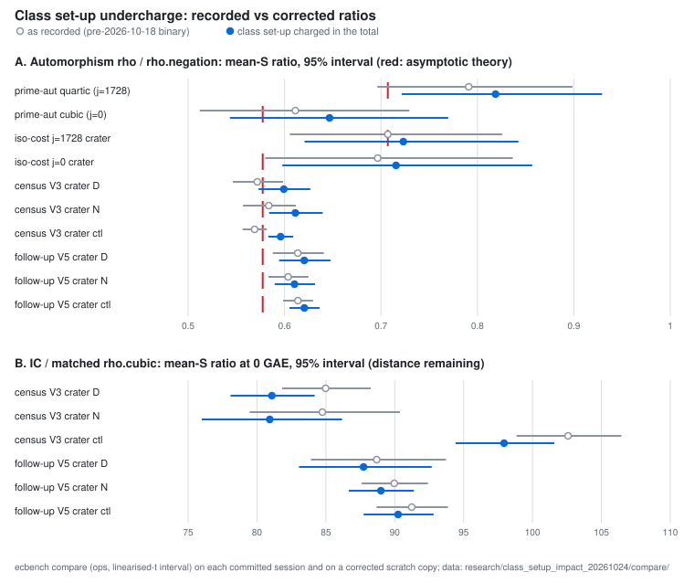

# Impact audit: the pre-2026-10-18 `rho.quartic` / `rho.cubic` class set-up undercharge

**Date.** 2026-10-24. **Status.** Derived from committed records with
ecbench's own `compare` and `table`. Nothing was re-measured, and no
committed session was changed. **Class.** Accounting: these are corrections
to how earlier results were charged, not improvements to any method.

## What was wrong

`rho.quartic` and `rho.cubic` start with a class set-up: the scalar
multiplication that fixes ι (j = 1728) or ζ₃ (j = 0) on the subgroup.
Binaries built before `9ead78cf0` (2026-10-18) charged it to the `setup`
phase but left it out of `total_gae` and `S`. So the total fell short of the
phase sum by exactly the set-up: 16–58 GAE per record at r ≈ 2^14–2^24,
and 111–125 GAE at r ≈ 2^39.5. The phase sum is the true total.
Every arm other than `rho.quartic` and `rho.cubic` was charged correctly,
`rho.negation` references included.

The fix charges the set-up in the total. `ecbench verify` still replays the
old records exactly by reconstructing the old figure from the replay, but
only for records written by the five pre-fix producer binaries
(`audit::PRE_CLASS_SETUP_BINARIES`, [`docs/ecbench/CLASS_SETUP_AUDIT.md`](../../docs/ecbench/CLASS_SETUP_AUDIT.md)).

## Census

Every session in this repository and its siblings (`cryptanalysis`,
`crypto-autoresearcher`, `ml-cryptanalysis`) was scanned for `rho.quartic` or
`rho.cubic` records, in all three storage forms: plain `records.jsonl`, the
`.tar.xz` session archives, and gzipped `records.jsonl.gz`. Zip, zstd and bzip2
archives were also scanned, and none held such records. Every record found
was short of its phase sum, and none carries `detail.class_setup`.

| study | sessions | records | producer binary | built from |
|:--|--:|--:|:--|:--|
| [`prime_rho_automorphism_20261015`](../prime_rho_automorphism_20261015/README.md) | 2 | 192 | `0a8a48d7…` | `c9db37d01` |
| [`drastic_prime_conductor_gap_round2_20261012`](../drastic_prime_conductor_gap_round2_20261012/README.md) | 2 | 128 | `1a87842e…` | `466035c18` |
| [`drastic_prime_conductor_gap_round3_20261012`](../drastic_prime_conductor_gap_round3_20261012/README.md) | 3 | 320 | `d24c2247…` | `7fa17f92e` |
| [`volcano_ecdlp_census_20261017`](../volcano_ecdlp_census_20261017/REPORT.md) (V3 crater, archived) | 3 | 4,032 | `ac4bc5b2…` | `d13f5259c` |
| [`volcano_ecdlp_census_followup_20261023`](../volcano_ecdlp_census_followup_20261023/PLAN.md) (V5, archived) | 66 | 7,600 | `ac4bc5b2…` (the census's frozen binary) | `d13f5259c` |
| [`isogeny-volcano-cost_20261017`](../isogeny-volcano-cost_20261017/README.md) (gzip) | 2 | 256 | `7da27ec3…` | `3d191d806` |

Records counts include warm-ups. The full digests are in
`audit::PRE_CLASS_SETUP_BINARIES`.

## Corrected headline ratios

Each row is `ecbench compare` (operations, ratio of mean S, linearised-t
95% interval, the current default) on the session as recorded and on a
scratch copy whose totals include the set-up
([`examples/ecbench_class_setup_corrected_copy.rs`](../../examples/ecbench_class_setup_corrected_copy.rs)).
The JSON is in [`compare/`](compare/). Both columns come from the same
`compare`, so they differ only in the accounting. Some committed reports
quote intervals from an earlier `compare` or from their own bootstrap, so
the "recorded" column can differ slightly from the number in that report.



### Automorphism rho against `rho.negation` (the positive controls)

| session | pairs | recorded | corrected | theory |
|:--|--:|:--|:--|--:|
| prime_rho_automorphism, quartic (j = 1728) | 72 | 0.791 [0.696, 0.899] | **0.819 [0.722, 0.929]** | 0.707 |
| prime_rho_automorphism, cubic (j = 0) | 72 | 0.611 [0.512, 0.729] | **0.647 [0.543, 0.770]** | 0.577 |
| isogeny-volcano-cost, j = 0 crater (`rho.cubic`) | 64 | 0.697 [0.580, 0.837] | **0.716 [0.598, 0.857]** | 0.577 |
| isogeny-volcano-cost, j = 1728 crater (`rho.quartic`) | 64 | 0.707 [0.606, 0.826] | **0.723 [0.621, 0.843]** | 0.707 |
| volcano census V3 crater, D | 1,000 | 0.572 [0.546, 0.598] | **0.599 [0.573, 0.627]** | 0.577 |
| volcano census V3 crater, N | 1,000 | 0.584 [0.557, 0.612] | **0.611 [0.584, 0.640]** | 0.577 |
| volcano census V3 crater, ctl | 2,000 | 0.569 [0.557, 0.582] | **0.596 [0.583, 0.609]** | 0.577 |
| census follow-up V5 crater, D | 1,000 | 0.614 [0.588, 0.641] | **0.620 [0.594, 0.648]** | 0.577 |
| census follow-up V5 crater, N | 1,000 | 0.604 [0.583, 0.625] | **0.610 [0.590, 0.632]** | 0.577 |
| census follow-up V5 crater, ctl | 2,000 | 0.614 [0.598, 0.630] | **0.621 [0.605, 0.636]** | 0.577 |

### Index calculus against the matched `rho.cubic` (distance remaining)

| session | pairs | recorded | corrected |
|:--|--:|:--|:--|
| volcano census V3 crater, D | 1,000 | 85.0× [81.8, 88.3] | **81.1× [78.1, 84.2]** |
| volcano census V3 crater, N | 1,000 | 84.7× [79.5, 90.4] | **80.9× [76.0, 86.2]** |
| volcano census V3 crater, ctl | 2,000 | 102.6× [98.8, 106.5] | **97.9× [94.4, 101.6]** |
| census follow-up V5 crater, D | 1,000 | 88.7× [83.9, 93.7] | **87.7× [83.0, 92.7]** |
| census follow-up V5 crater, N | 1,000 | 90.0× [87.6, 92.4] | **89.0× [86.7, 91.4]** |
| census follow-up V5 crater, ctl | 2,000 | 91.2× [88.7, 93.9] | **90.2× [87.7, 92.8]** |

All of these are at 0 GAE for unpriced work. The correction raises the rho
arm's charged cost, so the IC/rho ratio falls by the same factor at every
price in the §5a band (0, 0.1, 1 GAE). Rho stays ahead on every row, by about
81× or more. The gap is about 4–5% smaller on V3 and about 1% smaller on V5.
That is an accounting change. It is not an IC improvement, and no IC
baseline moves.

### Conductor-gap rounds 2 and 3 (`rho.cubic` / `rho.quartic` as the matched reference)

The set-up is 111–125 GAE against totals of 0.4–1.0 M GAE on these 40-bit
curves, which is 0.012–0.026% of a solve. Mean S and its interval are
unchanged at three decimals. `S / theory` moves in the third decimal on
some rows (0.982 → 0.983). The tables are in [`tables/`](tables/). No IC/rho
ratio in either round changes at the precision they report.

## What changes in each study

1. **prime_rho_automorphism_20261015 (material).** Finding 1, "both
   predictions hold", no longer holds for quartic. The corrected quartic
   ratio, 0.819 [0.722, 0.929], excludes the asymptotic prediction 0.707.
   Cubic still covers 0.577. The cause is the set-up itself: it is a fixed
   cost of about one scalar multiplication, which is several percent of a
   solve at r ≈ 2^14–2^24. The √A saving is asymptotic and excludes it.
   The "Consequence for round 2" factors (about 1.6× and 1.3×) become
   about 1.55× and 1.22×. Round 2's conclusion, that no IC cell is below
   its matched rho, stands.
2. **volcano_ecdlp_census_20261017 (validated; benchmarks row).** The
   positive control still passes its gate: the upper bound is below 0.85
   on every corrected row. But the corrected ratios sit about 3–6% above
   1/√3, and the N and ctl intervals exclude 0.577. So the statement that
   the control matches theory (0.5733 against 0.5774) was an artefact of
   the undercharge. The IC / `rho-cubic` gap on the V3 crater (A3/F1) is
   about 81× rather than 85× at 0 GAE. The order holds across the band.
3. **volcano_ecdlp_census_followup_20261023 (in progress).** It runs the
   census's frozen binary, so its preregistered analysis will read
   `rho-cubic` about 1% low on V5. That covers the positive control
   (0.614 recorded, 0.620 corrected), the crater IC / `rho-cubic` gap
   (about 1%) and the H-T composition, which has `rho-cubic` at the crater
   in its numerator. Its analysis should add the class set-up to every
   `rho-cubic` total, or amend the plan to say why it does not.
4. **isogeny-volcano-cost_20261017.** Both automorphism controls remain
   detected (their intervals exclude 1). j = 0 reads 0.716 (was 0.697).
   j = 1728 reads 0.723 (was 0.707), still covering √(1/2).
5. **Conductor-gap rounds 2 and 3.** Checked and unchanged (above).

Each affected study's report carries a dated erratum pointing here. Its
committed sessions, records, figures and PDFs are left as recorded, and
the erratum says which numbers it supersedes.

## Graphs checked

- `research/prime_rho_automorphism_20261015/reports/run-20261015T2305Z/ratios.svg`:
  plots the recorded quartic and cubic ratios. Left as the run report of
  that run. This study's [`figures/impact.svg`](figures/impact.svg) is the
  corrected graph.
- `research/volcano_ecdlp_census_20261017/analysis/figures/*`: the V3
  positive-control and crater figures plot the recorded ratios. Left as
  validated. The erratum names the corrected values.
- `benchmarks/20261017-volcano-ecdlp-census/` and its `benchmarks/README.md`
  row quote 0.573 and 84.9×. The row is validated and digest-pinned, so it
  is not rewritten here. The erratum in the study report supersedes those
  two numbers.
- `docs/index-calculus-scoreboard.html`, `docs/ic-current-state.html`,
  `docs/ic/LEADERBOARD.md`: no row cites an affected `rho.cubic` /
  `rho.quartic` figure (searched by value and by session id). Unchanged.

## Reproduce

```bash
cargo build --release --bin ecbench --example ecbench_class_setup_corrected_copy
TMPDIR=/tmp research/class_setup_impact_20261024/run_impact.sh
```

`run_impact.sh` reads the committed sessions, works on copies under
`$TMPDIR`, and writes `compare/` and `tables/`. The graph is drawn from
`compare/` by `figures/plot.py` (layout only) and the PDF built from
`report.typ`.
