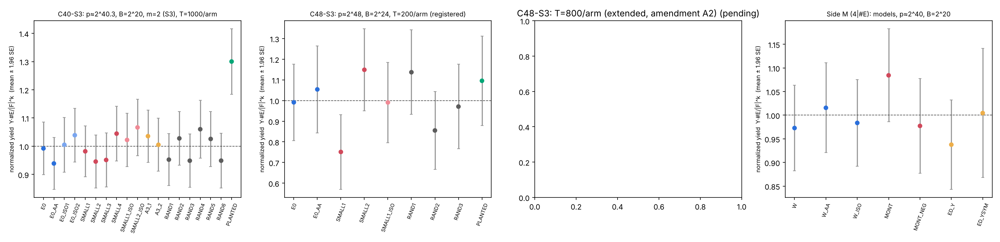
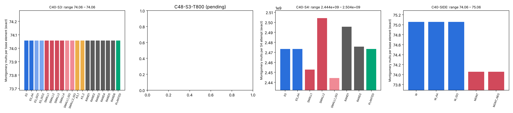
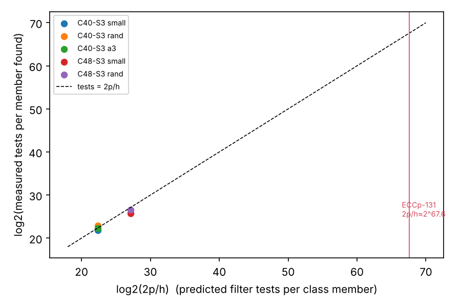

# Answer

**The class is flat**: the registered primary cell (C40-S3) meets every
condition of the frozen "flat" rule. The 2^48 replication sees no effect
either (P1 0.996 [0.910, 1.091]), but by rule it is "inconclusive", because
its positive control was too weak to be detected. On reduced ECCp-131
analogues, isogenous curves with
minimal |a|, |b| find S3 relations at the same rate and the same counted cost
as random isogenous curves. Montgomery and Edwards factor bases on a 4 | #E
side curve match Weierstrass ones. A small-coefficient member of a class
with h ≈ 2^63.6 lies about 2^67.6 candidates away. At one group operation
per test or more, reaching it costs more than Pollard rho (≈ 2^64.9). Even
if it were free, it would buy nothing measurable.

Status labels used below: **exact** (a theorem or a deterministic
computation), **measured** (from the frozen runs), **derived** (an
extrapolation from measured values, not measured at 131 bits).

| Question | Result | Status |
|---|---|---|
| Montgomery/Edwards model inside the ECCp-131 class? | None. h = 1, so every isogenous curve has prime order, and 4 ∤ #E | exact |
| S3 yield, small-coefficient members vs random members, p ≈ 2^40.3 | 0.987 [0.928, 1.051]: **flat** under the frozen rule | measured |
| Same at p ≈ 2^48, T = 200 (registered) | 0.962 [0.801, 1.156]: **inconclusive** (underpowered) | measured |
| Same at p ≈ 2^48, T = 800 (amendment A2) | 0.996 [0.910, 1.091]; still **inconclusive** by rule (planted control not detected), no effect seen | measured |
| S3 counted cost per base element, every Weierstrass arm | identical (74.0576–74.0577 at 2^40; 87.0693 at 2^48) | measured, exact count |
| Montgomery vs Weierstrass S3 yield (side curve) | 1.091 [0.976, 1.216], p_holm 0.77: no effect | measured |
| Montgomery vs Weierstrass S3 cost | 74.06 vs 75.06 mults per element: one multiplication (the b·s term), 1.3% | measured, exact count |
| Filter tests to reach one class member | ≈ 2p/h: 7.6M (C40, 2p/h = 5.4M), 97M (C48, 2p/h = 143M) | measured |
| Tests to reach a small member of the ECCp-131 class | ≈ 2^67.6 candidates > rho ≈ 2^64.9 | derived |

# 1. Question and design

The goal, as set: does summation-polynomial relation finding over F_p depend
on the curve coefficients? The class holds about 2^64 of the 2^131
j-invariants, so a member with |a|, |b| ≈ 2^34 should exist. If the cost moves,
JMV plus subexponential path finding would give a reduction.

The protocol (`PROTOCOL.md`) was frozen and committed before any data. It
has amendment A1 (native Rust port of setup, verify and analyze, made before
any analysis) and amendment A2 (C48 extension, made before any extension
data).

- **Instrument** (`tool/`, Rust, `cmsem`). Montgomery-form F_p arithmetic
  with exact counters. A Weierstrass S3 root-finder solves
  S3(x1, xR, X) = c2 X² + c1 X + c0 with c2 = (x1 − xR)²,
  c1 = −2[(x1 + xR)(x1 xR + a) + 2b], c0 = (x1 xR − a)² − 4b(x1 + xR). A
  Montgomery S3 root-finder does the same in the Montgomery model. S4 is
  done by S3 chaining. A group-law counter checks the root-finders
  independently.
- **Factor base**: F = {P : x(P) ∈ [0, B)}, at the same B on every arm of a
  cell.
- **Primary metric**: normalized yield Y·#E/|F|^k per target (heuristic mean
  1). Y(R) is the number of decompositions of a random target R over F.
- **Arms** in each main cell:
  - E0, a random prime-order curve with Frobenius conductor 1 (an ECCp-131
    analogue)
  - SMALL_k: the minimal-|a|,|b| members of E0's class, found by an
    exhaustive search outward
  - A3_k: a = −3 members
  - RAND_k: uniform random class members (the control)
  - E0_ISO / SMALL_ISO: isomorphic rescalings (same j, large coefficients),
    which separate the coefficients from the curve
  - E0_AA: an A/A copy of E0
  - PLANTED: E0 with 10% of targets equal to P1 + P2 for P1, P2 in F (the
    positive control)
- **Class membership** is decided by n·P = O for random P with n prime and
  greater than 4√p. This forces #E = n, so the curve is isogenous to E0
  (Tate). `cmsem verify` re-checks every arm independently: `all_ok = true`
  on all cells.
- **Statistics**: 95% bootstrap CIs (10000 resamples), Holm correction over
  the P2/P3 family, and a permutation heterogeneity test. Jobs run in
  shuffled order over 4 threads. Clocks are descriptive only.

## Cells

| Cell | p | B | m | T per arm | Arms |
|---|---|---|---|---|---|
| C40-S3 | 1332528136487 (2^40.3), h = 489272 | 2^20 | 2 (S3) | 1000 | 19 |
| C40-S4 | same curves | 2^13 | 3 (S4) | 40 | 8 (descriptive, low power by design) |
| C48-S3 | 293787651428179 (2^48.06), h ≈ 4.10·10^6 | 2^24 | 2 | 200 (registered), 800 (A2) | 9 |
| C40-SIDE | 1308776011747, #E = 4·327194106979 | 2^20 | 2 | 1000 | 7 models |

The smallest-coefficient class members found:

- C40: (a, b) = (209, −977), (1056, 574), (1369, 661), (−597, −1919).
- C48: (−94, −1651) and (−5387, 56).

Against random class members, whose coefficients are ≈ p, these are 2^29
and 2^33 times smaller in each coefficient.

# 2. Exact fact E1: no Montgomery or Edwards model in the class

ECCp-131 has prime order (cofactor h = 1). Isogenous curves over F_p have
equal order, so every member of the class has odd prime order. A Montgomery
or twisted Edwards model needs 4 | #E. **No curve in the class has one.** The
"Montgomery/Edwards" treatment for an ECCp-131 analogue is therefore empty
by construction. The model question was measured on a separate 4 | #E curve
(side study M, §4), as a question about models in general.

# 3. Coefficient size: measured results

## 3.1 C40-S3 (p ≈ 2^40.3, 19000 targets, 380 group-law cross-checks, 0 mismatches)

| Contrast | Ratio of mean normalized yield | 95% CI | p_holm |
|---|---|---|---|
| **P1: SMALL (4 curves) / RAND (6 curves)** | **0.987** | [0.928, 1.051] | (primary) |
| SMALL1 / RAND | 0.988 | [0.891, 1.090] | 1.0 |
| SMALL2 / RAND | 0.951 | [0.853, 1.055] | 1.0 |
| SMALL3 / RAND | 0.957 | [0.858, 1.063] | 1.0 |
| SMALL4 / RAND | 1.051 | [0.948, 1.158] | 1.0 |
| A3_1 / RAND, A3_2 / RAND | 1.042, 1.011 | [0.944, 1.148], [0.911, 1.116] | 1.0 |
| E0 / RAND | 0.998 | [0.900, 1.101] | 1.0 |
| P3: SMALL1 / SMALL1_ISO (same curve, large coefficients) | 0.961 | [0.842, 1.093] | 1.0 |
| P3: SMALL2 / SMALL2_ISO | 0.887 | [0.774, 1.015] | 1.0 |
| A/A: E0_AA / E0 | 0.946 | [0.826, 1.084] | — |
| Positive control: PLANTED / E0 | **1.311** | [1.148, 1.494] | detected |

The permutation heterogeneity test across all 18 non-planted arms gives
p = 0.70.

Counted cost per base element is 74.0576 to 74.0577 Montgomery
multiplications on **every** arm. The S3 kernel treats a and b as full field
elements: once it has done its first multiplication, the coefficient is no
longer small.

**Decision under the frozen rule: flat.** The P1 CI lies inside
[0.90, 1.10], no family contrast is significant, the positive control was
detected, and the per-element cost is equal.

## 3.2 C48-S3 (p ≈ 2^48.06)

**Registered sample size (T = 200, 1800 targets, 45 cross-checks, 0
mismatches).**

- P1 = 0.962 [0.801, 1.156], and A/A = 1.063 [0.804, 1.398].
- The positive control was **not detected**: 1.105 [0.836, 1.447], 13
  planted targets.
- SMALL1/RAND = 0.761 [0.574, 0.979], raw p 0.029, p_holm 0.145.
- Heterogeneity p = 0.082.
- **Decision: inconclusive.** The design was underpowered for its own
  positive control, a protocol fault recorded in amendment A2.

**Extended (amendment A2, T = 800).** 7200 targets, 45 cross-checks, 0
mismatches.

- **Replay**: the 1800 T = 200 rows reappear in the T = 800 output with
  identical counts and multiplication tallies (0 differences,
  `runs/C48-S3-T800.replay.json`). The 6164 rows of a first T = 800 attempt,
  killed by a 2-hour task limit, also reappear unchanged.
- P1 = **0.996 [0.910, 1.091]**. Every family contrast has p_holm = 1.0:
  - SMALL1/RAND 0.998 [0.885, 1.120]. The T = 200 dip of 0.76 regressed
    away.
  - SMALL2/RAND 0.994
  - P3 SMALL1/SMALL1_ISO 0.979 [0.847, 1.130]
  - E0/RAND 1.039
- Heterogeneity p = 0.99. Counted cost is 87.0693 multiplications per
  element on every arm.
- Positive control: 1.116 [0.972, 1.279]. **Not detected.**
- **Decision under the frozen rule: still inconclusive**, for one reason
  only: the planted control was not detected. At p = 2^48 the planted signal
  is weak (+0.12 measured), so even T = 800 cannot resolve it. No further
  extension is made; that would compound optional stopping.
- What the cell does establish, independently of the control: any effect of
  coefficient size on S3 yield at 2^48 is smaller than ±9% (the P1 CI). The
  C40 detector, the same code, demonstrably sees a +31% planted effect.
- Descriptive note, not the registered rule: the PLANTED arm's own mean,
  1.13 ± 1.96 SE, excludes the heuristic value 1 (figure, third panel).
  The registered contrast divides by E0 and inherits E0's noise, which is
  why it does not exclude 1.

## 3.3 C40-S4 (descriptive; T = 40, registered as low power)

S4 yields arrive in clumps. One S4 decomposition is counted once for each
ordering of its points, so the A/A ratio is 6.0 [1.0, 10.0]. The cell has no
power on yield, as stated in advance.

Its exact output is the counted cost. Montgomery multiplications per S4
attempt divided by |F_x|² is 148.147–148.175 on every arm, E0, SMALL, ISO
and RAND alike: a spread of 0.02%. Coefficient size does not enter the S4
chain either.

# 4. Curve model: side study M (4 | #E, p ≈ 2^40.3, 7000 targets, 100 cross-checks, 0 mismatches)

The same curve in four presentations. Each factor base is an interval in the
model's own coordinate: Weierstrass x, Montgomery u (u = s(x − α), with
s = ±1 normalisations), and Edwards y (interval [0, B) or symmetric about 0).

| Arm | Ynorm mean ± SE | Ratio to W | 95% CI | p_holm |
|---|---|---|---|---|
| W (Weierstrass x) | 0.973 ± 0.046 | — | — | — |
| W_AA | 1.016 ± 0.048 | 1.044 | [0.914, 1.191] | 1.0 |
| W_ISO (isomorphic rescaling) | 0.984 ± 0.047 | 0.989 | [0.880, 1.109] | 1.0 |
| MONT (u ∈ [0, B)) | 1.084 ± 0.050 | 1.091 | [0.976, 1.216] | 0.77 |
| MONT_NEG (−u ∈ [0, B)) | 0.977 ± 0.051 | 0.983 | [0.870, 1.110] | 1.0 |
| ED_Y (Edwards y ∈ [0, B)) | 0.938 ± 0.048 | 0.943 | [0.833, 1.060] | 1.0 |
| ED_YSYM (y symmetric about 0) | 1.005 ± 0.070 | 1.010 | [0.864, 1.169] | 1.0 |

Heterogeneity p = 0.585. **The model changes neither the yield nor the
heuristic count.**

What the model does change is the per-element cost of the Montgomery S3
root-finder: **74.06 vs 75.06** multiplications. It is exactly one
multiplication: Weierstrass c0 carries 4b(x1 + xR) and Montgomery c0 is a
square, so the gap is 1.3% at 40 bits and shrinks with p, because the square
root costs about log₂ p multiplications. The Edwards arms were counted by the
group-law counter only, so their cost is not measured.

# 5. Why there is no free reduction (derived)

1. **The coefficients enter the S3 kernel in one product.** Per base
   element, a enters only through additions. b enters through the single
   product b·(x1 + xR). A 34-bit b could turn that product into a
   small-scalar product. That is at most 1 of ≈ 75 multiplications at
   40 bits and less than 1% at 131 bits. Yield, measured above, does not
   move.
2. **Reaching the curve costs more than rho.** A random (a, b) lies in the
   class with probability ≈ h/(2p), so a member with |a|, |b| ≤ β exists once
   4β² ≈ 2p/h. Finding one by search tests ≈ 2p/h candidates. This was
   measured at toy size: 7.6M and 97M tests per member against
   2p/h = 5.4M and 143M (`report/figures/reach_cost.*`). For ECCp-131,
   h ≈ 2^63.6 (analytic class-number estimate, not an exact h) gives 2p/h ≈ 2^67.6 candidates. At **one unit per candidate**
   that exceeds rho, √(πn/4) ≈ 2^64.9 group operations. A real membership
   test (n·P = O, about 2^7.6 group operations by window scalar
   multiplication) puts it at about 2^75.
3. **JMV does not help find it.** JMV and subexponential path finding move
   a DLP between two curves that are already known. They do not say which j
   among the h ≈ 2^63.6 has small coefficients. Building the curve by CM
   needs the Hilbert class polynomial of degree h ≈ 2^63.6.

**The §5a band (pricing a candidate test at 0, 0.1 and 1 GAE).**

| Price per test | Search cost | Against rho (2^64.9) |
|---|---|---|
| 1 GAE | 2^67.6 | above rho |
| 0.1 GAE | 2^64.3 | below rho |
| 0 GAE | 0 | below rho |

So the ordering "search > rho" does **not** hold across the band. It needs
at least 2^−2.7 ≈ 0.15 GAE per test. By the §5a rule, point 2 alone does not
rank the search above rho. (A membership test needs at least one scalar
multiplication, ≥ 2^7.6 GAE, so 0.1 is an unrealistic price. But the rule is
the rule.)

The conclusion does not depend on point 2. Even with the curve given for
free (price 0), it buys nothing: §3–§4 measure equal yield and equal counted
cost on the small-coefficient curves. The gain is bounded by the single b·s
multiplication of point 1.

# 6. Threats to validity and what was done about them

- **Small-search order and arms.** The SMALL members are the first k found
  in the fixed search order (|a| + |b| growing). Using several SMALL curves
  and pooling them in P1 guards against any one member being atypical.
- **Factor-base size.** |F| differs between arms by a few parts per
  thousand. Normalization by |F|^k removes this. Raw Y is also recorded.
- **Clocks.** The SMALL4 clock median at C40 first looked 30% high. It was
  bimodal host contention (≈ 920 vs ≈ 470 ns per element across run
  quarters); within each quarter SMALL4 matched the other arms. Clocks
  decide nothing.
- **Instrument correctness.** Every cross-checked target (380 + 45 + 100,
  plus 510 in smoke tests) gives the same count from the root-finder and the
  independent group-law counter.
- **Optional stopping (C48).** The T = 800 verdict is reported next to the
  registered T = 200 verdict, which stands.
- **Scale.** p ≤ 2^48 against 2^131. The flatness argument is structural (the
  S3 algebra and the factor-base heuristic do not see coefficient size). The
  measurements test it at two sizes. Nothing at 131 bits is measured.

# 7. Prior work and sources checked

research-kb is not installed in this container (`scripts/research-kb`: no
executable). The fallback was a grep over this repository and the sibling
atlas.

- `research/isogeny_class_ic_yield_20261102/`: S3 yield was flat across
  Elkies neighbours and random curves of ECCp-131 analogues. The present
  study adds the coefficient-size and model axes, uniform class sampling,
  and isomorphic controls.
- Lead atlas: LEAD-ICE-curve-presentation-invariance and
  LEAD-EXO-curve-model-representation (both predicted invariance; this
  study measures it).
- Petit, Kosters and Messeng (PKC 2016) on prime-field summation polynomials
  with algebraic factor bases: rho is not beaten. This is consistent with
  the flat result here.

All values above are measured by the runs listed, or derived from them as
labelled. They are unverified assertions in the pcc sense ([pcc:unverified]):
no pcc claim was filed. No IC-leaderboard or benchmarks row: this is a
characterization, not an improvement over the index-calculus baseline.

# 8. Figures







# 9. Reproduce

```
cd research/coeff_model_semaev_20261109/tool && cargo build --release
./target/release/cmsem verify ../runs/C48-S3.cell
./target/release/cmsem run < ../runs/C40-S3.cell > C40-S3.jsonl   # ~1 h on 4 vCPU
./target/release/cmsem analyze C40-S3.jsonl C40-S3 s3 out.json
```

Raw rows: `runs/*.jsonl.gz`, with hashes in `runs/SHA256SUMS` and
`runs/C40-S3.jsonl.sha256`.
