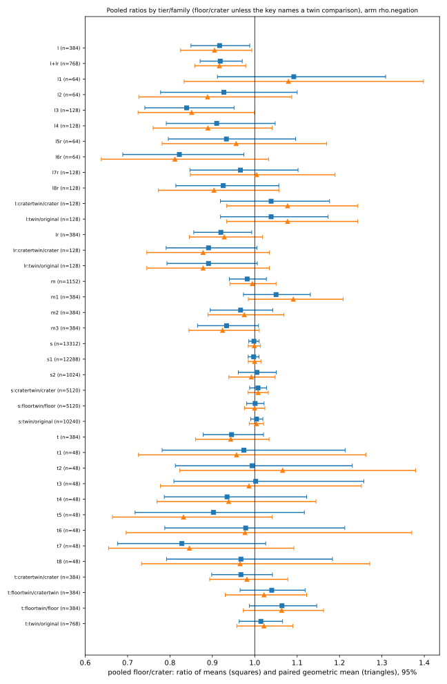
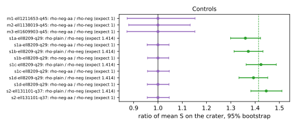
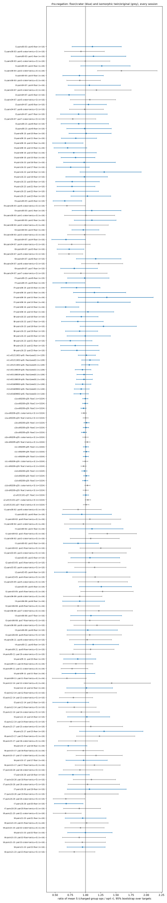
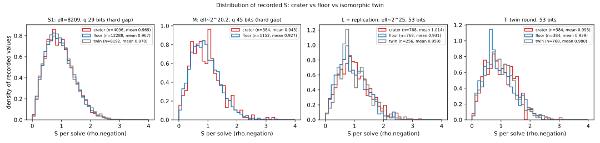

# Does Pollard rho see a large prime conductor gap? A large-sample test

Study of 2026-10-18. Protocol frozen before data: [`PROTOCOL.md`](PROTOCOL.md),
with two pre-data amendments and one pre-registered post-hoc replication in
[`AMENDMENTS.md`](AMENDMENTS.md); hashes in `FROZEN.sha256*`. Harness: the
repository's native `ecbench` (binary sha256 `ee0af723cf6c1064…`, source at or
before commit `42ab2c57`, which is an ancestor of the checkout with no change to
the ecbench sources since). Formal companion: [`lean/`](lean/README.md).

## 1. Question

Two ordinary curves over GF(q) in the same F_q-isogeny class with prime order N
and endomorphism rings O_K (the *crater*, conductor 1) and Z + ℓ·O_K (a *floor*,
conductor the prime ℓ) are joined only by isogenies of degree divisible by ℓ.
Jao, Miller and Venkatesan (ANTS VII, 2005; J. Number Theory 2009) prove that the
ECDLP is equally hard, up to polynomial factors, on curves whose endomorphism
conductors differ only at small primes; a *large* prime conductor gap is the one
case their expander argument does not reach, and whether the two sides can differ
in ECDLP hardness has been open since. This study asks the measurable part of
that question: does the cost of Pollard rho, the best known attack over prime
fields, differ between the crater and the floors?

Null hypothesis H0: for every (q, N) the per-target distribution of
S = charged group operations / √r is the same on the crater and on every floor.

## 2. What was measured

| tier | ℓ | q bits | kernel field degree k | gap crossing | curves | targets / curve | arms | solves |
|---|---|---|---|---|---|---|---|---|
| S1 (`s1a`–`s1d`) | 8209 | 29 | 2736 | hard (≈2^34 vs rho 2^14.5) | crater, 3 floors, 2 twins | 4 × 1024 | rho.negation, rho.plain, A/A | 73,728 |
| S2 (`s2`) | 131101 | 37 | 65550 | hard (≈2^44 vs 2^18.5) | crater, 1 floor, 2 twins | 1024 | same | 12,288 |
| M1–M3 (`m1`–`m3`) | 1,211,653 / 1,138,019 / 1,609,903 | 45 | ℓ−1, ℓ−1, (ℓ−1)/2 | hard (≈2^53 vs 2^22.5) | crater, 3 floors each | 128 | rho.negation, A/A | 3,072 |
| L (`l1`–`l4`) | 33,555,419 … 35,282,963 (≈2^25) | 53 | 2 | easy (one Vélu ℓ-isogeny on the twist, ≈2^25 vs 2^26.3) | 24 crater/floor pairs, 8 crater twins | 16 | rho.negation | 896 |
| L follow-ups (`l5r`–`l8r`, `t1`–`t8`; §4) | same | 53 | 2 | easy | same 24 pairs; replication, then twins of both endpoints | 16 + 16 | rho.negation | 896 + 1,536 |

D = −19 throughout (class number 1, Aut = ±1 on every curve, so no automorphism
confound). "Kernel field degree" is k = ord(t/2 mod ℓ), the degree over GF(q) of
the field of definition of the kernel points of the connecting ℓ-isogenies; the
crossing cost quoted is the ℓ^2.6 scaling of
`benchmarks/20261011-isogeny-vertical-margin-historical` for a non-rational
kernel, and Vélu's O(ℓ) for tier L, where t = ℓ − 2 makes the quadratic twist's
ℓ-torsion rational. Tiers S and M are therefore the regime JMV leaves open
(crossing the gap costs more than solving the DLP); tier L is the regime where
equivalence is already constructive, and it was included because it is the largest
ℓ in the repository and it carries the earlier, unexplained post-hoc rho ratio of
1.17 [1.00, 1.38] (`conductor_gap_cm_orbits_20261015`).

Curves: tier S are the Sage-verified curves of
`research/conductor_gap_cm_pairs_20261010` (same q, a, b, generator); tier M are
new parameters (q = (t² + 19ℓ²)/4 and N = q + 1 − t prime, k computed exactly),
built and certified inside the session by the native `conductor_gap` constructor
(`[N]P = O` on an affine point, N prime above the Hasse width, j ≠ j_D for the
floors); tier L are pairs 0–23 of
`research/conductor_gap_cm_orbits_20261015/inputs/pairs.json`. Isomorphic twins
are (a·3⁴, b·3⁶) with generator (3²x, 3³y): the same curve up to isomorphism, same
endomorphism ring, different point representation.

Controls. *Negative*: the twin/original ratio, the null distribution of "different
coordinates, same everything else" (rho's partition hashes the representation).
*Positive*: `rho.plain` against `rho.negation` on the same workloads, expected
√2 = 1.414. *A/A*: a second `rho.negation` arm. Targets are `planted_shared`
(the same scalars on every curve of a spec) so comparisons are paired per target.
Seeds are fresh: measurement seed 20261018 (every earlier study used 1 or
20261012), target seeds per spec in the specs.

Unit and scope. S is ecbench's `cost.s` (charged group additions and doublings over
√r; `canonicalisations_uncharged` is the one unpriced counter, the same on every
arm, so the §5a pricing band does not change any ranking here). Wall time was
never read: the host was shared with two other jobs (load 24–37 of 32) and every
run is L0.

## 3. Results (operation counts only)

Full tables: [`results/summary.md`](results/summary.md) (every curve, arm and
control, with intervals), `results/summary.json`. Intervals are 95 % bootstrap
over targets (4000 draws) for the ratio of means, and a normal 95 % interval for
the paired per-target log-ratio.

### 3.1 Pooled floor / crater, arm `rho.negation` (frozen analysis)

| tier / family | pairs | solves per side | ratio of means | 95 % | paired geometric mean | 95 % |
|---|---:|---:|---:|---|---:|---|
| S = S1 + S2 (ℓ = 8209, 131101; hard gap) | 13 | 13,312 | **0.998** | [0.986, 1.010] | 0.999 | [0.985, 1.014] |
| S1 (ℓ = 8209, 12 floor/crater pairs over 4 shards) | 12 | 12,288 | 0.998 | [0.985, 1.011] | 1.000 | [0.985, 1.015] |
| S2 (ℓ = 131101) | 1 | 1,024 | 1.005 | [0.960, 1.052] | 0.992 | [0.939, 1.048] |
| S twins / originals (negative control) | 10 | 10,240 | 1.004 | [0.990, 1.019] | 1.004 | [0.987, 1.021] |
| M = M1–M3 (ℓ ≈ 2^20.2; hard gap) | 9 | 1,152 | **0.982** | [0.940, 1.028] | 0.994 | [0.941, 1.050] |
| M1 / M2 / M3 | 3 each | 384 | 1.050 / 0.967 / 0.934 | [0.974, 1.133] / [0.897, 1.047] / [0.864, 1.008] | 1.091 / 0.975 / 0.924 | |
| L (ℓ ≈ 2^25; easy gap) | 24 | 384 | **0.917** | [0.851, 0.988] | 0.905 | [0.825, 0.993] |
| L1 / L2 / L3 / L4 | 4 / 4 / 8 / 8 | 64–128 | 1.092 / 0.927 / 0.839 / 0.910 | [0.917, 1.311] / [0.776, 1.096] / [0.738, 0.954] / [0.796, 1.044] | | |
| L twins / originals (negative control) | 8 | 128 | 1.039 | [0.920, 1.173] | 1.077 | [0.934, 1.243] |

### 3.2 Controls

- Positive control, `rho.plain` / `rho.negation` on the crater: 1.360 [1.301, 1.422],
  1.372 [1.311, 1.431], 1.424 [1.365, 1.486], 1.393 [1.334, 1.455] in the four
  ℓ = 8209 shards and 1.446 [1.382, 1.511] at ℓ = 131101. Every interval excludes
  1 and contains or brackets √2: the detector sees a 41 % effect at these sample
  sizes without difficulty.
- A/A arm: ecbench shares the algorithm seed per (workload, round) across arms,
  so the second `rho.negation` arm reproduced the reference *exactly* on every
  target (paired ratio 1.0000 [1.0000, 1.0000]). It is a determinism check, not an
  independent draw; the between-draw noise floor is the twin control instead.
- Per-curve: of the 12 floor/crater comparisons in S1 and the 3 in S2 (n = 1024
  each), none excludes 1 (range 0.968–1.017). Of the 9 in tier M (n = 128) none
  excludes 1. Of the 24 in tier L (n = 16), two do (pair 5: 0.73 [0.51, 0.99];
  pair 12: 0.67 [0.46, 0.96]) and neither survives a Bonferroni correction over 24;
  one of the 8 twin controls in the same tier excludes 1 in the other direction
  (pair 2 twin: 1.59 [1.20, 2.18]).

### 3.3 Decision under the frozen rule

H0 is not rejected in any tier.

- Tiers S and M (the hard-gap regime that JMV leaves open): the pooled ratios are
  0.998 [0.986, 1.010] and 0.982 [0.940, 1.028]. At ℓ = 8209 the earlier lead of
  1.22 [1.005, 1.46] (4 targets, seed 1, `conductor_gap_cm_pairs_20261010`) is
  excluded by 12,288 paired solves under a fresh seed: any floor/crater difference
  in rho's operation count is below about 1.2 % at ℓ = 8209, below 5 % at
  ℓ = 131101 and below 6 % at ℓ ≈ 2^20, with the twin controls at the same level
  (1.004 [0.990, 1.019]).
- Tier L (easy gap, 16 targets per curve): the pooled interval 0.917 [0.851, 0.988]
  excludes 1, in the *opposite* direction to the earlier post-hoc 1.17 [1.00, 1.38]
  on the same 24 pairs with one target each, and the frozen rule (a) is not met:
  no single pair survives Bonferroni, and (b) one twin control is further from 1
  than any floor. This is recorded as an observation, not a difference. It is
  what prompted the pre-registered replication and twin round of §4, which
  attribute it to the coordinate models, not to the conductor.

### 3.4 What the twins say about the sheriff's point

The repository's earlier generic-invariance theorem does not cover rho, because
ecbench's rho hashes the point representation (sheriff case SHF-20261016-3caa6f).
The twin controls measure that effect directly: at n = 1024 per curve the
representation changes rho's mean cost by at most ≈ 2 % (pooled 1.004
[0.990, 1.019]); at n = 16 it produces intervals as wide as 1.59 [1.20, 2.18].
Every floor/crater ratio in this study is inside the twin band of its tier.

## 4. Tier L follow-ups (post hoc, each pre-registered before its own data)

Tier L is the only tier whose frozen interval excluded 1. Two follow-up rounds
were run on the same 24 pairs with fresh target seeds (AMENDMENTS.md items 3–4);
they are reported separately from the frozen analysis, which does not change.

| round | what | floor / crater | crater-twin / crater | floor-twin / floor | floor-twin / crater-twin |
|---|---|---:|---:|---:|---:|
| L frozen (`l1`–`l4`) | 24 pairs, 8 crater twins (u = 3), 16 targets | 0.917 [0.850, 0.988] | 1.039 [0.919, 1.176] | — | — |
| replication (`l5r`–`l8r`) | same curves, fresh targets | 0.920 [0.856, 0.993] | 0.891 [0.791, 1.005] | — | — |
| L + replication | 48 pair-samples, 768 solves per side | 0.919 [0.871, 0.971] | | | |
| twin round (`t1`–`t8`) | 24 pairs, twins (u = 5) of *both* endpoints, fresh targets | 0.945 [0.878, 1.021] | 0.967 [0.898, 1.042] | 1.064 [0.988, 1.146] | **1.040 [0.966, 1.119]** |

Reading. The replication reproduced the frozen floor/crater ratio almost exactly
(0.920 against 0.917), so the shift is not a one-off draw; over 48 pair-samples the
floors cost 8 % [3 %, 13 %] fewer operations than the craters. But the replication's
twin control moved by the same amount with no change of endomorphism ring (0.891
[0.791, 1.005]), and the per-pair intervals that exclude 1 are driven by high-S
crater draws that depress the twin ratio of the same pair just as much (pairs 0 and
5 of the replication). The twin round was designed to separate the two readings and
its three pre-registered comparisons all contain 1. The decisive one is
floor-twin / crater-twin, 1.040 [0.966, 1.119]: the same conductor gap between two
freshly re-coordinatised models shows no deficit at all, while the comparisons
that involve the original crater models (floor/crater 0.945, crater-twin/crater
0.967) keep a few per cent of it. Within this tier the shift therefore attaches to
the particular coordinate models of `pairs.json`, not to End(E); re-coordinatising
both endpoints removes it. What remains is a statement about ecbench's fixed
partition hash: on specific models it can move rho's mean cost by ≈ 5 % at n = 384,
which is exactly the residual the Lean result (§5) says a fixed hash can carry and
which the uniform-hash theorem rules out in distribution. It is also the magnitude
of the previous unexplained post-hoc value on these pairs (1.17, one target each,
opposite sign), which this study therefore closes as representation noise.

## 5. Formal companion (Lean 4.34.1, no Mathlib)

[`lean/RepresentationHashInvariance.lean`](lean/RepresentationHashInvariance.lean)
proves, with no axioms beyond `propext` and `Quot.sound`
([`lean/build.log`](lean/build.log)), that along any isomorphism φ of the groups
of points an r-adding walk whose partition hashes the representation has a
transported partner walk (hash ∘ φ⁻¹, φ ∘ multipliers) with the same trajectory and
the same first-collision cost at every budget (`rhoCost_transport`), and that
transport is a bijection of the space of (partition, multiplier) choices
(`costPreservingBijection`). Consequence, read outside Lean: over a uniformly
random partition the distribution of rho's cost is identical on crater and floor,
so the endomorphism conductor can reach rho only through the one fixed partition an
implementation uses. That residual is exactly what this study measured, and it is
at the ≤ 1–2 % level of the twins. The earlier files `GenericInvariance.lean`
(BSGS-type algorithms) and `TransferBound.lean` (any solver transfers across an
evaluable isogeny at the isogeny's cost) in
`research/conductor_gap_cm_pairs_20261010/lean/` complete the formal picture:
generic algorithms are blind to the gap by theorem, representation-hashing walks
are blind in distribution by theorem and blind in practice by measurement, and
any other algorithm can differ across the gap by at most the cost of the
connecting isogeny.

## 6. What this does and does not settle

Settled by this study, within its scope:

- For Pollard rho with the negation map, the floor and the crater of a prime
  conductor gap are indistinguishable at the 1 % level for ℓ = 8209 (29-bit q), at
  the 5 % level for ℓ = 131101 (37-bit) and at the 6 % level for ℓ ≈ 2^20 (45-bit),
  all with a hard (non-rational, degree-k ≥ 2736) kernel, under a fresh seed and
  with the positive control confirming the detector. The repository's one open
  rho lead (ℓ = 8209) is closed.
- Tier L (easy gap, ℓ ≈ 2^25, 53-bit): the floors of the 24 `pairs.json` pairs cost
  8 % [3 %, 13 %] fewer rho operations than the craters over 48 pair-samples, but
  twins of both endpoints show the same gap at 1.040 [0.966, 1.119], so the shift is
  a property of the specific coordinate models (and of ecbench's representation
  hash), not of the endomorphism ring. The previous post-hoc 1.17 on these pairs is
  closed the same way.

Not settled, and not settleable by measurement or by the theorems above:

- Whether some *non-generic* algorithm exploits End(E) = Z + ℓO_K versus O_K. The
  transfer bound says any such advantage is at most the cost of one ℓ-isogeny
  evaluation, which for a non-rational kernel is ≈ ℓ^2.6 by the repository's
  measurement; nobody has a cheaper way, and nobody has proved there is none.
  "Definitively solving" the JMV question in the sense of a proof of equal
  hardness would require lower bounds on ECDLP that do not exist for any curve.
- Everything here is over prime fields, D = −19, q ≤ 53 bits, and ecbench's
  particular walk (32-adding, distinguished points, negation classes). Index
  calculus is not measured in this study (see `conductor_gap_cm_orbits_20261015`
  for 0.980 [0.866, 1.111] at ℓ ≈ 2^25).

## 7. Audits and reproduction

- `audits/*.audit.json`: `ecbench verify` receipts for all 24 sessions. Tiers S and
  M: `--replay-all` (every run re-executed with identical counts; e.g. s1a: 18,432 of
  18,432 replays reproduced, 0 problems; m1–m3: 1,024 of 1,024 each). Tier L, the
  replication and the twin round: `--replay 24` each, all identical. Every receipt
  is `ok` with 0 problems.
- Session layout in git: the 19 sessions of tiers M, L, the replication and the twin
  round are committed raw under `sessions/` (≈ 50 MB), together with the three
  interrupted sessions of the first launch. The five tier-S sessions (420 MB,
  86,016 records) are committed as unmodified gzipped tarballs in
  `sessions_packed/` (≈ 30 MB) with `SHA256SUMS`, because the CI session discovery
  keys on `session.json` and would re-audit all of them on every pull request; their
  `verify --replay-all` receipts, which list every file's sha256, are in `audits/`.
  `sessions_packed/README.md` says how to restore and re-audit them.
- Reproduce: `python3 make_specs.py` (writes `specs/`), `./run_sessions.sh`
  (one session per spec, `taskset`-pinned, `--cpus none`), `./audit.sh`,
  `python3 analyze.py` (fixed analysis → `results/`),
  `/tmp/report-venv/bin/python plot.py && make_run_reports.py && make_report.py`
  (figures, per-session run reports in `reports/run-*/`, `report.pdf`).
- Pitfalls met (kept in `AMENDMENTS.md`): this ecbench build exits 0 without a
  session when given an explicit `--cpus <n>`; planning costs ≈ 37 ms per workload
  and each execution ≈ 0.3 s of process overhead on this host, so small-field
  sessions are overhead-bound. The three sessions interrupted before the amendment
  are kept unmodified in `sessions/interrupted-20261018T0852Z/` and unused.
