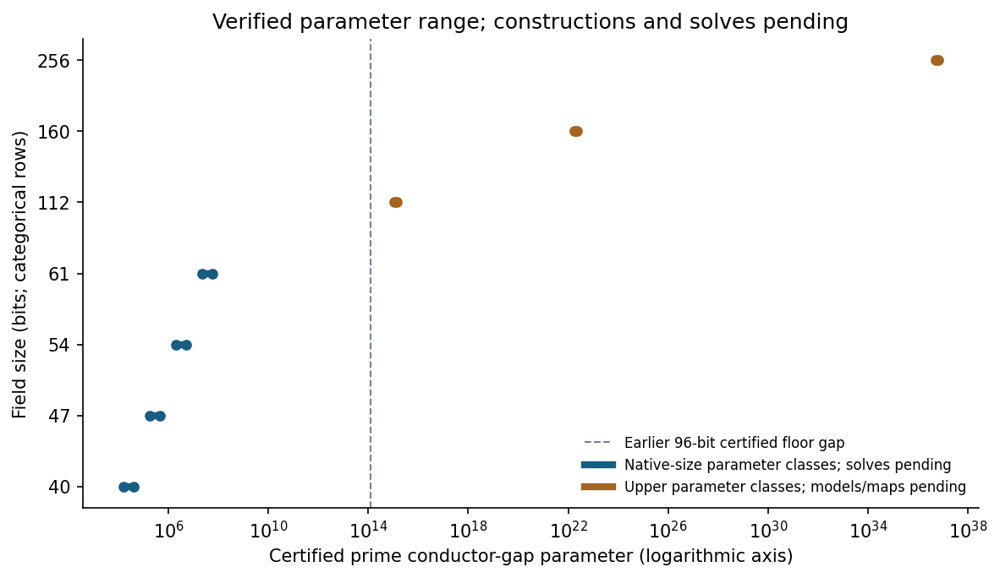
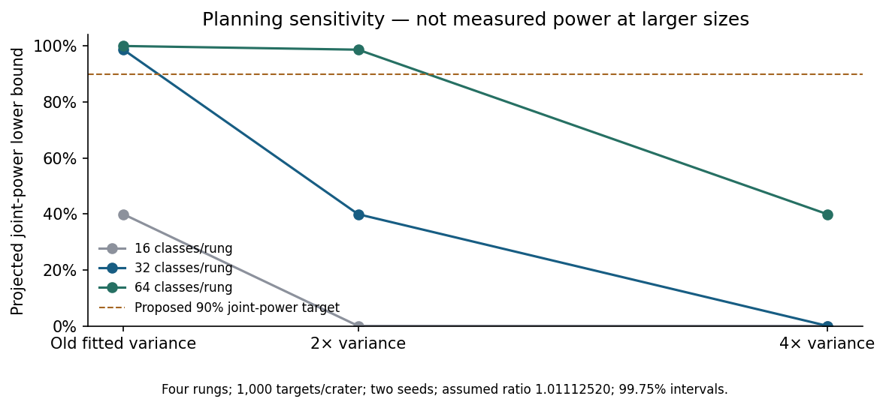

# Broader conductor gaps: sizes, precision and remaining work

2026-10-26. **Parameter search and experimental design; zero new ECDLP
solves and zero new explicit curve models.** Native source was frozen
before each search. The corrected crater result remains inconclusive:
S2/S1 = 1.01112520, enumerated 98% interval [0.97323,1.05706].

The useful next objective is a larger measured range with enough independent
replication to exclude an average rho cost difference beyond ±5%. Merely
increasing the conductor integer, subgroup bits or repeated seeds cannot
guarantee that conclusion. The user requested broader gaps and stronger
confidence; the completed parameter work and pending measurements are
distinguished below.

| Requirement | Actual status |
|:--|:--|
| Broaden candidate conductor gaps and subgroup sizes | Verified parameter arithmetic/primality: 128 native-size classes plus six upper classes. |
| Include much larger key-space parameters | Verified prime subgroup-order parameters through 254 bits; no supplied curve/generator or solve at that size. |
| Define a high-confidence comparison | Proposed: all four rung intervals within ±5%, nominal 99% simultaneous coverage; pilot calibration still required. |
| Construct exact models, floors and transported targets | Not performed; explicit map/order/stratum certificates remain required. |
| Run the disjoint pilot and confirmation | Not performed; native driver, replay, variance and resource feasibility remain blocked. |
| Establish broader equivalence or hardness | Not established. The earlier measured crater verdict is unchanged. |

## The retained parameter range

Each native-size rung has eight distinct classes for each of D=-11,-19,
-43,-67: **32 classes per rung**, 128 total. Cofactor is at most 64;
the actual subgroup bits, rather than field bits, control generic work.
The design keeps depth four and the within-class S1/three-S2 comparison.
Different classes hold different fields/traces; each eventual within-class
comparison must hold field, order and subgroup fixed.

| Field bits | Classes | Actual subgroup bits | Prime gap range |
|--:|--:|--:|:--|
| 40 | 32 | 34–38 | 15,749–39,323 |
| 47 | 32 | 41–45 | 179,957–441,319 |
| 54 | 32 | 48–52 | 2,044,391–5,042,963 |
| 61 | 32 | 55–59 | 23,177,047–57,063,697 |
| 112 | 2 | 110 | approximately 1.1004e15–1.3735e15 |
| 160 | 2 | 158 | approximately 1.8462e22–2.3045e22 |
| 256 | 2 | 254 | approximately 5.1965e36–6.4866e36 |

The upper classes use D=-43,-67, trace -2 and cofactor four. Exact
decimal integers and witnesses are in [candidates.csv](results-v2/candidates.csv);
[design.json](results-v2/design.json) records all ranges and search counts.
The [independent verifier receipt](results-v2/verification.json) covers all
134 classes and 22 cells. It explicitly verifies **zero models, maps or
solver records**. Prime subgroup-order parameters do not become registered
ICV1 curve identities until exact models and generators are constructed.

{width=95%}

The old replication used gaps 997–4,799 and 25–32-bit subgroups. The
original transported depth-six class had gap 631,409 and a 41-bit subgroup.
Separate historical 53-bit ECDLP comparisons already cover gaps
33,555,419–35,282,963, with their recorded transfer/timing limits. The older
96-bit construction certifies a floor at gap 125,000,000,302,579 but does
not certify full target transport. These are different evidence types;
the new parameter search cannot be called a new comparison at those sizes.

For an actual endomorphism conductor ratio $\ell$ dividing the Frobenius
conductor, $\ell \le 2\sqrt{p}/\sqrt{|D_K|}$; an additional depth-four
factor gives $\ell \le 2\sqrt{p}/(16\sqrt{|D_K|})$. Thus gap and field
size cannot be varied independently over arbitrary ranges. The design
requires paired comparisons within classes and reports every subgroup/
cofactor; it does not claim a field-independent causal gap effect.

## Repetitions: a precision objective, not a magic count

The proposed primary comparison has four size rungs. Use 99.75% marginal
intervals, giving at least 99% simultaneous coverage by the union bound
**if their marginal coverage is valid**. Bootstrap intervals have approximate
coverage and must be calibrated under the selected design. All four
intervals must lie wholly inside [0.95,1.05]; failing to detect a difference
is not evidence of equivalence. Individual classes and CM families also
remain visible. A pooled average does not establish uniform equivalence.

The provisional allocation is 32 classes/rung, four craters/class,
1,000 distinct fresh logarithms/crater, two independent rho seeds per log,
four rungs: **1,024,000 independent one-target solves**, plus full separate
replays and controls. There is no shared multi-target collision table.
Classes, target draws, solver seeds and correctness replays are distinct
units. Replaying an existing record adds no statistical observation.

\newpage

Native planning uses the old variance components, with variance of the
log-ratio approximated by $\tau^2/K + (V_{\rm target}+V_{\rm seed}/R)/(KM)$. The assumed
true ratio below is the old 1.01112520. The joint-power lower bound uses
the union bound and does not assume independence across rungs.

| Variance relative to old fitted model | Approximate per-rung power | Joint-power lower bound |
|:--|--:|--:|
| 1× | 99.67% | 98.68% |
| 2× | 84.97% | 39.90% |
| 4× | 39.65% | 0% |

At ratio 1.01 the old-model joint lower bound is 99.22%; none of these
values is measured power at the larger sizes. A zero union lower bound
does not mean zero actual joint power. The old model itself used only
32 two-seed targets per class, with six of eight estimated target
covariances negative before truncation; its uncertainty is unquantified.

{width=95%}

After model/map construction and execution-feasibility checks, run a
separate pilot of 32 fresh targets/crater, two seeds, all 128 classes:
**32,768 pilot solves**, plus separate replays. Exclude them from
confirmation. The pilot must support at least 90% joint power for true
ratios in [0.99,1.01], coverage calibration and the declared resource
envelope before the confirmation count is frozen. Otherwise revise a new
protocol and leave confirmation pending. Never continue until equivalence
happens to pass, change the margin after results, or drop failed targets.

The native generic-negation model projects about 1.0051e14 group additions
for the proposed native-size confirmation and 2.0102e14 including replays,
before controls, construction and unpriced work. These are **operation-model
projections, not measured runtime, complete costs or a resource allocation**.
They make execution feasibility a real open requirement. The 254-bit
subgroup parameters would imply roughly $2^{127}$ generic-rho work per solve;
upper structural checks cannot stand in for completed rho comparisons.

\newpage

## Preserved failure and corrected family

The [v1 card](cards/CARD-conductor-gap-size-20261026-1.yaml) stopped after
retaining 131 parameter classes: all 128 native classes and three upper
D=-43 classes. All three D=-19 upper cells exhausted 3,000,000 candidates.
No independent verification command ran after that stop. Raw v1 results,
logs, receipt and stopped assessment remain unchanged.

The restricted D=-19, trace=-2, h=4 formula gives $p=1216\ell^2+1$ and
$r=304\ell^2+1$. For prime $\ell>5$, ell modulo 5 is 1,2,3 or 4; its square is
1 or 4. Respectively r or p is a proper multiple of 5. This is a
four-case modular obstruction for this formula, not a statement about
all D=-19 curves. The [native residue table](mod5-cases.json) records each
case. Supporting product-decomposition certificate
**IDC1h4e934fe294c7d1ba** is [retained](mod5-identity.json), with 32 issued
and 64 additional checked points over F_(2^61-1). That finite-field
evaluation is an additional arithmetic check; the integer modular argument
is the four explicit cases. Lean/lake are unavailable; no checked Lean
proof is claimed.

The [v2 amendment](AMENDMENT-v2.md), frozen before execution, replaced only
those three cells with D=-67. It reused every original row byte-for-byte,
searched three new upper cells, then independently verified all 134 classes.
The [v2 receipt](cards/CARD-conductor-gap-size-20261026-2.receipt.json) pins
the source commit 834cc5015d221c9bac774bd9eb278db624db4d85, inputs,
binaries, commands and outputs. The director's assessments concern execution
and verbatim relay only, not the scientific conclusion.

## Validation, reproducibility and pending work

Native C++17/GMP search and independent verification use different
Miller–Rabin base sets and modular-exponentiation implementations. Upper
primality uses recursive Pocklington witnesses with sufficiently large
known factors; probable-prime tests only filter candidates. Bad known
factors, duplicated classes and truncated cohorts are rejected. Reversed
row order gives the same verifier receipt; the retained v1 prefix matches
byte-for-byte. Source/inputs and artifact hashes accompany the study.

Rust library validation: 4,494 passed, zero failed, 119 ignored. The new
native identity example has two passing tests. All 49 site tests pass;
all 49 validation-gate tests and the gate pass **after local hydration**.
The parent artifact-store migration removes 15 raw inputs needed by two
existing validation rows; the unhydrated gate fails. Local copies were
restored from pre-migration Git with all 53 referenced digests verified,
without recomputing or changing frozen bytes. A clean CI checkout still
needs hydration; see [validation context](VALIDATION_CONTEXT.md).

Rebuild the two native programs using the amendment's commands; then
run the verifier against results-v2/candidates.csv into a fresh receipt.
The mechanical cards preserve the complete search commands. Re-render:

```sh
study=research/conductor_gap_size_ladder_20261026
MPLCONFIGDIR=/tmp/conductor-gap-size-mpl python3 "$study/render.py"
```

Python only lays out recorded native values. No performance result, IC
ranking, benchmark row or measured volcano edge changed. Historical graphs
in the old studies, scoreboard, progress timeline and leaderboard retain
their frozen findings; the new parameter-range and sensitivity figures
belong here. The companion PDF is inspected separately.

The [problem record](../../problems/conductor-gap-crater-sampling-and-size.md)
and [blocked backlog card](../../backlog/XP-20261026-conductor-gap-size-confirmation/README.md)
retain the exact next obligations: actual models/maps, native resumable
driver, independent replay, disjoint pilot, calibrated precision and an
executable resource envelope. No solver campaign or paid resource has been
launched. Complete CM setup accounting and a prime-field algebraic oracle
remain open. Rho comparisons alone cannot establish a general ECDLP
hardness gap or full-cost speed equivalence.
