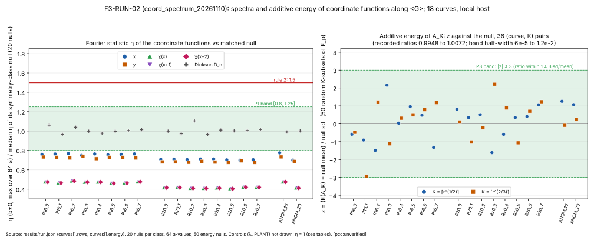

# F3: Fourier spectrum and additive energy of coordinate functions along ⟨G⟩ on prime-order curves over F_p

**Status:** closed by decision rule 3 (run F3-RUN-02 complete; no replication is prescribed). Every number in this file is `[pcc:unverified]` (no pcc claim id exists for this run). No improvement over rho, or over anything, is claimed.

**Class:** boundary diagnostic; exact counts, no S, no rho row, no leaderboard change.

## Purpose and mechanism

For a cheap-to-evaluate `g : ⟨G⟩ → F_p` the study measures the character sums `S_g(a, b) = Σ_{k ∈ Z/r} e(a·g([k]G)/p + b·k/r)` and `η_g = max |S_g(a,b)| / r`. A coefficient `η ≫ r^{−1/4}` would give the logarithm by a hidden-shift step in about `log r / η²` group operations (the generator's derivation, `[derived]`, not checked). The bound it must escape: for `g` of algebraic degree `d` in the coordinates the Weil bound gives `η ≲ 2d·r^{−1/2}` (Kohel–Shparlinski, `[recalled]`), which restates rho's barrier; only functions of degree about `r^{1/4}` or more that stay cheap could escape it.

The second statistic is the additive energy `E(A) = #{(a,b,c,d) ∈ A⁴ : a+b = c+d in F_p}` of `A_K = {x([k]G) : 1 ≤ k ≤ K}`, which single character sums do not control: an excess over random growing with `p` would mean Freiman-type structure in the orbit (4-term x-coordinate relations harvestable without summation polynomials). The instrument is native Rust (std only): exact-arithmetic (f64) FFT of length `r` at 64 values of `a`, exact energies by hashing pair sums, `K ∈ {⌈r^{1/2}⌉, ⌈r^{2/3}⌉}`, against 20 nulls per class (spectrum) and 50 random `K`-subsets of F_p (energy).

## Rows and functions (PROTOCOL.md section 1)

- **R16, R20:** 8 prime-order curves each, `p` = largest prime below 2^16 / 2^20, `G` = first point by ascending `x` then `y`.
- **ANOM:** 2 anomalous curves (`#E = p`) built by CM with `D = −11` (`p = 74869` and `p = 1060513`; the "2^16" curve lands above 2^16). Positive control.
- Functions per curve: `x`, `y`, `χ(x + c)` for `c = 0, 1, 2` (Legendre), the Dickson polynomial `D_n(x)` of degree `n = ⌈r^{1/4}⌉` (the Weil-escape class); controls: `λ` the Smart p-adic logarithm (ANOM only, must be linear in `k`) and `PLANT`, `g(k) = ⌊k·p/r⌋` (synthetic heavy coefficient, every curve).

## Frozen predictions and decision rules (PROTOCOL.md sections 3 and 4, verbatim)

- **P1.** `η_x, η_y, η_χ, η_D` within `[0.8, 1.25] × median(η_NULL)` on every R16/R20 curve.
- **P2.** `λ` on ANOM and `PLANT` everywhere: `η ≥ 0.5` (detector sees a linear function).
- **P3.** `E(A_K) / mean E(random)` within `1 ± 3·sd/mean` of the null on every curve and `K`.
- **P4.** ANOM's `x, y, χ` rows behave as P1 (anomaly lives in `λ`, not in coordinates).
- Prior that P1 or P3 fails on ≥ 2 curves of one size: 0.03.

1. **Instrument failure:** P2 fails, or FFT error bound exceeds `10^{−6} r`. Fix, re-freeze, re-run.
2. **Lead alive:** a non-control `g` has `η_g > 1.5 × median(η_NULL)` on ≥ 2 curves of one size, or P3 fails in the same direction on ≥ 2 curves of one size. Then replicate on 16 fresh curves and at `2^24` before any claim.
3. **Closed:** otherwise: no heavy Fourier coefficient and no additive-energy excess in the coordinate orbit for these function classes at `r ≤ 2^20`. Rule 3 does not bound functions outside the classes listed, higher Gowers norms (`U³` and up), or larger `p`.

## Amendments before the run (PROTOCOL.md section 6, summarised)

Predictions and rules were committed (`c8bbc80e1a`) before the tool existed. After the implementer's `--quick` (R16, 2 curves, 5 nulls; not committed, not scored), three corrections to the *statistic and null*, not to the predictions or rules:

1. **`b = 0` is excluded from the gated η.** On a prime-order curve `⟨G⟩ = E(F_p)`, so `S_g(a, 0)` is a character sum of `g` over the whole group and cannot carry logarithm information (Kloosterman-type for Dickson maps when `n | p − 1`). Gated: `η_g = max_{a, b≠0}`; the `b = 0` column (`eta_b0`) is reported separately in `results/run.json`.
2. **Legendre rows enter as complex ±1 values**, `S_χ(b) = Σ_k χ(x([k]G)+c)·e(b·k/r)`, against a null of uniformly random ±1 sequences (the original map ±1 ↦ {1, p−1} made `e(a·g/p)` nearly constant, an encoding artefact).
3. **Nulls carry the negation symmetry of the coordinate map.** `x`, `χ(x+c)`, `D_n(x)` are even (`g_{r−k} = g_k`); `y`, `λ` are odd. Nulls are drawn per class (`even_fp`, `even_pm1`, `odd_fp`; 20 each); every P1/P4 ratio is against the null of its function's class. PLANT keeps the uniform null.

**Freeze note (stated before the run).** After items 1–3 the quick run read x 0.74–0.79, y 0.73, χ 0.455–0.464 and D_n 0.99–1.04 of class-null medians, so P1's band `[0.8, 1.25]` was "expected to **fail downward** on x, y, χ; it is kept as written and will be scored as failed." Reading to be tested, not a rule: a Weil-type bound `|S_g(a,b)| ≤ C√p` for every `b` sits below the random extreme-value maximum `≈ √(r ln r)`, so orbit spectra are flatter than random; rule 2 fires only upward and is unaffected.

## Results

Source of every number below: `results/run.json` (header, `curves[]`), run `F3-RUN-02`, 15,500.9 s on 4 threads of a shared local host. Table cells: η columns are `eta_over_null_median` (η of the coordinate function divided by the median η of its symmetry-class null, 20 nulls); `λ η` and `PLANT η` are the controls' raw η; the energy columns are `ratio_to_null_mean` and `z` (null: 50 random `K`-subsets) for K1 = ⌈r^{1/2}⌉ and K2 = ⌈r^{2/3}⌉. The P3 criterion is `ratio` within `1 ± band_3sd_over_mean`, equivalent to `|z| ≤ 3`; `within_1_pm_band` is true in all 36 (curve, K) pairs. `[pcc:unverified]`

### R16 (8 curves, p = 65521)

| curve | r | x | y | χ(x) | χ(x+1) | χ(x+2) | D_n | PLANT η | E ratio, z (K1) | E ratio, z (K2) |
|---|---|---|---|---|---|---|---|---|---|---|
| R16_0 | 65257 | 0.758 | 0.732 | 0.474 | 0.474 | 0.473 | 1.060 | 1.000000 | K=256: 0.99791, -0.59 | K=1621: 0.99990, -0.48 |
| R16_1 | 65587 | 0.763 | 0.728 | 0.464 | 0.464 | 0.464 | 0.964 | 1.000000 | K=257: 0.99654, -0.91 | K=1627: 0.99937, -2.94 |
| R16_2 | 65479 | 0.767 | 0.721 | 0.484 | 0.483 | 0.484 | 1.039 | 1.000000 | K=256: 0.99575, -1.49 | K=1625: 1.00034, +1.21 |
| R16_3 | 65731 | 0.748 | 0.739 | 0.471 | 0.472 | 0.472 | 0.998 | 1.000000 | K=257: 1.00722, +2.16 | K=1629: 0.99970, -1.13 |
| R16_4 | 65353 | 0.763 | 0.714 | 0.472 | 0.472 | 0.473 | 0.976 | 1.000000 | K=256: 1.00010, +0.03 | K=1623: 1.00006, +0.31 |
| R16_5 | 65447 | 0.754 | 0.728 | 0.460 | 0.460 | 0.460 | 0.997 | 1.000000 | K=256: 1.00393, +0.96 | K=1625: 1.00016, +0.50 |
| R16_6 | 65731 | 0.758 | 0.728 | 0.463 | 0.463 | 0.463 | 1.005 | 1.000000 | K=257: 1.00158, +0.48 | K=1629: 1.00020, +0.79 |
| R16_7 | 65407 | 0.764 | 0.721 | 0.475 | 0.475 | 0.476 | 1.014 | 1.000000 | K=256: 0.99476, -1.33 | K=1624: 1.00029, +1.18 |

### R20 (8 curves, p = 1048573)

| curve | r | x | y | χ(x) | χ(x+1) | χ(x+2) | D_n | PLANT η | E ratio, z (K1) | E ratio, z (K2) |
|---|---|---|---|---|---|---|---|---|---|---|
| R20_0 | 1046897 | 0.708 | 0.682 | 0.415 | 0.415 | 0.415 | 0.999 | 1.000000 | K=1024: 1.00075, +0.81 | K=10311: 1.00000, +0.10 |
| R20_1 | 1049437 | 0.709 | 0.683 | 0.416 | 0.416 | 0.416 | 0.972 | 1.000000 | K=1025: 1.00032, +0.35 | K=10327: 0.99998, -1.02 |
| R20_2 | 1048633 | 0.704 | 0.677 | 0.409 | 0.409 | 0.409 | 1.105 | 1.000000 | K=1025: 1.00040, +0.51 | K=10322: 0.99999, -0.22 |
| R20_3 | 1046711 | 0.711 | 0.688 | 0.408 | 0.408 | 0.408 | 0.964 | 1.000000 | K=1024: 0.99804, -1.62 | K=10310: 1.00006, +2.21 |
| R20_4 | 1047883 | 0.711 | 0.679 | 0.411 | 0.411 | 0.411 | 1.010 | 1.000000 | K=1024: 0.99940, -0.60 | K=10317: 1.00002, +0.88 |
| R20_5 | 1049173 | 0.702 | 0.676 | 0.404 | 0.404 | 0.404 | 1.002 | 1.000000 | K=1025: 1.00030, +0.35 | K=10326: 0.99997, -1.07 |
| R20_6 | 1050391 | 0.698 | 0.692 | 0.420 | 0.420 | 0.420 | 1.005 | 1.000000 | K=1025: 1.00038, +0.41 | K=10334: 1.00002, +0.70 |
| R20_7 | 1049387 | 0.704 | 0.676 | 0.419 | 0.419 | 0.419 | 1.016 | 1.000000 | K=1025: 1.00101, +1.06 | K=10327: 1.00003, +1.23 |

### ANOM (2 anomalous curves; positive control for λ)

| curve | r | x | y | χ(x) | χ(x+1) | χ(x+2) | D_n | λ η | PLANT η | E ratio, z (K1) | E ratio, z (K2) |
|---|---|---|---|---|---|---|---|---|---|---|---|
| ANOM_16 | 74869 | 0.774 | 0.733 | 0.474 | 0.474 | 0.474 | 0.991 | 1.000000 | 1.000000 | K=274: 1.00468, +1.26 | K=1777: 0.99998, -0.09 |
| ANOM_20 | 1060513 | 0.700 | 0.686 | 0.411 | 0.411 | 0.411 | 1.000 | 1.000000 | 1.000000 | K=1030: 1.00105, +1.07 | K=10400: 1.00001, +0.24 |

Each curve's per-row `argmax (a, b)`, `eta_b0`, the null medians, minima and maxima per class, and the operation counts are in `results/run.json` and `results/run-02.stdout.txt`. The three χ columns agree to within 0.001 on every curve, so their markers nearly coincide in Figure 1. `[pcc:unverified]`

### Summary block (verbatim from `results/run-02.stdout.txt`, "numbers, not verdicts")

```
summary (numbers, not verdicts):
  P1_coordinate_functions_R16: {   "curves": 8,   "pairs": 48,   "eta_over_null_median_min": 4.5968749246628116e-1,   "eta_over_null_median_max": 1.060196599948265e0,   "pairs_outside_0.8_1.25": 40,   "pairs_above_1.5": 0,   "curves_with_a_pair_above_1.5": 0  }
  P3_energy_R16: {   "curve_K_pairs": 16,   "outside_1_pm_3sd_over_mean": 0,   "energy_ratio_min": 9.947561178965965e-1,   "energy_ratio_max": 1.0072178245006844e0,   "max_abs_z": 2.942544493207049e0  }
  P1_coordinate_functions_R20: {   "curves": 8,   "pairs": 48,   "eta_over_null_median_min": 4.040048343673199e-1,   "eta_over_null_median_max": 1.1048936213795235e0,   "pairs_outside_0.8_1.25": 40,   "pairs_above_1.5": 0,   "curves_with_a_pair_above_1.5": 0  }
  P3_energy_R20: {   "curve_K_pairs": 16,   "outside_1_pm_3sd_over_mean": 0,   "energy_ratio_min": 9.980426291680091e-1,   "energy_ratio_max": 1.0010057999069402e0,   "max_abs_z": 2.2143126599736997e0  }
  P4_anom_coordinates_ANOM: {   "curves": 2,   "pairs": 10,   "eta_over_null_median_min": 4.1128832744454824e-1,   "eta_over_null_median_max": 7.744092055274636e-1,   "pairs_outside_0.8_1.25": 10,   "pairs_above_1.5": 0,   "curves_with_a_pair_above_1.5": 0  }
  P3_energy_ANOM: {   "curve_K_pairs": 4,   "outside_1_pm_3sd_over_mean": 0,   "energy_ratio_min": 9.999805518799264e-1,   "energy_ratio_max": 1.0046844423355137e0,   "max_abs_z": 1.2579179925218338e0  }
  P2_controls: {   "lambda_eta_min": 1.0000000000000002e0,   "lambda_curves": 2,   "plant_eta_min": 9.999999996168333e-1,   "plant_curves": 18,   "lambda_linear_violations_total": 0  }
  instrument: {   "parseval_max_relative_deviation_from_r2": 8.682964995996564e-16,   "fft_vs_naive_max_abs_error_over_r": 1.347539132337562e-15,   "fft_error_bound_1e-6_r_holds": true,   "rule1_instrument_failure_flag": false  }
```

`[pcc:unverified]`

Figure 1 (`figures/eta_energy.svg`, `.png`): left, η / null-median for x, y, χ(x), χ(x+1), χ(x+2) and D_n on each of the 18 curves, with the P1 band [0.8, 1.25] and the rule-2 line at 1.5; right, the energy z for each (curve, K) with the ±3 band (equivalent to the ratio band `1 ± 3·sd/mean`; the recorded ratios are 0.9948 to 1.0072).



## Rule application (verbatim from the session log, 2026-11-12 00:05Z)

- Rules applied verbatim (§4, first applicable): rule 1 no (P2 holds, FFT bound holds); rule 2 no (no non-control g with η > 1.5 × null median on ≥ 2 curves of one size; P3 fails nowhere); **rule 3: closed** — "no heavy Fourier coefficient and no additive-energy excess in the coordinate orbit for these function classes at r ≤ 2²⁰". P4 reads as P1 (ANOM coordinates flat; the anomaly lives in λ, η = 1).
- P1 (as written): fails, 40 of 48 pairs outside [0.8, 1.25] on R16 and on R20, all below; the failure is downward and was announced in the freeze note. P1 on ANOM (P4): 10 of 10 pairs below the band. P2 holds; P3 holds (0 of 36 pairs outside). `[pcc:unverified]`

## Reading (offered, not a result, not a rule)

The x, y and χ rows sit at 0.40–0.78 of their class-null medians: the orbit spectra of these functions are flatter than those of random functions. This is consistent with a Weil-type bound `|S| ≤ C√p` for every `b`, which lies below the random extreme value `≈ √(r ln r)`. The Dickson rows (degree 16 to 33) sit at 0.96–1.10, at the null: a reading is that the degree-dependent constant in the Weil-type bound exceeds the random maximum, so the bound has no room to flatten them. This reading was not tested by a separate experiment. `[pcc:unverified]`

**Rule 3's own caveats.** The closure does not bound functions outside the listed classes, higher Gowers norms (`U³` and up), or larger `p`; `r ≤ 2^20` only. It says nothing about functions of degree near `r^{1/4}` other than the one Dickson degree sampled.

## Limitations

- Local host (4 vCPU, shared with three other running studies); the Section 9a isolab-eks confirmatory run is open (the route was unavailable from the session: no aws CLI). Counts are exact (f64 reductions with recorded error bounds); no timing is a result.
- 20 nulls per class per curve and 64 values of `a` per function, so the null median and extremes are estimated from 20 draws; 50 random subsets for energy.
- 8 + 8 + 2 curves; one function per class and Dickson degree; `c ∈ {0,1,2}` for χ.
- The z of R16_1, K2 is −2.94, 0.06 inside the 3-sd band (all other |z| ≤ 2.22); with 36 pairs this is noted, not scored.
- ANOM's "2^16" curve has `p = 74869 > 2^16`.
- No research-kb query was made for this write-up; no novelty or "not tried" claim is made.

## Evidence pointers

- Card `cards/F3-RUN-02.json` (CARD-coord-spectrum-20261110-F3-RUN-02), sha256 `d09186447235f7da48e4e1e0d188c90141206dff54661cec1e733dc054c66f3a` (as recorded in the receipt; matches the file).
- Receipt `cards/receipts/F3-RUN-02.receipt.json` (status completed, 13 commands, each one attempt, exit 0).
- Pinned head `9465664dbe6ba5757b9cb011192215a00605e8d8` (`F3-RUN-02.git-head.stdout`).
- Binary `tool/target/release/coord_spectrum`: sha256 `7e08c12ec3865247299923e9f71398260dfe605b261ce66c5a78226496fe1c4e` (`F3-RUN-02.binary-sha256.stdout`; equals the card's bound binary).
- `results/run.json`: sha256 `642bf9cd48c7f11fabc73f29c7563e488c14742148c5aa4f948ea52daa8dc30a` (151,455 bytes; `F3-RUN-02.result-sha256.stdout`); table in `results/run-02.stdout.txt`.
- FREEZE.sha256 (sha256 `4891d5aa563392fe32dd9c3035c2d65c43bd749af8efca329853facb8775bf7a`; all four entries OK in `F3-RUN-02.verify-freeze.stdout`): PROTOCOL.md `4bfd872a04d0e7b671446c6016a541f2e7384fdecc411e1c4d05a0810be2ec7f`; tool/src/main.rs `ecb877ef619ea88e80fbe096059cd43bfb4022f67ecc1e5b2f3fc73c208289a6`; tool/Cargo.toml `a3f4cf8b04cd89c2b071ba0c27f113cd7f5c54559d064dc5fda807239c76f52a`; tool/Cargo.lock `3cc4284b70d5c7155750195fc11e5a1c8b66d4fcb25cd9886682c0adc3cfd203`.
- Tests (`F3-RUN-02.test.stdout`): 7 passed, 0 failed, 0 ignored. Host: rustc 1.97.0, cargo 1.97.0, Linux 6.18.44-fc-v378, 4 CPUs, Intel Xeon @ 2.10GHz (KVM).
- Instrument (from `run.json` summary): Parseval max relative deviation 8.68e-16, FFT vs naive max |dS|/r 1.35e-15 (bound 1e-6 holds); λ linearity violations 0.
- The stale `results/run.stdout.txt` and `run.stderr.txt` belong to the lost F3-RUN-01 (container restart) and are not evidence for this run.
- Sources checked: PROTOCOL.md, the F3-RUN-02 card and receipts, `docs/session-logs/2026-11-12.md` (00:05Z entry). research-kb was not queried.

## Files

- `README.md` (this file); `REPORT.typ`, `REPORT.pdf` (typst Python wheel 0.15.2 in a scratch venv).
- `figures/eta_energy.svg`, `.png` (matplotlib 3.11.2); `figures/plot.py` (draws only from `results/run.json`; also writes `figures/table_R16|R20|ANOM.md|.typ`).
- `results/`, `cards/`, `tool/`, `PROTOCOL.md`, `FREEZE.sha256` (inputs, unchanged).
