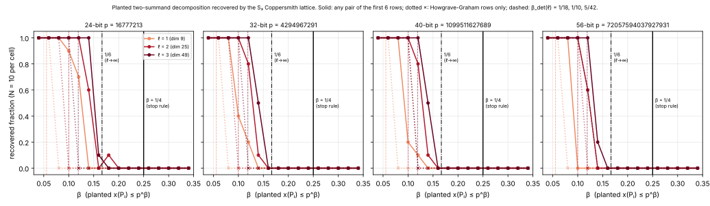

# Run report: S₃ Coppersmith θ₂ falsifier, run-20261023T2122Z

Descriptive record of one run under the frozen protocol
[`../../PROTOCOL.md`](../../PROTOCOL.md) (committed as `c785a0e23` before this run).
Observations only; the reading against the decision rule is in
[`../../REPORT.md`](../../REPORT.md).

| item | value |
|:--|:--|
| Instrument | `examples/coppersmith_s3_theta2_falsifier.rs` at commit `c785a0e232f340cd3b32b1a88ebd3926e97e93ed` (`cargo build --release`) |
| Command | `./target/release/examples/coppersmith_s3_theta2_falsifier --bits 24,32,40,56 --ell 1,2,3 --beta 0.04:0.34:0.02 --trials 10 --neg-trials 10 --neg-beta 0.30 --seed 20261023 --out reports/run-20261023T2122Z` |
| Host | 4 vCPU, x86_64, Intel(R) Xeon(R) Processor @ 2.10GHz; cloud container, not isolated; one thread (`host.txt`, `load_before.txt`, `load_after.txt`) |
| Wall time | 15m20.629s (`time.txt`); the instrument's own clock: 920.624825337 s |
| Primes | 24-bit 16777213, 32-bit 4294967291, 40-bit 1099511627689, 56-bit 72057594037927931 (largest prime below `2^bits`); one random curve per size (`a`, `b` in `trials.jsonl`) |
| Arms | planted: 4 sizes × ℓ ∈ {1, 2, 3} × 16 values of β × N = 10 (1920 trials); negative control: 4 × 3 × 10 at β = 0.30 (120 trials) |
| Seeds | `seed = 20261023`; per-trial seeds recorded in `trials.jsonl` |
| Raw rows | `trials.jsonl` (2040 rows, one per trial); cell summaries `run.json`; the table below is `stdout.md` |
| Sieve primes | 2305843009213693951, 2305843009213693921, 2305843009213693907 (`run.json`) |
| Failures | none; every trial completed; exit 0 |

**Columns.** `recovered/N`: the pipeline's reported set of genuine pairs
contains the planted `{x(P₁), x(P₂)}` (decision metric). `recovered (HG
rows)`: same, restricted to row pairs satisfying Howgrave-Graham. `HG first
two`: the first two reduced rows satisfy Howgrave-Graham (a priori, root not
used). `≥2 rows vanish`: at least two reduced rows vanish at the planted root
over Z (diagnostic, uses the root). Times are means over the cell's trials,
wall-clock milliseconds on this host, not a benchmark.

## Recorded cells

| bits | p | ℓ | dim | β | B | recovered/N | recovered (HG rows)/N | HG first two/N | ≥2 rows vanish/N | mean LLL ms | mean extract ms |
|---:|---:|---:|---:|---:|---:|---:|---:|---:|---:|---:|---:|
| 24 | 16777213 | 1 | 9 | 0.04 | 1 | 10/10 | 10/10 | 10/10 | 10/10 | 4.4 | 1.8 |
| 24 | 16777213 | 1 | 9 | 0.06 | 2 | 10/10 | 10/10 | 10/10 | 10/10 | 4.5 | 3.7 |
| 24 | 16777213 | 1 | 9 | 0.08 | 3 | 10/10 | 0/10 | 0/10 | 10/10 | 2.4 | 1.7 |
| 24 | 16777213 | 1 | 9 | 0.10 | 5 | 9/10 | 0/10 | 0/10 | 9/10 | 1.6 | 1.3 |
| 24 | 16777213 | 1 | 9 | 0.12 | 7 | 7/10 | 0/10 | 0/10 | 8/10 | 1.6 | 1.3 |
| 24 | 16777213 | 1 | 9 | 0.14 | 10 | 0/10 | 0/10 | 0/10 | 1/10 | 1.1 | 0.5 |
| 24 | 16777213 | 1 | 9 | 0.16 | 14 | 0/10 | 0/10 | 0/10 | 0/10 | 0.9 | 0.6 |
| 24 | 16777213 | 1 | 9 | 0.18 | 19 | 0/10 | 0/10 | 0/10 | 1/10 | 0.9 | 0.6 |
| 24 | 16777213 | 1 | 9 | 0.20 | 27 | 0/10 | 0/10 | 0/10 | 0/10 | 0.9 | 0.5 |
| 24 | 16777213 | 1 | 9 | 0.22 | 38 | 0/10 | 0/10 | 0/10 | 0/10 | 0.8 | 0.6 |
| 24 | 16777213 | 1 | 9 | 0.24 | 54 | 0/10 | 0/10 | 0/10 | 0/10 | 0.7 | 0.6 |
| 24 | 16777213 | 1 | 9 | 0.26 | 75 | 0/10 | 0/10 | 0/10 | 0/10 | 1.7 | 0.6 |
| 24 | 16777213 | 1 | 9 | 0.28 | 105 | 0/10 | 0/10 | 0/10 | 0/10 | 1.2 | 0.7 |
| 24 | 16777213 | 1 | 9 | 0.30 | 147 | 0/10 | 0/10 | 0/10 | 0/10 | 0.7 | 0.7 |
| 24 | 16777213 | 1 | 9 | 0.32 | 205 | 0/10 | 0/10 | 0/10 | 0/10 | 0.6 | 0.5 |
| 24 | 16777213 | 1 | 9 | 0.34 | 286 | 0/10 | 0/10 | 0/10 | 0/10 | 0.4 | 0.4 |
| 24 | 16777213 | 1 | 9 | 0.30 (negative control) | 147 | genuine 0/10 (raw candidates in 10) | – | – | – | 0.7 | 0.7 |
| 24 | 16777213 | 2 | 25 | 0.04 | 1 | 10/10 | 10/10 | 10/10 | 10/10 | 271.7 | 16.6 |
| 24 | 16777213 | 2 | 25 | 0.06 | 2 | 10/10 | 10/10 | 10/10 | 10/10 | 175.3 | 18.5 |
| 24 | 16777213 | 2 | 25 | 0.08 | 3 | 10/10 | 10/10 | 10/10 | 10/10 | 151.9 | 20.7 |
| 24 | 16777213 | 2 | 25 | 0.10 | 5 | 10/10 | 0/10 | 0/10 | 10/10 | 92.5 | 15.9 |
| 24 | 16777213 | 2 | 25 | 0.12 | 7 | 10/10 | 0/10 | 0/10 | 10/10 | 64.7 | 10.6 |
| 24 | 16777213 | 2 | 25 | 0.14 | 10 | 6/10 | 0/10 | 0/10 | 7/10 | 42.2 | 10.4 |
| 24 | 16777213 | 2 | 25 | 0.16 | 14 | 0/10 | 0/10 | 0/10 | 2/10 | 23.6 | 1.4 |
| 24 | 16777213 | 2 | 25 | 0.18 | 19 | 1/10 | 0/10 | 0/10 | 1/10 | 20.9 | 0.7 |
| 24 | 16777213 | 2 | 25 | 0.20 | 27 | 0/10 | 0/10 | 0/10 | 0/10 | 20.3 | 0.7 |
| 24 | 16777213 | 2 | 25 | 0.22 | 38 | 0/10 | 0/10 | 0/10 | 0/10 | 14.3 | 0.7 |
| 24 | 16777213 | 2 | 25 | 0.24 | 54 | 0/10 | 0/10 | 0/10 | 0/10 | 18.4 | 0.8 |
| 24 | 16777213 | 2 | 25 | 0.26 | 75 | 0/10 | 0/10 | 0/10 | 0/10 | 13.8 | 0.7 |
| 24 | 16777213 | 2 | 25 | 0.28 | 105 | 0/10 | 0/10 | 0/10 | 0/10 | 11.5 | 0.7 |
| 24 | 16777213 | 2 | 25 | 0.30 | 147 | 0/10 | 0/10 | 0/10 | 0/10 | 10.8 | 0.8 |
| 24 | 16777213 | 2 | 25 | 0.32 | 205 | 0/10 | 0/10 | 0/10 | 0/10 | 9.4 | 0.5 |
| 24 | 16777213 | 2 | 25 | 0.34 | 286 | 0/10 | 0/10 | 0/10 | 0/10 | 7.2 | 0.4 |
| 24 | 16777213 | 2 | 25 | 0.30 (negative control) | 147 | genuine 0/10 (raw candidates in 10) | – | – | – | 11.6 | 0.8 |
| 24 | 16777213 | 3 | 49 | 0.04 | 1 | 10/10 | 10/10 | 10/10 | 10/10 | 5382.0 | 90.9 |
| 24 | 16777213 | 3 | 49 | 0.06 | 2 | 10/10 | 10/10 | 10/10 | 10/10 | 2893.0 | 87.1 |
| 24 | 16777213 | 3 | 49 | 0.08 | 3 | 10/10 | 10/10 | 10/10 | 10/10 | 2348.8 | 88.8 |
| 24 | 16777213 | 3 | 49 | 0.10 | 5 | 10/10 | 10/10 | 10/10 | 10/10 | 1670.7 | 97.2 |
| 24 | 16777213 | 3 | 49 | 0.12 | 7 | 10/10 | 0/10 | 0/10 | 10/10 | 1088.3 | 88.3 |
| 24 | 16777213 | 3 | 49 | 0.14 | 10 | 10/10 | 0/10 | 0/10 | 10/10 | 641.3 | 61.2 |
| 24 | 16777213 | 3 | 49 | 0.16 | 14 | 1/10 | 0/10 | 0/10 | 6/10 | 233.8 | 1.5 |
| 24 | 16777213 | 3 | 49 | 0.18 | 19 | 0/10 | 0/10 | 0/10 | 3/10 | 192.6 | 1.1 |
| 24 | 16777213 | 3 | 49 | 0.20 | 27 | 0/10 | 0/10 | 0/10 | 2/10 | 145.4 | 1.0 |
| 24 | 16777213 | 3 | 49 | 0.22 | 38 | 0/10 | 0/10 | 0/10 | 0/10 | 139.0 | 1.1 |
| 24 | 16777213 | 3 | 49 | 0.24 | 54 | 0/10 | 0/10 | 0/10 | 0/10 | 137.2 | 1.2 |
| 24 | 16777213 | 3 | 49 | 0.26 | 75 | 0/10 | 0/10 | 0/10 | 0/10 | 125.1 | 1.2 |
| 24 | 16777213 | 3 | 49 | 0.28 | 105 | 0/10 | 0/10 | 0/10 | 0/10 | 113.5 | 1.1 |
| 24 | 16777213 | 3 | 49 | 0.30 | 147 | 0/10 | 0/10 | 0/10 | 0/10 | 100.2 | 1.1 |
| 24 | 16777213 | 3 | 49 | 0.32 | 205 | 0/10 | 0/10 | 0/10 | 0/10 | 96.1 | 1.2 |
| 24 | 16777213 | 3 | 49 | 0.34 | 286 | 0/10 | 0/10 | 0/10 | 0/10 | 90.0 | 1.0 |
| 24 | 16777213 | 3 | 49 | 0.30 (negative control) | 147 | genuine 0/10 (raw candidates in 10) | – | – | – | 105.8 | 1.2 |
| 32 | 4294967291 | 1 | 9 | 0.04 | 2 | 10/10 | 10/10 | 10/10 | 10/10 | 5.3 | 2.2 |
| 32 | 4294967291 | 1 | 9 | 0.06 | 3 | 10/10 | 10/10 | 10/10 | 10/10 | 3.9 | 2.0 |
| 32 | 4294967291 | 1 | 9 | 0.08 | 5 | 10/10 | 0/10 | 0/10 | 10/10 | 2.7 | 1.8 |
| 32 | 4294967291 | 1 | 9 | 0.10 | 9 | 4/10 | 0/10 | 0/10 | 5/10 | 2.3 | 1.2 |
| 32 | 4294967291 | 1 | 9 | 0.12 | 14 | 2/10 | 0/10 | 0/10 | 2/10 | 1.6 | 1.2 |
| 32 | 4294967291 | 1 | 9 | 0.14 | 22 | 0/10 | 0/10 | 0/10 | 0/10 | 1.1 | 0.8 |
| 32 | 4294967291 | 1 | 9 | 0.16 | 34 | 0/10 | 0/10 | 0/10 | 0/10 | 1.3 | 0.5 |
| 32 | 4294967291 | 1 | 9 | 0.18 | 54 | 0/10 | 0/10 | 0/10 | 0/10 | 0.9 | 0.5 |
| 32 | 4294967291 | 1 | 9 | 0.20 | 84 | 0/10 | 0/10 | 0/10 | 0/10 | 0.9 | 0.6 |
| 32 | 4294967291 | 1 | 9 | 0.22 | 131 | 0/10 | 0/10 | 0/10 | 0/10 | 1.0 | 0.6 |
| 32 | 4294967291 | 1 | 9 | 0.24 | 205 | 0/10 | 0/10 | 0/10 | 0/10 | 0.9 | 0.6 |
| 32 | 4294967291 | 1 | 9 | 0.26 | 319 | 0/10 | 0/10 | 0/10 | 0/10 | 0.7 | 0.6 |
| 32 | 4294967291 | 1 | 9 | 0.28 | 497 | 0/10 | 0/10 | 0/10 | 0/10 | 0.6 | 0.7 |
| 32 | 4294967291 | 1 | 9 | 0.30 | 776 | 0/10 | 0/10 | 0/10 | 0/10 | 0.5 | 0.7 |
| 32 | 4294967291 | 1 | 9 | 0.32 | 1209 | 0/10 | 0/10 | 0/10 | 0/10 | 0.4 | 0.8 |
| 32 | 4294967291 | 1 | 9 | 0.34 | 1884 | 0/10 | 0/10 | 0/10 | 0/10 | 0.3 | 0.6 |
| 32 | 4294967291 | 1 | 9 | 0.30 (negative control) | 776 | genuine 0/10 (raw candidates in 10) | – | – | – | 0.7 | 0.8 |
| 32 | 4294967291 | 2 | 25 | 0.04 | 2 | 10/10 | 10/10 | 10/10 | 10/10 | 235.2 | 16.3 |
| 32 | 4294967291 | 2 | 25 | 0.06 | 3 | 10/10 | 10/10 | 10/10 | 10/10 | 225.9 | 16.9 |
| 32 | 4294967291 | 2 | 25 | 0.08 | 5 | 10/10 | 10/10 | 10/10 | 10/10 | 188.0 | 17.6 |
| 32 | 4294967291 | 2 | 25 | 0.10 | 9 | 10/10 | 0/10 | 0/10 | 10/10 | 140.9 | 17.5 |
| 32 | 4294967291 | 2 | 25 | 0.12 | 14 | 8/10 | 0/10 | 0/10 | 10/10 | 90.9 | 11.2 |
| 32 | 4294967291 | 2 | 25 | 0.14 | 22 | 1/10 | 0/10 | 0/10 | 4/10 | 62.5 | 11.5 |
| 32 | 4294967291 | 2 | 25 | 0.16 | 34 | 0/10 | 0/10 | 0/10 | 1/10 | 33.3 | 1.2 |
| 32 | 4294967291 | 2 | 25 | 0.18 | 54 | 0/10 | 0/10 | 0/10 | 0/10 | 25.3 | 0.7 |
| 32 | 4294967291 | 2 | 25 | 0.20 | 84 | 0/10 | 0/10 | 0/10 | 0/10 | 21.9 | 0.8 |
| 32 | 4294967291 | 2 | 25 | 0.22 | 131 | 0/10 | 0/10 | 0/10 | 0/10 | 19.3 | 0.7 |
| 32 | 4294967291 | 2 | 25 | 0.24 | 205 | 0/10 | 0/10 | 0/10 | 0/10 | 16.2 | 0.8 |
| 32 | 4294967291 | 2 | 25 | 0.26 | 319 | 0/10 | 0/10 | 0/10 | 0/10 | 17.9 | 0.9 |
| 32 | 4294967291 | 2 | 25 | 0.28 | 497 | 0/10 | 0/10 | 0/10 | 0/10 | 13.5 | 0.8 |
| 32 | 4294967291 | 2 | 25 | 0.30 | 776 | 0/10 | 0/10 | 0/10 | 0/10 | 13.7 | 1.0 |
| 32 | 4294967291 | 2 | 25 | 0.32 | 1209 | 0/10 | 0/10 | 0/10 | 0/10 | 10.3 | 0.9 |
| 32 | 4294967291 | 2 | 25 | 0.34 | 1884 | 0/10 | 0/10 | 0/10 | 0/10 | 10.4 | 0.9 |
| 32 | 4294967291 | 2 | 25 | 0.30 (negative control) | 776 | genuine 0/10 (raw candidates in 10) | – | – | – | 13.6 | 0.9 |
| 32 | 4294967291 | 3 | 49 | 0.04 | 2 | 10/10 | 10/10 | 10/10 | 10/10 | 4627.3 | 88.7 |
| 32 | 4294967291 | 3 | 49 | 0.06 | 3 | 10/10 | 10/10 | 10/10 | 10/10 | 3635.4 | 89.1 |
| 32 | 4294967291 | 3 | 49 | 0.08 | 5 | 10/10 | 10/10 | 10/10 | 10/10 | 2976.1 | 87.8 |
| 32 | 4294967291 | 3 | 49 | 0.10 | 9 | 10/10 | 10/10 | 10/10 | 10/10 | 2100.9 | 87.1 |
| 32 | 4294967291 | 3 | 49 | 0.12 | 14 | 10/10 | 0/10 | 0/10 | 10/10 | 1494.6 | 100.9 |
| 32 | 4294967291 | 3 | 49 | 0.14 | 22 | 5/10 | 0/10 | 0/10 | 9/10 | 849.4 | 61.3 |
| 32 | 4294967291 | 3 | 49 | 0.16 | 34 | 0/10 | 0/10 | 0/10 | 3/10 | 335.5 | 2.0 |
| 32 | 4294967291 | 3 | 49 | 0.18 | 54 | 0/10 | 0/10 | 0/10 | 0/10 | 225.6 | 1.1 |
| 32 | 4294967291 | 3 | 49 | 0.20 | 84 | 0/10 | 0/10 | 0/10 | 0/10 | 189.4 | 1.2 |
| 32 | 4294967291 | 3 | 49 | 0.22 | 131 | 0/10 | 0/10 | 0/10 | 0/10 | 182.8 | 1.3 |
| 32 | 4294967291 | 3 | 49 | 0.24 | 205 | 0/10 | 0/10 | 0/10 | 0/10 | 158.5 | 1.3 |
| 32 | 4294967291 | 3 | 49 | 0.26 | 319 | 0/10 | 0/10 | 0/10 | 0/10 | 134.8 | 1.2 |
| 32 | 4294967291 | 3 | 49 | 0.28 | 497 | 0/10 | 0/10 | 0/10 | 0/10 | 127.1 | 1.3 |
| 32 | 4294967291 | 3 | 49 | 0.30 | 776 | 0/10 | 0/10 | 0/10 | 0/10 | 128.0 | 1.5 |
| 32 | 4294967291 | 3 | 49 | 0.32 | 1209 | 0/10 | 0/10 | 0/10 | 0/10 | 103.0 | 1.5 |
| 32 | 4294967291 | 3 | 49 | 0.34 | 1884 | 0/10 | 0/10 | 0/10 | 0/10 | 90.8 | 1.3 |
| 32 | 4294967291 | 3 | 49 | 0.30 (negative control) | 776 | genuine 0/10 (raw candidates in 10) | – | – | – | 126.7 | 1.5 |
| 40 | 1099511627689 | 1 | 9 | 0.04 | 3 | 10/10 | 10/10 | 10/10 | 10/10 | 6.9 | 2.1 |
| 40 | 1099511627689 | 1 | 9 | 0.06 | 5 | 10/10 | 10/10 | 10/10 | 10/10 | 4.7 | 2.1 |
| 40 | 1099511627689 | 1 | 9 | 0.08 | 9 | 10/10 | 0/10 | 0/10 | 10/10 | 3.7 | 1.4 |
| 40 | 1099511627689 | 1 | 9 | 0.10 | 15 | 2/10 | 0/10 | 0/10 | 2/10 | 3.2 | 1.4 |
| 40 | 1099511627689 | 1 | 9 | 0.12 | 27 | 1/10 | 0/10 | 0/10 | 2/10 | 2.5 | 1.4 |
| 40 | 1099511627689 | 1 | 9 | 0.14 | 48 | 0/10 | 0/10 | 0/10 | 0/10 | 1.5 | 0.8 |
| 40 | 1099511627689 | 1 | 9 | 0.16 | 84 | 0/10 | 0/10 | 0/10 | 0/10 | 1.4 | 0.6 |
| 40 | 1099511627689 | 1 | 9 | 0.18 | 147 | 0/10 | 0/10 | 0/10 | 0/10 | 1.2 | 0.6 |
| 40 | 1099511627689 | 1 | 9 | 0.20 | 255 | 0/10 | 0/10 | 0/10 | 0/10 | 1.0 | 0.6 |
| 40 | 1099511627689 | 1 | 9 | 0.22 | 445 | 0/10 | 0/10 | 0/10 | 0/10 | 0.9 | 0.7 |
| 40 | 1099511627689 | 1 | 9 | 0.24 | 776 | 0/10 | 0/10 | 0/10 | 0/10 | 0.9 | 0.7 |
| 40 | 1099511627689 | 1 | 9 | 0.26 | 1351 | 0/10 | 0/10 | 0/10 | 0/10 | 1.3 | 1.2 |
| 40 | 1099511627689 | 1 | 9 | 0.28 | 2352 | 0/10 | 0/10 | 0/10 | 0/10 | 1.1 | 1.5 |
| 40 | 1099511627689 | 1 | 9 | 0.30 | 4095 | 0/10 | 0/10 | 0/10 | 0/10 | 0.8 | 2.2 |
| 40 | 1099511627689 | 1 | 9 | 0.32 | 7131 | 0/10 | 0/10 | 0/10 | 0/10 | 0.7 | 3.2 |
| 40 | 1099511627689 | 1 | 9 | 0.34 | 12416 | 0/10 | 0/10 | 0/10 | 0/10 | 0.4 | 2.8 |
| 40 | 1099511627689 | 1 | 9 | 0.30 (negative control) | 4095 | genuine 0/10 (raw candidates in 10) | – | – | – | 0.6 | 1.6 |
| 40 | 1099511627689 | 2 | 25 | 0.04 | 3 | 10/10 | 10/10 | 10/10 | 10/10 | 309.3 | 16.2 |
| 40 | 1099511627689 | 2 | 25 | 0.06 | 5 | 10/10 | 10/10 | 10/10 | 10/10 | 230.1 | 16.3 |
| 40 | 1099511627689 | 2 | 25 | 0.08 | 9 | 10/10 | 10/10 | 10/10 | 10/10 | 195.0 | 17.0 |
| 40 | 1099511627689 | 2 | 25 | 0.10 | 15 | 10/10 | 10/10 | 10/10 | 10/10 | 175.8 | 18.0 |
| 40 | 1099511627689 | 2 | 25 | 0.12 | 27 | 8/10 | 0/10 | 0/10 | 10/10 | 120.9 | 11.4 |
| 40 | 1099511627689 | 2 | 25 | 0.14 | 48 | 1/10 | 0/10 | 0/10 | 3/10 | 74.0 | 11.8 |
| 40 | 1099511627689 | 2 | 25 | 0.16 | 84 | 0/10 | 0/10 | 0/10 | 0/10 | 32.6 | 1.3 |
| 40 | 1099511627689 | 2 | 25 | 0.18 | 147 | 0/10 | 0/10 | 0/10 | 0/10 | 28.7 | 0.7 |
| 40 | 1099511627689 | 2 | 25 | 0.20 | 255 | 0/10 | 0/10 | 0/10 | 0/10 | 22.9 | 0.8 |
| 40 | 1099511627689 | 2 | 25 | 0.22 | 445 | 0/10 | 0/10 | 0/10 | 0/10 | 21.3 | 0.8 |
| 40 | 1099511627689 | 2 | 25 | 0.24 | 776 | 0/10 | 0/10 | 0/10 | 0/10 | 18.8 | 1.0 |
| 40 | 1099511627689 | 2 | 25 | 0.26 | 1351 | 0/10 | 0/10 | 0/10 | 0/10 | 17.5 | 1.1 |
| 40 | 1099511627689 | 2 | 25 | 0.28 | 2352 | 0/10 | 0/10 | 0/10 | 0/10 | 18.2 | 1.6 |
| 40 | 1099511627689 | 2 | 25 | 0.30 | 4095 | 0/10 | 0/10 | 0/10 | 0/10 | 13.6 | 1.9 |
| 40 | 1099511627689 | 2 | 25 | 0.32 | 7131 | 0/10 | 0/10 | 0/10 | 0/10 | 11.6 | 2.7 |
| 40 | 1099511627689 | 2 | 25 | 0.34 | 12416 | 0/10 | 0/10 | 0/10 | 0/10 | 9.6 | 2.9 |
| 40 | 1099511627689 | 2 | 25 | 0.30 (negative control) | 4095 | genuine 0/10 (raw candidates in 10) | – | – | – | 13.3 | 1.8 |
| 40 | 1099511627689 | 3 | 49 | 0.04 | 3 | 10/10 | 10/10 | 10/10 | 10/10 | 4980.1 | 99.2 |
| 40 | 1099511627689 | 3 | 49 | 0.06 | 5 | 10/10 | 10/10 | 10/10 | 10/10 | 4301.2 | 91.3 |
| 40 | 1099511627689 | 3 | 49 | 0.08 | 9 | 10/10 | 10/10 | 10/10 | 10/10 | 3432.4 | 91.0 |
| 40 | 1099511627689 | 3 | 49 | 0.10 | 15 | 10/10 | 10/10 | 10/10 | 10/10 | 2799.4 | 92.2 |
| 40 | 1099511627689 | 3 | 49 | 0.12 | 27 | 10/10 | 0/10 | 0/10 | 10/10 | 1854.1 | 85.9 |
| 40 | 1099511627689 | 3 | 49 | 0.14 | 48 | 5/10 | 0/10 | 0/10 | 10/10 | 1043.5 | 57.8 |
| 40 | 1099511627689 | 3 | 49 | 0.16 | 84 | 0/10 | 0/10 | 0/10 | 0/10 | 347.8 | 1.7 |
| 40 | 1099511627689 | 3 | 49 | 0.18 | 147 | 0/10 | 0/10 | 0/10 | 0/10 | 269.7 | 1.3 |
| 40 | 1099511627689 | 3 | 49 | 0.20 | 255 | 0/10 | 0/10 | 0/10 | 0/10 | 227.2 | 1.3 |
| 40 | 1099511627689 | 3 | 49 | 0.22 | 445 | 0/10 | 0/10 | 0/10 | 0/10 | 202.1 | 1.4 |
| 40 | 1099511627689 | 3 | 49 | 0.24 | 776 | 0/10 | 0/10 | 0/10 | 0/10 | 182.1 | 1.4 |
| 40 | 1099511627689 | 3 | 49 | 0.26 | 1351 | 0/10 | 0/10 | 0/10 | 0/10 | 164.1 | 1.6 |
| 40 | 1099511627689 | 3 | 49 | 0.28 | 2352 | 0/10 | 0/10 | 0/10 | 0/10 | 156.1 | 2.2 |
| 40 | 1099511627689 | 3 | 49 | 0.30 | 4095 | 0/10 | 0/10 | 0/10 | 0/10 | 143.2 | 2.6 |
| 40 | 1099511627689 | 3 | 49 | 0.32 | 7131 | 0/10 | 0/10 | 0/10 | 0/10 | 132.2 | 3.7 |
| 40 | 1099511627689 | 3 | 49 | 0.34 | 12416 | 0/10 | 0/10 | 0/10 | 0/10 | 109.4 | 4.1 |
| 40 | 1099511627689 | 3 | 49 | 0.30 (negative control) | 4095 | genuine 0/10 (raw candidates in 10) | – | – | – | 137.8 | 2.6 |
| 56 | 72057594037927931 | 1 | 9 | 0.04 | 4 | 10/10 | 10/10 | 10/10 | 10/10 | 5.9 | 1.9 |
| 56 | 72057594037927931 | 1 | 9 | 0.06 | 10 | 10/10 | 10/10 | 10/10 | 10/10 | 4.6 | 1.8 |
| 56 | 72057594037927931 | 1 | 9 | 0.08 | 22 | 10/10 | 0/10 | 0/10 | 10/10 | 4.6 | 1.7 |
| 56 | 72057594037927931 | 1 | 9 | 0.10 | 48 | 0/10 | 0/10 | 0/10 | 0/10 | 3.5 | 1.3 |
| 56 | 72057594037927931 | 1 | 9 | 0.12 | 105 | 0/10 | 0/10 | 0/10 | 0/10 | 3.1 | 1.4 |
| 56 | 72057594037927931 | 1 | 9 | 0.14 | 229 | 0/10 | 0/10 | 0/10 | 0/10 | 2.2 | 0.9 |
| 56 | 72057594037927931 | 1 | 9 | 0.16 | 497 | 0/10 | 0/10 | 0/10 | 0/10 | 2.0 | 0.7 |
| 56 | 72057594037927931 | 1 | 9 | 0.18 | 1082 | 0/10 | 0/10 | 0/10 | 0/10 | 1.7 | 0.8 |
| 56 | 72057594037927931 | 1 | 9 | 0.20 | 2352 | 0/10 | 0/10 | 0/10 | 0/10 | 1.7 | 1.2 |
| 56 | 72057594037927931 | 1 | 9 | 0.22 | 5113 | 0/10 | 0/10 | 0/10 | 0/10 | 1.4 | 2.0 |
| 56 | 72057594037927931 | 1 | 9 | 0.24 | 11113 | 0/10 | 0/10 | 0/10 | 0/10 | 1.7 | 4.0 |
| 56 | 72057594037927931 | 1 | 9 | 0.26 | 24154 | 0/10 | 0/10 | 0/10 | 0/10 | 1.1 | 7.5 |
| 56 | 72057594037927931 | 1 | 9 | 0.28 | 52498 | 0/10 | 0/10 | 0/10 | 0/10 | 0.9 | 14.6 |
| 56 | 72057594037927931 | 1 | 9 | 0.30 | 114104 | 0/10 | 0/10 | 0/10 | 0/10 | 0.8 | 30.1 |
| 56 | 72057594037927931 | 1 | 9 | 0.32 | 248003 | 0/10 | 0/10 | 0/10 | 0/10 | 0.8 | 69.8 |
| 56 | 72057594037927931 | 1 | 9 | 0.34 | 539027 | 0/10 | 0/10 | 0/10 | 0/10 | 0.5 | 97.0 |
| 56 | 72057594037927931 | 1 | 9 | 0.30 (negative control) | 114104 | genuine 0/10 (raw candidates in 10) | – | – | – | 0.9 | 30.4 |
| 56 | 72057594037927931 | 2 | 25 | 0.04 | 4 | 10/10 | 10/10 | 10/10 | 10/10 | 412.0 | 17.2 |
| 56 | 72057594037927931 | 2 | 25 | 0.06 | 10 | 10/10 | 10/10 | 10/10 | 10/10 | 345.4 | 16.8 |
| 56 | 72057594037927931 | 2 | 25 | 0.08 | 22 | 10/10 | 10/10 | 10/10 | 10/10 | 288.2 | 16.6 |
| 56 | 72057594037927931 | 2 | 25 | 0.10 | 48 | 10/10 | 10/10 | 10/10 | 10/10 | 227.0 | 17.4 |
| 56 | 72057594037927931 | 2 | 25 | 0.12 | 105 | 6/10 | 0/10 | 0/10 | 9/10 | 158.4 | 11.4 |
| 56 | 72057594037927931 | 2 | 25 | 0.14 | 229 | 0/10 | 0/10 | 0/10 | 1/10 | 95.9 | 11.7 |
| 56 | 72057594037927931 | 2 | 25 | 0.16 | 497 | 0/10 | 0/10 | 0/10 | 0/10 | 47.0 | 1.6 |
| 56 | 72057594037927931 | 2 | 25 | 0.18 | 1082 | 0/10 | 0/10 | 0/10 | 0/10 | 40.5 | 1.1 |
| 56 | 72057594037927931 | 2 | 25 | 0.20 | 2352 | 0/10 | 0/10 | 0/10 | 0/10 | 31.9 | 1.5 |
| 56 | 72057594037927931 | 2 | 25 | 0.22 | 5113 | 0/10 | 0/10 | 0/10 | 0/10 | 26.5 | 2.2 |
| 56 | 72057594037927931 | 2 | 25 | 0.24 | 11113 | 0/10 | 0/10 | 0/10 | 0/10 | 24.3 | 4.1 |
| 56 | 72057594037927931 | 2 | 25 | 0.26 | 24154 | 0/10 | 0/10 | 0/10 | 0/10 | 24.5 | 8.6 |
| 56 | 72057594037927931 | 2 | 25 | 0.28 | 52498 | 0/10 | 0/10 | 0/10 | 0/10 | 21.1 | 16.4 |
| 56 | 72057594037927931 | 2 | 25 | 0.30 | 114104 | 0/10 | 0/10 | 0/10 | 0/10 | 18.4 | 34.0 |
| 56 | 72057594037927931 | 2 | 25 | 0.32 | 248003 | 0/10 | 0/10 | 0/10 | 0/10 | 15.3 | 73.8 |
| 56 | 72057594037927931 | 2 | 25 | 0.34 | 539027 | 0/10 | 0/10 | 0/10 | 0/10 | 12.2 | 98.6 |
| 56 | 72057594037927931 | 2 | 25 | 0.30 (negative control) | 114104 | genuine 0/10 (raw candidates in 10) | – | – | – | 21.9 | 38.5 |
| 56 | 72057594037927931 | 3 | 49 | 0.04 | 4 | 10/10 | 10/10 | 10/10 | 10/10 | 7418.9 | 87.1 |
| 56 | 72057594037927931 | 3 | 49 | 0.06 | 10 | 10/10 | 10/10 | 10/10 | 10/10 | 6033.7 | 90.1 |
| 56 | 72057594037927931 | 3 | 49 | 0.08 | 22 | 10/10 | 10/10 | 10/10 | 10/10 | 4967.4 | 99.0 |
| 56 | 72057594037927931 | 3 | 49 | 0.10 | 48 | 10/10 | 10/10 | 10/10 | 10/10 | 3987.9 | 89.9 |
| 56 | 72057594037927931 | 3 | 49 | 0.12 | 105 | 10/10 | 6/10 | 3/10 | 10/10 | 2857.7 | 93.2 |
| 56 | 72057594037927931 | 3 | 49 | 0.14 | 229 | 2/10 | 0/10 | 0/10 | 8/10 | 1600.4 | 66.6 |
| 56 | 72057594037927931 | 3 | 49 | 0.16 | 497 | 0/10 | 0/10 | 0/10 | 0/10 | 475.2 | 2.0 |
| 56 | 72057594037927931 | 3 | 49 | 0.18 | 1082 | 0/10 | 0/10 | 0/10 | 0/10 | 390.3 | 1.7 |
| 56 | 72057594037927931 | 3 | 49 | 0.20 | 2352 | 0/10 | 0/10 | 0/10 | 0/10 | 285.0 | 2.0 |
| 56 | 72057594037927931 | 3 | 49 | 0.22 | 5113 | 0/10 | 0/10 | 0/10 | 0/10 | 251.5 | 2.9 |
| 56 | 72057594037927931 | 3 | 49 | 0.24 | 11113 | 0/10 | 0/10 | 0/10 | 0/10 | 233.3 | 4.9 |
| 56 | 72057594037927931 | 3 | 49 | 0.26 | 24154 | 0/10 | 0/10 | 0/10 | 0/10 | 235.1 | 9.9 |
| 56 | 72057594037927931 | 3 | 49 | 0.28 | 52498 | 0/10 | 0/10 | 0/10 | 0/10 | 209.6 | 20.9 |
| 56 | 72057594037927931 | 3 | 49 | 0.30 | 114104 | 0/10 | 0/10 | 0/10 | 0/10 | 204.2 | 42.5 |
| 56 | 72057594037927931 | 3 | 49 | 0.32 | 248003 | 0/10 | 0/10 | 0/10 | 0/10 | 183.4 | 96.8 |
| 56 | 72057594037927931 | 3 | 49 | 0.34 | 539027 | 0/10 | 0/10 | 0/10 | 0/10 | 152.6 | 151.3 |
| 56 | 72057594037927931 | 3 | 49 | 0.30 (negative control) | 114104 | genuine 0/10 (raw candidates in 10) | – | – | – | 191.9 | 42.1 |

## Observations (no interpretation)

- Every planted cell with β ≥ 0.20 recorded 0/10 on every metric, at every
  size and multiplicity (96 cells, 960 trials). The largest β with any
  recovery is 0.18 (1/10, 24-bit, ℓ = 2).
- Largest β with `recovered ≥ 5/10`, by size and ℓ: 24-bit 0.12 / 0.14 / 0.14;
  32-bit 0.08 / 0.12 / 0.14; 40-bit 0.08 / 0.12 / 0.14; 56-bit 0.08 / 0.12 / 0.12
  (ℓ = 1 / 2 / 3).
- Largest β with `HG first two = 10/10`: ℓ = 1: 0.06 at every size; ℓ = 2:
  0.08 (24, 32 bits), 0.10 (40, 56 bits); ℓ = 3: 0.10 at every size.
- Negative control: 0 genuine pairs in 120 trials; every trial reported the
  raw candidate (0, 0), which fails `S₃ ≡ 0 (mod p)` and is filtered.
- Mean LLL time per trial falls with β and rises with the prime size; the
  largest cell mean is 7.4 s (56-bit, ℓ = 3, β = 0.04). Extraction time grows
  with B at 56 bits (up to 151 ms at B = 539027).
