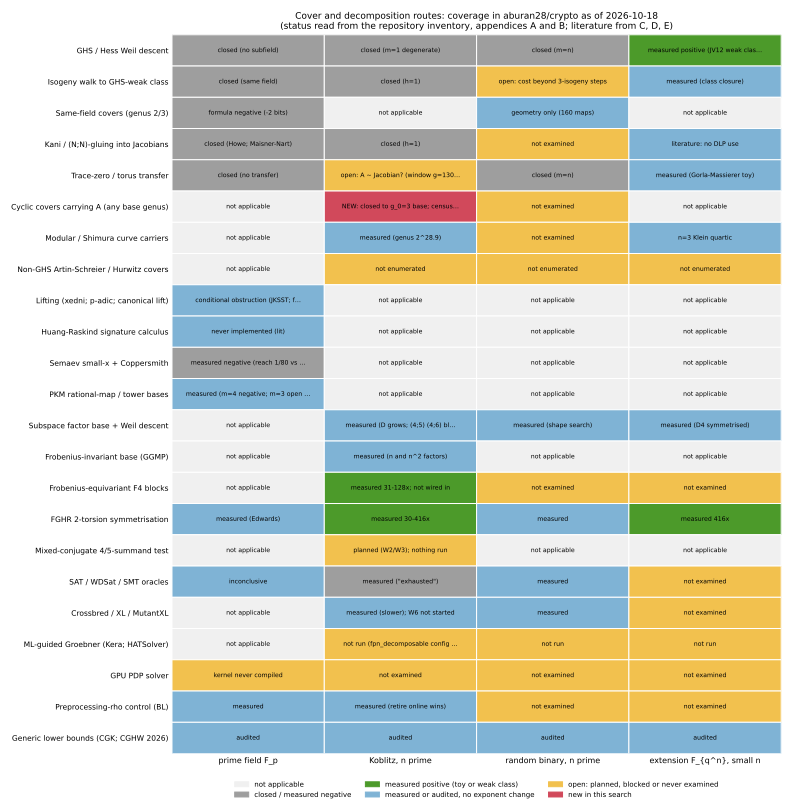

# Cover and decomposition attacks: what has been searched, what has not (2026-10-18)

**Type.** Research search round (literature, repository, one derivation, one census). No ECDLP
speedup is claimed, no baseline moves, and no statement about a deployed curve's security is made
or withdrawn. **Report.** [`report.pdf`](report.pdf) (source [`report.typ`](report.typ)).
**Graph.** [`coverage.svg`](coverage.svg) / [`coverage.png`](coverage.png), laid out by
[`plot_coverage.py`](plot_coverage.py) from [`coverage.csv`](coverage.csv).
**Census.** [`census.json`](census.json) from `examples/unramified_cyclic_cover_census.rs`
(native, on the enumerator of `src/cryptanalysis/curve_construction/enumerate.rs`); the
Python scoping script that preceded it is kept as `appendix/scoping_enum_f2.py` and is not cited
for any number. **Appendices.** A and B: inventories of what this repository has already done on
covers and on decomposition. C, D, E: three literature sweeps (adjacent routes; covers 2015–2026;
decomposition 2014–2026).

## 0. Bottom line

1. **The repository has already examined every published cover and decomposition route for
   prime fields, Koblitz curves and prime-degree binary curves, and most unpublished ones.**
   Appendices A and B list about 90 study directories. Every route on the three target families is
   either closed by a theorem-level argument (no subfield; GHS magic number 1 or n; the
   Corrigan-Gibbs–Kogan and Corrigan-Gibbs–Henzinger–Wu generic bounds), measured negative, or
   measured as a constant-factor gain. The three literature sweeps found **no paper since 2020**
   that proposes a new route on these families, and no credible claim of progress on
   secp256k1, P-256, Curve25519, ECC2K-130 or the NIST binary curves. The most recent genuine
   cover result is Tian's (ℓ,ℓ,ℓ)-isogeny route (J. Cryptology 2023), which needs a cubic
   extension field.
2. **One question in the repository was still open on the structured side, and this round closes a
   large part of it.** For ECC2K-130, the ledger asks whether the simple 130-dimensional trace-zero
   variety `A` is isogenous to a factor of a Jacobian of genus 130 to about 290 over `F_2`
   (`RESEARCH_ECC2K130_HYPERELLIPTIC.md` §6). The repository had closed GHS covers and cyclic covers
   of bases of genus ≤ 1. §4 below shows that **every curve over `F_2` with a geometric
   automorphism of order 131 that carries `A` inside the window must be an unramified `Z/131`-cover
   of a genus-3 curve with `#Jac(F_2) = 131`, of genus 263**, and the census finds **no genus-3
   curve over `F_2` with Jacobian order 131** (hyperelliptic models and all `2^15 − 1` plane
   quartics). So no such curve exists. The same derivation applied to the toy ladder
   `n ∈ {5, 7, 11, 13}` with genus-2 bases gives a necessary condition `N_1(C_0) ∈ {1, n+1}` that
   no genus-2 curve over `F_2` with `n | #Jac` satisfies. A counting heuristic (§4.4) says that
   outside structured families the expected number of carriers in the window is `2^{-3800}` or
   smaller. What remains open is narrower than before: a carrier in the window with no order-131
   symmetry, from a structured family nobody has named.
3. **What has not been searched, in order of what it could decide** (§5): the Frobenius-equivariant
   F4 cells `(m, ℓ) = (4, 5), (4, 6)` on a host with this one's memory (the only measurement that
   bears on binary-curve security and that this box can run); the prime-field `D₄`-symmetrised `S₅`
   lattice probe (the last prime-field falsifier the leads note asked for, never run); Hess's
   generalised Artin–Schreier magic numbers for the deployed random binary curves (never
   enumerated, cheap, expected closed); the mixed-conjugate 4/5-summand test of the decomposition
   programme (planned, nothing run); and, from the literature, five items the repository never cited
   (Yokoyama et al. 2020, Diem–Kochinke, Oyono–Thériault 2023, Huang–Raskind 2009, Delaplace–May
   2019), none of which changes an exponent on the target families.
4. **What to stop searching for** (§6): any cover route for prime fields; any GHS/Hess route for
   Koblitz or prime-degree binary curves; Kani/gluing transfers on the same field; lifting; trace-zero
   transfers for `F_p`; elliptic-net factor bases; anything whose decomposition oracle is a table
   lookup. Each has a one-line reason the owner's success criterion accepts.

## 1. Question and method

The question was: for cover attacks and decomposition attacks on elliptic curves over prime fields,
on Koblitz curves over `F_{2^n}` with `n` prime, and on random binary curves, what has this
repository searched, what has the literature searched, and what has neither touched.

Method, 2026-10-18:

- Two read-only survey agents inventoried the repository (about 690 directories under `research/`,
  the `RESEARCH_*.md` notes, `docs/ic/`, `backlog/`, `problems/`, `journal/`). Their reports are
  appendices A and B, lightly edited for format; every row cites a path.
- Three web-search agents swept the literature: covers 2015–2026 (appendix D, about 70 queries),
  decomposition 2014–2026 (appendix E, about 75 queries), and adjacent or unconventional routes
  (appendix C, about 45 queries). ePrint PDFs are bot-blocked from this host; abstracts, arXiv and
  author copies were used, and the appendices say where a statement rests on an abstract.
- The repository's own earlier literature rounds (`research/literature_search_20261011`,
  `research_notes/Index calculus leads next steps/literature_frontier.md`) were read first so this
  round could look past them.
- One derivation and one census were done here (§4). The census ran first as a throwaway Python
  scoping check, then natively.

The coverage matrix (figure) summarises the result per route and field family; the cell text is a
compressed status and the colour is the status class. Every cell traces to a row of appendix A or
B (repository) or C, D, E (literature).

## 2. The obstruction every route on the three families runs into

Stated once so the rest of the note can refer to it. For `E/F_q` with `q = p` prime or `q = 2^n`,
`n` prime, `F_q` has no proper subfield. Any transfer of the DLP by a correspondence (a cover
`C → E`, an isogeny or gluing `E × E' → J(C)`, a Weil restriction, a trace-zero or torus map) lands
in an abelian variety over a field `F_{q'}` whose group has order at least `r ≈ q`, and:

- if `q' = q`, index calculus on a `g`-dimensional variety over `F_q` costs `Ω̃(q^{2−2/g}) ≥ q^{1/2}`
  (Gaudry; Diem's `Õ(q)` plane-quartic algorithm at `g = 3`; Diem–Kochinke for `g ≥ 5`), which is
  what rho costs, so the transfer can only lose a constant at `g = 2` and loses the exponent above;
- if `q' < q` the only option is `q' = 2` for binary curves (prime fields have nothing), and then
  the variety has dimension `≥ n` (Diem's bound `g(C) ≥ n`), so the only regime that pays is the
  large-genus Enge–Gaudry one, which is the ECC2K-130 window question of §4.

For decomposition the same fact appears as: over `F_p` no subset of size `B` has a membership
polynomial of degree below `B` (`RESEARCH_PRIME_FIELD_BREAKTHROUGH_PROGRAM.md` §2.3), and over
`F_{2^n}` with `n` prime the only Frobenius-stable subspaces are `{0}`, `F_2`, the trace-zero
hyperplane and the field. Every generic decomposition oracle sits on the `S·T² ≳ r/|Aut|` line
(`RESEARCH_IC_LEADS_AND_CONNECTIONS_20261010.md` §1), now a theorem for structured algorithms as well
(Corrigan-Gibbs–Henzinger–Wu, ePrint 2026/384, audited in `research/lit2026_w3_ggm_audit_20261011`).

## 3. What the repository has already searched, by family

The appendices carry the detail. The one-paragraph summaries:

**Prime fields.** Covers: closed by §2 (`research/cover_route_prime_binary_20261008` Part A); the
same-field genus-2 catalogue (1,940 maps) is geometry only and prices at −2 bits; the `(N,N)`-split
gluing is excluded structurally for prime-order curves (Howe; Maisner–Nart) and is `2^{-181}` or
rarer for cofactor curves; P-192 over `F_{p^6}` has a constructed Type I cover with zero relations
found and a relation method as the open gate. Decomposition: the small-`x` route is closed by the
Coppersmith reach (`1/80` against the `1/5` needed at the first arity that could beat rho); the PKM
tower bases are measured negative at `m = 4` and inconclusive at `m = 3`, `N = 21` (the 192 GB cell
now running on this box); thirteen other factor-base families are refuted or yield-conserving;
preprocessing rho is measured as the control.

**Koblitz, `n` prime.** Covers: GHS magic number 1, so the descent carries only the logarithm
modulo `#E(F_2)`; the isogeny class is a Galois orbit (`h(O_K) = 1`), so there is no weak neighbour;
the only cover question left is the ECC2K-130 window (§4). Decomposition: Frobenius-invariant bases
give the factors `n` and `n²`; FGHR symmetrisation 30–416× on the solve; Frobenius-equivariant F4
31–128× on rank; the solving degree grows with `ℓ` on every cell measured and the deciding cells
`(4, 5)`, `(4, 6)` are blocked by memory elsewhere; every table-lookup oracle is generic and the
online "wins" fall to Bernstein–Lange at equal advice.

**Random binary, `n` prime.** Covers: magic number `m = n` for every deployed curve, genus `2^{n−1}`;
Hess's generalised Artin–Schreier covers are not enumerated (open, §5). Decomposition: shape search
over eleven factor-base families, refutation degree set by `ℓ` alone; MITM oracle ladder to
`ℓ = 12` with no rho ratio.

**Extension fields, small `n` (context).** The only measured below-rho transfer in the repository
is the Joux–Vitse reproduction on `E(F_{p^6})` (0.003–0.005× rho at `p ≈ 1800`), on the weak class;
the cubic-GHS genus-3 route has a toy exponent `q^{1.30–1.38}` against rho's `q^{1.5}`.

## 4. New here: cyclic covers carrying `A` at any base genus

### 4.1 The question

`⟨G⟩ ⊂ E_0(F_{2^131})` is `A(F_2)` for the simple 130-dimensional part `A` of
`Res_{F_{2^131}/F_2}(E_0)`. A curve `C/F_2` of genus 130 to about 290 with `P_A | P_C` and an
evaluable correspondence would price index calculus at `2^{37}`–`2^{60}` against rho's `2^{60.8}`
(`RESEARCH_ECC2K130_HYPERELLIPTIC.md` §5, model figures). The repository closed: GHS/Hess covers
(genus 1, `2^{130}−1` or `2^{130}`), the modular curve `X_H(441·263²)` (genus `2^{28.92}`), and
geometrically cyclic degree-131 covers of bases of genus ≤ 1 (genus ≥ 1300,
`RESEARCH_ECC2K130_CURVE_CONSTRUCTION.md` §4). Bases of genus ≥ 2 were not treated.

### 4.2 Derivation

Let `C → C_0` be a cover over `F_2` that is geometrically cyclic of degree 131, with `C` carrying
`A`. Write `d` for the order of the action of the `F_2`-Frobenius on the covering group `Z/131`
(`d | 130`).

1. **`A` lies in the Prym.** `Jac(C) ~ Jac(C_0) × P` with `P` the Prym. `A` is simple, so its image
   under the projection to one factor is `A` up to isogeny. `A ⊂ Jac(C_0)` would force
   `g(C_0) ≥ 130` and `g(C) ≥ 131·129`, far outside the window. So `A ⊂ P` up to isogeny.
2. **Twisted actions are excluded.** The `F_2`-Frobenius permutes the character eigenspaces of
   `P ⊗ C` in orbits of length `d`, so the Weil numbers of `P` are stable under multiplication by
   `μ_d` (the argument `RESEARCH_ECC2K130_CURVE_CONSTRUCTION.md` §4 already uses). `A`'s Weil
   numbers `{ζ^i α, ζ^i ᾱ : ζ^{131} = 1, ζ ≠ 1}` are not `μ_d`-stable for any `d > 1` (`−ζα` is
   not among them: `Q(√−7)` has no roots of unity beyond `±1`, and 131 is odd). So `P` would have
   to contain `A` and its `μ_d`-twists, `dim P ≥ 130 d`. Write `b` for the number of geometric
   branch points (all tame, since 131 is odd), so `dim P = 130 (g_0 − 1) + 65 b` and
   `g(C) = 131 (g_0 − 1) + 1 + 65 b`. Ramified twisted covers are out: over `F_{2^d}` the cover is
   cyclic with trivial action, class field theory there gives `130 | d · deg P` for every branch
   place, so `b ≥ 130/d` and `g(C) ≥ 131 (g_0 − 1) + 1 + 8450/d`, which with `g_0 ≥ d + 1` exceeds
   the window for every `d`. Unramified twisted covers need `g_0 ≥ d + 1`, so `g(C) ≥ 131 d + 1`:
   genus 263 at `d = 2` and at least 394 (outside the window) at `d ≥ 3`. The `d = 2`, `g_0 = 3`
   case is the quadratic twist of a `d = 1` cover of the quadratic twist of `C_0`, and the census
   below enumerates every genus-3 curve over `F_2`, twists included, so the `d = 1` analysis
   covers it.
3. **Trivial action, ramified: excluded.** With `d = 1` the cover is an abelian extension of
   `F_2(C_0)` with constant field `F_2`, so class field theory applies: the inertia group at a
   branch place `P` is a quotient of `F_{2^{deg P}}^×`, hence `131 | 2^{deg P} − 1`, hence
   `130 | deg P`. One branch place contributes at least 130 geometric branch points and
   `g(C) ≥ 65·130`. (This is the "130/d branch points" rule of the repository, now with `d = 1`.)
4. **Trivial action, unramified.** Geometric unramified `Z/131`-covers of `C_0` over `F_2` correspond
   to surjections `Pic^0(C_0)(F_2) → Z/131`, so `131 | #Jac(C_0)(F_2) ≤ (1+√2)^{2 g_0}`. That
   forces `g_0 ≥ 3`, and `g(C) = 131 (g_0 − 1) + 1`: genus 263 at `g_0 = 3`, genus 394 at
   `g_0 = 4` (outside the window). At `g_0 = 3`, `#Jac(C_0)(F_2) ≤ 198 < 262`, so
   **`#Jac(C_0)(F_2) = 131` exactly**. The cover is then unique up to the 131 constant-field twists
   (which only rotate the Prym's Weil numbers by `μ_{131}`, a freedom `A` has too).

So inside the window the whole family reduces to: **genus-3 curves over `F_2` with Jacobian order
131.** For such a base one would still have to check that the Prym (dimension 260, a rank-2
`Z[ζ_131]`-module) contains `A`, which is a divisibility of the degree-4 Artin L-function
`L(C_0, χ, T)` by `1 + ζ^c T + 2ζ^{2c} T²` for some `c`; that check is moot if no base exists.

Because a curve with a geometric automorphism of order 131 is a cyclic cover of its quotient, the
statement also reads: **no curve over `F_2` of genus below 394 that carries `A` has a geometric
automorphism of order 131.** Every structured construction in the repository (GHS, modular, Kummer,
Fermat quotients) has that symmetry; the modular curve `X_H(N) → X_0(N)` is itself an étale
`Z/131`-cover, of a base of genus about `3.9·10^6`, in line with step 4.

### 4.3 The census

The native census enumerates every genus-3 curve over `F_2` (hyperelliptic models
`y² + h y = f`, `deg h ≤ 4`, `deg f ≤ 8`; all `2^15 − 1` plane quartics) with the enumerator the
curve-construction note used, reads off the characteristic polynomial from `N_1, N_2, N_3`, and tests
divisibility by every degree-6 Weil polynomial with `P(1) = 131`. A miss needs no smoothness check:
completeness of the enumeration is what makes a miss a proof. Results: [`census.json`](census.json).

| family | models admitted | Weil polynomials with `P(1) = 131` tested | hits |
|---|---:|---:|---:|
| genus-3 hyperelliptic | 6,144 (smooth models) | 347 | **0** |
| genus-3 plane quartic | 32,767 (every non-zero form; singular ones can only add false hits) | 347 | **0** |

The Python scoping run that preceded it (`appendix/scoping_enum_f2.py`, independent code, counts
over `F_2 … F_{64}` and a functional-equation consistency check on `N_4 … N_6`) found the same:
0 hyperelliptic and 0 quartic models with `#Jac = 131`. The native run is the one cited.

**Toy ladder, genus-2 bases.** For `n ∈ {5, 7, 11, 13}` an unramified `Z/n`-cover of a genus-2
curve has genus `n + 1` and a Prym of dimension `n − 1 = dim A_n`, so the Prym would have to be
isogenous to `A_n` itself. Then `L(C_0, χ, T) = 1 + c_1 T + c_2 T²` must have reciprocal roots
`{ζ^c α, ζ^c ᾱ}`, so `c_1 = ζ^c`: a sum of `N_1(C_0)` `n`-th roots of unity equal to one root of
unity, which for prime `n` forces `N_1 ∈ {1, n + 1}`. The census records `(#Jac, N_1)` for every
genus-2 curve over `F_2` with `n | #Jac`: the pairs that occur are `(5, 2), (5, 3), (10, 4),
(15, 5)`, `(7, 3), (14, 5)`, `(11, 4)`, `(13, 5)`. None has `N_1 ∈ {1, n+1}`. So the genus-2-base
family is empty at every ladder rung as well, which is consistent with the repository's finding
that `A_5` has no carrier at genus ≤ 5 and that the genus-7 carriers of `A_7` come from a GHS-type
(not cyclic-unramified) structure.

### 4.4 A counting heuristic for the unstructured remainder

The repository's §6 heuristic compares `dim M_g` with `dim A_g` and says so is crude. A sharper
one uses DiPippo–Howe's count of isogeny classes: about `q^{g(g+1)/4}` classes of `g`-dimensional
abelian varieties over `F_q`. The fraction of genus-`g` Weil polynomials divisible by `P_A` is then
about `2^{[(g−130)(g−129) − g(g+1)]/4} = 2^{4192.5 − 65 g}`, and with about `2^{3g−3}` curves of genus
`g` over `F_2` the expected number of carriers is `2^{4189.5 − 62 g}`: `2^{−3870}` at `g = 130`,
smaller above. Calibration: at `n = 5` the same formula predicts about `2^{g+3}` carriers of `A_5`
at genus `g = 4…8`, and the repository's complete genus-4 search found none, so the heuristic
over-predicts for the ladder's small targets (where `P_A` has tiny coefficients and curve
Weil polynomials are far from uniform) while `research/ic_next10_20261014/10-torelli-toy` found it
under-predicts structured classes by up to `2^{19}`. It is a heuristic for the *unstructured*
remainder only: it says that a carrier in the window, if one exists, must come from a structured
family, and every structured family named so far is now closed or lands outside the window.

### 4.5 What this does not settle

- A structured family without the order-131 symmetry. None is named in the repository or in the
  literature swept here (Frey–Shaska's "correspondences of low degree between Jacobians" is the
  closest open problem, and it is stated as open).
- The correspondence. Even a carrier needs an evaluable map; the modular curve's Hecke projector
  has none at its level.
- The window's cost model (`2^7` per trial conversion, `RESEARCH_ECC2K130_HYPERELLIPTIC.md` §8).

## 5. What has not been searched, ranked

Each item: status in the repository, status in the literature, the cheapest falsifier, the expected
outcome, and what a surprise would mean. "Expected" is this note's reading, not a measurement.

| # | item | repository | literature | falsifier | expected |
|---|---|---|---|---|---|
| 1 | **Frobenius-equivariant F4 solving degree at `(m, ℓ) = (4, 5), (4, 6)`** | measured to `(4, 4)` (degree levels at 4); `(4, 5)`, `(4, 6)` blocked at a 3 GB cap (`ic_next10/06`) | nothing bounds `D` for summation systems (Kousidis–Wiemers bound the first fall degree only) | run the equivariant pass on this 124 GB host; protocol frozen first; three cells of `D` | `D` follows `ℓ + 4`; a level at 7 would move ECC2K-130's `m = 4` pricing by up to 96 bits and is the one place a surprise could live |
| 2 | **Prime-field `D₄`-symmetrised `S₅` lattice probe at `m = 4`** | asked for in `RESEARCH_IC_LEADS_AND_CONNECTIONS_20261010.md` §9 item 5; run only over `F_{p⁴}` (`d4_symmetrised_s5_20261015`), never as the `F_p` small-root probe | Coppersmith reach `1/80` is a determinant bound; no symmetric-lattice result exists | Probe B/C with the `(Z/2)³ ⋊ S₄` invariants of `S₅` on a 40-bit curve; milestone `δ ≥ 1/4` at `m = 3`, target `δ ≈ 1/5` at `m = 4` | the symmetric lattice lowers cost per reduction and not the threshold, as Probe C found for `S₃`; closes the last prime-field falsifier |
| 3 | **Hess's generalised Artin–Schreier covers for the deployed random binary curves** | `JACOBIAN_TRANSFERS.md`: "not enumerated (needs a per-curve function-field search)" | Hess 2003: the genus is one of two computable values; "no threat for prime extension degrees" (statement, no table for sect curves) | compute Hess's generalised magic number for sect113r1 … sect571r1 natively; one afternoon | every value is `n` or `n + 1`; records the closure the ledger lacks |
| 4 | **Mixed-conjugate 4/5-summand test** (`decomposition_programme_20261016` W2/W3) | planned; nothing run; budget `2^{25}`–`2^{34}` per attempt | no published test; GGMP handle only same-conjugate systems | W2's `e(ℓ)` census at `n = 13, 19, 23` first (cheap) | `e(ℓ)` grows with `ℓ`; the test stays above budget |
| 5 | **Hess-type covers in the counterfactual `N = 130`** | model-positive at genus 255 (−4.7 bits); nothing constructed | — | construct the genus-255 cover, its norm–conorm map and `#Jac`; a mechanics result, not a security one | the construction works and the `2^7` unit conversion eats the margin |
| 6 | **Isogeny-walk cost for GHS-extended on composite binary curves** | "cost beyond 3-isogeny steps not established" (`weak_isogeny_classes_20261013`) | Galbraith 2024 and Galbraith–Gilchrist–Robert 2025: `Õ(q^{1/4})` rigorous via Kani's lemma | re-price the `cover_descent` rows with that cost; no run needed | the walk is never the bottleneck; irrelevant for prime `n` (no weak member exists) |
| 7 | **Literature the repository never cited** | — | Yokoyama–Yasuda–Takahashi–Kogure (JMC 2020: naive small-`x` IC ≥ rho, a published version of the repository's §2.4); Diem–Kochinke (pencils, `g ≥ 5`); Oyono–Thériault (FFA 2023, non-planar IC); Huang–Raskind (LMS JCM 2009, signature calculus, never implemented); Delaplace–May (ePrint 2019/800, `p^{4/5}` with `p^{6/5}` precomputation on `F_{p²}`); Courtois 2016/003; Karabina 2015/319; Chi-Domínguez–Rodríguez-Henríquez–Smith 2021 (115-bit GLS record) | read; add to `papers/*/refs.bib`; cite Yokoyama 2020 beside §2.4 | none changes a target-family exponent; Delaplace–May is a precomputation arm that the equal-advice control should price |
| 8 | **Huang–Raskind signature calculus at toy size** | not mentioned | never implemented by anyone | compute signatures for `E/F_p`, `p < 2^{20}`, check reciprocity numerically, measure growth | signatures cost as much as the logarithm; two days, negative |
| 9 | **ML-guided Gröbner on summation systems** | `fpn_decomposable` config in the sibling ML repo unrun; HATSolver cited, not run | Kera et al. NeurIPS 2024; HATSolver 2025/2219; one negative result (ACML 2023) | train on `n = 17–23` Weil-descent systems; falsifier: a learned variable order beating WDSat's default by 2× | at chance on blind labels, as every blind cost label in the ML repo has been |
| 10 | **Composite-degree binary, as the one reachable measured cover win** | Oakley group 3 genus-16 IC "not started"; +1.1 bits formula | Chi-Domínguez et al. 2021 did `F_{2^{155}}` GLS in 1,035 CPU-days | out of the asked scope (not prime `n`); listed because it is the only cover row on any binary field where a measured, non-toy improvement is possible | a measured row at +1 bit; not a security statement |

Items judged **not worth a search** after this round, with the reason: trace-zero transfers for `F_p`
(the trace-zero part of `E(F_{p^k})` does not contain `E(F_p)`); Kani/`(N,N)`-gluing for `F_p` or
Koblitz (same field; `h = 1`); xedni with modern lattices (JKSST's `C_0/p` bound is on the
coefficients, not on the reduction quality); canonical-lift or `p`-adic ECDLP for `ℓ ≠ p`
(`E(Z/p²)` is an extension by `F_p^+`, torsion prime to `p` lifts isomorphically); elliptic nets
(Lauter–Stange equivalence); Drinfeld analogues (the linear structure that makes them easy is what
`E` lacks); Belyi/Hurwitz/Chow constructions (zero literature hits and §2 applies).

## 6. What to stop searching for

- **Covers of prime-field curves.** §2, Part A of `cover_route_prime_binary_20261008`, and the
  Howe / Maisner–Nart exclusion. No paper since 2003 (Hess) proposes a way around it.
- **GHS, Hess or isogeny-extended descents of Koblitz curves** (`m = 1`, `h = 1`) and of
  prime-degree random binary curves (`m = n`), once item 3 above has recorded the generalised
  magic numbers.
- **Table-lookup decomposition oracles** of any arity (4-, 5-, 6-sum extractions, pair tables,
  residual walks): generic, bounded by `S·T² ≳ r/|Aut|`, and now beaten at equal advice by
  preprocessing rho on every rung measured (`ic_next10/09`).
- **First-fall-degree measurements** (flat at 3, does not bound `D`); **small-`x` Coppersmith at
  `S₃`, `S₄`** (cannot reach `√p` at any constant; Yokoyama 2020 says the same in print).
- **Cyclic covers carrying `A`** at any base genus (§4), and any carrier with an order-131
  automorphism.

## 7. Recommended next experiments on this host, in order

1. **Land this round's census as a receipt** (this PR): the native example, `census.json`, and a
   line in `RESEARCH_ECC2K130_CURVE_CONSTRUCTION.md` §8 pointing here.
2. **Item 1 of §5** once the PKM `m = 3`, `N = 21` run releases the memory: a frozen protocol for
   `(4, 5)` and `(4, 6)` with the equivariant pass, three cells of `D`, reported as a solving-degree
   result with its gap to rho at `n = 131` priced by `RESEARCH_ECC2K130_DESCENT_DEGREE.md`.
3. **Item 2 of §5**: the `D₄`-symmetrised `S₅` lattice probe, one day, closes the prime-field
   falsifier list.
4. **Item 3 of §5**: Hess's generalised magic numbers for the sect curves, one afternoon, closes the
   `JACOBIAN_TRANSFERS.md` "not enumerated" row.

## 8. Files

| file | what |
|---|---|
| `README.md` | this note |
| `report.typ`, `report.pdf` | the rendered report |
| `coverage.csv`, `plot_coverage.py`, `coverage.svg`, `coverage.png` | the coverage matrix and its layout script (plotting only) |
| `census.json` | native census output (`examples/unramified_cyclic_cover_census.rs`) |
| `appendix/A_repo_cover_inventory.md` | repository inventory, covers |
| `appendix/B_repo_decomposition_inventory.md` | repository inventory, decomposition |
| `appendix/C_literature_adjacent_routes.md` | literature sweep, adjacent routes |
| `appendix/D_literature_covers_2015_2026.md` | literature sweep, covers |
| `appendix/E_literature_decomposition_2014_2026.md` | literature sweep, decomposition |
| `appendix/scoping_enum_f2.py` | the Python scoping check that preceded the native census; not cited |
