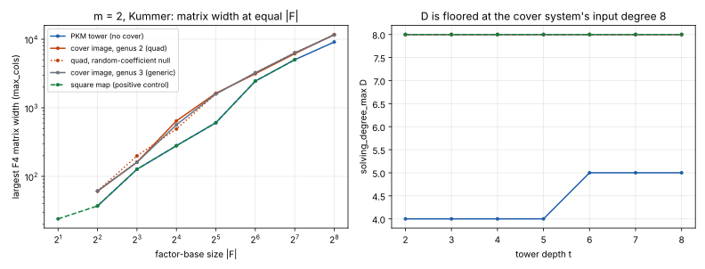

# Cover-image factor bases on E(F_p): the summation system on x∘φ(V) (2026-11-12)

**Question (idea 2).** Use a cover `φ: C → E` only to choose the factor base:
`F = x∘φ(V)`, `V` a structured set of `u`-coordinates on `C` (a PKM tower set),
relations and the linear algebra stay on `E`. Does the summation system restricted to
`φ(V)` solve more cheaply than (a) its own random-coefficient null, (b) PKM's tower
base of the same size, (c) a random base of the same size?

**Answer: no sign of it** [pcc:unverified]. The formal reading is **not read**:
the preregistered positive control P0 failed on its letter, because the metric D is
floored by the input degree (below). The falsifier H0 holds on its letter in every cell
anyway. A post-hoc look at matrix width (Amendment 1, exploratory) finds the cover
systems the same size as their null and 1.3–2.7× wider than PKM's tower at equal `|F|`.

- Protocol: [`PROTOCOL.md`](PROTOCOL.md), committed in `07c6471fe5` before any cell.
- Instrument: `examples/pkm_tower_pilot.rs --engine f4 --cover-map square|quad|generic`
  and control `randbase` (commit `6061b6fa42`). Without the flag the pilot reproduces the
  24 committed rows of `research/pkm_matched_prime_20261106/raw/t5.jsonl` exactly
  (D, matrix sizes, targets, curves, steps).
- Runs: [`run.sh`](run.sh) → `runs/*.jsonl`, `runs/progress.txt`, binary hash and
  commit in `runs/`. Table: [`cells.tsv`](cells.tsv) ([`tabulate.py`](tabulate.py)).
  Figure: [`fig_cols.svg`](fig_cols.svg) ([`plot.py`](plot.py)).
- 0 planted violations: every planted system vanished at its solution, and every
  basis contained it.

## Construction

A degree-2 map `X = N(u)/D(u)` pulls `E: Y² = f(X)` back to `C: v² = h(u)`,
`h = D⁴·f(N/D)`. Both critical values on branch points of `E` → genus 1, a 2-isogeny
(PKM's Vélu step); one at ∞ → genus 2; neither → genus 3. Each row records the genus
from a squarefree check of `h`: `square` and `quad` 2 (sextic `h`), `generic` 3.

## Results (p = 2013265921, 3 planted + 3 random targets per cell, no timeouts)

m = 2, Kummer tower (Dickson identical in every cell). D = `solving_degree_max`;
cols = widest F4 matrix.

| t | \|F\| | PKM tower D / cols | quad D / cols | quad null D / cols | generic D / cols | randbase D |
|---|---|---|---|---|---|---|
| 4 | 16 | 4 / 280 | 8 / 645 | 8 / 491 | 8 / 565 | 18 |
| 5 | 32 | 4 / 606 | 8 / 1,629 | 8 / 1,601 | 8 / 1,594 | 34 |
| 6 | 64 | 5 / 2,451 | 8 / 3,141 | 8 / 3,233 | 8 / 3,247 | 66 |
| 7 | 128 | 5 / 5,031 | 8 / 6,159 | 8 / 6,355 | 8 / 6,330 | 130 |
| 8 | 256 | 5 / 9,119 | 8 / 11,723 | 8 / 11,570 | 8 / 11,580 | 258 |

m = 3 (tower control only): at t = 4 (`|F| = 16`), PKM D 6, cols 12,314; quad D 8,
cols 24,482; generic D 9, cols 22,598. The `m3-square` arm was stopped by the
container's 2-hour background limit before writing a row. Not rerun: it is a control,
and the collapse it tests is exact at m = 2.

### Against the preregistration

- **P0 failed on its letter.** `square` gave D = 8 at every t, not ≤ the tower's 4–5.
  The collapse is real but D cannot show it. `S₃(u², …)` has total degree 8 in the
  bottom tower variable, and the pilot's D includes the input degree. The same presentation
  in `y₁ = y₀²` has degree 4. Per the protocol, the D-based verdict is not read.
- **H0 holds on its letter in every cell:** `D_cover = D_null,cover = 8` and
  `D_cover ≥ D_tower` at every t, for quad and generic, both towers, m = 2.
- **H1 does not hold:** D_cover never falls below its null. Its slope criterion
  (0 ≤ the tower's) is met only through the floor, which is the reason P0 exists.

### Amendment 1 (post hoc, exploratory; written after seeing the data)

Matrix width (`max_cols`) is not floored by the input degree, so it is the usable
measure here. It is not preregistered.

- **The positive control works in this metric.** `square` at depth t has exactly the
  widths of the PKM tower at depth t−1 (37, 127, 280, 606, 2,451, 5,031, 9,119 shifted
  by one), in the tower and null controls and for both tower kinds.
- **The cover image is indistinguishable from its null.** quad/null width ratio at
  t = 5–8: 1.02, 0.97, 0.97, 1.01. At t = 4 it is 1.31, and 0.81 at t = 3.
- **The cover image is wider than PKM's tower at equal |F|.** quad/PKM: 2.30 (t = 4),
  2.69 (5), 1.28 (6), 1.22 (7), 1.29 (8). generic is about the same. At m = 3, t = 4:
  1.99 (quad) and 1.84 (generic).
- `randbase` has two unknowns and degree-`|F|` memberships: D = |F| + 2 and narrow
  matrices. It is the univariate route and is not comparable in D. It is kept as the
  unstructured reference the protocol asked for.

## Reading

No structure from the cover appears in F4 at these sizes. In D (floored) and in
matrix width (post hoc), the summation system on `x∘φ(V)` behaves like a
random-coefficient system of the same monomial support, which is what PKM's own tower
did (`research/pkm_matched_prime_20261106/`). It costs more than PKM's tower at
equal `|F|`, because substituting the degree-2 map doubles the degree of `S₃` in
every summand. Genus 2 versus genus 3 makes no visible difference. Prior stated in the
protocol: H0 about 0.8.

## Not claimed

No `S`, no relation-phase cost, no rho comparison, no leaderboard or `benchmarks/` row
(stage diagnostic; counts only; wall times logged, not compared, on a shared 4-core
container). Small prime, t ≤ 8, m ≤ 3, degree-2 covers only. Higher-degree covers, or
a grading that puts `x∘φ(u)` at weight 1, are not tested. A future run should
preregister a degree measure that subtracts the input degree, or use matrix width.
The 2026-11-12 session log records the missing S3 checkpoint and Conductor.
