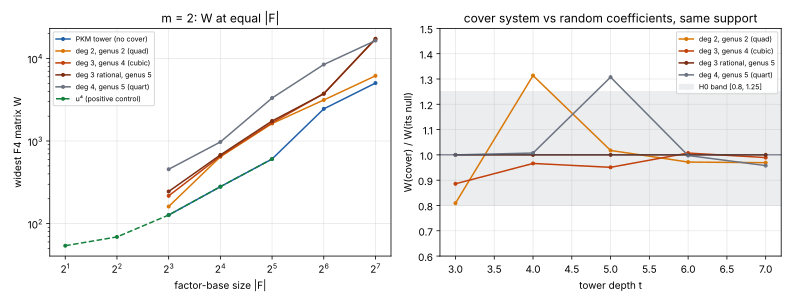

# Cover-image factor bases, round 2: degree-3 and degree-4 covers, matrix width (2026-11-12)

**Question.** Round 1 ([`../cover_image_fb_20261112/`](../cover_image_fb_20261112/README.md))
could not read its preregistered verdict: the solving degree D was floored by the input degree.
This round fixes the measure in advance as the widest F4 matrix (W), and adds cover maps of
degree 3 and 4. Does the summation system on `x∘φ(V)` give F4 smaller matrices than the same
system with random coefficients, or than PKM's tower at the same base size?

**Answer: no** [pcc:unverified]. Both calibration gates pass exactly. Two of three main arms
land on the preregistered falsifier H0. The third, `quart`, is inconclusive on the letter of the
rule: at one depth its width is 1.31× its null, which is the cover doing *worse*, not better. No arm
comes near H1.

- Protocol: [`PROTOCOL.md`](PROTOCOL.md), pushed in `ce3aeddf77` before any measured cell.
- Instrument: `examples/pkm_tower_pilot.rs --engine f4`, `--cover-map` with `fourth`, `cubic`,
  `quart`, `generic3` added (`3466f3be9e`).
- Runs: [`run.sh`](run.sh) → `runs/`. Table and gates: [`tabulate.py`](tabulate.py) →
  [`cells.tsv`](cells.tsv). Figure: [`fig_width.svg`](fig_width.svg) ([`plot.py`](plot.py)).
- p = 2013265921, Kummer tower, 3 planted + 3 random targets per cell, t = 3–7 at m = 2,
  t = 2–3 at m = 3. 0 timeouts, 0 censored cells, 0 planted violations.

## Gates

| gate | result |
|---|---|
| R0: `quad` replays round 1's W | **pass**: 10/10 cells identical (tower and null, t = 3–7) |
| P0: `square` = tower at t−1, `fourth` = tower at t−2 | **pass**: 7/7 cells identical |
| `cubic` (degree 3, genus 4) | **H0** |
| `generic3` (degree-3 rational, genus 5) | **H0** |
| `quart` (degree 4, genus 5) | **inconclusive** (W/null = 1.31 at t = 5, above the 1.25 band) |

## W at m = 2 (tower control)

| t | \|F\| | PKM tower | quad | cubic | generic3 | quart |
|---|---|---|---|---|---|---|
| 5 | 32 | 606 | 1,629 | 1,663 | 1,749 | 3,315 |
| 6 | 64 | 2,451 | 3,141 | 3,755 | 3,728 | 8,436 |
| 7 | 128 | 5,031 | 6,159 | 17,126 | 17,313 | 16,453 |

Ratios at t = 5, 6, 7 (from `tabulate.py`):

| arm | W / its null | W / PKM tower |
|---|---|---|
| cubic | 0.95, 1.01, 0.99 | 2.74, 1.53, 3.40 |
| generic3 | 1.00, 1.00, 1.00 | 2.89, 1.52, 3.44 |
| quart | 1.31, 1.00, 0.96 | 5.47, 3.44, 3.27 |

m = 3 (tower only, t = 3, |F| = 8): PKM 3,285; cubic 1,866; quart 1,876; generic3 3,434.
**Here the cubic and quartic covers are narrower than PKM's tower.** This is the secondary cell,
with no null control and two depths, so it carries no gate. A run with a null at larger t would
test whether it holds.

E (how far F4's degree climbs above the input degree) is 0 in every cover cell, at m = 2 and
m = 3. The cover systems start at input degree 8–16 and F4 finishes there. The PKM tower starts at
4 and climbs to 5 at t ≥ 6. Like D in round 1, E does not separate the arms: the cover's cost is
its starting degree.

## Reading

At m = 2, every cover map tested (degrees 2–4, genus 2–5) gives F4 the same matrices as a
random-coefficient system on the same monomials. The structure of `φ(V)` is invisible to F4, as
the structure of PKM's own tower was in `research/pkm_matched_prime_20261106/`. At equal base size
the cover systems are 1.5–5.5× wider than PKM's tower, because substituting a degree-d map raises
`S₃` to degree 4d in the two summands. Higher degree did not help, and genus 4 behaves like
genus 5.

The one open point is the m = 3, t = 3 cell, where `cubic` and `quart` came in narrower than the
tower. It is a single unreplicated cell with no null.

## Not claimed

No `S`, no relation-phase cost, no rho comparison, no leaderboard or `benchmarks/` row. This is a
stage diagnostic: counts only, local 4-core container, small prime, t ≤ 7. The covers are fibre
products through a map on `x`; other covers are out of scope. No S3 checkpoint (no upload
credentials) and no Conductor task (not installed); recorded in the session log.
