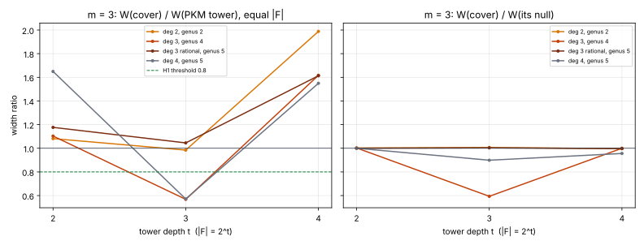

# Cover-image factor bases, round 3: the m = 3 lead does not hold (2026-11-12)

**Question.** Round 2 ([`../cover_image_fb_r2_20261112/`](../cover_image_fb_r2_20261112/README.md))
left one ungated m = 3 cell where the `cubic` and `quart` cover systems had smaller F4 matrices
than PKM's tower (t = 3, |F| = 8). Does that hold at t = 4, and is it the cover's structure?

**Answer: it does not hold** [pcc:unverified]. All four cover maps land on the preregistered
falsifier H0 at t = 4. They are 1.55–1.99× wider than PKM's tower and 1.3–2.3× slower per system.
The t = 3 dip was real but transient: it shows in the cubic's own null comparison at t = 3
(0.59×) and is gone at t = 4 (1.00×). This closes the cover-image factor-base line at the sizes
this container can reach.

- Protocol: [`PROTOCOL.md`](PROTOCOL.md), pushed in `5556627954` before any measured cell, with
  Amendment 1 (`a9088c3c61`), written before any cover-map t = 4 value was read.
- Runs: [`run.sh`](run.sh) (tower pass), [`drive.sh`](drive.sh) and [`run_nulls.sh`](run_nulls.sh)
  (Amendment 1) → `runs/`. Gates: [`tabulate.py`](tabulate.py) → [`cells.tsv`](cells.tsv).
  Figure: [`fig_m3.svg`](fig_m3.svg) ([`plot.py`](plot.py)).
- m = 3 with the `--null-chain` null, Kummer tower, p = 2013265921, 3 planted + 3 random targets
  per cell, t = 2–4. No timeouts, no censored cells, 0 planted violations.

## Gates

| gate | result |
|---|---|
| R0: t = 2, 3 `tower` W replays round 2 | **pass**, 8/8 cells identical |
| `quad` | **H0** (W/PKM 0.98 at t = 3, 1.99 at t = 4) |
| `cubic` | **H0** (0.57 at t = 3, 1.62 at t = 4) |
| `quart` | **H0** (0.57 at t = 3, 1.55 at t = 4) |
| `generic3` | **H0** (1.05 at t = 3, 1.61 at t = 4) |
| S (structure) | not read: the protocol reads it only for an arm with H1 |

## t = 4 (|F| = 16, N = 12 tower unknowns)

| map | W | W / PKM | W / own null | rows | D (input) | median F4 ms |
|---|---|---|---|---|---|---|
| PKM tower | 12,314 | 1 | 0.99 | 12,896 | 6 (4) | 55,139 |
| quad | 24,482 | 1.99 | 1.00 | 28,441 | 8 (8) | 110,949 |
| cubic | 19,911 | 1.62 | 1.00 | 18,592 | 12 (12) | 127,654 |
| quart | 19,079 | 1.55 | 0.96 | 14,668 | 16 (16) | 73,912 |
| generic3 | 19,863 | 1.61 | 1.00 | 18,628 | 13 (13) | 112,435 |

Times are from a shared 4-core container, four processes at once: descriptive only.

## Descriptive: the t = 3 dip

At t = 3 the cubic's system is 0.59× its own null (1,866 vs 3,144) and the quartic's 0.90×
(1,876 vs 2,087). So the dip that started this round was partly the cover's structure, not only
the system's shape. By t = 4 both are at 0.96–1.00× their null, and 1.55–1.62× PKM's tower. One
depth is not a trend. Measuring it needs t ≥ 5 at m = 3, which ran out of memory here (below).

## Amendment 1, in short

The PKM arm was killed by the 16 GB memory limit (7.9 GB resident) in its t = 5 cell, with four
arms running at once. t = 5 was already outside every gate, so it was dropped. The nulls ran in a
second pass on the same seeds. The round-1–3 `run.sh` logged the exit status of `date`, not of the
pilot, so logged `exit=0` lines in those runs are not evidence of a clean exit. The row files are.

## Across the three rounds

Every cover map tested (degrees 2–4, genus 2–5; m = 2 to t = 8, m = 3 to t = 4) gives F4 the same
matrices as random coefficients on the same monomials, with a single transient exception at m = 3,
t = 3. At equal |F| every map is wider than PKM's tower once t ≥ 4. PKM's tower was itself already
equal to its null (`research/pkm_matched_prime_20261106/`). The line is closed unless a run at
m = 3, t ≥ 5 or m = 4, on a host with more memory, shows the t = 3 structure returning.

## Not claimed

No `S`, no relation-phase cost, no rho comparison, no leaderboard or `benchmarks/` row. Stage
diagnostic, counts only. No S3 checkpoint (no upload credentials) and no Conductor task; the
session log records both.
