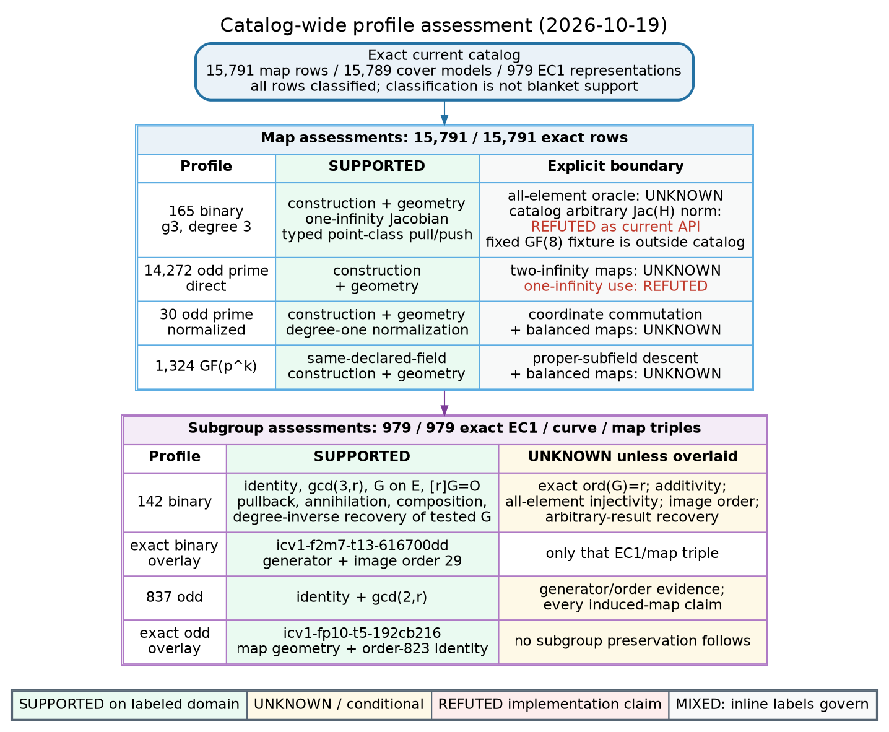
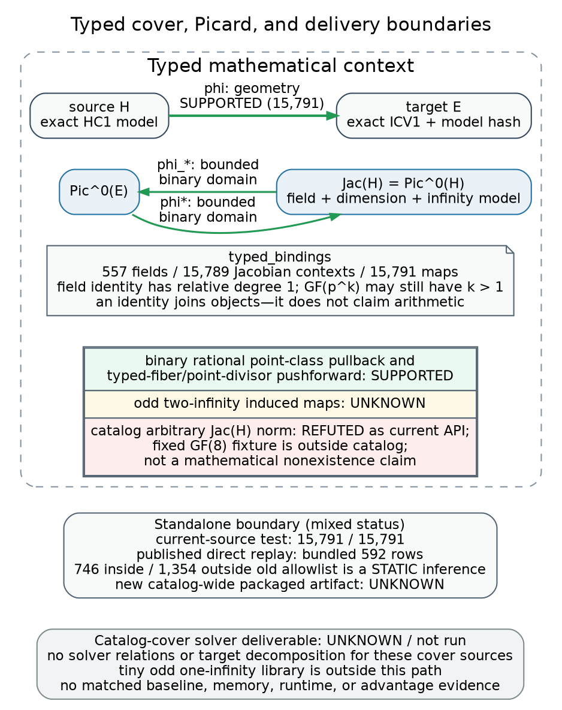

<!-- cover-transfer-assessments/v2; catalog_maps=15791; unique_cover_models=15789; geometry_verified_maps=15791; ec1_representations=979; assessed_maps=15791; unassessed_maps=0; assessed_subgroups=979; unassessed_subgroups=0 -->

# Outcome

This 2026-11-18 evidence refresh retains catalog commit
`728304718cb0ab6df70da620a908a5f76f175293`, the 15,791-map cohort originally
frozen on 2026-10-24. Throughout the report, "pinned cohort" means that exact
snapshot and "current source" means the implementation bytes hash-bound by the
machine ledger. As of 2026-11-18 the separate live geometry catalog has grown
to 22,417 maps and 1,090 EC1 representations. The 6,626 added maps and 111
added representations are outside this assessment; they inherit no transfer
or subgroup-support conclusion from it. See the
[coverage gap](../../problems/catalog-cover-subgroup-certificates-incomplete.md)
for the separate current-catalog obligation.

The legacy formula-inventory finding is also historical: its source artifact
now declares `source_commit` =
`0c82a7dd1d1e6e3c847b49f8446d29d405beb0c5`, preserving the exact 2,572-entry
inventory that the finding describes. Separately, the live Jacobian formula
catalog now screens 22,417 registry entries with the same cost model. This
completes the metadata refresh in historical obligation 7 below; it supplies no
new transfer certificate, solver execution, or measured advantage. All other
implementation artifacts still bind their current repository bytes.

Every cover map and linked EC1 representation in the pinned cohort has an
explicit v2 assessment. Classification of that cohort is complete;
implementation support is not. In particular, the complete dated inventory
must not be read as a complete live Jacobian-transfer pipeline.

The main results are:

- all 15,791 explicit cover formulas replay over their declared fields, subject
  to the field-validity assumptions stated below;
- all 165 binary maps have the implemented one-infinity genus-three Jacobian
  arithmetic, rational-point pullback, arbitrary-class pushforward, and the
  image/Prym projector;
- the current native batch test covers all 142 pinned binary EC1 bindings for generator membership,
  `[r]G=O`, pullback validity, `[r]phi^*(G)=0`, composition, and
  degree-inverse recovery;
- those generator-level tests do **not** prove pullback additivity,
  all-element composition, injectivity, or image-order equality on the full
  generated subgroup; only the retained order-29 overlay has the stronger
  narrow exact-order and image-order certificate;
- the pinned odd-characteristic cohort separates into `14,012 proved_u64`
  direct maps and `2 proved_psi13` direct maps with checked balanced
  two-infinity arithmetic and induced maps; `258
  unsupported_without_primality_certificate` direct maps, `30 normalized
  fail-closed` maps, and `1,324 extension backend unavailable` maps retain
  geometry without executable transfer support;
- the independent F2 source-law pilot covers exactly 20 classes, 400 sums, and
  8,000 associativity triples; it is not the full 486-class fixed-`GF(8)`
  source-law oracle and does not prove a catalog-wide subgroup claim; and
- no complete Jacobian relation solver, measured transfer advantage, or key
  recovery result is part of this assessment.

The canonical machine record is the
[assessment ledger](../../docs/curves/cover-transfer-assessments.json),
generated by the
[assessment builder](../../scripts/build_cover_transfer_assessments.mjs)
and validated against the
[assessment schema](../../docs/curves/cover-transfer-assessment.schema.json).
It uses only `supported`, `refuted`, `unknown`, and `not_applicable`.
`Refuted` always refers to a concrete implementation or evidence claim; it
never turns a missing implementation or failed bounded search into a theorem
of nonexistence.

## 2026-11-18 implementation refresh and live-catalog boundary

The live registry and regenerated graph now contain 22,417 maps, 22,415
distinct cover models, and 1,090 EC1 representations. The live profiles are
174 binary maps with 150 EC1 links, 20,808 direct-prime maps with 909 links,
30 normalized-prime maps with 22 links, and 1,405 odd-extension maps with 9
links. All live models have geometry records, while every graph
`subgroup_transport` field remains `not_tested` with null evidence. These
numbers do not replace the 15,791-map membership or conclusions of this dated
assessment.

Current binary code implements arbitrary-class pushforward for the supported
catalog family and exposes structured pushforward, pullback, composition,
projector, and conditional subgroup-status operations in the standalone CLI.
The fixed-`GF(8)` replay independently implements map values but still obtains
source sums from production. A separate F2 pilot supplies a genuinely
independent 20-class source law; it is partial and does not close the required
486-class gate.

The separate balanced backend implements canonical arithmetic for monic
squarefree genus-two sextics with two labelled rational infinities. The direct
short-Weierstrass cover API implements pullback, arbitrary-class pushforward,
`pi_*pi^*=[2]`, and `pi^*pi_*=1+deck_*` when the modulus is proved by the
deterministic-u64 gate or the strict
`p < 3317044064679887385961981` psi13 gate. Passing the configured bases at or
above that exclusive bound is not proof. Extension fields and normalized
Montgomery/Edwards target coordinates remain fail-closed.

These additions do not establish subgroup preservation for a live graph row,
a Jacobian relation solver, key recovery, or a computational advantage. The
catalog cohort remains historical and pinned, while the capability tables
below are refreshed against the current hash-bound implementation evidence.

## Fixed-GF(8) addendum and later catalog-family generalization

The 2026-10-14 library revision accepted every valid reduced class for one
exact synthetic fixture: `GF(8)` in the polynomial basis `z^3+z+1`, target coefficients
`a=1`, `b=3`, and cover parameter `d=7`. Exhaustive native tests cover all
486 classes and all 236,196 ordered pairs, including nonsplit, shared-support,
exceptional, and malformed cases. A separately implemented point-count replay
certifies only the source-Jacobian cardinality `486`; it is not an independent
divisor-arithmetic or norm-map oracle.

This fixture is a mechanics and homomorphism test, not an injective full-group
ECDLP transfer. The target has order 6, the six norm fibers each contain 81
Jacobian classes, and `gcd(3,6)=3`; the generic degree-coprime subgroup
criterion therefore does not certify injectivity on the full target group.

The standalone `construct`/`verify` receipt for that historical revision
replayed only the geometry certificate. It did not initialize or execute the
486-class norm and was not a per-invocation transfer proof. Current source has
since generalized arbitrary-class pushforward to every catalog binary cubic
cover, including nonsplit degree-two and degree-three support through residue
fields and Frobenius traces, and exposes transfer operations in the CLI.

None of the 165 pinned catalog binary rows is this `GF(8)` fixture. The
fixture therefore remains an exhaustive mechanics control rather than a
catalog certificate. Its map-value cross-check still uses production source
addition in the homomorphism loop; the independent F2 pilot covers only 20
classes. Neither result promotes a subgroup-wide claim, solver, or advantage.

The existing `CoverTransfer.lean` package proves only the conditional abstract
group lemma described below. It does not formalize this fixture's finite-field
or curve model, the checked `N1`–`N3` counts and zeta-to-Jacobian-order bridge,
the 486-class divisor presentation, or the norm homomorphism. Those are
concrete open formalization obligations; no Lean proof receipt is claimed for
the fixed-`GF(8)` order or all-class transfer results.

# Original requirements and evidence status

| Requested item | Status | Evidence boundary |
|---|---|---|
| Primary theorem and exact hypotheses | verified | Xarles v1, Corollary 3; same base field, characteristic not 2 or 3, higher genus at most 5, two independent maps |
| Audit crypto PR #1389 and cryptanalysis PR #290 | verified historical audit | pinned heads and matching `quartic-ic` source hashes below; this is a non-hyperelliptic norm-projection experiment |
| Separate supported input models | implemented with explicit boundaries | binary and odd-characteristic constructors are separate; unsupported infinity configurations return a structured result |
| Constructive covers | supported for the two fixed catalog families | all 15,791 formulas are explicit and replayed; this is not a theorem-complete Xarles constructor |
| Genuine Jacobian arithmetic | partial | binary one-infinity sources and the 14,014 proof-admitted direct-prime two-infinity sources are supported; 258 proof-unsupported direct rows, 30 normalized rows, and 1,324 extension rows remain outside executable arithmetic or transfer support as stated by their profiles |
| Pullback, pushforward, and subgroup transfer | partial | binary arbitrary-class norms and proof-admitted direct-prime induced maps are implemented; all 142 binary generators receive the stated native checks, while odd catalog generator/order replay, subgroup-wide preservation, and independently checked all-element identities remain open |
| EC1/ICV1 catalog evidence | partial | exact memberships, typed object bindings, hashes, statuses, and four narrow overlays cover the pinned 15,791-map snapshot; the independent F2 source-law pilot is a non-catalog specialization and does not widen a catalog subgroup claim |
| Standalone executable | source verified; packaged scope incomplete | current-source tests cover 15,791 inputs; the published artifact was replayed on its bundled 592-row registry, not on all current inputs |
| Validation and shipping | partial | deterministic checks and native tests exist; independent divisor-class replay, local Lean kernel receipt, fresh package, and final CI gates remain open |
| Full Jacobian index-calculus solver | separate and not delivered | no cover-integrated or catalog-supported solver/run for these binary and even-sextic sources; the existing tiny odd-prime one-infinity relation/linear-algebra/recovery library is outside this assessment and is not a general solver |

# Population and profile coverage

The v2 ledger assigns every exact map UID to one map profile and every exact
`[EC1, curve UID, map UID]` triple to one subgroup profile. Sorted memberships
and domain-separated membership hashes make the coverage checkable rather
than count-only.

| Map profile | Maps | Source / map | What is established |
|---|---:|---|---|
| Binary cubic, same field | 165 | genus 3, degree 3 | geometry, one-infinity arithmetic, arbitrary-class norm, bounded typed transfer |
| Direct odd prime: `proved_u64` | 14,012 | genus 2, degree 2 | geometry, balanced arithmetic, pullback, arbitrary-class pushforward, both composition identities |
| Direct odd prime: `proved_psi13` | 2 | genus 2, degree 2; 73-bit pilot | the same checked direct-prime operations inside the strict psi13 theorem range |
| Direct odd prime: proof unavailable | 258 | genus 2, degree 2 | geometry; `unsupported_without_primality_certificate` for arithmetic and induced maps |
| Normalized odd prime field | 30 | genus 2, degree 2 plus degree-one target normalization | geometry; transfer `fail-closed` without an all-point Montgomery/Edwards adapter |
| Odd extension field | 1,324 | genus 2, degree 2 over the declared `GF(p^k)` | geometry over that field; extension backend unavailable |
| **Total** | **15,791** | **15,789 unique HC1 cover models** | **every map classified** |

The two repeated cover objects are intentional shared models, not duplicate
assessment rows. The exact machine-friendly partition is:
`14,012 proved_u64`; `2 proved_psi13`;
`258 unsupported_without_primality_certificate`;
`30 normalized fail-closed`; and `1,324 extension backend unavailable`, in
addition to the 165 binary rows.

| Subgroup profile | EC1 bindings | Established catalog-wide facts | Still open |
|---|---:|---|---|
| Binary degree 3 | 142 | exact identity joins, `gcd(3,r)=1`, generator membership, annihilation, pullback, tested-generator composition, and inverse recovery | independent additivity and all-element composition; injectivity and image order; proof-grade numeric exact order except order 29; solver-produced arbitrary-result recovery |
| Odd degree 2 | 837 | exact identity joins and `gcd(2,r)=1` | catalog-wide generator/order certificates, map replay on each named generator, kernel and image-order claims, arbitrary-result recovery, and advantage |
| **Total** | **979** | **every binding classified** | **unknowns remain explicit** |

These are 979 EC1 representations on 973 curve models; six models have two
distinct representations. The semantic verifier computes the effective
`supported`, `unknown`, `refuted`, and `not_applicable` assignment totals from
the generated ledger. Those are claim assignments, not counts of distinct
maps, and no count of classified claims implies that the claims are supported.

## Typed identity bindings are contexts, not capability claims

The ledger's explicit `typed_bindings` materialize 557 content-addressed
declared-field records, 15,789 Jacobian contexts, and 15,791 typed curve-map
bindings. A map binding joins the exact target ICV1 slug and model hash to its
source-cover UID, source-Jacobian UID, and declared-field relationship. A
Jacobian context records `Picard_degree_zero`, its dimension, its cover and
field UIDs, and whether the source has one or two rational infinity points.

These records prevent accidental mixing of fields, source curves, infinity
models, or maps. Their word `identity` is deliberately narrow:
`same_declared_field_identity` says that the source-to-target field
relationship is the identity, of relative degree one. The declared field
itself may still be `GF(p^k)` with absolute extension degree greater than one,
which the field binding retains. The identity does **not** assert that
Jacobian arithmetic exists, that an induced pullback or pushforward is
implemented, or that either is a homomorphism. Likewise, merely naming a
Jacobian context does not promote its arithmetic. Capability status comes only
from the applicable profile claim, result template, and any exact overlay.

# Construction and geometry

## Binary characteristic

For an ordinary binary target over its exact polynomial-basis field,

\[
 E: y^2+xy=x^3+a x^2+b, \qquad b\ne0,
\]

put \(d=\sqrt b\) and construct

\[
 H: v^2+u^2v=u^7+a u^4+d u,
 \qquad \phi(u,v)=(u^3,uv+d).
\]

The native checker verifies \(d^2=b\), the defining-equation identity,
affine smoothness, the infinity chart, genus three, degree three, and
separability. The binary field polynomial is checked by the exact Rabin
criterion. The details and proof are in
[`COVERS.md`](../../docs/curves/COVERS.md) and the implementation is in
[`checker.rs`](../../src/bin/curve_cover_check/checker.rs).

## Odd characteristic

After any recorded degree-one Montgomery or Edwards normalization, write the
short target as

\[
 E: y^2=F(x)=x^3+a x+b.
\]

Choose the first \(c\in\{0,1,2,3\}\) with \(F(c)\ne0\), and construct

\[
 H: v^2=F(u^2+c),
 \qquad \phi(u,v)=(u^2+c,v).
\]

The checker verifies the equation identity, the monic squarefree sextic,
genus two, two rational points at infinity, degree two, separability, and the
recorded target-model identities. This construction works over the same
declared prime field or polynomial-basis extension field; it is not a descent
to a proper subfield.

For odd characteristic, `p` passes a fixed 20-base probable-prime screen but
is retained as a registry input assumption, not a primality proof. Extension
moduli pass the exact Rabin irreducibility criterion *conditional on that
prime-field assumption*. Thus “verified over the declared field” has this
explicit boundary. The catalog checker does not certify group orders,
generators, or EC1 subgroup parameters.

The independent semantic replay in
[`verify_assessment.mjs`](verify_assessment.mjs) checks every content join,
profile predicate, membership hash, and all 15,791 finite-field map formulas.
It does not independently prove odd `p` primality, extension-modulus
irreducibility without that assumption, EC1 subgroup orders, or computational
advantage.

# Original theorem audit

The broader source is Xavier Xarles, *Hyperelliptic curves covering an
elliptic curve twice*,
[arXiv:1303.4220v1](https://arxiv.org/abs/1303.4220v1), Corollary 3. Its
statement applies to an elliptic curve over an arbitrary field \(K\) of
characteristic different from 2 and 3. It gives a hyperelliptic curve
\(H/K\) of genus at most five with two independent \(K\)-defined maps to the
elliptic curve; it does not require first extending the base field.

“Independent maps” means independent in Xarles's map/endomorphism sense: the
proof excludes a relation obtained by composing the two maps with distinct
elliptic endomorphisms. It does not mean independent software implementations,
independent computational routes, subgroup preservation, or an ECDLP speedup.

For \(j\ne0,1728\), the paper displays a genus-five construction with two
degree-three maps. Degree three together with characteristic different from
three makes those displayed generic maps separable. Separability is not a
separately stated hypothesis or conclusion of Corollary 3, however, and the
exceptional `j` cases invoke earlier genus-two results whose maps were not
separately audited here for separability. The corollary is therefore an
existence theorem with explicit generic formulas, not a single uniform
executable constructor and certificate for every input model. Its
exceptional-case citations must not be silently upgraded into the repository's
implementation evidence.

“Hyperelliptic” here means the higher-genus setting, genus at least two. The
tautological genus-one reading in which an elliptic curve covers itself is not
the content being used. The repository's two fixed families above are
separate constructive results: they give one explicit map per supported
catalog model and do not claim Xarles's pair of independent maps.

# Existing `quartic-ic` experiment audit

Crypto PR [#1389](https://github.com/aburan28/crypto/pull/1389) and
cryptanalysis PR
[#290](https://github.com/aburan28/cryptanalysis/pull/290) were audited at
these immutable revisions:

- crypto PR #1389 head:
  `6c6247bde5e585642773ed5b6b933b4ec4c6fd4f`
- crypto PR #1389 merge:
  `7ea1db7a6b4b6962f3fa38d70ac65300d25ceb4b`
- cryptanalysis PR #290 head:
  `3b14ec30de6c79fbc9dd72f4ed3eb8ea19d5a642`
- cryptanalysis PR #290 merge:
  `54cbf1dc27879b9bd441df7b64e2c629e9d9d9ea`

At both heads, the quartic kernel, CLI, and retained receipt were byte-identical
with these SHA-256 values:

```text
kernel   54ef65c7325a7c850741a8def84ee2b2ceddcc3689a0879afd2796eb7cb01e52
CLI      0f71936014b3ff54dacc9dc6b642c88bea60b70a658f6e42c467aab73f11a069
receipt  d3de82409e6fe82a59e74425916ed820ac5f8912e74046f41468cef56c01a967
```

The immutable October 6
[audit](../hyperelliptic_cover_infrastructure_20261006/README.md) records the
retrieval and replay details.

The experiment uses the smooth plane quartic

\[
 C:v^4=x^3+ax+b, \qquad \pi(x,v)=(x,v^2),
\]

over bounded small prime fields. A smooth plane quartic has genus three and is
**non-hyperelliptic**. `quartic-ic` certifies complete line sections, then forms
its linear system after elliptic norm projection. Its fixture's passing tests
support that bounded projected experiment; they do not construct a
hyperelliptic cover, implement divisor-class arithmetic in the full quartic
Jacobian, or establish a Jacobian index-calculus solver. Deck-conjugate
divisors may share an elliptic norm while retaining different Prym components,
so elliptic projected relations cannot be relabeled as full-Jacobian
relations.

# Jacobians and transfer maps

## Binary supported domain

[`hyperelliptic.rs`](../../src/binary_ecc/hyperelliptic.rs) implements checked
canonical reduced Mumford divisors for the binary one-infinity source family:
validity, reduction, equality, negation, addition, and scalar multiplication.
Its tests include identity, exceptional divisors, shared support, inverses,
and exhaustive small-field fixtures.

[`cover_transfer.rs`](../../src/binary_ecc/cover_transfer.rs) implements:

- pullback of rational elliptic point classes `[P]-[O]`, including infinity
  and the exceptional ramified fiber;
- arbitrary-class pushforward for every valid canonical reduced Mumford class
  of degree at most three, including irreducible degree-two and degree-three
  support evaluated in the corresponding residue fields;
- pushforward of rational source-point divisors and the implementation's own
  typed pullback witnesses;
- image/Prym projector certificates on the checked arbitrary-class domain; and
- a native typed-path check whose pushforward result equals `[3]P` for the
  implementation's own pullback witness.

The last item is implementation/test evidence on values constructed by the
same typed API, not a proof-grade universal algebraic identity. No
`identity.certificate/v1` / `IDC1h…` record has been issued for
`phi_* phi^* = [3]`. Until such a certificate and an independent divisor-map
replay exist, universal composition, kernel, and subgroup-recovery conclusions
remain conditional or `unknown` as stated below.

The exact fixed-`GF(8)` fixture described in the addendum checks all 486
classes and all 236,196 ordered pairs, but its homomorphism loop still uses
production source addition. The separate F2 source-law pilot independently
checks 20 classes, 400 sums, and 8,000 associativity triples together with
both induced maps and both composition identities for one specialization.
It is deliberately not the full 486-class oracle and not a catalog-wide
subgroup certificate. Independent pullback additivity and all-element
composition across every exact catalog member therefore remain `unknown`.

## The 142 pinned binary subgroup checks

For each of the 142 binary triples in the current native batch certificate, the test decodes the
catalog generator and verifies:

1. the generator lies on the exact target and is nonidentity;
2. `[r]G=O` for the catalog integer `r`;
3. `phi^*(G)` is a valid nonidentity reduced divisor;
4. `[r]phi^*(G)=0`;
5. the typed composition gives `phi_*phi^*(G)=[3]G`; and
6. multiplication by the inverse of 3 modulo `r` recovers `G` on this typed
   route.

Because `[r]G=O`, the actual order of `G` divides `r`, and the checked modular
inverse calculation recovers this one tested generator from its typed
composition result. That is not enough to prove a homomorphism or injectivity
on all of `<G>`: the batch test does not establish pullback additivity or the
composition identity for every subgroup element through an independent map
oracle. Catalog-wide kernel intersection and actual image/source-order
equality therefore remain `unknown` and conditional. It also does **not**
prove `ord(G)=r`. Proof-grade numeric equality with the catalog order remains
`unknown` for 141 of the 142 binary bindings; the retained
\(\mathbf F_{2^7}\) order-29 overlay is the one narrow exception.

The elementary group-theoretic core is formalized in
[`CoverTransfer.lean`](lean/CoverTransfer.lean): if a finite subgroup has
exact cardinality `r`, `push(pull(x))=d*x` on that subgroup, and
`Nat.Coprime d r`, then the restricted pullback is injective. The written
proof is immediate: equal pullbacks give equal `d`-multiples after applying
pushforward, while multiplication by `d` is bijective on a finite group whose
cardinality is coprime to `d`.

That Lean theorem assumes exact cardinality and the composition identity; it
constructs neither map, does not supply the missing `IDC1h…` identity
certificate, and does not promote the tested catalog bindings by itself.
The additional bridge from `[r]G=O` to
`ord(G) | r`, and hence coprimality with the actual generated-subgroup order,
is used in the native certificate but is not a separately formalized Lean
corollary here; additivity and all-element composition are still missing.
The sources pin Lean 4.34.1 and Mathlib revision
`d13f23b723b8a846827a245b89c10fc7d3f11612`. The original October 13
mounted-home attempt stopped at 2,536 of 8,908 cache files when the sandbox
ran out of space. The [October 22 pinned scratch replay](lean/README.md#pinned-replay-2026-10-22)
subsequently completed all 8,908 cache files, built 1,131 jobs, and passed
the Lean axiom audit with only the repository's standard axioms. The named
conditional `pull_injective_on_subgroup` theorem is kernel-verified under
those pinned dependencies. This does not verify any catalog row's concrete
cover maps, subgroup order, or composition identity; those per-cover
obligations remain open.

## Odd-characteristic boundary

Every odd-characteristic source is a degree-six genus-two curve with two
labelled rational infinity points. Current source has a separate balanced
backend in [`balanced.rs`](../../src/prime_hyperelliptic/balanced.rs), rather
than passing these curves to the older one-infinity backend. It supplies
canonical `(u,v,n_plus)` validity, reduction, equality, negation, addition,
and scalar multiplication. The checked direct-prime API in
[`cover_transfer.rs`](../../src/prime_hyperelliptic/cover_transfer.rs) supplies
rational-point pullback, arbitrary balanced-class pushforward, and both
`pi_*pi^*=[2]` and `pi^*pi_*=1+deck_*`.

That executable support has a strict proof boundary enforced by
[`primality.rs`](../../src/prime_hyperelliptic/primality.rs): it covers the
14,012 pinned direct rows proved by deterministic `u64` primality and the two
73-bit rows proved below the exclusive psi13 bound. The 258 remaining direct
rows fail closed with `unsupported_without_primality_certificate`; passing
the configured probable-prime bases is not proof. The 30 normalized rows fail
closed until the original Montgomery/Edwards coordinates have an all-point
adapter, and the 1,324 extension rows fail closed because the balanced backend
is prime-field only.

These runtime maps do not by themselves establish subgroup preservation. For
the 837 linked odd EC1 records, the exact identity join and numerical
`gcd(2,r)=1` are supported, while generator membership and annihilation,
exact order, map replay on each named generator, kernel and image order,
recovery, and advantage remain `unknown`. Those proof-grade obligations are
tracked in
[`catalog-cover-subgroup-certificates-incomplete.md`](../../problems/catalog-cover-subgroup-certificates-incomplete.md).

# Exact overlays retained from the prior audit

The v2 ledger keeps four narrow overlays rather than extrapolating them:

| Overlay | Added evidence | Boundary |
|---|---|---|
| `icv1-f2m7-t13-616700dd` degree-three map | detailed geometry replay | does not widen the typed transfer domain |
| `icv1-f2m7-t13-616700dd` order-29 subgroup | exact source and image order | only that one EC1/map triple |
| `icv1-fp10-t5-192cb216` degree-two map | detailed geometry replay | its direct map lies in the deterministic-u64 implementation profile; this overlay itself adds no subgroup claim |
| `icv1-fp10-t5-192cb216` order-823 identity | exact catalog identity retained | no preservation claim follows |

The prior October 6 evidence remains immutable in
[`evidence.json`](../hyperelliptic_cover_infrastructure_20261006/evidence.json).
The v2 generator reuses it only for these exact overlays. The stale
[`jacobian-transfers.json`](../../docs/curves/jacobian-transfers.json) formula
screen is not imported as a map, order, or recovery certificate.

# Source, packaged binary, and browser boundary

The current source allowlist accepts all four pinned input profiles. The
catalog-wide constructor test exercises the standalone `construct` path for
all 15,791 models in the pinned snapshot recorded at
[4a181ccb](https://github.com/aburan28/crypto/commit/4a181ccb3201d3275cbf7aed29bfd72f58d82467). That commit pins the three
catalog files; the test assertion is part of the current source. This is
source-level evidence, not a published-artifact claim.

The independently replayed published binary
[`v0.1.0-main.1371`](https://github.com/aburan28/crypto/releases/tag/v0.1.0-main.1371)
predates that allowlist repair. Direct replay establishes that it runs against
its own bundled 592-row registry. Separately, static comparison of its pinned
source allowlist with the earlier 2,100-row model partition placed 746 forms
inside its syntactic domain (160 binary and 586 direct-prime) and 1,354
outside: the latter were 1,324 extension-field rows and 30 normalized
Montgomery/Edwards rows. That historical classification has not been rerun
against the later 2,572-row catalog. No exact batch receipt ran all current
inputs against the archived executable. The artifact is therefore **not**
evidence of a catalog-wide current binary. Exact asset hashes, directly
executed commands, and the historical static-classification boundary are
preserved in
[`release_replay.txt`](release_replay.txt).

The generated curve-browser sidecar for the pinned snapshot has 15,791 cards
using this geometry status:

```text
verified_over_declared_field
```

They retain `subgroup_transfer: not_tested` and keep DLP advantage null. The
v2 sidecar does not silently turn those geometry cards into transfer badges.

The retained offline cryptanalysis parity rerun reported
`hyperelliptic mirror manifest and crypto source: verified` for exactly seven
manifest records at its pinned snapshot. Its `cover_transfer.rs` digest is
`67b94112…`, which predates the current `e1336ef5…` source containing the
catalog-family arbitrary-class norm. The receipt also excludes the standalone
CLI, Cargo configuration, catalogs, schema, assessment ledger, workflows, and
package artifacts, and it does not check the manifest's recorded commit against
the checkout's actual `HEAD`. It therefore establishes historical parity for
those seven bindings, not a current cryptanalysis mirror or integration of the
new norm or CLI changes.

# Validation controls

| Control | Status | Scope and limit |
|---|---|---|
| Exact identity joins | `supported` | all 15,791 map UIDs and 979 EC1/curve/map triples; identity alone claims no arithmetic |
| Cover geometry | `supported` | all 15,791 fixed-family rows; equations, smoothness, genus, degree, separability, and infinity behavior, conditional on the declared odd base-prime assumptions described above |
| Internal Jacobian arithmetic | `supported` on stated models | all 165 binary rows and the 14,014 proof-admitted direct-prime rows; the 258 proof-unsupported direct, 30 normalized, and 1,324 extension rows fail closed |
| Independent arithmetic/map oracle | `unknown` catalog-wide | the independent F2 pilot covers exactly 20 classes, 400 sums, and 8,000 associativity triples for one specialization; it is not the full 486-class `GF(8)` oracle or a replay of every catalog member |
| Binary catalog generators | `supported` on tested generators | all 142 pinned triples pass the listed membership, annihilation, pullback, image annihilation, tested-generator composition, and inverse-degree checks; no subgroup-wide promotion follows |
| Direct-prime induced-map runtime | `supported` on proof-admitted rows | 14,012 deterministic-u64 rows and 2 strict-psi13 rows have balanced arithmetic, pullback, arbitrary-class pushforward, and both checked composition identities; this is not a catalog subgroup certificate |
| Direct-prime proof boundary | `refuted` outside the theorem gate | 258 direct rows return `unsupported_without_primality_certificate`; probable-prime bases are not promoted to proof |
| Normalized target transfer | `refuted` as a current API claim | 30 rows return `unsupported_normalized_target_transfer_backend`; geometry normalization alone is not an all-point coordinate adapter |
| Odd extension transfer | `refuted` as a current API claim | 1,324 rows retain geometry, but the prime-field balanced/induced-map backend does not accept their extension fields |
| Published artifact on all current inputs | `refuted` as evidence claim | only its bundled 592 rows were directly replayed; 746/1,354 is a historical static allowlist classification, not a catalog-wide receipt |
| Historical cross-repository core parity | `supported` on the pinned receipt snapshot | offline rerun verified exactly seven bindings; CLI, Cargo, catalogs, schema, ledger, workflows, packages, and actual-HEAD binding are excluded |
| Current binary norm mirror | `unknown` | retained parity binds old `cover_transfer.rs` digest `67b94112…`, not current `e1336ef5…`; no current-tip cryptanalysis mirror receipt is attached |
| Coordinate commutation and proper-subfield descent | `unknown` | normalization geometry is checked, but induced-divisor commutation and descent are not |
| Paired performance | `not_applicable` | no performance or speedup experiment was conducted |

# Cost and solver boundary

No performance experiment was conducted. Every measured-value field below is
therefore null; correctness-test elapsed time is not an algorithmic cost.

| Phase | Status | Value | Why |
|---|---|---:|---|
| Construction and failed searches | `unknown` | null | fixed constructors have no calibrated search ledger |
| Duplicate candidates | `unknown` | null | no candidate-deduplication accounting |
| Geometry verification | `unknown` | null | replayable but uncalibrated |
| Jacobian arithmetic | `unknown` | null | correctness tests only |
| Pullback, pushforward, recovery | `unknown` | null | binary and proof-admitted direct-prime paths are implemented but no complete conversion cost was measured |
| Reusable preprocessing | `unknown` | null | no amortization boundary |
| Peak memory and total runtime | `unknown` | null | not measured end to end |
| Matched generic baseline | `unknown` | null | not run |
| End-to-end speedup | `unknown` | null | numerator and denominator absent |
| Relations, linear algebra, target decomposition | `not_applicable` | null | no solver was integrated with or run on the assessed covers; the separate tiny odd-prime one-infinity library is outside this cost record |

The full Jacobian index-calculus solver remains a separate deliverable. Its
acceptance gate must require genuine Jacobian relations, verified linear
algebra and target decomposition, independently checked outputs, explicit
parameter limits, and complete accounting for preprocessing, failed searches,
duplicates, memory, and total runtime. Elliptic norm projection is not that
solver. The repository does contain a bounded odd-prime, one-infinity
relation/linear-algebra/recovery library for tiny enumerable domains; it does
not consume the assessed binary or even-sextic catalog covers and does not
satisfy this full-solver acceptance gate.

# Visual summary



*Figure 1: Catalog-wide map and subgroup classification. Green denotes
supported claims on the labeled domain, orange unknown obligations, red
refuted current implementation claims, and neutral cells contain explicitly
mixed statuses governed by their inline labels.*

Editable source:
[`typed_correspondence.dot`](typed_correspondence.dot). Vector rendering:
[`typed_correspondence.svg`](typed_correspondence.svg).



*Figure 2: Typed curve/Picard context and delivery boundaries. Green arrows
exist only on the bounded domains printed beside them. An identity binding
does not claim arithmetic, a transfer implementation, or a solver result.*

Editable source:
[`typed_transfer_context.dot`](typed_transfer_context.dot). Vector rendering:
[`typed_transfer_context.svg`](typed_transfer_context.svg). No edge in either
figure denotes an unlisted solver result.

# Reproduction

Generate and verify the exact catalog-wide ledger:

```sh
node scripts/build_cover_transfer_assessments.mjs --check
python -m jsonschema \
  -i docs/curves/cover-transfer-assessments.json \
  docs/curves/cover-transfer-assessment.schema.json
node research/cover_transfer_assessment_20261013/verify_assessment.mjs
```

Replay the native geometry, arithmetic, and subgroup checks:

```sh
cargo test --release --locked --bin curve_cover_check
cargo test --release --locked --lib hyperelliptic
cargo test --release --locked --lib binary_ecc::cover_transfer::tests
cargo test --release --locked --test binary_cover_transfer_f2_source_oracle
cargo test --release --locked --lib prime_hyperelliptic::balanced::tests
cargo test --release --locked --lib prime_hyperelliptic::cover_transfer::tests
cargo test --release --locked --lib prime_hyperelliptic::primality::tests
cargo test --release --locked --bin hyperelliptic-cover -- \
  --test-threads=1
cargo test --release --locked --bin hyperelliptic-cover \
  every_current_catalog_model_reaches_the_standalone_constructor
cargo test --release --locked --bin hyperelliptic-cover \
  every_binary_ec1_generator_has_checked_typed_transfer_hypotheses
```

The earlier standalone-binary suite was run offline with Rust 1.90.0 and
reported 13 passed, 0 failed against the prior 2,100-row catalog. Exact
source and registry hashes are retained in
[`release_replay.txt`](release_replay.txt). Rebuild and audit the Lean package
when sufficient cache space is available:

```sh
cd research/cover_transfer_assessment_20261013/lean
lake exe cache get
lake build
lake env lean AxiomAudit.lean
```

Regenerate the visual and PDF after any reported count, status, or conclusion
changes:

```sh
cd research/cover_transfer_assessment_20261013
dot -Tsvg typed_correspondence.dot -o typed_correspondence.svg
dot -Tpng -Gdpi=150 typed_correspondence.dot -o typed_correspondence.png
dot -Tsvg typed_transfer_context.dot -o typed_transfer_context.svg
dot -Tpng -Gdpi=150 typed_transfer_context.dot \
  -o typed_transfer_context.png
pandoc README.md \
  --from=markdown+tex_math_single_backslash \
  --pdf-engine=tectonic \
  -o cover_transfer_assessment_20261013.pdf
python3 -m pip install pypdf==6.0.0
python3 set_pdf_metadata.py
pdfinfo cover_transfer_assessment_20261013.pdf
```

When the Tectonic bundle endpoint is unavailable, the same Markdown source can
be rendered with installed XeLaTeX using `--pdf-engine=xelatex`. Then run
`python3 set_pdf_metadata.py --pdf-engine xelatex` so the PDF identifies the
engine actually used. This changes rendering provenance, without changing the
assessment cohort or the proof boundary.

# Open obligations at the 2026-11-18 evidence refresh

These obligations feed WS1 and WS2 of the proposed
[comprehensive elliptic-curve private-key recovery audit](../notes/ecdlp-general/RESEARCH_COMPREHENSIVE_ECDLP_AUDIT_PLAN.md).
That program link does not change any status below or turn this cover
assessment into a solver or advantage result.

1. Extend the independent F2 source-law pilot to the full 486-class fixed-`GF(8)`
   control and then independently replay source arithmetic and induced maps on
   representative catalog binary rows.
2. Add proof-certificate ingestion beyond the strict psi13 range, an all-point
   Montgomery/Edwards coordinate adapter for the 30 normalized rows, and a
   balanced arithmetic/induced-map backend for the 1,324 extension rows.
3. Add proof-grade exact-order evidence and map-bound certificates wherever a
   numeric EC1 order or image-order claim is desired.
4. Replay generator membership, catalog-order annihilation, and the induced
   maps for all 837 odd bindings without promoting any unavailable profile.
5. Replay map additivity and composition through an independent divisor-class
   implementation.
6. Add coordinate-isomorphism commutation and proper-subfield descent controls.
7. Publish and replay a standalone artifact that accepts all 15,791 pinned
   model forms.
8. Refresh the legacy formula inventory without promoting modeled routes to
   certificates.
9. Keep the full solver and every cost claim behind its separate acceptance
   gates.

# Exploration boundary

This work assessed supplied public catalog constructions. It did not search
production targets, recover a private key, run a discrete-logarithm campaign,
prove minimal genus or degree, exhaust all cover families, or infer security
from an unsupported path. A failed construction outside the supported
families remains a structured unsupported result, never proof that no cover
exists.
