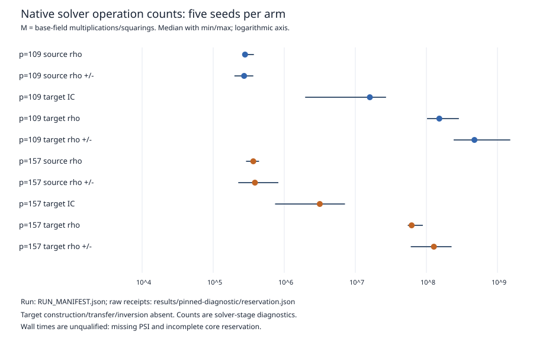

# Native cubic-transfer follow-up, 2026-10-25

This round pursued the universal extra-step question, complete chart handling,
and isolated repeated benchmarking. All three remain partial as requirements;
the results below do not redefine their acceptance criteria.

The symbolic result is an explicit rational order-three translation lift on
H0(E,3O), checked by exact integer polynomial calculations and replayed by the
existing Rust identity checker. It matches 232 nonzero actions on 29 saved
curves. The remaining extra-step calculation is the labelled level-nine
neighbor obstruction divisors and arithmetic constants. The two fixed bad
centers have a nonsquare neighbor character product; this is an observation,
not a modular identity.

The geometric chart argument bounds bad representative classes by
5*p^2+7*p+6 for the stated genus-three point-count/order assumptions. For
p>=19 a common multiplier for three nonzero images exists. Full evaluation
and inversion across that domain remain open. The native local-jet encoding
checks 2,492 effective divisors on the declared curves, including multiplicity
and infinity; it starts from supplied support coordinates.

The frozen native run manifest requests 50 main runs (five seeds x five
arms x two primes) and eight A/A repeats. All 58 complete and verify, with
all A/A counted outputs equal. FLINT independently rechecks every scalar
against the original public source relation. Synthetic target points share
the known answer; they are not actual native transfers of the source points.

No timing is qualified. Strict preflight refuses missing CPU/memory PSI.
The diagnostic run pins CPU 3 and moves 16 movable threads, but cannot move
all system threads. The visible-tick monitor detects no contention; that does
not satisfy the missing pressure/reservation conditions. The raw unqualified
wall times remain recorded. Native source inversion uses one base-field
inversion via an adjugate. Operation counts are uncalibrated M/I/NAT/LA;
no GAE, full-pipeline speedup or external-fastest claim is made.

Reproducible source links: [protocol](../PROTOCOL.md),
[run manifest](../RUN_MANIFEST.json),
[raw receipts](../results/pinned-diagnostic/reservation.json),
[benchmark summary](../results/benchmark-summary.json),
[native count CSV](../results/solver-counts.csv),
[source replay](../results/source-replay.json),
[theta proof calculations](../results/theta-symbolic-audit.json),
[theta certificate replay](../results/theta-certificate-replay.json),
[other certificate replay](../results/certificate-replay.json),
[geometric argument](../GEOMETRIC_CHART_BOUND.md),
[square-class obligation](../SQUARE_CLASS_OBLIGATION.md),
[development failures](../results/development-obstructions.json).

The run is bound to manifest SHA-256
4dc7f9aab3f92759a32413c822e1ca8b030737a354dd17a72808920b20a3c86b;
worker binary SHA-256
8c67ce79c66ac5013f4be4bf374664fb1dd4b851d86ca59c91e5c50f8e0e1d43.
UTC process-start timestamps were not captured by this diagnostic harness;
no exact start time is inferred from filesystem timestamps. Compiler and host
records are saved beside the run. The report is a new write-once round report;
it does not replace the historical Sage report or combine its timings.

Canonical historical component figures are unchanged because the native
replay adds no new isogeny edge or coverage result. The scoreboard, registry,
benchmark index and leaderboard remain unchanged because admission gates
are unmet. A browsing copy of this report and graph is included under
benchmarks/20261025-cubic-transfer-native-diagnostics/.
