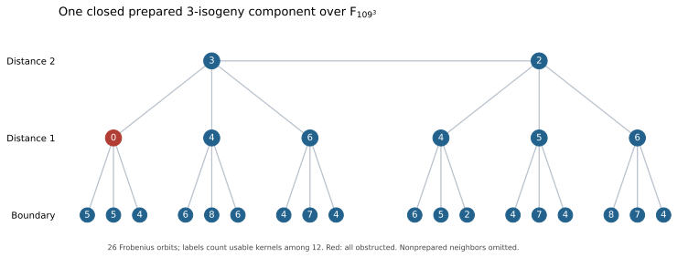

# Frozen cubic-extension transfer evidence import

This import records an already executed SageMath 10.6 study; it runs no new
cryptographic experiment and makes no native performance claim. Source files
and recorded results under ../historical/ retain their original bytes.

The central recorded counterexample is over F_(157^3), with prime source
order 3868159. All twelve transverse targets have the independently certified
order 3871629. Two nonprepared sources are each forced by their unique
rational three-isogeny into the all-obstructed prepared model. A second
three-isogeny repairs the instance. The complete retained solver recovers
271828 and checks the answer on the source elliptic curve.

The known p=109 example has a closed component of 26 prepared Frobenius
orbits. The complete fixed-order CM audit has twelve orbits and one
all-obstructed orbit. A degree-five repair preserves the three-torsion type
and endomorphism order. All of these statements retain their finite-field,
transverse-kernel, and subgroup assumptions from the source report.

The figure and its source are frozen historical artifacts, not a new
repository-standard volcano-renderer run. Labels count usable kernels among
twelve; red marks all-obstructed coverage. Nodes identify Frobenius orbits,
not individual models. Exact model data are retained in the component JSON.

The prototype records contain ten complete transfer cases and seven edge
checks. The largest displayed example uses a rank-39 target system and
recovers its source scalar through two actual degree-three maps. Historical
wall-clock observations are not admitted performance results: jobs sometimes
ran concurrently, native counters and the strongest folded rho reference
were not measured, and no repository ecbench or cross-host audit was run.

Publication is partial: five original files are hash-manifested for S3 upload,
not asserted to exist remotely. The 164-file original bundle is unchanged.
The import's checked items are byte preservation, source-hash consistency,
archive integrity, JSON parsing, and source syntax from the preceding stage.
Repository-wide Cargo tests, Lean, conductor reservation, artifact readback,
native replay and leaderboard admission remain pending or unavailable.

The report PDF is generated from IMPORT.tex; its graph comes from the same
frozen SVG. Canonical scoreboard and leaderboard graphs were inspected for
their admission requirements and left unchanged because this import has no
qualifying operation-cost evidence. No historical diagnostic is promoted.

The proof map is finite order certificates to retained Sage verifiers,
two-step subgroup preservation to the recorded composed maps and source
checks, and the endomorphism-order argument to the written source report.
None is labelled a checked Lean theorem. Formalization must bridge actual
elliptic curves, isogenies, Jacobians and the twelve-kernel construction;
arithmetic-only lemmas would not discharge those obligations.

See the study README, PUBLICATION.json, and
[admission problem](../../../problems/cubic-extension-transfer-admission.md).
