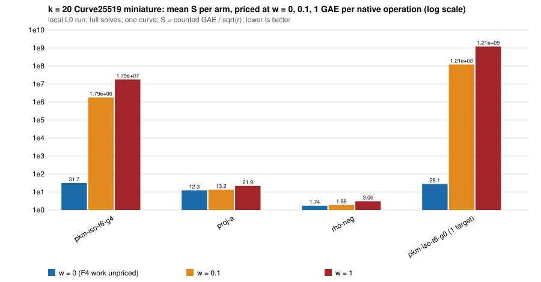

# Algebraic oracle vs generic baseline, charged in ecbench's counted unit

Protocol: [PROTOCOL.md](PROTOCOL.md) (frozen before data; Amendment 1 appended).
**Scope of every statement: k = 20 Curve25519 miniature (`p = 1048573`,
`r = 131203`, 17 bits, one curve), these arms, 6 targets (1 target for the
G = 0 control), local L0 run.** Nothing is claimed for other sizes, curves,
t or G.

## Result in one paragraph

Charged in ecbench's counted unit with the F4 multiply-adds priced at the
AGENTS.md §5a band, the algebraic oracle (`pkm-semaev`, isogeny tower t = 6,
guess depth G = 4, lead 4's best cell) is **behind the generic baseline at
every weight of the band**: 2.6x at `w = 0` (where the F4 work is not
counted at all), 1.4e5x at `w = 0.1`, 8.2e5x at `w = 1`. It is behind
`rho-neg` by 18x, 9.6e5x and 5.9e6x. The order against the baseline is the
same at the three weights, so the band ranks it (`proj-a < pkm-iso-t6-g4`),
unlike an "unresolved" verdict. A solve takes about 6.5e9 F4 multiply-adds
(6 solves, 2.3e9 to 9.1e9); the band's price of that work dominates `S` as
soon as `w > 0`. This measures the distance remaining; it is not an
improvement and not a security statement.

## Table (S = counted GAE + w x unpriced native operations, over sqrt(r) = 362.2)

All arms are full solves (relations, linear algebra, discrete log checked by
ecbench against the planted scalar). Same 6 public targets for every arm of
session 1 (`target_seed 2026110231`). Source: `analysis/band_s1.txt`,
`analysis/band_s2.json`, produced by `ecbench band` (frozen binary).

| arm | verified/runs | S (w=0) | S (w=0.1) | S (w=1) | x rho-neg at w=0 / 0.1 / 1 | x proj-a at w=0 / 0.1 / 1 |
|---|--:|--:|--:|--:|---|---|
| `rho-neg` (reference) | 6/6 | 1.744 | 1.876 | 3.061 | 1 / 1 / 1 | 0.142 / 0.142 / 0.140 |
| `proj-a` (baseline: `prime-projected-abscissa:size=32`, `mitm:negation_folded=1`) | 6/6 | 12.284 | 13.249 | 21.932 | 7.04 / 7.06 / 7.17 | 1 / 1 / 1 |
| `pkm-iso-t6-g4` (candidate) | 6/6 | 31.703 | 1.7916e6 | 1.7916e7 | 18.2 / 9.55e5 / 5.85e6 | 2.58 / 1.35e5 / 8.17e5 |
| `pkm-iso-t6-g4-aa` (A/A copy) | 6/6 | 31.703 | 1.7916e6 | 1.7916e7 | identical to the line above | identical |
| `pkm-iso-t6-g0` (control; **target 0 only**, session 2) | 1/1 | 28.060 | 1.2141e8 | 1.2141e9 | 23.2 / 9.4e7 / 6.1e8 (vs rho-neg on target 0) | 2.34 / 9.4e6 / 5.7e7 (vs proj-a on target 0) |

Reading the "x" columns: they are the distance remaining to `rho-neg` and
the distance of the algebraic arms to the baseline; neither is a pass/fail
gate. The G = 0 row ratios use the target-0 values of the other arms
(`rho-neg` 1.209 / 1.289 / 2.004, `proj-a` 12.015 / 12.940 / 21.269, `pkm-g4`
28.060 / 1.569e6 / 1.569e7), because the arm has one solve.
The baseline's own gap to rho (7.0 to 7.2x here) is a little below the earlier
48-run baseline (7.8 to 7.9x), on fresh targets.

Band verdicts (`ecbench band --ranks`): `rho-neg < proj-a`, `rho-neg <
pkm-iso-t6-g4`, `proj-a < pkm-iso-t6-g4` at every weight; `pkm-iso-t6-g4`
vs its A/A copy unresolved (identical counts).

Why the weights bite: per solve `pkm-iso-t6-g4` charges 11,483 GAE on
average (factor-base build with the auxiliary-curve search, target draws,
lifts, verification) plus 6.49e9 F4 multiply-adds (the `solver` block:
146,161 F4 calls over 3,221 to 13,532 trials, 7 to 19 relations a solve) and
about 1e6 further unpriced field operations (`pkm_system_fp_mults`,
`pkm_grid_fp_mults`, target guards, square roots). At `w = 0.1` the F4 term
is 6.5e8 GAE a solve, 5.6e4 times the charged GAE.

`analysis/figure_S_band.svg`: mean S per arm at w = 0, 0.1, 1 on a log scale
(`analysis/make_figure.sh`, jq + awk; the G = 0 bar is one target).

## What ecbench charged, and what changed in the code

F4 multiply-adds were already a native counter: the oracle's `solver` block
carries `ops`, the record lists `solver_F_p_multiply-adds_(elimination_only)_uncharged`
as unpriced, and `band.rs` resolves it to `solver.ops`, so `ecbench band`
priced it from the start. No harness code needed to change. What was missing
was a test pinning this, so one was added (`band.rs`,
`pkm_f4_multiply_adds_are_priced_by_the_band`, built from the committed real
record `fixtures/pkm_iso_t6_g4_target3.record.json`). The "total_gae" of the
algebraic arm in ecbench's plain tables (and `ecbench table`) is the
w = 0 column and is a lower bound; the price of the F4 work lives only in
`band`.

## Preregistered predictions (PROTOCOL.md)

| | prediction | outcome |
|---|---|---|
| P1 | at w = 0.1 and 1 both algebraic arms > 100x behind `proj-a` in S | **true**: G = 4: 1.35e5x and 8.17e5x; G = 0 (target 0): 9.4e6x and 5.7e7x. Not close to the threshold. The rough arithmetic in the task was an under-estimate of the margin: a solve needs 7 to 19 relations but 3.2e3 to 1.4e4 F4-decided trials at about 4.4e4 to 7e5 multiply-adds each, 6.5e9 in total |
| P2 | at w = 0 the candidate is below the baseline, so the band pair is unresolved | **false**: at w = 0 the candidate is 2.6x *above* the baseline (31.7 vs 12.3; per-target 14.3 to 42.9 against 11.0 to 13.9), so the band ranks the pair strictly, `proj-a` ahead at all three weights. The one-target probe before the protocol (S = 6.4, 901 trials) was a lucky target; this was disclosed |
| P3 | `rho-neg` ahead of the candidate at every w | true (18x, 9.6e5x, 5.9e6x) |
| P4 (amended) | G = 0 solver multiply-adds per trial >= 20x those at G = 4 | **true**: target 0, 8,213 trials at both depths, 4.398e11 vs 5.680e9 multiply-adds = 77.4x. (lead 4's 78.2x per target.) The amendment expected the G = 0 solve to time out; it finished in 584 s, so no extrapolation rule was used |

## All arms, failures, and audits

- Session 1 (`ECBS1h1a9fd7090916`): 24 records, 24 verified, 0 failures.
  `ecbench verify --replay 8` (seed 2026110233): all 8 replays identical, audit
  ok (`analysis/verify_s1.json`).
- Session 2 (`ECBS1h85a995ea0c4a`, G = 0): 1 record, verified. **Its replay
  audit failed**: `ecbench verify --replay 1` reports `replay of seq 0: differs in
  phase counts` (`analysis/verify_s2_replay_FAILED.json`), and the same on an
  independent second run (`ECBS1h2b9828823b27`, session 2b). The cause was not
  found. Evidence it is not a count instability: the original and the
  independent second *run* (not replay) agree exactly on `cost`, `counters`,
  every phase's native map and the solver block (everything except wall time and peak
  bytes; `sessions/s2_g0_records.jsonl` vs `sessions/s2b_g0_rerun_records.jsonl`).
  The G = 0 row stands as one verified solve with a failed replay audit; it is
  a control, not a basis for any ranking claim.
- Aborted: the first start of session 1 (`spec.json`, 12 targets, 2 rounds)
  was killed by its own PID after 6 warm-up records because a solve took
  ~300 s (Amendment 1). Its warm-up records (discarded, not in any table)
  showed the same picture (algebraic S(w=0) = 34.5 against proj-a 12.6). A
  first G = 0 start was also killed before running; the first queued
  G = 0 session aborted for an existing output directory and was re-run.
- Probe before the protocol: one single-target `pkm-iso-t6-g4` solve (S(w=0) = 6.4), disclosed
  in the protocol, in no table.
- A/A copy: identical counts at all weights (counts are deterministic).
- Isolation L0, `--cpus none --allow-busy`, 4-core box shared with three other
  agents; load average 7.2 at session 1 start and end, 7.1 to 10.7 for
  session 2 (`analysis/load_s*.txt`). Counted units only; wall times in
  the records (200 to 380 s per algebraic solve under load) are not claims.
  **Local, not Iso Lab EKS.** No second-host replay and no validator report,
  so **no leaderboard row and no `benchmarks/README.md` row results** (validation gate).
- Binary check (coordinator's hazard note): the frozen `ecbench_leadA`
  (sha256 `14ad4a38...e285c14`) was built from this worktree, which has no code
  difference from `main` apart from the new test. A rebuild after `touch` of
  the sources gave a binary of the same size with a different sha256
  (builds are not bit-reproducible here), identical `ecbench methods` output
  (330 lines) and identical counts on a 3-target smoke run of `rho-neg` and
  `proj-a`; the pkm guess code (`pkm-semaev guess=`) is present and exercised
  by the records. The binary I measured with is the one hashed in every record.

## Files

`PROTOCOL.md`, `spec*.json` (+ `_a1`), `fixtures/` (one real record),
`analysis/` (band, table, verify receipts, load, figure script, record hashes; hashes of s1, s2, s2b record files, paths of the scratch copies),
`sessions/` (the two G = 0 record files). Session 1's `records.jsonl`
(222 KB, over 64 KiB) is not committed: sha256 in `analysis/records.sha256`.
`REPORT.pdf`: this file rendered.
