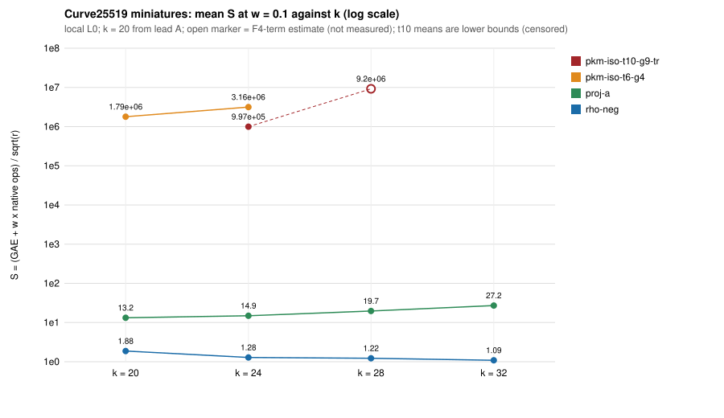

# Algebraic oracle vs generic baseline at larger k (scale-up S2)

Protocol: [PROTOCOL.md](PROTOCOL.md), written and committed before any data
(commit `8fb8f9ccaf`). **Scope of every statement: Curve25519-rule
miniatures at k = 24, 28, 32 (one curve each), these arms, 6 / 2 / 6
one-target chunks, local L0 run on a shared box.** Nothing is claimed for other
curves, sizes, t or G. Lead A's k = 20 numbers are quoted from
[its README](../curve25519_algebraic_ecbench_20261102/README.md), not re-run.

## Result in one paragraph

The algebraic arm stays behind the generic baseline at every weight where it
was measured, and the generic gap to rho keeps growing with k. At k = 24 the
t = 10, G = 9, trace = 1 arm finished 2 of 6 solves (4 hit the 3000 s wall
limit), so its numbers are lower bounds: 3.2x behind `proj-a` at w = 0, 6.5e4x
at w = 0.1, 3.6e5x at w = 1, and 44x, 9.2e5x, 5.3e6x behind `rho-neg`. Lead A's
bridge arm (t = 6, G = 4) at k = 24 (2 of 2 finished) is 3.9x, 2.2e5x, 1.2e6x
behind `proj-a`, against 2.6x, 1.35e5x, 8.2e5x at k = 20. At k = 28 the
t = 10 arm finished 0 of 2 solves, so it has no measured S; a labelled
F4-term-only estimate puts it near 4.7e5x behind `proj-a` at w = 0.1. At
k = 32, where the F4 engine cannot run (p >= 2^31), `proj-a` is 24.9x behind
`rho-neg` at every weight, against 7.0x (k = 20), 11.6x (k = 24) and 16.0x
(k = 28). This measures distances remaining; it is not an improvement and not a
security statement. [pcc:unverified]

## Instrument

- `ecbench_scale` sha256 `928e9880c3e833e71c23e7fa37798d24bc60a7d529000b7fe1e106e735366067`
  (checked before every session by `scripts/run_chunks.sh`, line `OK` in the driver logs).
- `curve25519_family_scale` sha256 `d66b85b0dcb60c2d1b551a2e3ce19de4cc76e6897ce359eafce1bf579606ca90`
  (hash checked; not needed for the measurement).
- No code change, no build. `RAYON_NUM_THREADS=1`, `ulimit -v 3500000`,
  `--cpus none --allow-busy --wait`, one process at a time.
- Limitation: the F4 tower engine refuses p >= 2^31, so the algebraic arm cannot
  run at k = 32 (p = 4294967197). k = 32 is generic only.

## Table 1: S per arm and k (S = (counted GAE + w x native ops) / sqrt(r))

Mean over the chunks where the arm finished; `proj-a` and `rho-neg` in the
"x" columns are the means on the same chunks (paired by target). "n" is
finished / run. Source: `analysis/summary.tsv` (from `ecbench band`, one JSON
per chunk in `analysis/band_perchunk/`).

| k | arm | n | S (w=0) | S (w=0.1) | S (w=1) | x proj-a at w=0 / 0.1 / 1 | x rho-neg at w=0 / 0.1 / 1 |
|--:|---|--:|--:|--:|--:|---|---|
| 24 | `rho-neg` | 6/6 | 1.179 | 1.284 | 2.237 | 0.087 / 0.086 / 0.084 | 1 |
| 24 | `proj-a` | 6/6 | 13.62 | 14.94 | 26.78 | 1 | 11.6 / 11.6 / 12.0 |
| 24 | `pkm-iso-t10-g9-tr` (lower bound) | 2/6 | 44.30 | 9.97e5 | 9.97e6 | 3.19 / 6.55e4 / 3.65e5 | 44.2 / 9.15e5 / 5.31e6 |
| 24 | `pkm-iso-t6-g4` (bridge) | 2/2 | 51.57 | 3.16e6 | 3.16e7 | 3.91 / 2.19e5 / 1.24e6 | 53.4 / 3.01e6 / 1.75e7 |
| 28 | `rho-neg` | 2/2 | 1.118 | 1.224 | 2.171 | 0.063 / 0.062 / 0.059 | 1 |
| 28 | `proj-a` | 2/2 | 17.86 | 19.73 | 36.63 | 1 | 16.0 / 16.1 / 16.9 |
| 28 | `pkm-iso-t10-g9-tr` | **0/2** | no measured S | no measured S | no measured S | see Table 3 | see Table 3 |
| 32 | `rho-neg` | 6/6 | 0.991 | 1.089 | 1.965 | 0.040 / 0.040 / 0.040 | 1 |
| 32 | `proj-a` | 6/6 | 24.68 | 27.17 | 49.56 | 1 | 24.9 / 25.0 / 25.2 |
| 32 | algebraic arms | not run | | | | | |

Per-chunk values (all chunks) are in `analysis/perchunk.tsv`. At k = 24 the
`pkm-iso-t10-g9-tr` arm's two finished solves are c0 (S(0.1) = 1.22e6) and c3
(7.7e5); on c0 the bridge arm has S(0.1) = 2.51e6. Band verdicts
(`ecbench band --ranks`, per chunk and pooled by k): `rho-neg < proj-a` at
every k; `proj-a < pkm-iso-t6-g4` and `rho-neg < pkm-iso-t6-g4` at k = 24;
pairs that include the t = 10 arm are reported "incomplete" by the tool
because 4 of its 6 runs did not finish. [pcc:unverified]

`analysis/figure_S_vs_k.svg` (`scripts/make_figure.sh`, awk only; data
`analysis/figure_data.tsv`). Open marker: the k = 28 estimate, not a
measurement.

## Table 2: the gap trend across k

Generic gap `S_proj-a / S_rho-neg` (w = 0; the same to within 6 percent at 0.1
and 1) and the algebraic distance to `proj-a` at w = 0.1:

| k | proj-a / rho-neg | bridge (t=6,G=4) / proj-a at w=0.1 | t=10 arm / proj-a at w=0.1 |
|--:|--:|--:|--:|
| 20 (lead A, 6 targets) | 7.04 | 1.35e5 | not run |
| 24 (6 targets; bridge 2) | 11.6 | 2.19e5 | 6.55e4 (lower bound, 2 of 6) |
| 28 (2 targets) | 16.0 | not run | no measurement; estimate 4.7e5 |
| 32 (6 targets) | 24.9 | not run (engine limit) | not run (engine limit) |

For context, the baseline's own 48-record values are 7.8, 10.6, 18.1, 24.7 at
k = 20, 24, 28, 32 (`../curve25519_ic_baseline_20261102`); this run's
6- and 2-target means (7.04 at k = 20 from lead A, 11.6, 16.0, 24.9) are in the
same range. The k = 28 value rests on 2 targets and one of the two `rho-neg`
walks was very short (S = 0.12 against 2.12), so it is noisy: the 48-record
18.1 is the better point for that k. The generic gap rises at every step in
both data sets.

## Table 3: the labelled estimate for the t = 10 arm at k = 28 (not a measurement)

By PROTOCOL rule 2: `R` = mean relations of the finished k = 24 solves of the
same arm = (214 + 147) / 2 = 180.5; `P` = lead B's modelled F4 multiply-adds
per relation for k = 28, t = 10, G = 9, 2.96e9. F4 term only, group
operations omitted, so a lower bound on S; kept out of the band. [pcc:unverified]

| quantity | w = 0 | w = 0.1 | w = 1 |
|---|--:|--:|--:|
| `R x P` | 5.34e11 multiply-adds | | |
| `S_est` | (not defined; F4 term only) | 9.2e6 | 9.2e7 |
| `S_est / S_proj-a` (k = 28, 2 targets) | | 4.7e5 | 2.5e6 |

The same formula at k = 24 (R x 1.74e8 = 3.1e10 multiply-adds) gives
S_est(0.1) = 2.2e6, 1.45e5 times `proj-a`; the measured, censored t = 10 means
there are 2.2 times lower (1.4e10 multiply-adds per finished solve), so the
formula overstates the measured F4 work at k = 24 and the k = 28 estimate
should be read as an upper-leaning figure. The model-to-model step from k = 24
to k = 28 is a factor 3.2 in the distance to `proj-a`.

## Failures and censoring (every one)

- `pkm-iso-t10-g9-tr`, k = 24: chunks c1, c2, c4, c5 hit the 3000 s limit
  (`status = timeout`, watchdog, signal 9); k = 28: c0 and c1 hit it. Six
  failures out of 8 solves. No S is claimed for them. [pcc:unverified]
- The limit is **wall-clock on a shared box** (load 1.5 to 10, 4 cores). The two
  finished k = 24 solves took 2894 s and 2877 s wall, 1885 s and 1514 s user
  CPU, close to the cap; the timed-out c1 solve had used 1590 s of CPU in 3000 s
  of wall. So which side of the cap a solve falls on depends on the load, and
  the "2 of 6" is a statement about this box, not an intrinsic solve cost. The
  finished-solve mean is right-censored and is reported as a lower bound.
- The bridge arm (t = 6, G = 4) finished both solves it was given (c0: 3.64e10
  multiply-adds, 1040 s wall; c1: 5.50e10, 1958 s).
- No run failed for memory or a parameter error: `guess=9,trace=1` was accepted
  by the oracle (the first chunk completed the t = 10 solve with
  `trace=1` in its label).
- Per-record `ns_per_op` of the F4 engine in the t = 10, trace = 1 runs is
  about 2.6e2 ns per multiply-add; wall times are not a claim of this report.

## Replays and audits

- All 14 sessions: `ecbench verify` audit ok; `--replay-seq 0 --replay-seq 1`
  (the `rho-neg` and `proj-a` runs): 28 of 28 replays "identical"
  (`analysis/verify/k*-c*-a1.json`). An earlier random draw `--replay 2` on the
  six k = 32 sessions (`analysis/verify/k32-c*.json`): 12 of 12 identical.
- Algebraic replays (a replay of a t = 10 solve takes 1.5 to 2.5 h, so a chosen
  subset): `k24-c3` seq 2 (t = 10, G = 9, trace = 1), `k24-c0` seq 2 (t = 10) and
  `k24-c0` seq 3 (bridge, t = 6, G = 4) all reproduced "identical"
  (`analysis/verify/pkm-k24-c3-a1-seq2.json`, `pkm-k24-c0-a1-seq2.json`,
  `pkm-k24-c0-a1-seq3.json`). Four algebraic solves finished (two t = 10, two
  bridge); the three replayed cover both t = 10 solves and one bridge solve; the
  c1 bridge solve was not replayed. [pcc:unverified]
- Session identifiers and record hashes: `analysis/records.sha256`; all
  records files are under 64 KiB and committed in `sessions/`.

## Predictions

| | prediction | outcome |
|---|---|---|
| P1 | every algebraic arm behind `proj-a` at every measured (k, w); more than 100x at w >= 0.1 | **held where measured**: t = 10 k = 24 (lower bound) 3.2x / 6.5e4x / 3.7e5x; bridge k = 24 3.9x / 2.2e5x / 1.2e6x; no cell at ratio 1 or below. k = 28 has no measured cell |
| P2 | `rho-neg` ahead of every arm at every k and w | held (band verdicts; 44x to 5e6x at k = 24) |
| P3a | generic gap larger at 28 than 24 and at 32 than 28 | held: 11.6, 16.0, 24.9 (no step down) |
| P3b | bridge ratio(0.1) at k = 24 above lead A's 1.35e5 | held: 2.19e5 (2 targets against 6; the shrink threshold 9.0e4 was not reached) |
| P3c | t = 10 ratio(0.1) at k = 28 above k = 24 | **not measurable**: 0 of 2 finished; the estimate-to-estimate step is 3.2x up, which is not a measurement |
| P4 | t = 10 arm finishes at least one k = 24 solve and none at k = 28 | held: 2 of 6, 0 of 2 |
| P5 | t = 10 uses fewer F4 multiply-adds than the bridge on the same target | held on the one target where both finished (c0): 1.74e10 against 3.64e10, 2.1x fewer |

What would have shown the gap shrinking (stated before data): a bridge ratio
below 9.0e4 at k = 24, a t = 10 ratio at k = 28 below the k = 24 value over 1.5,
or a generic step down of more than 25 percent. None occurred; the second
could not be tested.

## Deviations

- Resume checkpoint: the token in the environment had expired
  (2026-11-04T16:59Z); `scripts/checkpoint.sh push` succeeded with the ambient
  AWS credentials (`s3://setec-astronomy-artifacts/checkpoints/crypto/scale-S2-ecbench/20261105T033314Z-106141b2b9ad/`).
  `.resume/RESUME.md` was rewritten for this effort and restored before the commit. [pcc:unverified]
- Not the Iso Lab EKS route (no Iso Lab identity here); local L0 with
  `--allow-busy`. No second-host replay and no validator report, so no
  leaderboard row and no `benchmarks/README.md` row (validation gate).
- Chunking into one-target sessions (restart safety) means 6 / 2 / 6 targets and
  one round per k; the generic arms ran on the same targets. The k = 28 point has
  two targets. `order = alternate_measured` with one round triggers an ecbench
  balance warning; counts are deterministic, so it is harmless here.
- Replay audits of the algebraic solves are partial (above), by cost.
- Conductor was not installed in this container; no file reservation was taken.
- Curve slugs `icv1-fp{24,28,32}-...` are not in `docs/curves/registry.json`.

## Files

`PROTOCOL.md`, `specs/` + `specs.sha256`, `scripts/` (spec generator, chunk
runner, tables, figure, replay scripts), `sessions/` (14 sessions' records and
metadata, `NOTES.tsv` start/end/load log), `analysis/` (per-chunk band JSON,
`perchunk.tsv`, `summary.tsv`, figure + data, verify receipts, load logs).
`REPORT.pdf`: this file rendered.
